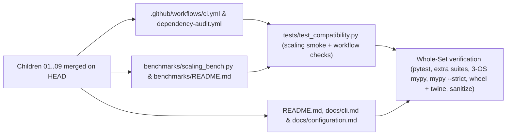

# IPD: CI compatibility matrix, scaling benchmarks, and whole-Set verification

- Date: 2026-11-27
- Kind: child
- Concern: Eight-lens rollup findings `ROLL-37` (`COMP-11`: Continuous Integration (CI) misses Python `<3.11` `no-tui`/`tomli` isolation, Windows wheel packaging smoke, `[bench]` extra smoke, downstream `mypy --strict --no-implicit-reexport` mode-module check, and `tomli`/`[tui]` dependency audit; `COMP-15`: stale `README.md` Windows Resident Set Size (RSS) `wmic` note; `ROLL-21`: `README.md` / `docs/cli.md` `pubrun run` wording; `PERF-13`: missing standard-library (stdlib) local scaling benchmarks for 1,000+ files, 1,000+ runs, 10,000 inactive `annotate`/`print` calls, and large-manifest diffs), plus explicit documentation handoffs from Set `assess-8l` siblings (`l596kn`, `p4ueaj`, `ameehy`, `m5s3g8`, `2ge0ea`) and whole-Set verification across all nine preceding children (`1o1cua` through `3q5rd5`).
- Scope: Update `.github/workflows/ci.yml`, `.github/workflows/dependency-audit.yml`, `README.md`, `docs/cli.md`, `docs/configuration.md`, `benchmarks/README.md`, add new files `benchmarks/scaling_bench.py` and `tests/test_compatibility.py`, and execute the full Set `assess-8l` verification suite.
- Scope-Paths: .github/workflows/ci.yml, .github/workflows/dependency-audit.yml, README.md, docs/cli.md, docs/configuration.md, benchmarks/scaling_bench.py, benchmarks/README.md, tests/test_compatibility.py
- Item-Dependencies: executed:1o1cua, executed:76z7ww, executed:l596kn, executed:p4ueaj, executed:ameehy, executed:m5s3g8, executed:caeqdz, executed:2ge0ea, executed:3q5rd5
- Status: reviewed
- Readiness: go-pending-approval
- Review-Depth: complex
- Short-Description: Expand CI matrix for tomli/Windows packaging/[bench]/mypy --strict, add local scaling benchmarks, sync README/cli/configuration docs, and verify the complete assess-8l Set
- Work-Kind: chore
- Priority: medium
- Set: assess-8l
- Order: 10
- Highest E allocated: 04
- Author: Antigravity
- Id: 6y55x4

> Write and proofread this plan per the technical writing standard, `.aw/system/workflows/technical-writing/technical-writing.md`, including requirement 12 (diagrams).

## Workflow history

- 2026-11-27 /plan-review (Antigravity): APPROVE WITH REVISIONS APPLIED; PR-001, PR-002, PR-003, PR-004, PR-005, PR-006
- 2026-11-27 /assess-all (Antigravity): created Child 10 of Set `assess-8l` covering CI matrix expansion, scaling benchmarks, doc accuracy fixes, and whole-Set verification (`ROLL-21`, `ROLL-37`).

## Goal

Close the remaining Continuous Integration (CI) matrix and benchmark-coverage blind spots identified by the `compatibility` and `performance` lenses, synchronize `README.md`, `docs/cli.md`, and `docs/configuration.md` with all shipped Set `assess-8l` behavior (accurate Windows Resident Set Size (RSS) probing, optional Terminal User Interface (TUI) `pubrun[tui]` Python `>=3.8.1` floor, `pubrun run` `import pubrun` prerequisite, `PUBRUN_OUTPUT_DIR` and `$VAR`/`~` path expansion, `[methods].format` Command-Line Interface (CLI) wiring, TTY-aware color without `DIM`, and new CLI flags), and run whole-Set verification across the combined output of children `01` through `09`.

### Verification and CI coverage flow

## Detailed Implementation Checklist (TODO)

Execution-state rule: mark an `E-*` item complete only after performing the action. Accepted execution states: blocked, failed, pending, performed; terminal gate demands `performed`.

### Task group 1: CI compatibility matrix and doc sync

- [ ] E-01 Expand `.github/workflows/ci.yml` and `.github/workflows/dependency-audit.yml`:
  - In `.github/workflows/ci.yml`:
    - `no-tui` job: convert to a matrix on `ubuntu-latest` with `python-version: ["3.10", "3.12"]` (using `"3.10"` rather than `"3.8"` because `ubuntu-latest` (Ubuntu 26.04) no longer ships Python `3.8`/`3.9` builds, matching the existing `test` job exclude note). Add a verification step on Python `"3.10"` asserting `python -c "import tomli"` succeeds so the conditional `tomli>=1.1.0; python_version < '3.11'` dependency in `pyproject.toml` is verified in isolation without `[tui]`.
    - `packaging` job: expand `runs-on` to a matrix over `os: [ubuntu-latest, windows-latest]` (`fail-fast: false`). Inside the existing `shell: bash` verification script (`check_wheel`), resolve the virtual-environment executable directory cross-platform (`if [ -d "$venv_dir/Scripts" ]; then venv_bin="$venv_dir/Scripts"; else venv_bin="$venv_dir/bin"; fi`) so `pip`, `python`, `pubrun`, and `pbr` work on both Linux and Windows (where `venv` writes executables under `Scripts/` instead of `bin/`). Keep the fast, non-prompting wheel smoke command `"$venv_bin/pubrun" bench --iterations 1 --passes 1 --no-baseline --local --no-submit < /dev/null` (not `--quick`, which runs 2x15 iterations and omits `--no-submit`) together with the existing `runs/` absence check and `check_share_safe_text` check. Add `"scaling_bench.py"` to the `forbidden` wheel-listing loop alongside `"startup_breakdown.py"` and `"package_capture_bench.py"` so the new checkout-only benchmark can never leak into the wheel.
    - `extra-suites` job: install `pip install -e ".[dev,bench]" pyyaml` so the optional `[bench]` extra (`pytest-benchmark`, `matplotlib`) is verified in CI, execute `pytest .github/scripts/ benchmarks/test_*.py tests/test_compatibility.py -v -p randomly` (which exercises the `pytest-benchmark` micro-tests in `benchmarks/test_benchmarks.py` without skipping AND runs the PyYAML workflow cross-checks in `tests/test_compatibility.py`), and run a headless `plot.py` smoke check (`python benchmarks/plot.py --help` and `python -c "import matplotlib; matplotlib.use('Agg'); import matplotlib.pyplot"`).
    - `typecheck` job: add a downstream Python Enhancement Proposal 561 (PEP 561) strict-typing step matching Child 04 (`p4ueaj`): `MYPYPATH=src python -m mypy --config-file /dev/null --strict --no-implicit-reexport --follow-imports=silent -c "from typing import Optional; import pubrun.auto, pubrun.full, pubrun.noauto, pubrun.nopatch, pubrun.noconsole, pubrun.minimal; v1: str = pubrun.auto.__version__; c1: Optional[str] = pubrun.auto.__commit__; v2: str = pubrun.full.__version__; c2: Optional[str] = pubrun.full.__commit__; v3: str = pubrun.noauto.__version__; c3: Optional[str] = pubrun.noauto.__commit__; v4: str = pubrun.nopatch.__version__; c4: Optional[str] = pubrun.nopatch.__commit__; v5: str = pubrun.noconsole.__version__; c5: Optional[str] = pubrun.noconsole.__commit__; v6: str = pubrun.minimal.__version__; c6: Optional[str] = pubrun.minimal.__commit__; pubrun.noauto.start(); pubrun.noauto.stop()"`.
  - In `.github/workflows/dependency-audit.yml`:
    - Expand `pip-audit` to a matrix with `python-version: ["3.10", "3.12"]` (`fail-fast: false`), keep `pip-audit .` (which audits `tomli` from `pyproject.toml` on Python `3.10`), and add a clean-venv `[tui]` audit step (`python -m venv "$RUNNER_TEMP/audit-venv"`, `"$RUNNER_TEMP/audit-venv/bin/pip" install -e ".[tui]"`, `"$RUNNER_TEMP/audit-venv/bin/pip" freeze --exclude-editable > "$RUNNER_TEMP/tui-reqs.txt"`, `pip-audit -r "$RUNNER_TEMP/tui-reqs.txt"`) so `tomli` (on `3.10`) plus optional `[tui]` dependencies (`textual`, `rich`, and transitive packages) are audited cleanly without polluting the audit with `pip-audit`'s own dependencies.
  - Depends on: none
  - Expected outcome: CI catches Python `<3.11` `tomli`, Windows wheel packaging (`Scripts/` venv + CLI + bench smoke + wheel exclusion), `[bench]` extra, downstream PEP 561 `mypy --strict --no-implicit-reexport`, and `tomli`/`[tui]` dependency-audit regressions automatically.
  - Execution state: pending

- [ ] E-02 Synchronize `README.md`, `docs/cli.md`, and `docs/configuration.md` with Set `assess-8l` changes (strictly zero em or en dashes across all three files):
  - In `README.md`:
    - Update `README.md#Live Process Inspection` (Windows RSS bullet) to state accurately that Windows RSS uses `ctypes` (`K32GetProcessMemoryInfo` / `psapi.GetProcessMemoryInfo`, per `src/pubrun/capture/liveness.py::_get_rss_windows`) with a legacy `wmic` fallback only if the Win32 call fails.
    - Update `README.md#pubrun ui` (and the `[tui]` installation note) to document that optional `pubrun[tui]` requires Python `>=3.8.1` while core `pubrun` remains `>=3.8`.
    - Update BOTH `README.md#Import Modes` ("Or use the CLI wrapper for scripts you can't modify:") AND `README.md#pubrun run` ("Spawn a command with a specific import mode...") to state clearly that `pubrun run --mode ... -- python script.py` overrides the import mode of scripts that already `import pubrun` (it does not inject `pubrun` into scripts that never import it).
    - Update `README.md#Configuration` precedence item 2 to mention `PUBRUN_OUTPUT_DIR` alongside `PUBRUN_AUTO_START=false`.
  - In `docs/cli.md`:
    - Update `docs/cli.md#run: Import Mode Wrapper` to state explicitly that the target script must already `import pubrun` (`pubrun run` sets `PUBRUN_RUN_MODE_OVERRIDE` and `PUBRUN_IMPORT_MODE` to override the import mode and does not inject `pubrun`).
    - Update `docs/cli.md#Output conventions` to reflect centralized TTY-aware `src/pubrun/report/output.py::use_color` (all commands honor `NO_COLOR`, `--no-color`, `FORCE_COLOR`, and non-TTY suppression with zero `DIM` styling, removing the stale claim that `show`/`status`/`res`/`diff` ignore TTY and use dim text).
    - Update `docs/cli.md#report-bug / feedback: Report a Bug or Send Feedback` to reflect `--no-browser` (and non-TTY/headless safety) plus `feedback` as a hidden alias of `report-bug`.
    - Update `docs/cli.md` command synopses and option tables for shipped Set `assess-8l` CLI additions from `m5s3g8`, `caeqdz`, and `2ge0ea`: `--dir PATH` across `show`/`report`, `diff`, `methods`, `inspect`, `rerun`, `res`/`cpu`/`mem`, and `show run config`; `status --json`; `diff --json`; `res`/`cpu`/`mem --utc`; `clean --force-remote-locks`; `[methods].format` honored by `pubrun methods` CLI (with banners on stderr); `show config <run>` / `show config default` redirect; and `pubrun[tui]` Python `>=3.8.1` note under `docs/cli.md#ui: Interactive Dashboard`.
  - In `docs/configuration.md` (fulfilling Child 08 `2ge0ea` `- Carrier: 6y55x4` handoff):
    - Update `[core].output_dir` to document `PUBRUN_OUTPUT_DIR` override and `$VAR`/`~` path expansion.
    - Update `[capture.resources].poll_timeout` and `Enabling process-tree memory capture` to note `ctypes` primary with legacy `wmic` fallback on Windows and include `PUBRUN_OUTPUT_DIR` among wired environment variables.
    - Update `[methods].format` to reflect that `pubrun methods` CLI now uses `[methods].format` as its default when `--format` is omitted (removing the stale "does not read this key" sentence).
    - Add `PUBRUN_OUTPUT_DIR` to `docs/configuration.md#Environment Variables` (noting whitespace stripping, `$VAR`/`~` expansion, and precedence above `.pubrun.toml` and below explicit API `output_dir=` / CLI `--dir`).
  - Depends on: none
  - Expected outcome: `README.md`, `docs/cli.md`, and `docs/configuration.md` accurately match shipped Set `assess-8l` behavior and contain zero em dashes (`\u2014`) or en dashes (`\u2013`).
  - Execution state: pending

### Task group 2: Local scaling benchmarks and whole-Set verification

- [ ] E-03 Add stdlib-only local scaling benchmark `benchmarks/scaling_bench.py` (new file), document it in `benchmarks/README.md`, and add compatibility/workflow tests in `tests/test_compatibility.py` (new file):
  - Create `benchmarks/scaling_bench.py` (Python 3.8+ compatible, standard library only, strictly local and non-publishing, never invokes `gh`, `git push`, or batch schedulers):
    - Support CLI flags `--quick` (scaled-down counts for fast smoke runs), `--workdir PATH` (optional parent directory; creates and cleans only a dedicated ephemeral subdirectory on exit, leaving `--workdir` and sibling files intact), and `--json-out PATH` (optional local redacted JavaScript Object Notation (JSON) output using schema `"pubrun-scaling-bench/1"`).
    - Benchmark four scaling scenarios with warm-up/timing metrics (median/elapsed ms and per-item throughput):
      1. `file_io` scaling (`src/pubrun/core.py::open` and `src/pubrun/core.py::register_input`): `1,000` distinct files (full) / `200` (`--quick`) inside an ephemeral active run (`level="stat"`), reporting elapsed ms and ms per 1,000 files.
      2. Run-directory scanning and lookup (`src/pubrun/status.py::scan_runs(..., keep_manifest=False)` and `src/pubrun/status.py::find_run(..., runs=...)`): `1,000` synthetic run directories (full) / `100` (`--quick`), reporting scan latency, exact-ID/recency lookup latency, and manifest parse count.
      3. Inactive hot-path overhead (`src/pubrun/core.py::annotate` and `src/pubrun/core.py::print` with output redirected to `io.StringIO` and no active run): `10,000` calls each (full) / `1,000` (`--quick`), reporting total ms and microseconds per call.
      4. Large-manifest diff and array diff (`src/pubrun/analysis/diff.py::compare_manifests` at `"standard"` and `"deep"` depth + `src/pubrun/analysis/render.py::_format_array_diff` on a rearranged list): `500` packages, `500` environment entries, and `1,000`-element arrays (full) / `100` and `200` (`--quick`).
    - Scrub hostname, username, home directory, `--workdir`, and repository root paths from both Markdown stdout and JSON output, and validate emitted output with `benchmarks/share_safety.py::check_share_safe_text` before printing or writing (exiting `1` if share-safety fails).
  - Document `benchmarks/scaling_bench.py` in `benchmarks/README.md` alongside `startup_breakdown.py` and `package_capture_bench.py` (with zero added em or en dashes in edited lines).
  - Create `tests/test_compatibility.py` (new file):
    - Run `python3 benchmarks/scaling_bench.py --quick --workdir <tmp_path> --json-out <tmp_path>/scaling.json` in a subprocess, asserting exit `0`, valid JSON with `"schema_version": "pubrun-scaling-bench/1"`, all four scenarios present with non-negative timings, zero leftover ephemeral subdirectories inside `--workdir`, and both stdout and JSON passing `benchmarks/share_safety.py::check_share_safe_text`.
    - Validate `.github/workflows/ci.yml` and `.github/workflows/dependency-audit.yml`: run always-on stdlib structural checks verifying required jobs/steps (`no-tui` `"3.10"`, `packaging` `windows-latest` + `Scripts` + `scaling_bench.py` exclusion, `extra-suites` `[dev,bench]`, `typecheck` `--no-implicit-reexport`, `dependency-audit` `"3.10"` + `[tui]`), AND guard full YAML Ain't Markup Language (YAML) parsing behind `yaml = pytest.importorskip("yaml")` (matching `.github/scripts/test_benchmark_intake_workflow.py::test_pyyaml_crosscheck_when_available`) so `test` and `no-tui` CI jobs (which do not install `pyyaml`) never fail with `ModuleNotFoundError`, while `extra-suites` (which installs `pyyaml`) executes the full YAML parse assertions.
  - Depends on: E-01, E-02
  - Expected outcome: `python3 benchmarks/scaling_bench.py --quick` executes cleanly with share-safe output, `benchmarks/README.md` documents it with zero added dashes, and `pytest tests/test_compatibility.py -v` passes both with and without `pyyaml`.
  - Execution state: pending

- [ ] E-04 Execute whole-Set `assess-8l` regression, typing, packaging, benchmark, documentation-dash, and leak-sanitization verification:
  - Run all commands in `## Required tests / validation` in order:
    1. Full test suite with randomized order and coverage gate: `pytest tests/ -p randomly --cov=src --cov-fail-under=78`.
    2. Extra script and benchmark contract suites (matching CI `extra-suites`): `pytest .github/scripts/ benchmarks/test_*.py tests/test_compatibility.py -v -p randomly`.
    3. Three-Operating-System (3-OS) `mypy`: `mypy && mypy --platform win32 && mypy --platform darwin`.
    4. Downstream PEP 561 `mypy --strict --no-implicit-reexport` across all six mode submodules (`auto`, `full`, `noauto`, `nopatch`, `noconsole`, `minimal`) checking `__version__: str`, `__commit__: Optional[str]`, and `pubrun.noauto.start()`/`stop()`.
    5. Clean wheel + sdist build, `python3 -m twine check --strict dist/*`, archive inspection confirming `pubrun/py.typed` is present and `scaling_bench.py`/`.aw/` are absent, then `rm -rf dist`.
    6. Local scaling benchmark smoke (`python3 benchmarks/scaling_bench.py --quick`) and tracked-file leak check (`python3 scripts/sanitize_paths.py --check --all`).
    7. User-facing dash check confirming `0` em/en dashes in `README.md`, `docs/cli.md`, `docs/configuration.md`, and added lines of `benchmarks/README.md`.
  - Depends on: E-03
  - Expected outcome: Every check exits `0` with pasted runner output confirming zero regressions across the complete Set `assess-8l` and a clean working tree (`dist/` removed).
  - Execution state: pending

## Project conventions discovered (Step 0)

- CI workflows live in `.github/workflows/ci.yml` and `.github/workflows/dependency-audit.yml`; `ubuntu-latest` (Ubuntu 26.04) no longer ships Python `3.8`/`3.9`, `packaging` runs in `shell: bash` (requiring `Scripts/` vs `bin/` venv resolution on Windows), and `pyyaml` is NOT in `pyproject.toml` `[project.optional-dependencies].dev` (it is installed only in CI `extra-suites`), so workflow tests under `tests/` must guard `yaml` with `pytest.importorskip("yaml")` (matching `.github/scripts/test_benchmark_intake_workflow.py::test_pyyaml_crosscheck_when_available`).
- User-facing prose in `README.md` and `docs/*.md` must contain zero em dashes (`\u2014`) or en dashes (`\u2013`); `README.md`, `docs/cli.md`, and `docs/configuration.md` currently have `0` each, and added/edited lines in `benchmarks/README.md` must also contain `0`.
- Local non-publishing micro-benchmarks live under `benchmarks/` alongside `startup_breakdown.py` and `package_capture_bench.py`, are excluded from the wheel (enforced in `.github/workflows/ci.yml`), and validate redacted output via `benchmarks/share_safety.py::check_share_safe_text`.
- `src/pubrun/capture/liveness.py::_get_rss_windows` uses `ctypes` (`K32GetProcessMemoryInfo` / `psapi.GetProcessMemoryInfo`) with a legacy `wmic` fallback.
- `src/pubrun/analysis/diff.py::compare_manifests` and `src/pubrun/analysis/render.py::_format_array_diff` are the exact symbols for large-manifest diff benchmarking.

## Findings

| ID | Concerns | Severity | Remediation Risk | Persona | Summary |
|---|---|---|---|---|---|
| `ROLL-21` | functionality; self-documentation; use-cases | High | Low (`usability`) | Complete novice | `README.md` and `docs/cli.md` state `pubrun run` tracks scripts you cannot modify without stating the `import pubrun` prerequisite, and `docs/cli.md`/`docs/configuration.md` need sync for Set `assess-8l` CLI/env/color/methods changes. |
| `ROLL-37` | compatibility; performance | Medium | Low (`complexity`) | Operator / Architect | CI misses `<3.11` `no-tui`/`tomli`, Windows wheel packaging, `[bench]` extra, downstream `mypy --strict --no-implicit-reexport` mode check, and `tomli`/`[tui]` audit; `README.md` Windows RSS `wmic` note is stale; no scaling benchmarks exist for 1,000+ files, 1,000+ runs, 10,000 inactive `annotate`/`print`, or large diffs. |

## Proposed changes (ordered, validatable)

1. `E-01` (`.github/workflows/ci.yml`, `.github/workflows/dependency-audit.yml`): Add Python `"3.10"` `no-tui` (`import tomli`) leg, cross-platform `Scripts/`/`bin/` `windows-latest` `packaging` leg (fast `--iterations 1 --passes 1 --no-baseline --local --no-submit` smoke + `scaling_bench.py` wheel exclusion), `[dev,bench]` + `tests/test_compatibility.py` + `plot.py` smoke in `extra-suites`, downstream PEP 561 `mypy --strict --no-implicit-reexport` check in `typecheck`, and Python `"3.10"`/`"3.12"` core + clean-venv `[tui]` audit in `dependency-audit.yml`.
2. `E-02` (`README.md`, `docs/cli.md`, `docs/configuration.md`): Sync Windows RSS (`ctypes` primary + legacy `wmic` fallback), `pubrun[tui]` Python `>=3.8.1` floor, `pubrun run` `import pubrun` prerequisite (all three occurrences across `README.md` and `docs/cli.md`), `PUBRUN_OUTPUT_DIR` + `$VAR`/`~` expansion, `[methods].format` CLI default, centralized TTY-aware color without `DIM`, and Set `assess-8l` CLI flags with zero em/en dashes.
3. `E-03` (`benchmarks/scaling_bench.py`, `benchmarks/README.md`, `tests/test_compatibility.py`): Add stdlib-only share-safe local scaling benchmark (`--quick`, `--workdir`, `--json-out`), document it in `benchmarks/README.md`, and add `tests/test_compatibility.py` with scaling smoke + share-safety checks and `pytest.importorskip("yaml")` workflow checks.
4. `E-04`: Execute full Set `assess-8l` verification (`pytest` with coverage, extra suites, 3-OS `mypy`, downstream `mypy --strict --no-implicit-reexport`, wheel/sdist build + `twine check --strict` + contents check + `rm -rf dist`, `scaling_bench.py --quick`, `sanitize_paths.py --check --all`, and dash check).

## Deferred / out of scope (with reason)

- Capping optional dependency upper bounds in `pyproject.toml` (`textual<9`, `rich<16`) and deciding Python 3.8 End of Life (EOL) policy are routed to orchestrator `k80suw` Open Question 6 (non-blocking maintainer choice).
  - Carrier-Declined: Maintainer dependency-policy choice (OQ-6); CI matrix verification ships regardless.

## Scope check

- Over-scope: none. Every change maps directly to `ROLL-21`, `ROLL-37`, explicit `Carrier: 6y55x4` sibling handoffs (`l596kn`, `p4ueaj`, `ameehy`, `m5s3g8`, `2ge0ea`), and whole-Set verification.
- Under-scope: none. All CI, doc-sync (`README.md`, `docs/cli.md`, `docs/configuration.md`), share-safe scaling benchmark, compatibility test, and whole-Set validation checks are included.

## Required tests / validation

1. `pytest tests/ -p randomly --cov=src --cov-fail-under=78`
2. `pytest .github/scripts/ benchmarks/test_*.py tests/test_compatibility.py -v -p randomly`
3. `mypy && mypy --platform win32 && mypy --platform darwin`
4. `MYPYPATH=src python3 -m mypy --config-file /dev/null --strict --no-implicit-reexport --follow-imports=silent -c "from typing import Optional; import pubrun.auto, pubrun.full, pubrun.noauto, pubrun.nopatch, pubrun.noconsole, pubrun.minimal; v1: str = pubrun.auto.__version__; c1: Optional[str] = pubrun.auto.__commit__; v2: str = pubrun.full.__version__; c2: Optional[str] = pubrun.full.__commit__; v3: str = pubrun.noauto.__version__; c3: Optional[str] = pubrun.noauto.__commit__; v4: str = pubrun.nopatch.__version__; c4: Optional[str] = pubrun.nopatch.__commit__; v5: str = pubrun.noconsole.__version__; c5: Optional[str] = pubrun.noconsole.__commit__; v6: str = pubrun.minimal.__version__; c6: Optional[str] = pubrun.minimal.__commit__; pubrun.noauto.start(); pubrun.noauto.stop()"`
5. `rm -rf dist && python3 -m build --outdir dist . && python3 -m twine check --strict dist/* && python3 -c "import glob, zipfile, tarfile; whl=glob.glob('dist/*.whl')[0]; names=zipfile.ZipFile(whl).namelist(); assert 'pubrun/py.typed' in names; assert not any('scaling_bench.py' in n or '.aw/' in n for n in names); sdist=glob.glob('dist/*.tar.gz')[0]; snames=tarfile.open(sdist).getnames(); assert not any('/.aw/' in n for n in snames); print('dist clean:', whl, sdist)" && rm -rf dist`
6. `python3 benchmarks/scaling_bench.py --quick && python3 scripts/sanitize_paths.py --check --all`
7. `python3 -c "import subprocess; [(_ for _ in ()).throw(AssertionError(p)) for p in ['README.md','docs/cli.md','docs/configuration.md'] if any(c in open(p, encoding='utf-8').read() for c in ('\u2014','\u2013'))]; diff=subprocess.check_output(['git','diff','-U0','--','benchmarks/README.md'], text=True); assert not any(c in line for line in diff.splitlines() if line.startswith('+') and not line.startswith('+++') for c in ('\u2014','\u2013')); print('zero em/en dashes verified')"`

## Spec / documentation sync

`README.md`, `docs/cli.md`, `docs/configuration.md`, and `benchmarks/README.md` are synced in `E-02` and `E-03` with zero em or en dashes in all three core docs and in all added/edited lines of `benchmarks/README.md`, fulfilling all sibling `- Carrier: 6y55x4` documentation handoffs (`l596kn`, `p4ueaj`, `ameehy`, `m5s3g8`, `2ge0ea`).

## Open questions

None. All CI, documentation, benchmark, and whole-Set verification changes are additive, non-breaking, and settled by repository code and Set `assess-8l` contracts.

## Validation and cross-check (verify before reporting done)

Validation-state rule: inspect evidence in a separate pass. Accepted validation results: blocked, failed, pass, pending; terminal gate demands `pass`.

- [ ] V-01 validates E-01
  - Required evidence: Pasted `pytest tests/test_compatibility.py -v` output and diff summary confirming `.github/workflows/ci.yml` (`no-tui` Python `"3.10"`/`"3.12"` + `import tomli`, `packaging` `windows-latest` with cross-platform `Scripts/`/`bin/` venv resolution + fast `--iterations 1 --passes 1 --no-baseline --local --no-submit` smoke + `scaling_bench.py` wheel exclusion, `extra-suites` `[dev,bench]` + `tests/test_compatibility.py` + `plot.py` smoke, `typecheck` downstream `mypy --strict --no-implicit-reexport` check) and `.github/workflows/dependency-audit.yml` (Python `"3.10"`/`"3.12"` `pip-audit .` + clean-venv `[tui]` audit) parse cleanly.
  - Observed evidence:
  - Result: pending

- [ ] V-02 validates E-02
  - Required evidence: Pasted diff summary and Command 7 dash-check output confirming `README.md`, `docs/cli.md`, and `docs/configuration.md` contain zero em/en dashes and accurately document Windows RSS (`ctypes` primary + legacy `wmic` fallback), `pubrun[tui]` Python `>=3.8.1`, `pubrun run` `import pubrun` prerequisite, `PUBRUN_OUTPUT_DIR` + `$VAR`/`~` expansion, `[methods].format` CLI default, TTY-aware color without `DIM`, and Set `assess-8l` CLI flags.
  - Observed evidence:
  - Result: pending

- [ ] V-03 validates E-03
  - Required evidence: Pasted output of `python3 benchmarks/scaling_bench.py --quick` (showing concrete metrics for all four scenarios: `file_io`, `scan_runs`/`find_run`, inactive `annotate`/`print`, and `compare_manifests`/`_format_array_diff`, plus share-safe redaction), Command 7 confirming zero added em/en dashes in `benchmarks/README.md`, and `pytest tests/test_compatibility.py -v` exiting `0` (verifying `--quick`/`--json-out`/`--workdir` cleanup, share-safety, and `pytest.importorskip("yaml")` workflow checks).
  - Observed evidence:
  - Result: pending

- [ ] V-04 validates E-04
  - Required evidence: Pasted runner output of Commands 1 through 7 (full `pytest` with coverage `>=78%`, `.github/scripts/` + `benchmarks/test_*.py` + `tests/test_compatibility.py`, three-OS `mypy`, downstream PEP 561 `mypy --strict --no-implicit-reexport`, clean wheel/sdist build + `twine check --strict` + archive contents check + `dist/` cleanup, `benchmarks/scaling_bench.py --quick`, `scripts/sanitize_paths.py --check --all`, and zero-dash verification) all exiting `0`.
  - Observed evidence:
  - Result: pending

## Approval and execution gate

1. **Open questions and approval:** This plan is a proposal and MUST NOT be executed until all blocking open questions are resolved (none remain) and explicit human approval is recorded (`aw set plan approved 6y55x4 --by-human`).
2. **Scope declaration:** `- Scope-Paths:` declares the expected files this plan modifies (`.github/workflows/ci.yml`, `.github/workflows/dependency-audit.yml`, `README.md`, `docs/cli.md`, `docs/configuration.md`, `benchmarks/scaling_bench.py`, `benchmarks/README.md`, `tests/test_compatibility.py`). If execution requires touching an additional file or leaving a declared file untouched, justify each delta at finalization with `--scope-reason` or `--scope-ack`.
3. **Validation honesty (hard MUST):** Every `V-*` item MUST paste actual runner output from this workspace confirming exit `0` and the required behavior; never claim passing tests, `mypy`, packaging checks, or benchmarks that were not actually run.
4. **Commits and push policy:** Commit ONLY files changed for this plan using `aw commit 6y55x4 -- <paths>` (never `git add -A`, bare `git add`, `git commit -a`, or raw `git commit`). Never push, tag, or publish.
5. **Lifecycle finalization:** On completion, this plan MUST be finalized to `.aw/records/plans/executed/` only after all `E-*` items are `performed` and all `V-*` items are `pass`. When run under `aw oc run` or `aw agy run`, the runner owns `aw ipd finalize 6y55x4`; when executed manually outside a runner, the executor runs `aw ipd finalize 6y55x4` (never hand-roll `git mv` to `executed/`).
