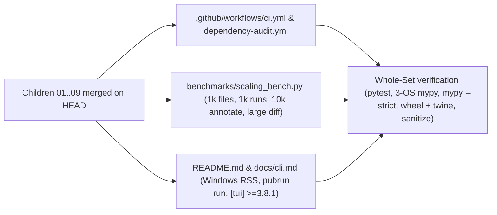

# IPD: CI compatibility matrix, scaling benchmarks, and whole-Set verification

- Date: 2026-11-27
- Kind: child
- Concern: Eight-lens rollup findings `ROLL-37` (`COMP-11`: CI misses Python `<3.11` `no-tui`/`tomli` isolation, Windows wheel packaging smoke, `[bench]` extra smoke, downstream `mypy --strict` mode-module check, and `tomli`/`[tui]` audit; `COMP-15`: stale `README.md` Windows RSS `wmic` note; `ROLL-21`: `README.md` / `docs/cli.md` `pubrun run` wording; `PERF-13`: missing stdlib local scaling benchmarks for 1k files, 1k runs, 10k `annotate`/`print`, and large-manifest diff), plus whole-Set verification across all nine preceding children (`1o1cua` through `3q5rd5`).
- Scope: Update `.github/workflows/ci.yml`, `.github/workflows/dependency-audit.yml`, `README.md`, `docs/cli.md`, `benchmarks/scaling_bench.py`, `benchmarks/README.md`, and `tests/test_compatibility.py`, and execute the full Set `assess-8l` verification suite.
- Scope-Paths: .github/workflows/ci.yml, .github/workflows/dependency-audit.yml, README.md, docs/cli.md, benchmarks/scaling_bench.py, benchmarks/README.md, tests/test_compatibility.py
- Item-Dependencies: executed:1o1cua, executed:76z7ww, executed:l596kn, executed:p4ueaj, executed:ameehy, executed:m5s3g8, executed:caeqdz, executed:2ge0ea, executed:3q5rd5
- Status: to-review
- Review-Depth: standard
- Short-Description: Expand CI matrix for tomli/Windows packaging/[bench]/mypy --strict, add local scaling benchmarks, fix README Windows RSS note, and verify the complete assess-8l Set
- Work-Kind: chore
- Priority: medium
- Set: assess-8l
- Order: 10
- Highest E allocated: 04
- Author: Antigravity
- Id: 6y55x4

> Write and proofread this plan per the technical writing standard, `.aw/system/workflows/technical-writing/technical-writing.md`, including requirement 12 (diagrams).

## Workflow history

- 2026-11-27 /assess-all (Antigravity): created Child 10 of Set `assess-8l` covering CI matrix expansion, scaling benchmarks, doc accuracy fixes, and whole-Set verification (`ROLL-21`, `ROLL-37`).

## Goal

Close the remaining CI matrix and benchmark-coverage blind spots identified by the `compatibility` and `performance` lenses, sync `README.md` and `docs/cli.md` with accurate Windows RSS, `[tui]` Python floor, and `pubrun run` wording, and run whole-Set verification across the combined output of children `01` through `09`.

### Verification and CI coverage flow

## Detailed Implementation Checklist (TODO)

Execution-state rule: mark an `E-*` item complete only after performing the action. Accepted execution states: blocked, failed, pending, performed; terminal gate demands `performed`.

### Task group 1: CI compatibility matrix and doc sync

- [ ] E-01 Expand `.github/workflows/ci.yml` and `.github/workflows/dependency-audit.yml`:
  - In `ci.yml`: add a Python `3.10` (or `3.8`) leg to `no-tui` so the conditional `tomli` runtime dependency is verified in isolation; add a `windows-latest` leg to `packaging` verifying wheel build, `twine check --strict`, and clean-venv `pubrun --version` / `pbr --version` / `pubrun bench --quick --local`; add a `pip install -e ".[bench]"` smoke test to `extra-suites`; add a downstream `mypy --strict --no-implicit-reexport` check covering all six import-mode submodules (`auto`, `full`, `noauto`, `nopatch`, `noconsole`, `minimal`) to `typecheck`.
  - In `dependency-audit.yml`: ensure `tomli` and optional `[tui]` dependencies are included in the audit pass (or audited on a `<3.11` leg).
  - Depends on: none
  - Expected outcome: CI catches `<3.11` `tomli`, Windows wheel packaging, `[bench]`, and PEP 561 mode-module regressions automatically.
  - Execution state: pending

- [ ] E-02 Sync `README.md` and `docs/cli.md` (with zero em or en dashes):
  - Update `README.md` Windows RSS note to accurately describe `ctypes` `GetProcessMemoryInfo` (removing the stale `wmic` RSS claim) and document that optional `pubrun[tui]` requires Python `>=3.8.1` (while core `pubrun` remains `>=3.8`).
  - Update `README.md` and `docs/cli.md` `pubrun run` wording to state clearly that `pubrun run --mode ... -- python script.py` overrides the import mode of scripts that already `import pubrun`.
  - Depends on: none
  - Expected outcome: `README.md` and `docs/cli.md` match actual shipped behavior with zero added em or en dashes.
  - Execution state: pending

### Task group 2: Local scaling benchmarks and whole-Set verification

- [ ] E-03 Add stdlib-only local scaling benchmark `benchmarks/scaling_bench.py` and document it in `benchmarks/README.md`:
  - Cover four scaling scenarios (local-only, never publishes): (1) 1,000+ file `open()`/`register_input()` (`file_io` linear scaling), (2) 1,000+ synthetic run directories (`scan_runs`/`find_run`/`diff` parse count and latency), (3) 10,000 inactive `annotate()` and `pubrun.print()` calls, and (4) large-manifest `compare_manifests` + `_format_array_diff`.
  - Document invocation in `benchmarks/README.md` alongside `startup_breakdown.py` and `package_capture_bench.py`.
  - Add a fast smoke test in `tests/test_compatibility.py` covering `scaling_bench.py --quick` and verifying workflow YAML syntax.
  - Depends on: E-01, E-02
  - Expected outcome: `python3 benchmarks/scaling_bench.py --quick` executes cleanly and reports concrete metrics for all four scaling scenarios.
  - Execution state: pending

- [ ] E-04 Execute whole-Set `assess-8l` regression and packaging verification:
  - Run full `pytest tests/ -p randomly --cov=src --cov-fail-under=78`, `pytest benchmarks/test_benchmarks.py benchmarks/test_share_safety.py .github/scripts/ -v`, three-platform `mypy` (`mypy && mypy --platform win32 && mypy --platform darwin`), downstream `mypy --strict --no-implicit-reexport` on all six mode submodules, clean wheel + sdist build + `python3 -m twine check --strict dist/*`, `python3 benchmarks/scaling_bench.py --quick`, and `python3 scripts/sanitize_paths.py --check --all`.
  - Depends on: E-03
  - Expected outcome: Every check exits `0` with pasted runner output confirming zero regressions across the complete Set `assess-8l`.
  - Execution state: pending

## Project conventions discovered (Step 0)

- CI workflows live in `.github/workflows/ci.yml` and `.github/workflows/dependency-audit.yml`; user-facing prose in `README.md` and `docs/*.md` must contain zero em or en dashes.
- Local non-publishing micro-benchmarks live under `benchmarks/` alongside `startup_breakdown.py` and `package_capture_bench.py`, and are excluded from the wheel.

## Findings

| ID | Concerns | Severity | Remediation Risk | Persona | Summary |
|---|---|---|---|---|---|
| `ROLL-21` | functionality; self-documentation; use-cases | High | Low (`usability`) | Complete novice | `README.md` and `docs/cli.md` state `pubrun run` tracks scripts you cannot modify without stating the `import pubrun` prerequisite. |
| `ROLL-37` | compatibility; performance | Medium | Low (`complexity`) | Operator / Architect | CI misses `<3.11` `no-tui`/`tomli`, Windows wheel packaging, `[bench]` extra, downstream `mypy --strict` mode check, and `tomli`/`[tui]` audit; `README.md` Windows RSS `wmic` note is stale; no scaling benchmarks exist for 1k files, 1k runs, 10k `annotate`, or large diffs. |

## Proposed changes (ordered, validatable)

1. `E-01` (`.github/workflows/ci.yml`, `.github/workflows/dependency-audit.yml`): Add `<3.11` `no-tui`/`tomli`, Windows `packaging`, `[bench]` smoke, downstream `mypy --strict` mode check, and `tomli`/`[tui]` audit legs.
2. `E-02` (`README.md`, `docs/cli.md`): Fix Windows RSS note, `[tui]` Python `>=3.8.1` floor note, and `pubrun run` wording with zero em/en dashes.
3. `E-03` (`benchmarks/scaling_bench.py`, `benchmarks/README.md`, `tests/test_compatibility.py`): Add stdlib local scaling benchmark script, doc entry, and smoke + YAML test.
4. `E-04`: Run whole-Set `assess-8l` regression, typing, packaging, benchmark, and leak-sanitization verification.

## Deferred / out of scope (with reason)

- Capping optional dependency upper bounds in `pyproject.toml` (`textual<9`, `rich<16`) and deciding Python 3.8 EOL policy are routed to orchestrator `k80suw` Open Question 6 (non-blocking maintainer choice).
  - Carrier-Declined: Maintainer dependency-policy choice (OQ-6); CI matrix verification ships regardless.

## Scope check

- Over-scope: none. Every change maps directly to `ROLL-21`, `ROLL-37`, and whole-Set verification.
- Under-scope: none. All CI, doc-sync, benchmark, and whole-Set validation checks are included.

## Required tests / validation

1. `pytest tests/ -p randomly --cov=src --cov-fail-under=78`
2. `pytest benchmarks/test_benchmarks.py benchmarks/test_share_safety.py .github/scripts/ -v`
3. `mypy && mypy --platform win32 && mypy --platform darwin`
4. `MYPYPATH=src python3 -m mypy --config-file /dev/null --strict --follow-imports=silent -c "import pubrun.auto, pubrun.full, pubrun.noauto, pubrun.nopatch, pubrun.noconsole, pubrun.minimal; pubrun.noauto.start(); pubrun.noauto.stop()"`
5. `rm -rf dist && python3 -m build --outdir dist . && python3 -m twine check --strict dist/*`
6. `python3 benchmarks/scaling_bench.py --quick && python3 scripts/sanitize_paths.py --check --all`

## Spec / documentation sync

`README.md`, `docs/cli.md`, and `benchmarks/README.md` are synced in `E-02` and `E-03` with zero em or en dashes.

## Open questions

None. All CI and benchmark additions are additive and non-breaking.

## Validation and cross-check (verify before reporting done)

Validation-state rule: inspect evidence in a separate pass. Accepted validation results: blocked, failed, pass, pending; terminal gate demands `pass`.

- [ ] V-01 validates E-01
  - Required evidence: Pasted YAML parse check and diff summary confirming new `no-tui` `<3.11`, Windows `packaging`, `[bench]`, downstream `mypy --strict`, and `dependency-audit` checks in `.github/workflows/`.
  - Observed evidence:
  - Result: pending

- [ ] V-02 validates E-02
  - Required evidence: Pasted diff and dash-check output confirming `README.md` and `docs/cli.md` updates contain zero em/en dashes and accurate Windows RSS / `pubrun run` / `[tui]` statements.
  - Observed evidence:
  - Result: pending

- [ ] V-03 validates E-03
  - Required evidence: Pasted output of `python3 benchmarks/scaling_bench.py --quick` and `pytest tests/test_compatibility.py -v` exiting `0`.
  - Observed evidence:
  - Result: pending

- [ ] V-04 validates E-04
  - Required evidence: Pasted runner output of full `pytest` with coverage, extra suites, three-platform `mypy`, downstream `mypy --strict`, `twine check --strict dist/*`, and `scripts/sanitize_paths.py --check --all` all exiting `0`.
  - Observed evidence:
  - Result: pending

## Approval and execution gate

Proposal only; requires review and explicit human approval before execution (`aw set plan approved 6y55x4 --by-human`). Not auto-executed. On completion, finalize to `.aw/records/plans/executed/`.
