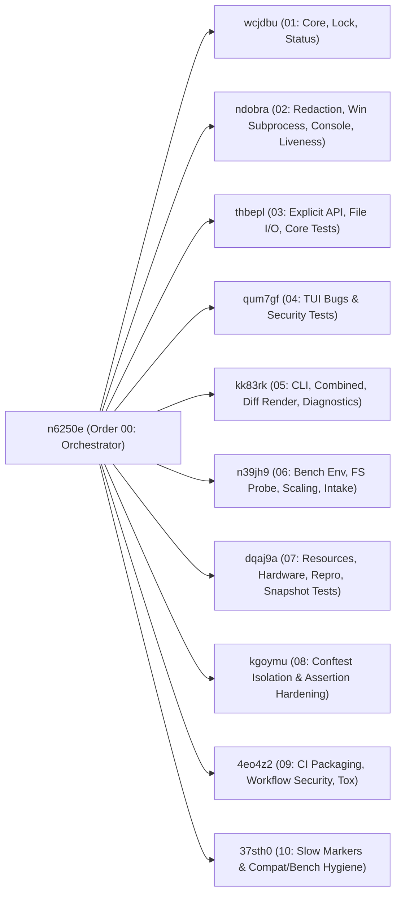

# IPD: Bugs and testing assessment rollup (post-assess-8l)

- Date: 2026-11-27
- Kind: orchestrator
- Concern: Consolidated remediation of 31 confirmed product bugs (8 High, 16 Medium, 7 Low) and 28 de-duplicated testing gaps (5 High, 17 Medium, 6 Low) identified by parallel `/assess bugs` and `/assess testing` audits on `pubrun` post-`assess-8l` (`512ee68` / `8f2aacd`).
- Scope: Coordinate ten file-disjoint child IPDs (`wcjdbu`, `ndobra`, `thbepl`, `qum7gf`, `kk83rk`, `n39jh9`, `dqaj9a`, `kgoymu`, `4eo4z2`, `37sth0`) across `src/pubrun/`, `tests/`, `benchmarks/`, `.github/`, `examples/verify_all.py`, and `tox.ini`. This orchestrator edits no product code directly; all code, test, and CI work is delegated to the ten child IPDs below.
- Scope-Paths: src/pubrun/, tests/, benchmarks/, .github/workflows/ci.yml, .github/scripts/test_benchmark_intake_workflow.py, examples/verify_all.py, tox.ini
- Item-Dependencies: none
- Status: to-review
- Coverage: pass
- Coverage-Fingerprint: 30777cad44478a6acf866a08b28ff841b59b34560a6a7751a2131d9dad8a124f
- Coverage-Checked: 2026-11-27 by uri/its_direct/pt3-claude-opus-5.5-1m-us
- Short-Description: De-duplicated remediation set covering 31 confirmed bugs and 28 testing gaps across core, capture, CLI, report, TUI, bench, and CI
- Work-Kind: bug
- Priority: high
- Set: assess-bt
- Order: 0
- Highest E allocated: 10
- Author: Antigravity
- Id: n6250e

> Write and proofread this plan per the technical writing standard, `.aw/system/workflows/technical-writing/technical-writing.md` (`.agents/workflows/technical-writing/technical-writing.md` in a legacy-layout install), including requirement 12 (diagrams).

## Workflow history

- 2026-11-27 coverage pass (aw oc run): fingerprint 30777cad4447, model uri/its_direct/pt3-claude-opus-5.5-1m-us
- 2026-11-27 to-review (Antigravity): Authored review-ready consolidated orchestrator IPD for parallel `/assess bugs` (verdict: `needs work`) and `/assess testing` (verdict: `adequate`) audits on HEAD `512ee68` / `8f2aacd`.
- 2026-11-27 draft (Antigravity): created.

## Goal

Fix all 31 confirmed correctness, security, data-integrity, and rendering defects and close all 28 de-duplicated testing, isolation, coverage, and CI enforcement gaps discovered after Set `assess-8l` landed. All ten child IPDs have mutually disjoint `Scope-Paths` so they can be reviewed and executed safely in parallel without merge contention.

### Set execution topology

## Detailed Implementation Checklist (TODO)

Execution-state rule: mark an `E-*` item complete only after performing the action. That mark is not validation. Right-sizing rule: write for a modest executor that cannot hold much in its head. Each E-item is one step (one concern, about one file, executable in one focused pass) and its V-item names each unit it covers with its own check; a plan stays at about 5 E-items and 8 work Scope-Paths, else split it into more child plans (guidance, `IPD-Z603`). Accepted execution states: blocked, failed, pending, performed; terminal gate demands 'performed'.

### Task group 1: Verify bug-fix and paired regression children reach `executed`

- [ ] E-01 CONFIRM wcjdbu REACHED executed
  - Depends on: none
  - Expected outcome: Child `wcjdbu` (Order 01: core lifecycle, lock ordering, config safety, and status classification) is finalized in `.aw/records/plans/executed/` with `- Status: executed`.
  - Execution state: pending

- [ ] E-02 CONFIRM ndobra REACHED executed
  - Depends on: none
  - Expected outcome: Child `ndobra` (Order 02: redaction security, Windows subprocess splitting, console resume, and liveness parity) is finalized in `.aw/records/plans/executed/` with `- Status: executed`.
  - Execution state: pending

- [ ] E-03 CONFIRM thbepl REACHED executed
  - Depends on: none
  - Expected outcome: Child `thbepl` (Order 03: explicit API `popen`/`print`/`phase`, file I/O streaming hash timing, and core/capture test hardening) is finalized in `.aw/records/plans/executed/` with `- Status: executed`.
  - Execution state: pending

- [ ] E-04 CONFIRM qum7gf REACHED executed
  - Depends on: none
  - Expected outcome: Child `qum7gf` (Order 04: TUI markup crash, live-to-completed hydration, stale panel reset, config expansion, and TUI archive/prune/pinning tests) is finalized in `.aw/records/plans/executed/` with `- Status: executed`.
  - Execution state: pending

- [ ] E-05 CONFIRM kk83rk REACHED executed
  - Depends on: none
  - Expected outcome: Child `kk83rk` (Order 05: CLI directory selectors, `--dir` expansion, bounded combined streaming, diff fast-path and array/ANSI render, show fixes, and run signal tests) is finalized in `.aw/records/plans/executed/` with `- Status: executed`.
  - Execution state: pending

- [ ] E-06 CONFIRM n39jh9 REACHED executed
  - Depends on: none
  - Expected outcome: Child `n39jh9` (Order 06: bench `PUBRUN_*` env isolation, filesystem mount-point live probing, `scaling_bench` scrub keys, `pull_submissions` retag, and benchmark test caching) is finalized in `.aw/records/plans/executed/` with `- Status: executed`.
  - Execution state: pending

### Task group 2: Verify testing coverage, isolation, and CI children reach `executed`

- [ ] E-07 CONFIRM dqaj9a REACHED executed
  - Depends on: none
  - Expected outcome: Child `dqaj9a` (Order 07: `ResourceWatcher` failure states, hardware parser/timeout boundaries, `meta_snapshot` containment, seed scan caps, and checks/methods coverage) is finalized in `.aw/records/plans/executed/` with `- Status: executed`.
  - Execution state: pending

- [ ] E-08 CONFIRM kgoymu REACHED executed
  - Depends on: none
  - Expected outcome: Child `kgoymu` (Order 08: `conftest.py` host user-config isolation and 7 module cache resets, tightened assertions, and signal sleep/pinning cleanup) is finalized in `.aw/records/plans/executed/` with `- Status: executed`.
  - Execution state: pending

- [ ] E-09 CONFIRM 4eo4z2 REACHED executed
  - Depends on: none
  - Expected outcome: Child `4eo4z2` (Order 09: CI packaging wheel bench enforcement, multi-line `run: |` workflow injection scan, `tox.ini` and `examples/verify_all.py` isolation, and dead CLI test monkeypatch fix) is finalized in `.aw/records/plans/executed/` with `- Status: executed`.
  - Execution state: pending

- [ ] E-10 CONFIRM 37sth0 REACHED executed
  - Depends on: none
  - Expected outcome: Child `37sth0` (Order 10: `@pytest.mark.slow` markers, parsed YAML/TOML compatibility assertions, and module-load isolation in package/startup benchmark tests) is finalized in `.aw/records/plans/executed/` with `- Status: executed`.
  - Execution state: pending

## Child IPDs, sequence, and dependencies

| Order | Id | File | What it does | Depends on |
|---|---|---|---|---|
| 01 | `wcjdbu` | `20261127-assess-bt-01-wcjdbu-core-lifecycle-lock-ordering-config-safety-and-status-classi.ipd.md` | Fixes `BUG-C1`, `BUG-C2`, `BUG-C3`, `BUG-C4`, `BUG-C6`, `BUG-C7`, `BUG-C8`, `BUG-C9`, `BUG-C10`, plus `TEST-U11` (`close_out_crashed_run` + root skip guard in `test_status.py`). | none |
| 02 | `ndobra` | `20261127-assess-bt-02-ndobra-redaction-security-windows-subprocess-splitting-console-resu.ipd.md` | Fixes `BUG-E1`, `BUG-E2`, `BUG-E4`, `BUG-E9` with behavioral security and capture regression tests. | none |
| 03 | `thbepl` | `20261127-assess-bt-03-thbepl-core-explicit-api-file-io-streaming-timing-and-capture-test.ipd.md` | Fixes `BUG-C5`, `BUG-E3` and closes `TEST-C1`/`TEST-I3` (4 `pubrun-hw` tests), `TEST-C2`, `TEST-C5`, `TEST-C6`, `TEST-C7` (manual `Path.cwd`), `TEST-C9` (`file_io`), and `TEST-I7` (`test_runtime_safety.py` sleeps). | none |
| 04 | `qum7gf` | `20261127-assess-bt-04-qum7gf-tui-markup-crash-live-hydration-stale-panels-config-expansio.ipd.md` | Fixes `BUG-U1`, `BUG-U2`/`TEST-U2`, `BUG-U4`, `BUG-U5` (TUI `ConfigPanel`) and closes `TEST-U1`, `TEST-U5`, `TEST-U8`. | none |
| 05 | `kk83rk` | `20261127-assess-bt-05-kk83rk-cli-selectors-combined-streaming-diff-array-rendering-and-di.ipd.md` | Fixes `BUG-U3`, `BUG-U5` (CLI `--dir`), `BUG-U6`, `BUG-U7`, `BUG-U8`, `BUG-U9`, `BUG-U10`, `BUG-U11`, `BUG-U12` and closes `TEST-U4`, `TEST-U9`. | none |
| 06 | `n39jh9` | `20261127-assess-bt-06-n39jh9-bench-env-isolation-filesystem-live-probing-scaling-scrub-an.ipd.md` | Fixes `BUG-E5`, `BUG-E6`, `BUG-E7`, `BUG-E8` and closes `TEST-I5` (benchmark script test isolation) and `TEST-I6` (`benchmarks/test_benchmarks.py` harness caching). | none |
| 07 | `dqaj9a` | `20261127-assess-bt-07-dqaj9a-capture-resource-hardware-reproducibility-and-snapshot-test.ipd.md` | Closes `TEST-C3`, `TEST-C4`, `TEST-U6`, `TEST-U7`, and `TEST-U10` across capture, reproducibility, snapshot, checks, and methods suites. | none |
| 08 | `kgoymu` | `20261127-assess-bt-08-kgoymu-global-test-isolation-assertion-hardening-and-sleep-or-pinni.ipd.md` | Closes `TEST-C7` (`conftest.py` + `load_user_config()`), `TEST-I4` (7 cache resets), `TEST-C8`, `TEST-C9` (`test_signals.py`), `TEST-I7` (`test_signals.py` sleeps), and `TEST-I10`. | none |
| 09 | `4eo4z2` | `20261127-assess-bt-09-4eo4z2-ci-packaging-wheel-bench-enforcement-workflow-security-scan.ipd.md` | Closes `TEST-I1`, `TEST-I2`, `TEST-I5` (`.github/scripts/`), `TEST-I8` (`test_bench_command.py`, `test_cli.py`), `TEST-I9` (`tox.ini`, `examples/verify_all.py`, CI), and `TEST-U3`. | none |
| 10 | `37sth0` | `20261127-assess-bt-10-37sth0-slow-test-markers-and-workflow-or-benchmark-test-isolation-c.ipd.md` | Closes `TEST-I6` (`@pytest.mark.slow` markers), `TEST-I8` (`test_compatibility.py`), and `TEST-I5` (`test_package_benchmark.py`, `test_startup_benchmark.py`). | none |

## Completion criteria (the whole Set is done only when)

- Core lifecycle non-dict config guards, post-manifest lock removal, lockless `outcome: "running"` classification, `SystemExit`/`bool` exit codes, `find_run()` stripping/ambiguity, `_merge_and_migrate()` races, and `close_out_crashed_run()` tests are fixed and verified. Owner: `wcjdbu`
- Redaction boolean-flag and `[REDACTED]]` leaks, Windows mid-token quote splitting, post-migration console error tracking, and liveness spy/Windows `ERROR_ACCESS_DENIED` parity are fixed and verified. Owner: `ndobra`
- `pubrun.popen()` POSIX signal decoding, small-chunk streaming hash timing, symlink-escape containment tests, `file_io` pending-digest/concurrent cap tests, and the 4 `pubrun-hw` race tests in `tests/test_explicit_api.py` are fixed and verified. Owner: `thbepl`
- TUI `ActionsPanel` markup crash, `RunDetailsView` live-to-completed hydration, empty-run panel clearing, `ConfigPanel` `$VAR`/`~` expansion, and archive/prune/pinning tests are fixed and verified. Owner: `qum7gf`
- CLI `status`/`combined` directory paths, `--dir` expansion, bounded `combined` streaming, `diff` direct-path guard, multiset array/ANSI diff rendering, `show <section> <run>` swap, `--last` upfront validation, `bench --prepare-submission` exit code, `show --utc`, and `pubrun run` signal forwarding tests are fixed and verified. Owner: `kk83rk`
- Packaged bench `PUBRUN_*` env isolation, mount-point live probing, `scaling_bench` scrub skip-key alignment, `pull_submissions` retag label handling, and `benchmarks/test_benchmarks.py` harness caching are fixed and verified. Owner: `n39jh9`
- `ResourceWatcher` failure states, `hardware.py` parser/timeout boundaries, `meta_snapshot` containment, `_has_recorded_seed_annotation` scan caps, and `checks.py`/`methods.py` coverage gaps are closed and verified. Owner: `dqaj9a`
- `tests/conftest.py` host user-config isolation and 7 module-level cache resets, tightened assertions across API/edge/import/capture/events/signals suites, and fixed-sleep/private-slot cleanup are completed and verified. Owner: `kgoymu`
- CI `packaging` wheel bench verification, multi-line `run: |` workflow injection scanning, `examples/verify_all.py` CI/config isolation, `tox.ini` updates, and `test_run_tests_exits_zero` replacement are completed and verified. Owner: `4eo4z2`
- `@pytest.mark.slow` markers, parsed workflow/config assertions in `tests/test_compatibility.py`, and module-load isolation in `tests/test_package_benchmark.py` and `tests/test_startup_benchmark.py` are completed and verified. Owner: `37sth0`

## Cross-IPD validation

- All ten child IPDs maintain strictly disjoint `Scope-Paths`, and every bug-fixing child runs `mypy` (Linux, win32, darwin) alongside its targeted `pytest -p randomly` suite (`wcjdbu`, `ndobra`, `thbepl`, `qum7gf`, `kk83rk`, `n39jh9`).
- All testing-hardening children verify deterministic randomized execution (`pytest -p randomly`) and host-config isolation (`dqaj9a`, `kgoymu`, `4eo4z2`, `37sth0`), and `4eo4z2` validates the CI packaging/workflow security checks plus `examples/verify_all.py`.

## Deferred / out of scope (with reason)

- Background `pubrun-hw` manifest refresh race specifically in `tests/test_explicit_api.py::test_report_and_artifact_reject_blank_and_reserved_names_case_insensitively`: already graduated from backlog item `7jd8g1` into pending plan `8o6o83` (child `thbepl` fixes the other four affected tests in `tests/test_explicit_api.py` without touching that test).
  - Carrier: 8o6o83
- Eager top-level import of `pubrun.capture.packages` from `src/pubrun/report/methods.py` when `capture.packages.mode == "off"`: already graduated from backlog item `b3dejs` into pending plan `3u1xgk`.
  - Carrier: 3u1xgk
- `ResourceWarning: Implicitly cleaning up <HTTPError 302 ...>` observed once during `pytest tests/ -p randomly` (unclosed synthetic `urllib.error.HTTPError` collected during `tests/test_commit_identity.py`): non-failing warning from an existing mock object, low risk and outside the audited bug/testing rubric.
  - Carrier-Declined: Single non-failing GC warning from an existing mock `HTTPError`; zero functional or test-flakiness impact and not worth expanding test-suite scope outside the audited findings.

## Scope check

- Over-scope: none. Every child maps directly to concrete, reproduced bugs or empirically verified testing/coverage gaps from the parallel `/assess bugs` and `/assess testing` runs on HEAD `512ee68` / `8f2aacd`, with zero overlap against pending plans `8o6o83` and `3u1xgk`.
- Under-scope: none. All 31 confirmed bugs and all 28 de-duplicated testing findings (out of 30 raw findings across 3 testing slices, with `TEST-U2` merged into `BUG-U2` and `TEST-I3` merged into `TEST-C1`) are explicitly assigned to children `wcjdbu` through `37sth0`.

## Required tests / validation

This orchestrator executes no code or tests directly. Each child performs its own targeted `pytest -p randomly`, coverage, and 3-OS `mypy` validation (`wcjdbu`, `ndobra`, `thbepl`, `qum7gf`, `kk83rk`, `n39jh9`, `dqaj9a`, `kgoymu`, `4eo4z2`, `37sth0`), and the runner's merge-and-revalidate gate validates the combined `main` HEAD as each child integrates.

## Open questions

None. All 31 bugs and 28 testing gaps have deterministic, unambiguous fixes anchored in existing `pubrun` contracts and test patterns.

## Validation and cross-check (verify before reporting the Set complete)

Validation-state rule: inspect evidence in a separate pass. Do not mark a `V-*` item complete from memory or from the matching execution checkmark. Accepted validation results: blocked, failed, pass, pending; terminal gate demands 'pass'. Runtime-demonstration reachability rule: for each `V-*` item demanding the software be observed acting (such as a run, a dispatch, or a transition), as distinct from items demanding a diff, a file's content, or a test result (which are reachable by construction), name the code path that produces the observation or the sibling `E-*` that creates it, else the demand is UNDER-SCOPE.

- [ ] V-01 validates E-01
  - Required evidence: `wcjdbu` resides in `.aw/records/plans/executed/` with `- Status: executed` and all `E-*`/`V-*` items `performed`/`pass`.
  - Observed evidence:
  - Result: pending

- [ ] V-02 validates E-02
  - Required evidence: `ndobra` resides in `.aw/records/plans/executed/` with `- Status: executed` and all `E-*`/`V-*` items `performed`/`pass`.
  - Observed evidence:
  - Result: pending

- [ ] V-03 validates E-03
  - Required evidence: `thbepl` resides in `.aw/records/plans/executed/` with `- Status: executed` and all `E-*`/`V-*` items `performed`/`pass`.
  - Observed evidence:
  - Result: pending

- [ ] V-04 validates E-04
  - Required evidence: `qum7gf` resides in `.aw/records/plans/executed/` with `- Status: executed` and all `E-*`/`V-*` items `performed`/`pass`.
  - Observed evidence:
  - Result: pending

- [ ] V-05 validates E-05
  - Required evidence: `kk83rk` resides in `.aw/records/plans/executed/` with `- Status: executed` and all `E-*`/`V-*` items `performed`/`pass`.
  - Observed evidence:
  - Result: pending

- [ ] V-06 validates E-06
  - Required evidence: `n39jh9` resides in `.aw/records/plans/executed/` with `- Status: executed` and all `E-*`/`V-*` items `performed`/`pass`.
  - Observed evidence:
  - Result: pending

- [ ] V-07 validates E-07
  - Required evidence: `dqaj9a` resides in `.aw/records/plans/executed/` with `- Status: executed` and all `E-*`/`V-*` items `performed`/`pass`.
  - Observed evidence:
  - Result: pending

- [ ] V-08 validates E-08
  - Required evidence: `kgoymu` resides in `.aw/records/plans/executed/` with `- Status: executed` and all `E-*`/`V-*` items `performed`/`pass`.
  - Observed evidence:
  - Result: pending

- [ ] V-09 validates E-09
  - Required evidence: `4eo4z2` resides in `.aw/records/plans/executed/` with `- Status: executed` and all `E-*`/`V-*` items `performed`/`pass`.
  - Observed evidence:
  - Result: pending

- [ ] V-10 validates E-10
  - Required evidence: `37sth0` resides in `.aw/records/plans/executed/` with `- Status: executed` and all `E-*`/`V-*` items `performed`/`pass`.
  - Observed evidence:
  - Result: pending

## Approval and execution gate

- Size assessment: standard
- Cohesion rationale: not required

1. **Open questions and approval:** Do not execute this Set until the human reviews and records approval (`aw set approved assess-bt --by-human` or per-plan `aw ipd set approved <id6> --by-human`).
2. **Runner retirement:** This orchestrator performs no code edits itself. Once all ten children (`wcjdbu`, `ndobra`, `thbepl`, `qum7gf`, `kk83rk`, `n39jh9`, `dqaj9a`, `kgoymu`, `4eo4z2`, `37sth0`) reach `executed` on disk, the runner retires `n6250e` to `.aw/records/plans/executed/` automatically.
3. **Commit and push policy:** Each child commits only its own `Scope-Paths` through `aw commit <child-id6> -- <paths>`. Never push, tag, or publish without explicit human direction.
