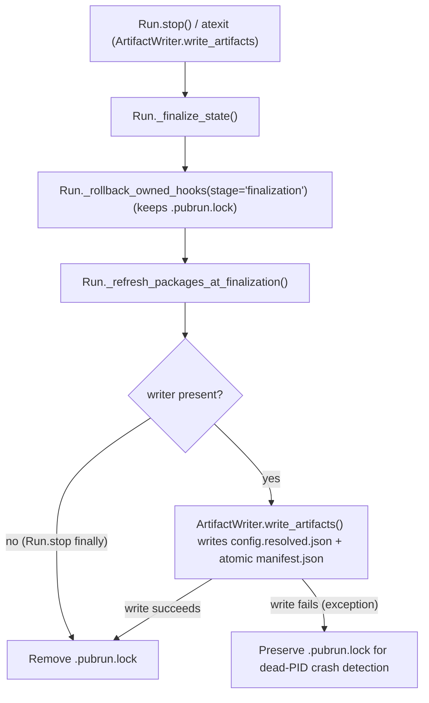

# IPD: Core lifecycle lock ordering config safety and status classification

- Date: 2026-11-27
- Kind: child
- Concern: Fix core runtime, lock-finalization, config-safety, and status-classification bugs (`BUG-C1`, `BUG-C2`, `BUG-C3`, `BUG-C4`, `BUG-C6`, `BUG-C7`, `BUG-C8`, `BUG-C9`, `BUG-C10`) plus status crash-closeout and root-safe test gaps (`TEST-U11`).
- Scope: Harden `src/pubrun/tracker.py`, `src/pubrun/writer.py`, `src/pubrun/status.py`, `src/pubrun/config.py`, and `src/pubrun/__init__.py` against non-dict config sections, premature `.pubrun.lock` removal, lockless `outcome: "running"` misclassification, `SystemExit`/bool exit-code corruption, `find_run()` stripping/ambiguity, `_merge_and_migrate()` concurrency/notice bugs, shadowed `open`, aliased `_deep_merge`, and symlink/corrupt-JavaScript Object Notation (JSON) `status.py` edges; synchronize finalization lock-removal documentation in `docs/architecture.md` and `docs/functional_spec.md`; add behavioral regression tests and update lock-finalization test expectations in `tests/test_core_lifecycle_bugs.py`, `tests/test_status_bugs.py`, and `tests/test_status.py`.
- Scope-Paths: src/pubrun/tracker.py, src/pubrun/writer.py, src/pubrun/status.py, src/pubrun/config.py, src/pubrun/__init__.py, tests/test_core_lifecycle_bugs.py, tests/test_status_bugs.py, tests/test_status.py, docs/architecture.md, docs/functional_spec.md
- Item-Dependencies: none
- Status: approved
- Readiness: go-pending-approval
- Review-Depth: complex
- Short-Description: Fix non-dict config crashes, lock removal before manifest write, lockless running misclassification, SystemExit/bool codes, find_run, migration races, and status tests
- Work-Kind: bug
- Priority: high
- Set: assess-bt
- Order: 1
- Highest E allocated: 05
- Author: Antigravity
- Id: wcjdbu
- Approval: 2026-11-28, recorded via aw ipd set: status set to approved

> Write and proofread this plan per the technical writing standard, `.aw/system/workflows/technical-writing/technical-writing.md` (`.agents/workflows/technical-writing/technical-writing.md` in a legacy-layout install), including requirement 12 (diagrams).

## Workflow history

- 2026-11-28 approved (aw set): status set to approved
- 2026-11-27 /plan-review (Antigravity): APPROVE WITH REVISIONS APPLIED; PR-001, PR-002, PR-003, PR-004, PR-005, PR-006
- 2026-11-27 to-review (Antigravity): Authored review-ready child IPD from parallel `/assess bugs` and `/assess testing` audits on HEAD `512ee68` / `8f2aacd`.
- 2026-11-27 draft (Antigravity): created.

## Goal

Eliminate three High core and status correctness and data-integrity defects (non-dict config crashes leaking hooks, premature `.pubrun.lock` removal before package refresh and finalized manifest persistence, and lockless `outcome: "running"` manifests misclassified as `completed`) alongside six Medium and Low lifecycle and status bugs and the `close_out_crashed_run` and root-safe status test gaps.

### Safe finalization and lock-removal order



## Detailed Implementation Checklist (TODO)

Execution-state rule: mark an `E-*` item complete only after performing the action. That mark is not validation. Right-sizing rule: write for a modest executor that cannot hold much in its head. Each E-item is one step (one concern, about one file, executable in one focused pass) and its V-item names each unit it covers with its own check; a plan stays at about 5 E-items and 8 work Scope-Paths, else split it into more child plans (guidance, `IPD-Z603`). Accepted execution states: blocked, failed, pending, performed; terminal gate demands 'performed'.

### Task group 1: Harden tracker, writer, config, and package root

- [ ] E-01 Harden `src/pubrun/tracker.py` and `src/pubrun/writer.py` for config safety, lock ordering, `SystemExit` handling, and migration races (`BUG-C1`, `BUG-C2`, `BUG-C4`, `BUG-C7`), and synchronize finalization docs:
  - In `src/pubrun/tracker.py`, replace every unguarded `.get(...)` chain on config sections in `Run._bootstrap_engines`, `_call_get_packages`, and `Run._refresh_packages_at_finalization` with `src/pubrun/config.py::_section`. Guard `self._bootstrap_engines()` in `src/pubrun/tracker.py::Run.__init__` so any unexpected exception latches `self._finalized = True`, `self._hardware_write_closed = True`, and `self.is_active = False` under `_run_lock`, calls `self._rollback_owned_hooks(stage="rollback")`, calls `self._enter_ghost_mode(format_safe_error_detail(exc, self.config))`, and returns cleanly rather than raising or leaking `SubprocessSpy` or `.pubrun.lock`.
  - In `src/pubrun/tracker.py::Run._rollback_owned_hooks`, call `self._remove_lock_file()` only when `stage == "rollback"` (ghost rollback). In `src/pubrun/writer.py::ArtifactWriter.write_artifacts`, remove `.pubrun.lock` only *after* `manifest.json` is atomically written and `self._artifacts_written = True`, invoking `remove_lock = getattr(self.run, "_remove_lock_file", None)` only when callable (preserving compatibility with test doubles such as `tests/test_writer.py::DummyRun`). In `Run.stop()`'s `finally` block, call `self._remove_lock_file()` only when `writer is None`. Update `docs/architecture.md` (`### Finalization`) and `docs/functional_spec.md` (`### 19.2 Finalization Lifecycle`) to describe post-manifest `.pubrun.lock` removal in `ArtifactWriter.write_artifacts()`.
  - In `src/pubrun/tracker.py::Run._finalize_state`, inspect `exc_type, exc_val, _ = sys.exc_info()`; when `exc_val is not None`, classify via `src/pubrun/core.py::_classify_exit_outcome(exc_val)` instead of treating all non-`KeyboardInterrupt` exceptions (including `SystemExit(0)` and `SystemExit(None)`) as `"failed"` (and if `exc_type is not None` with `exc_val is None`, map `KeyboardInterrupt` subclasses to `"interrupted"` and others to `"failed"`). Coerce `bool` `SystemExit.code` via `int(code)` (`True -> 1`, `False -> 0`) before calling `record_exit_code`.
  - In `src/pubrun/tracker.py::Run._merge_and_migrate`, keep `_hardware_thread.join()`/`_hardware_future_done.wait()` and `SubprocessSpy.install()` outside `_run_lock` (preserving `_run_lock` lock ordering and avoiding deadlock with `pubrun-hw` or concurrent `stop()`). Perform the authoritative `_api_overrides` read, `_deep_merge`, `resolve_config`, optional directory move (under `_run_lock` -> `writer._write_lock`, guarding `isinstance(new_base_str, (str, os.PathLike))` before `Path(new_base_str)`), `self.config_notices` recomputation via `src/pubrun/config.py::profile_deprecation_notice(merged)`, state commit, and `writer.sync_config_if_changed()` atomically under `_run_lock`. When `SubprocessSpy.install(..., owner=self._spy_owner_token)` returns `True` outside `_run_lock`, re-acquire `_run_lock` and immediately roll back via `SubprocessSpy.uninstall(owner=self._spy_owner_token)` (keeping `self._spying_subprocesses = False`) if `not self.is_active or self._finalized`.
  - Depends on: none
  - Expected outcome: Non-dict config overrides and unexpected bootstrap errors never raise `AttributeError` or leak hooks; `.pubrun.lock` persists until after atomic `manifest.json` write (and docs match); `SystemExit(0)`/`None`/`bool` record accurate outcomes and `int` exit codes; concurrent `_merge_and_migrate` updates never deadlock, drop overrides, leak `SubprocessSpy`, or leave `config_notices` stale.
  - Execution state: pending

- [ ] E-02 Fix `src/pubrun/config.py` and `src/pubrun/__init__.py` (`BUG-C8`, `BUG-C9`):
  - In `src/pubrun/config.py::_deep_merge`, replace `result[key] = value` with `result[key] = copy.deepcopy(value)` so nested lists and dicts from `dict2` are never aliased into the merged result.
  - In `src/pubrun/__init__.py::_read_pyproject_project_meta`, import `builtins` locally inside the function (avoiding pollution of `pubrun.__dir__()`) and replace both unqualified `open(...)` calls (the `tomllib`/`tomli` binary-read branch and the fallback text-parser branch) with `builtins.open(...)` so `__commit__` resolution during an active run never calls shadowed `src/pubrun/core.py::open` or records `pyproject.toml` into `run.data_files["inputs"]`.
  - Depends on: none
  - Expected outcome: Mutating `_deep_merge(d1, d2)` never mutates `d2`; accessing `pubrun.__commit__` during an active run never pollutes `data_files["inputs"]` or `pubrun.__dir__()`.
  - Execution state: pending

### Task group 2: Harden `status.py` classification, selector matching, and directory sizing

- [ ] E-03 Harden `src/pubrun/status.py` (`BUG-C1`, `BUG-C3`, `BUG-C6`, `BUG-C10`, plus `~`/`$VAR` expansion in `_resolve_output_dir` supporting `BUG-U5`):
  - In `src/pubrun/status.py::_resolve_output_dir`, look up `core` via `src/pubrun/config.py::_section(config, "core")`, validate `isinstance(base_str, str) and base_str`, and expand `~` and `$VAR` (`os.path.expanduser(os.path.expandvars(...))`) on both explicit `output_dir` arguments (via `os.fspath(output_dir)` to tolerate `str` and `Path`) and config-derived strings.
  - In `src/pubrun/status.py::RunInfo._load_from_manifest`, add an explicit `elif self.outcome == "running":` branch before `elif self._received_sigpipe():` and `else: self.status = STATUS_COMPLETED`: classify as `STATUS_RUNNING` (setting `self.elapsed = max(0.0, time.time() - self.started_at_utc)` when `self.elapsed is None`, plus `self.rss_bytes = get_rss_bytes(self.pid)` and `self.cpu_percent = get_cpu_percent(self.pid)`) only when `(not self.hostname or self.hostname == get_hostname()) and self.pid and self.pid > 0 and self.started_at_utc is not None and is_same_process(self.pid, self.started_at_utc, expected_script=self.script)`; classify as `STATUS_CRASHED` otherwise (never falling through to `STATUS_COMPLETED` and never matching a remote-host process ID (PID) locally).
  - In `src/pubrun/status.py::RunInfo._load_from_manifest`, `RunInfo._load_from_lock`, and `RunInfo._enrich_from_manifest`, check `isinstance(data, dict)` before storing `self.manifest` or `self.lock_data` or reading keys (degrading valid-JSON non-dict payloads such as `[]` or `null` to `_parse_dir_name()` + `STATUS_CRASHED` + `classify_timing_semantics({}, status=self.status)` in `_load_from_manifest` and `_load_from_lock`, and returning early in `_enrich_from_manifest`), coerce non-dict sub-sections (`run`, `status`, `git`, `invocation`, `signals`, `process`) to `{}`, and check `isinstance(argv, list) and argv` before indexing `argv[0]`.
  - In `src/pubrun/status.py::find_run`, use stripped `sel` in prefix and substring matching (steps 2 and 3, including error messages), and raise `AmbiguousRunSelectorError(sel, by_recency, other_exact[0], candidates=[by_recency, *other_exact])` whenever `by_recency is not None` and `other_exact = [r for r in exact_id if r is not by_recency]` is non-empty (covering `len(other_exact) >= 2` while preserving `by_recency`, `by_id`, and all colliding `candidates`).
  - In `src/pubrun/status.py::_dir_size`, skip symlinks (`not f.is_symlink() and f.is_file()`) and guard each entry inside the loop with `try ... except OSError: continue` (keeping the outer `OSError` guard) so one unreadable or disappearing entry does not abort sizing.
  - Depends on: none
  - Expected outcome: Lockless startup manifests with dead, missing, or remote PIDs classify as `STATUS_CRASHED` and live local PIDs classify as `STATUS_RUNNING`; non-dict config and JSON payloads degrade safely; `find_run` honors whitespace stripping and multi-collision ambiguity; `_dir_size` excludes symlinks and tolerates per-entry `OSError`.
  - Execution state: pending

### Task group 3: Add behavioral regression tests and validate

- [ ] E-04 Add behavioral regression tests and update lock-finalization test expectations in `tests/test_core_lifecycle_bugs.py`, `tests/test_status_bugs.py`, and `tests/test_status.py` (`BUG-C1`..`C4`, `BUG-C6`..`C10`, `TEST-U11`):
  - In `tests/test_core_lifecycle_bugs.py`, add tests for: (a) non-dict `events`/`capture` section overrides in `pubrun.start()` leaving `SubprocessSpy._installed == False` after `stop()`, plus an unexpected exception escaping `Run._bootstrap_engines()` after `SubprocessSpy.install()` and `_write_lock_file()` rolling back `SubprocessSpy`, removing `.pubrun.lock`, and entering ghost mode cleanly; (b) `.pubrun.lock` remaining present during `merge_package_snapshots` and `_atomic_json_write`, removed after success, and preserved when `manifest.json` write raises `OSError`; (c) `_finalize_state()` on `SystemExit(0)`, `SystemExit(None)`, `SystemExit(True)`, and `SystemExit(False)` checking outcomes and `type(exit_code) is int`; (d) `_merge_and_migrate()` refreshing `config_notices` on `start(profile="deep")`, racing `SubprocessSpy.install` against `stop()` without deadlocking or leaking `SubprocessSpy`, and concurrent `start()` override retention; (e) `pubrun.__commit__` during an active run not adding `pyproject.toml` to `data_files["inputs"]`; (f) `_deep_merge()` not aliasing mutable values from `dict2`.
  - In `tests/test_status_bugs.py`, add tests for: (a) `scan_runs()` with `core = "bad"` or `[core]\noutput_dir = 123` and `$VAR` expansion; (b) lockless startup `manifest.json` (`outcome="running"`) classifying as `STATUS_CRASHED` for dead PID, missing PID, or remote hostname, and `STATUS_RUNNING` for live local PID; (c) `find_run(" abcd ", d)`, `find_run(" train ", d)`, and `find_run("1", d)` with two runs sharing `run_id="1"` plus a newer run raising `AmbiguousRunSelectorError` with all three runs in `.candidates`; (d) `_dir_size()` excluding symlinks and tolerating per-entry `OSError`; (e) `RunInfo(run_dir)` degrading to `STATUS_CRASHED` on `[]`, `null`, or `{"run": null, "invocation": {"argv": 123}}`; (f) `close_out_crashed_run` time-of-check to time-of-use (TOCTOU) refusal on live `os.getpid()` and fallback `run_id`/`mtime` reconstruction on empty `lock_data={}` (`TEST-U11`).
  - In `tests/test_status.py`, update `TestLockFile.test_lock_file_removed_on_atexit_finalization` to verify `.pubrun.lock` remains present after `run._finalize_state()` alone and is removed once `run.writer.write_artifacts()` (the registered `atexit` callback) completes (`BUG-C2`), and add `hasattr(os, "geteuid") and os.geteuid() == 0` to `TestLockFile.test_ghost_mode_no_lock_file`'s skip guard (`TEST-U11`).
  - Depends on: E-01, E-02, E-03
  - Expected outcome: Every defect and test gap in this child has a failing-before/passing-after behavioral regression test, and `TestLockFile.test_lock_file_removed_on_atexit_finalization` verifies the post-manifest lock-removal contract.
  - Execution state: pending

- [ ] E-05 Run targeted `pytest -p randomly` and three-operating-system (Linux, Windows, macOS) `mypy` validation and record complete output:
  - Run all commands listed in `## Required tests / validation` and verify exit code `0` with zero failures.
  - Depends on: E-04
  - Expected outcome: All targeted pytest suites pass under `-p randomly` and three-operating-system `mypy` reports zero errors.
  - Execution state: pending

## Project conventions discovered (Step 0)

- `src/pubrun/config.py::_section(cfg, key)` is the house helper introduced in `1o1cua` to coerce non-dict TOML/override sections safely to `{}`.
- `src/pubrun/core.py::_classify_exit_outcome(exc)` defines the authoritative mapping from exception and `SystemExit` values to `("completed" | "failed" | "interrupted")`.
- `tests/test_report_checks_bugs.py` already uses `hasattr(os, "geteuid") and os.geteuid() == 0` alongside `sys.platform == "win32"` for read-only permission tests.
- All tests must exercise observable behavior and outcomes (no abstract syntax tree (AST)/source inspection or private-slot pinning).

## Findings

| ID | Concerns | Severity | Remediation Risk | Persona | Summary |
|---|---|---|---|---|---|
| `BUG-C1` | bugs | High | Low (`functionality`) | Software Engineer | Non-dict config sections crash `Run._bootstrap_engines()` mid-startup (leaking hooks/lock) and `status._resolve_output_dir()`. |
| `BUG-C2` | bugs | High | Medium (`functionality`) | Data Integrity | `.pubrun.lock` is removed in `_rollback_owned_hooks` before package refresh and atomic `manifest.json` persistence. |
| `BUG-C3` | bugs | High | Low (`functionality`) | Data Integrity | `RunInfo._load_from_manifest` misclassifies lockless `outcome: "running"` manifests as `STATUS_COMPLETED`. |
| `BUG-C4` | bugs | Medium | Low (`functionality`) | Software Engineer | `Run._finalize_state` maps active `SystemExit(0)`/`None` to `"failed"` and stores `bool` exit codes. |
| `BUG-C6` | bugs | Medium | Low (`usability`) | Quality Assurance (QA) Engineer | `find_run` ignores stripped `sel` in prefix/substring branches and misses multi-run recency collisions. |
| `BUG-C7` | bugs | Medium | Low (`functionality`) | Concurrency Reviewer | `Run._merge_and_migrate` has a `SubprocessSpy` post-finalization leak race, stale `config_notices`, and concurrent override lost-update. |
| `BUG-C8` | bugs | Low | Low (`functionality`) | Software Engineer | `src/pubrun/__init__.py::_read_pyproject_project_meta` calls shadowed `src/pubrun/core.py::open` instead of `builtins.open`. |
| `BUG-C9` | bugs | Low | Low (`functionality`) | Software Engineer | `src/pubrun/config.py::_deep_merge` aliases mutable values from `dict2`. |
| `BUG-C10` | bugs | Low | Low (`usability`) | QA Engineer | `src/pubrun/status.py::_dir_size` follows symlinks and aborts on `OSError`; `RunInfo` crashes directly on valid-JSON non-dict files. |
| `TEST-U11` | testing | Low | Low (`complexity`) | QA / Continuous Integration (CI) Engineer | `tests/test_status.py::TestLockFile.test_ghost_mode_no_lock_file` lacks root skip guard; `close_out_crashed_run` TOCTOU and empty-lock fallback paths are untested. |

## Proposed changes (ordered, validatable)

1. `E-01` (`src/pubrun/tracker.py`, `src/pubrun/writer.py`, `docs/architecture.md`, `docs/functional_spec.md`): Guard config section lookups with `_section()`, roll back cleanly into ghost mode on unexpected bootstrap failure, defer `.pubrun.lock` removal until after atomic `manifest.json` write (and synchronize finalization docs), fix `SystemExit`/`bool` handling in `_finalize_state()`, and harden `_merge_and_migrate()` without holding `_run_lock` across `pubrun-hw` join or `SubprocessSpy.install()`.
2. `E-02` (`src/pubrun/config.py`, `src/pubrun/__init__.py`): Deep-copy `dict2` values in `_deep_merge()` and use a function-local `builtins.open` in both branches of `_read_pyproject_project_meta()`.
3. `E-03` (`src/pubrun/status.py`): Guard and expand `_resolve_output_dir()`, classify lockless `outcome: "running"` via host-guarded local liveness, harden non-dict JSON handling in `_load_from_manifest`/`_load_from_lock`/`_enrich_from_manifest`, fix `find_run()` stripping and multi-collision `candidates`, and harden `_dir_size()`.
4. `E-04` (`tests/test_core_lifecycle_bugs.py`, `tests/test_status_bugs.py`, `tests/test_status.py`): Add behavioral regression tests, update `test_lock_file_removed_on_atexit_finalization` for post-manifest lock removal, and add the root-safe skip guard.
5. `E-05` (validation): Run randomized pytest suites (including writer, capture isolation, commit identity, and timing consumer suites) and three-operating-system `mypy`.

## Deferred / out of scope (with reason)

None. All core lifecycle, lock-ordering, config-safety, and status findings assigned to Order 01 are covered in this plan.

## Scope check

- Over-scope: none. Only the five directly affected runtime modules, three paired test files, and two documentation files whose finalization text changes under `BUG-C2` are in `Scope-Paths`.
- Under-scope: none. Every finding (`BUG-C1`..`C4`, `BUG-C6`..`C10`, `TEST-U11`) has a dedicated code change, documentation sync where affected, and behavioral regression test.

## Required tests / validation

1. Targeted randomized pytest run:
   ```sh
   pytest -p randomly tests/test_core_lifecycle_bugs.py tests/test_status_bugs.py tests/test_status.py tests/test_config.py tests/test_tracker.py tests/test_writer.py tests/test_capture_isolation.py tests/test_commit_identity.py tests/test_timing_consumers.py tests/test_runtime_safety.py tests/test_hook_ownership_rollback.py -v
   ```
2. Three-operating-system static type check:
   ```sh
   mypy && mypy --platform win32 && mypy --platform darwin
   ```

## Spec / documentation sync

Update `docs/architecture.md` (`### Finalization`) and `docs/functional_spec.md` (`### 19.2 Finalization Lifecycle`) in `E-01` to document that `.pubrun.lock` stays intact across `Run._rollback_owned_hooks(stage="finalization")` and `Run._refresh_packages_at_finalization()` and is removed in `ArtifactWriter.write_artifacts()` only after final `manifest.json` is atomically written (or in `Run.stop()`'s `finally` when `writer is None`). All other fixes align runtime behavior with existing documented contracts (non-interference golden rule, lock-based crash detection, non-mutating `_deep_merge`, and `find_run` ambiguity handling).

## Open questions

None.

## Validation and cross-check (verify before reporting done)

Validation-state rule: inspect evidence in a separate pass. Do not mark a `V-*` item complete from memory or from the matching execution checkmark. Accepted validation results: blocked, failed, pass, pending; terminal gate demands 'pass'. Runtime-demonstration reachability rule: for each `V-*` item demanding the software be observed acting (such as a run, a dispatch, or a transition), as distinct from items demanding a diff, a file's content, or a test result (which are reachable by construction), name the code path that produces the observation or the sibling `E-*` that creates it, else the demand is UNDER-SCOPE.

- [ ] V-01 validates E-01
  - Required evidence: Pasted `git diff -- src/pubrun/tracker.py src/pubrun/writer.py docs/architecture.md docs/functional_spec.md` confirming `_section()` guards and bootstrap rollback-to-ghost handling, post-manifest `.pubrun.lock` removal (with callable check for `DummyRun`) plus synced finalization docs, `_classify_exit_outcome()` + `int(code)` coercion, and deadlock-free `_merge_and_migrate()` lock/notice/spy-rollback hardening, plus passing output for the new `tests/test_core_lifecycle_bugs.py` tests exercising `Run._bootstrap_engines`, `ArtifactWriter.write_artifacts`, `Run._finalize_state`, and `Run._merge_and_migrate`.
  - Observed evidence:
  - Result: pending

- [ ] V-02 validates E-02
  - Required evidence: Pasted `git diff -- src/pubrun/config.py src/pubrun/__init__.py` confirming `copy.deepcopy(value)` in `_deep_merge` and function-local `builtins.open` in both branches of `_read_pyproject_project_meta`, plus passing output for the corresponding `tests/test_core_lifecycle_bugs.py` tests.
  - Observed evidence:
  - Result: pending

- [ ] V-03 validates E-03
  - Required evidence: Pasted `git diff -- src/pubrun/status.py` confirming `_resolve_output_dir` expansion/guards, host-and-PID-guarded `outcome == "running"` classification before `_received_sigpipe()`, non-dict JSON resilience across `_load_from_manifest`/`_load_from_lock`/`_enrich_from_manifest`, `find_run` `sel`/multi-collision `candidates` fixes, and `_dir_size` symlink/per-entry `OSError` handling, plus passing output for the corresponding `tests/test_status_bugs.py` tests.
  - Observed evidence:
  - Result: pending

- [ ] V-04 validates E-04
  - Required evidence: Pasted `pytest -v` output naming every newly added test function in `tests/test_core_lifecycle_bugs.py` and `tests/test_status_bugs.py`, confirming `test_lock_file_removed_on_atexit_finalization` passes under the post-manifest lock-removal contract, confirming `test_ghost_mode_no_lock_file` passes (or skips cleanly when `os.geteuid() == 0`), and pasted `git diff -- tests/test_status.py` showing both updates.
  - Observed evidence:
  - Result: pending

- [ ] V-05 validates E-05
  - Required evidence: Pasted complete output of both commands in `## Required tests / validation` (`pytest -p randomly ...` across all eleven test files and three-operating-system `mypy`), all exiting `0` with zero failures.
  - Observed evidence:
  - Result: pending

## Approval and execution gate

- Size assessment: standard
- Cohesion rationale: not required

1. **Open questions and approval:** Do not execute until all blocking open questions are resolved and explicit human approval is recorded (`aw ipd set approved wcjdbu --by-human` or `aw set approved assess-bt --by-human`).
2. **Scope declaration:** This plan declares ten `Scope-Paths` (`src/pubrun/tracker.py`, `src/pubrun/writer.py`, `src/pubrun/status.py`, `src/pubrun/config.py`, `src/pubrun/__init__.py`, `tests/test_core_lifecycle_bugs.py`, `tests/test_status_bugs.py`, `tests/test_status.py`, `docs/architecture.md`, `docs/functional_spec.md`). If an out-of-scope edit is genuinely required during execution, make it and justify each out-of-scope path via `--scope-reason` (and acknowledge any unmodified declared path via `--scope-ack`) at finalization; do not halt solely over a scope question, while still stopping for unsafe conditions such as an unresolvable concurrent-edit conflict or missing prerequisite symbols.
3. **Validation honesty:** You MUST paste actual command outputs from this workspace for every `V-*` item; never claim a test or check passed without running it and capturing its output.
4. **Commits and push policy:** Commit only files modified for this plan through `aw commit wcjdbu -- <paths>`. Never use `git add -A`, bare `git add`, `git commit -a`, or raw `git commit`, and never push, tag, or publish without explicit human direction.
5. **Lifecycle finalization:** Finalization is mandatory once every `E-*` is `performed` and every `V-*` is `pass`: under runner-managed execution (`aw oc run` / `aw agy run`), leave finalization to the runner after its merge-and-revalidate gate; under standalone manual execution, run `aw ipd finalize wcjdbu` (never hand-roll `git mv` to `executed/`).
