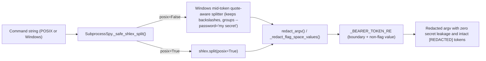

# IPD: Redaction security Windows subprocess splitting console resume and liveness

- Date: 2026-11-27
- Kind: child
- Concern: Fix two High secret-redaction leaks (`BUG-E1`, `BUG-E2`), a post-migration console error-reporting regression (`BUG-E4`), and liveness spy leakage / Windows permission parity (`BUG-E9`).
- Scope: Fix `src/pubrun/capture/redaction.py`, `src/pubrun/capture/subprocesses.py`, `src/pubrun/capture/console.py`, and `src/pubrun/capture/liveness.py`, and add deterministic behavioral regression tests in `tests/test_security_hardening.py`, `tests/test_capture_engine_bugs.py`, and `tests/test_liveness.py`.
- Scope-Paths: src/pubrun/capture/redaction.py, src/pubrun/capture/subprocesses.py, src/pubrun/capture/console.py, src/pubrun/capture/liveness.py, tests/test_security_hardening.py, tests/test_capture_engine_bugs.py, tests/test_liveness.py
- Item-Dependencies: none
- Status: to-review
- Short-Description: Fix boolean-flag redaction leaks, Windows mid-token quote splitting, post-migration console error tracking, and liveness spy/Windows parity
- Work-Kind: security
- Priority: high
- Set: assess-bt
- Order: 2
- Highest E allocated: 05
- Author: Antigravity
- Id: ndobra

> Write and proofread this plan per the technical writing standard, `.aw/system/workflows/technical-writing/technical-writing.md` (`.agents/workflows/technical-writing/technical-writing.md` in a legacy-layout install), including requirement 12 (diagrams).

## Workflow history

- 2026-11-27 to-review (Antigravity): Authored review-ready child IPD from `/assess bugs` Slice 2 audit on HEAD `512ee68` / `8f2aacd`.
- 2026-11-27 draft (Antigravity): created.

## Goal

Close two reachable plaintext secret leaks in shell/diagnostic redaction and Windows `SubprocessSpy` tokenization, ensure `ConsoleInterceptor.resume_after_migration` reports post-migration reopen failures accurately instead of falsely claiming `complete`, and bring `liveness.py` into parity with sibling capture modules (`disable_spy()` and Windows `ERROR_ACCESS_DENIED`).

### Redaction and Windows tokenization pipeline



## Detailed Implementation Checklist (TODO)

Execution-state rule: mark an `E-*` item complete only after performing the action. That mark is not validation. Right-sizing rule: write for a modest executor that cannot hold much in its head. Each E-item is one step (one concern, about one file, executable in one focused pass) and its V-item names each unit it covers with its own check; a plan stays at about 5 E-items and 8 work Scope-Paths, else split it into more child plans (guidance, `IPD-Z603`). Accepted execution states: blocked, failed, pending, performed; terminal gate demands 'performed'.

### Task group 1: Fix redaction and Windows subprocess splitting security defects

- [ ] E-01 Fix boolean-flag secret leaks and `[REDACTED]]` corruption in `src/pubrun/capture/redaction.py` (`BUG-E1`):
  - Update `_BEARER_TOKEN_RE` to require a leading non-flag boundary and disallow values beginning with `-` (e.g., `r"(?i)(?<![A-Za-z0-9_-])(bearer|token|auth)\s+(?!-)([a-zA-Z0-9._~+/-]+=*)"`).
  - Update `_redact_flag_space_values` to skip consuming `val_match` when `val_match.group(0).startswith("-")`, matching `redact_argv`'s boolean-flag guard so `--use-key --password supersecret` redacts `supersecret` instead of swallowing `--password`.
  - Update `_DIAG_TOKEN_VAL_RE` to match literal `\[REDACTED\]` as an atomic token (`r"\[REDACTED\]|\"[^\"]*\"|'[^']*'|[^\s,)\];]+"`) so already-redacted markers are never rewritten to `[REDACTED]]`.
  - Depends on: none
  - Expected outcome: `redact_argv` and `format_safe_error_detail` redact secrets following boolean flags (`--use-auth --password supersecret`, `--use-key --password supersecret`, `--token --secret supersecret`), preserve `Bearer tok123 -> Bearer [REDACTED]`, and never produce `[REDACTED]]`.
  - Execution state: pending

- [ ] E-02 Fix Windows mid-token quote splitting in `src/pubrun/capture/subprocesses.py::SubprocessSpy._safe_shlex_split` (`BUG-E2`):
  - Replace the `shlex.split(args, posix=False)` branch in `_safe_shlex_split` with a dedicated Windows quote-aware splitter that handles quotes appearing mid-token (such as `--password="my secret"`, `API_KEY="foo bar"`, and `--data="C:\Program Files\a.csv"`), preserves Windows backslashes verbatim, strips matched outer quote pairs on tokens or post-`=` values cleanly, and falls back to `[args]` on unterminated quotes.
  - Depends on: none
  - Expected outcome: `SubprocessSpy._safe_shlex_split(cmd, posix=False)` keeps `--password="my secret"` and `--data="C:\Program Files\a.csv"` as single tokens with intact backslashes so `redact_argv()` redacts the entire secret value.
  - Execution state: pending

### Task group 2: Fix console post-migration failure reporting and liveness spy/Windows parity

- [ ] E-03 Fix `src/pubrun/capture/console.py::ConsoleInterceptor.resume_after_migration` and `src/pubrun/capture/liveness.py` (`BUG-E4`, `BUG-E9`):
  - In `ConsoleInterceptor.resume_after_migration`, return early when `self.mode == "off" or not self._started`. Reopen `stdout.log` and `stderr.log` in independent `try/except` blocks; on failure, mark the corresponding tee's `_log_write_failed = True` under `finalization_lock` and log via `format_safe_error_detail(err, self._config)` so `stop()` accurately reports `capture_state.status == "partial"`.
  - In `src/pubrun/capture/liveness.py`, wrap all six `subprocess.run` calls (`_check_command_macos`, `_check_command_windows`, `_get_start_time_macos`, `_get_rss_macos`, `_get_cpu_macos`, `_get_rss_windows`) with `with disable_spy():`, and in `_is_pid_alive_windows` return `True` when `not handle` and `ctypes.get_last_error() == 5` (`ERROR_ACCESS_DENIED`).
  - Depends on: none
  - Expected outcome: Failed console log reopen after migration sets `capture_state.status == "partial"` and never opens handles after a failed `start()`; liveness probes never leak into `SubprocessSpy` records and Windows `ERROR_ACCESS_DENIED` reports alive parity with POSIX `PermissionError`.
  - Execution state: pending

### Task group 3: Add regression tests and validate

- [ ] E-04 Add behavioral regression tests in `tests/test_security_hardening.py`, `tests/test_capture_engine_bugs.py`, and `tests/test_liveness.py`:
  - In `tests/test_security_hardening.py`, add tests covering `redact_argv` and `format_safe_error_detail` on `--use-auth --password supersecret`, `--use-key --password supersecret`, `--token --secret supersecret`, `--password [REDACTED]`, `Bearer tok123`, plus `SubprocessSpy._safe_shlex_split(..., posix=False)` followed by `redact_argv(...)` on Windows commands with backslashes and mid-token quoted spaces (`--password="my secret"`, `--data="C:\Program Files\a.csv"`, `KEY="top secret"`).
  - In `tests/test_capture_engine_bugs.py`, add tests verifying `ConsoleInterceptor.resume_after_migration` failure sets `stop()["capture_state"]["status"] == "partial"` and that calling `resume_after_migration()` after a failed `start()` opens no log files.
  - In `tests/test_liveness.py`, add tests verifying `SubprocessSpy.get_records()` stays empty when macOS/Windows liveness helpers run under an active `SubprocessSpy`, and verifying `_is_pid_alive_windows` returns `True` on `ERROR_ACCESS_DENIED` (5) and `False` on `ERROR_INVALID_PARAMETER` (87).
  - Depends on: E-01, E-02, E-03
  - Expected outcome: Every defect in this child has a deterministic, platform-independent behavioral regression test.
  - Execution state: pending

- [ ] E-05 Run targeted `pytest -p randomly` and 3-OS `mypy` validation and capture output:
  - Run all commands listed in `## Required tests / validation` and verify exit `0`.
  - Depends on: E-04
  - Expected outcome: All targeted pytest suites pass under `-p randomly` and 3-OS `mypy` exits `0`.
  - Execution state: pending

## Project conventions discovered (Step 0)

- `src/pubrun/capture/redaction.py::format_safe_error_detail(err, config)` is the house helper for logging safe, redacted exception messages.
- `src/pubrun/capture/subprocesses.py::disable_spy()` is already used in `hardware.py`, `git.py`, `filesystem.py`, and `resources.py` to prevent internal pubrun probes from polluting user `subprocesses` records.
- `src/pubrun/capture/liveness.py::_get_win_kernel32()` already opens `kernel32` with `use_last_error=True`, so `ctypes.get_last_error()` reliably returns the Win32 error code after `OpenProcess`.

## Findings

| ID | Concerns | Severity | Remediation Risk | Persona | Summary |
|---|---|---|---|---|---|
| `BUG-E1` | bugs; security | High | Low (`security`) | Software / QA Engineer | Boolean sensitive flags before another sensitive flag leak plaintext secrets in `redact_argv` and `format_safe_error_detail`; `[REDACTED]` is corrupted to `[REDACTED]]`. |
| `BUG-E2` | bugs; security | High | Low (`security`) | Software / QA Engineer | `SubprocessSpy._safe_shlex_split(..., posix=False)` splits mid-token quoted spaces (`--password="my secret"`), leaking trailing words into `manifest.json`. |
| `BUG-E4` | bugs | Medium | Low (`functionality`) | Data Integrity | `ConsoleInterceptor.resume_after_migration` silently drops post-migration logs on reopen failure while `stop()` reports `complete`, and opens files even if `start()` failed. |
| `BUG-E9` | bugs | Low | Low (`functionality`) | Software Engineer | `liveness.py` `subprocess.run` calls lack `disable_spy()`, and `_is_pid_alive_windows` returns `False` on `ERROR_ACCESS_DENIED`. |

## Proposed changes (ordered, validatable)

1. `E-01` (`src/pubrun/capture/redaction.py`): Harden `_BEARER_TOKEN_RE`, `_redact_flag_space_values`, and `_DIAG_TOKEN_VAL_RE`.
2. `E-02` (`src/pubrun/capture/subprocesses.py`): Implement Windows mid-token quote-aware splitting in `SubprocessSpy._safe_shlex_split`.
3. `E-03` (`src/pubrun/capture/console.py`, `src/pubrun/capture/liveness.py`): Guard/track `resume_after_migration` reopen failures and add `disable_spy()` + Windows `ERROR_ACCESS_DENIED` parity in `liveness.py`.
4. `E-04` (`tests/test_security_hardening.py`, `tests/test_capture_engine_bugs.py`, `tests/test_liveness.py`): Add deterministic behavioral regression tests.
5. `E-05` (validation): Execute randomized pytest and 3-OS `mypy`.

## Deferred / out of scope (with reason)

None.

## Scope check

- Over-scope: none. Only the four capture modules and three corresponding test files are modified.
- Under-scope: none. Both High security leaks and both capture engine parity/reporting bugs are fully fixed and tested.

## Required tests / validation

1. Targeted randomized pytest run:
   ```sh
   pytest -p randomly tests/test_security_hardening.py tests/test_capture_engine_bugs.py tests/test_liveness.py tests/test_capture_engines.py tests/test_runtime_safety.py -v
   ```
2. Three-OS static type check:
   ```sh
   mypy && mypy --platform win32 && mypy --platform darwin
   ```

## Spec / documentation sync

N/A. Fixes enforce existing secret-redaction, console capture-state, and liveness parity contracts without changing configuration keys or CLI flags.

## Open questions

None.

## Validation and cross-check (verify before reporting done)

Validation-state rule: inspect evidence in a separate pass. Do not mark a `V-*` item complete from memory or from the matching execution checkmark. Accepted validation results: blocked, failed, pass, pending; terminal gate demands 'pass'. Runtime-demonstration reachability rule: for each `V-*` item demanding the software be observed acting (such as a run, a dispatch, or a transition), as distinct from items demanding a diff, a file's content, or a test result (which are reachable by construction), name the code path that produces the observation or the sibling `E-*` that creates it, else the demand is UNDER-SCOPE.

- [ ] V-01 validates E-01
  - Required evidence: Pasted `git diff -- src/pubrun/capture/redaction.py` and passing pytest output from `tests/test_security_hardening.py` exercising `redact_argv` and `format_safe_error_detail` on boolean-flag combinations and `[REDACTED]`.
  - Observed evidence:
  - Result: pending

- [ ] V-02 validates E-02
  - Required evidence: Pasted `git diff -- src/pubrun/capture/subprocesses.py` and passing pytest output from `tests/test_security_hardening.py` exercising `SubprocessSpy._safe_shlex_split(..., posix=False)` + `redact_argv(...)` on Windows backslashes and mid-token quoted spaces.
  - Observed evidence:
  - Result: pending

- [ ] V-03 validates E-03
  - Required evidence: Pasted `git diff -- src/pubrun/capture/console.py src/pubrun/capture/liveness.py` and passing pytest output from `tests/test_capture_engine_bugs.py` and `tests/test_liveness.py` exercising `resume_after_migration`, `disable_spy()`, and `_is_pid_alive_windows`.
  - Observed evidence:
  - Result: pending

- [ ] V-04 validates E-04
  - Required evidence: Pasted `pytest -v` output listing every newly added test function across `tests/test_security_hardening.py`, `tests/test_capture_engine_bugs.py`, and `tests/test_liveness.py` as `PASSED`.
  - Observed evidence:
  - Result: pending

- [ ] V-05 validates E-05
  - Required evidence: Pasted complete output of both commands in `## Required tests / validation`, both exiting `0` with zero failures.
  - Observed evidence:
  - Result: pending

## Approval and execution gate

- Size assessment: standard
- Cohesion rationale: not required

1. **Open questions and approval:** Do not execute until explicit human approval is recorded (`aw ipd set approved ndobra --by-human` or `aw set approved assess-bt --by-human`).
2. **Scope declaration:** Modify only the seven declared `Scope-Paths`.
3. **Validation honesty:** Paste actual command outputs from this workspace for every `V-*` item.
4. **Commits and push policy:** Commit only files modified for this plan through `aw commit ndobra -- <paths>`. Never push, tag, or publish.
5. **Lifecycle finalization:** Finalize via `aw ipd finalize ndobra` (or let the runner finalize) only after every `E-*` is `performed` and every `V-*` is `pass`.
