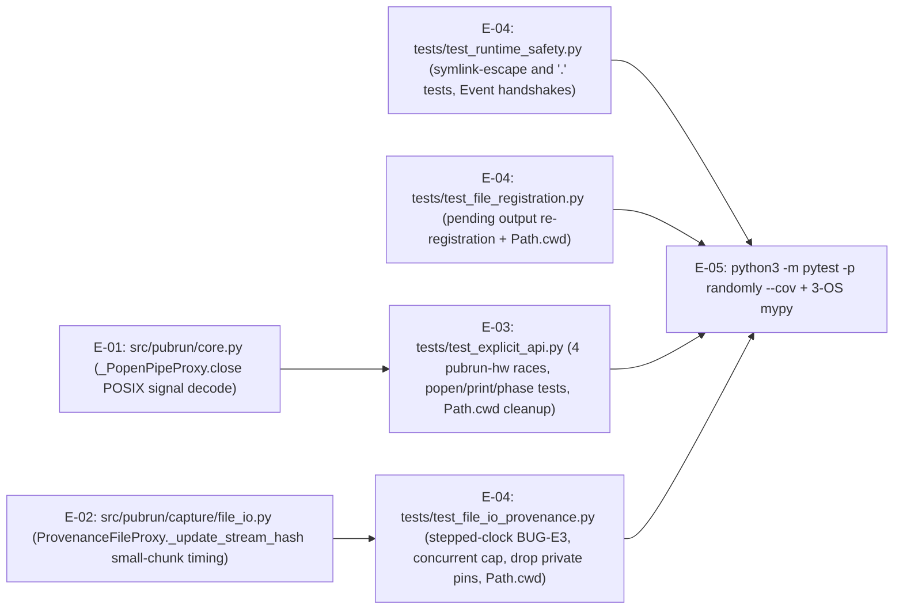

# IPD: Core explicit API file IO streaming timing and capture test hardening

- Date: 2026-11-27
- Kind: child
- Concern: Fix `pubrun.popen()` POSIX signal exit decoding (`BUG-C5`) and `file_io` small-chunk streaming hash timing (`BUG-E3`), and close high/medium testing gaps across `tests/test_explicit_api.py`, `tests/test_runtime_safety.py`, `tests/test_file_io_provenance.py`, and `tests/test_file_registration.py` (`TEST-C1`/`TEST-I3`, `TEST-C2`, `TEST-C5`, `TEST-C6`, `TEST-C7` manual `Path.cwd`, `TEST-C9` file I/O pinning, `TEST-I7` fixed sleeps).
- Scope: Fix `src/pubrun/core.py::_PopenPipeProxy.close` and `src/pubrun/capture/file_io.py::ProvenanceFileProxy._update_stream_hash`, and harden `tests/test_explicit_api.py` (leaving `test_report_and_artifact_reject_blank_and_reserved_names_case_insensitively` untouched for pending plan `8o6o83`), `tests/test_runtime_safety.py`, `tests/test_file_io_provenance.py`, and `tests/test_file_registration.py`.
- Scope-Paths: src/pubrun/core.py, src/pubrun/capture/file_io.py, tests/test_explicit_api.py, tests/test_runtime_safety.py, tests/test_file_io_provenance.py, tests/test_file_registration.py
- Item-Dependencies: none
- Status: approved
- Readiness: go-pending-approval
- Review-Depth: complex
- Short-Description: Fix pubrun.popen POSIX signal decoding and small-chunk stream hash timing; close explicit API, symlink-escape, and file_io coverage gaps
- Work-Kind: bug
- Priority: high
- Set: assess-bt
- Order: 3
- Highest E allocated: 05
- Author: Antigravity
- Id: thbepl
- Approval: 2026-11-28, recorded via aw ipd set: status set to approved

> Write and proofread this plan per the technical writing standard, `.aw/system/workflows/technical-writing/technical-writing.md` (`.agents/workflows/technical-writing/technical-writing.md` in a legacy-layout install), including requirement 12 (diagrams).

## Workflow history

- 2026-11-28 approved (aw set): status set to approved
- 2026-11-27 /plan-review (Antigravity): APPROVE WITH REVISIONS APPLIED; PR-001, PR-002, PR-003, PR-004, PR-005
- 2026-11-27 to-review (Antigravity): Authored review-ready child IPD from parallel `/assess bugs` and `/assess testing` audits on HEAD `512ee68` / `8f2aacd`.
- 2026-11-27 draft (Antigravity): created.

## Goal

Fix POSIX signal-terminated exit-code corruption in `pubrun.popen()` (`src/pubrun/core.py`) and small-chunk `max_total_hash_seconds` timing bypass in `ProvenanceFileProxy._update_stream_hash` (`src/pubrun/capture/file_io.py`), while eliminating background `pubrun-hw` thread races in `tests/test_explicit_api.py` (without touching the function owned by pending plan `8o6o83`) and closing high-priority security (`artifact`/`report` symlink escapes), explicit-API error-path, and `file_io` concurrency/re-registration test gaps.

### Core explicit API, file I/O timing, and test hardening scope



## Detailed Implementation Checklist (TODO)

Execution-state rule: mark an `E-*` item complete only after performing the action. That mark is not validation. Right-sizing rule: write for a modest executor that cannot hold much in its head. Each E-item is one step (one concern, about one file, executable in one focused pass) and its V-item names each unit it covers with its own check; a plan stays at about 5 E-items and 8 work Scope-Paths, else split it into more child plans (guidance, `IPD-Z603`). Accepted execution states: blocked, failed, pending, performed; terminal gate demands 'performed'.

### Task group 1: Fix core `popen` signal decoding and `file_io` streaming hash timing

- [ ] E-01 Fix POSIX signal-terminated exit decoding in `src/pubrun/core.py::popen` (`_PopenPipeProxy.close`) (`BUG-C5`):
  - On POSIX (`sys.platform != "win32"`), when `isinstance(exit_status, int) and not isinstance(exit_status, bool)`: if `exit_status < 0 and (exit_status & 0xFF) == 0`, decode `rc = exit_status >> 8` (`-signum`); else if `exit_status >= 0 and os.WIFEXITED(exit_status)`, use `os.WEXITSTATUS(exit_status)`; else if `exit_status >= 0 and os.WIFSIGNALED(exit_status)`, use `-os.WTERMSIG(exit_status)`; else keep `exit_status`.
  - Depends on: none
  - Expected outcome: `pubrun.popen("kill -TERM $$")` and `pubrun.popen("kill -9 $$")` record `-15` and `-9` (matching `pubrun.subprocess.run` and `SubprocessSpy`) instead of `241` and `247`, normal non-zero exits decode cleanly (`exit 5` -> `5`), and unusual negative integers without a zero low byte are preserved verbatim.
  - Execution state: pending

- [ ] E-02 Fix small-chunk streaming hash timing in `src/pubrun/capture/file_io.py::ProvenanceFileProxy._update_stream_hash` (`BUG-E3`):
  - When `budget.max_total_hash_seconds > 0.0`, time every `self._stream_hasher.update(data)` call with `time.monotonic()` into `self._stream_elapsed`. If `self._stream_elapsed > budget.max_total_hash_seconds`, abort streaming immediately lock-free (`_stream_over_budget = True`, set `_stream_over_budget_reason`, call `_invalidate_stream()`, and return) so slow small-chunk streams do not keep hashing up to `DEFAULT_CHUNK_SIZE`. Keep the `DEFAULT_CHUNK_SIZE` throttle strictly for the locked `budget.check_stream_progress(self._stream_bytes, self._stream_elapsed)` call (with the final check still running at `close()` for cumulative multi-file budgets). Keep the zero-timer fast path only when `budget.max_total_hash_seconds == 0.0`.
  - Depends on: none
  - Expected outcome: Small-chunk streaming I/O (<64 KiB reads/writes) enforces `max_total_hash_seconds` accurately (both single-file lock-free and cumulative multi-file), avoids unnecessary hashing once the single-file time exceeds `max_total_hash_seconds`, and records accurate `hash_duration_seconds`.
  - Execution state: pending

### Task group 2: Harden explicit API, runtime safety, and file I/O test suites

- [ ] E-03 Eliminate `pubrun-hw` thread races, add explicit-API failure/edge tests, and clean up manual `Path.cwd` mutation in `tests/test_explicit_api.py` (`TEST-C1`/`TEST-I3`, `TEST-C6`, `TEST-C7`, `BUG-C5`):
  - Pass `capture={"hardware": {"depth": "off"}, "resources": {"depth": "off"}}` in `test_explicit_subprocess_popen_wait_communicate_poll_timeout_and_failure`, `test_explicit_popen_monotonic_and_launch_failure_schema`, `test_explicit_subprocess_run_monotonic_and_schema`, and `test_manual_subprocess_provenance_isolation_cap_zero_bool_and_concurrency`. Do NOT edit `test_report_and_artifact_reject_blank_and_reserved_names_case_insensitively` (owned by pending plan `8o6o83`).
  - Add behavioral tests covering:
    - (a) POSIX `pubrun.popen` signal termination (`@pytest.mark.skipif(sys.platform == "win32", reason="POSIX signal exit semantics")` covering `kill -TERM $$` -> `-15` and `kill -9 $$` -> `-9`), plus cross-platform non-zero exit (`exit 5` -> `5`, `capture_state.status == "failed"`) and double-`close()` idempotency (second `close()` returns `None` and records only one subprocess entry);
    - (b) `pubrun.print` timestamped multi-line output directly through `core.py`'s timestamping branch (configure `console={"capture_mode": "standard", "non_tty_mode": "off"}` so `_should_log_pubrun_print` returns `True` rather than delegating to `TqdmSafeTee`, and verify UTC timestamp prefixes on each non-empty line in `stdout.log`), simulated write `OSError` recovery (warning logged, cached handle cleared, subsequent `pubrun.print` recovers cleanly), and concurrent multi-threaded `pubrun.print` calls;
    - (c) failing `cProfile.Profile.dump_stats` and fake `yappi` `save()` raising `OSError`, verifying the 0-byte sentinel `.prof` file is unlinked and no `profile_saved` event is emitted.
  - Remove direct `Path.cwd = staticmethod(lambda: tmp_path)` assignments in `test_report_and_artifact`, `test_pubrun_print`, `test_pubrun_open_provenance`, and `test_explicit_subprocess_and_popen` (relying on autouse `tests/conftest.py::isolated_cwd`).
  - Depends on: E-01
  - Expected outcome: `tests/test_explicit_api.py` has zero background `pubrun-hw` interference in the four racy tests, leaves `8o6o83`'s test untouched, has zero manual `Path.cwd = staticmethod(...)` assignments, and covers all explicit `popen`/`print`/`phase` failure paths including `core.py`'s timestamped `pubrun.print` lines.
  - Execution state: pending

- [ ] E-04 Add symlink-escape security tests, replace fixed sleeps, and harden `file_io` tests in `tests/test_runtime_safety.py`, `tests/test_file_io_provenance.py`, and `tests/test_file_registration.py` (`TEST-C2`, `TEST-C5`, `TEST-C7`, `TEST-C9`, `TEST-I7`, `BUG-E3`):
  - In `tests/test_runtime_safety.py`:
    - add symlink-escape and `"."` target security tests for `pubrun.artifact()` / `pubrun.report()` (using `capture={"hardware": {"depth": "off"}}` so `manifest.json` snapshots cannot race with `pubrun-hw`): symlink to an outside directory rejected for both `artifact` and `report`, symlink to `manifest.json` rejected for both `artifact` and `report` with `manifest.json` unchanged, and `artifact(".", ...)` / `artifact("./", ...)` rejected (skipping symlink cases cleanly via `pytest.skip` if `os.symlink` raises `OSError` or `NotImplementedError`);
    - replace the two fixed-sleep thread handshakes (`time.sleep(0.05)` in `_fake_hw_worker` and `time.sleep(0.03)` before `ci.stop()` in the concurrent `ConsoleInterceptor` test) with `threading.Event` synchronization (leaving the bounded child-process exit polling loop in `test_subprocess_spy_windows_shlex_and_drain_reaping` intact).
  - In `tests/test_file_io_provenance.py`:
    - add a deterministic small-chunk (<`DEFAULT_CHUNK_SIZE`) streaming hash budget regression test for `BUG-E3` using a monkeypatched stepped `file_io.time.monotonic` clock (so fast CPUs cannot round `hash_duration_seconds` to `0.0`), asserting `hash_status == "over_budget"` under a tight `max_total_hash_seconds` cap and `hash_status == "completed"` + `observation_time == "during_stream"` + expected positive `hash_duration_seconds` under a generous cap;
    - add a multi-threaded `threading.Barrier` test racing `pubrun.open()`, `pubrun.register_input()`, and `pubrun.register_output(..., defer=True)` against a small `max_tracked_files` cap, asserting total stored records equal `max_tracked_files` and `records_truncated` accounts for the dropped registrations;
    - remove private-attribute assertions (`fh._budget._has_caps`, `fh._stream_valid`, `fh._stream_over_budget`) in favor of observable manifest assertions including `hash_stats["extra_read_bytes"] == 0` and `hash_stats["bytes_hashed"] == 0` on the over-budget record (`TEST-C9`);
    - remove redundant manual `Path.cwd = staticmethod(...)` mutations (`TEST-C7`).
  - In `tests/test_file_registration.py`:
    - add a behavioral test for re-registering an existing pending deferred output (`defer=True`, `level="stat"`, initial metadata) with `digest`, `verify_digest=True`, `level="hash"`, and updated metadata before creating the file, confirming single-record deduplication (`registration_count == 2`, merged metadata, index eviction/reindex without duplicate outputs) and `finalize_pending_registrations` verification (`hash_status == "completed"`, `caller_digest["verified"] is True`, `evidence_strength == "verified_content"`, `registered_before_creation is True`) (`TEST-C5`);
    - remove redundant manual `Path.cwd = staticmethod(...)` mutation in `_run_manifest` (`TEST-C7`).
  - Depends on: E-02
  - Expected outcome: Symlink-escape security guards, deterministic small-chunk stream hash timing, concurrent `max_tracked_files`, and pending-output re-registration are behaviorally verified with zero private-field pinning, zero fixed-sleep thread handshakes, and zero manual `Path.cwd` overwrites.
  - Execution state: pending

### Task group 3: Validate

- [ ] E-05 Run targeted `pytest -p randomly` with coverage and 3-OS `mypy` and record complete output:
  - Run all commands listed in `## Required tests / validation` and verify exit `0`.
  - Depends on: E-03, E-04
  - Expected outcome: All targeted tests pass under `-p randomly`, targeted coverage lines in `src/pubrun/core.py` and `src/pubrun/capture/file_io.py` are hit, and 3-OS `mypy` exits `0`.
  - Execution state: pending

## Project conventions discovered (Step 0)

- `tests/test_explicit_api.py::test_report_and_artifact_reject_blank_and_reserved_names_case_insensitively` is already assigned to pending plan `8o6o83` (graduated from backlog item `7jd8g1`); leave that function untouched here to avoid merge conflict with `8o6o83`.
- `tests/conftest.py::isolated_cwd` (`autouse=True`) already isolates working directory per test via `monkeypatch.chdir(tmp_path)` and `monkeypatch.setattr("pathlib.Path.cwd", lambda: tmp_path)`; direct `Path.cwd = staticmethod(...)` overwrites are unnecessary.
- `src/pubrun/core.py::_resolve_within_run_dir` is the containment gate used by both `pubrun.artifact()` and `pubrun.report()`.
- `src/pubrun/core.py::_should_log_pubrun_print` returns `False` whenever `ConsoleInterceptor`'s `stdout_tee` is installed on `sys.stdout`, so testing `core.py`'s timestamped `pubrun.print` formatting branch requires disabling `stdout_tee` attachment (for example `console={"capture_mode": "standard", "non_tty_mode": "off"}`).

## Findings

| ID | Concerns | Severity | Remediation Risk | Persona | Summary |
|---|---|---|---|---|---|
| `BUG-C5` | bugs | Medium | Low (`functionality`) | Software / QA Engineer | `pubrun.popen()` corrupts POSIX signal-terminated exit codes (`-9 -> 247`, `-15 -> 241`). |
| `BUG-E3` | bugs | Medium | Low (`functionality`) | QA Engineer | `ProvenanceFileProxy._update_stream_hash` leaves small-chunk (<64 KiB) updates untimed, bypassing `max_total_hash_seconds`. |
| `TEST-C1` / `TEST-I3` | testing | High | Low (`functionality`) | Testing Expert | Four tests in `tests/test_explicit_api.py` monkeypatch `time`/`Popen.__init__` while background `pubrun-hw` is running. |
| `TEST-C2` | testing | High | Low (`security`) | QA Engineer | Missing symlink-escape and `"."` target security tests for `pubrun.artifact()` / `pubrun.report()`. |
| `TEST-C5` | testing | Medium | Low (`functionality`) | Testing Expert | Pending-output re-registration index eviction and multi-threaded `max_tracked_files` cap are untested. |
| `TEST-C6` | testing | Medium | Low (`functionality`) | QA Engineer | Untested `pubrun.popen` non-zero/double-close, `pubrun.print` timestamped/error/concurrency, and `phase.__exit__` 0-byte `.prof` rollback. |
| `TEST-C7` (partial) | testing | Medium | Low (`functionality`) | Testing Expert | Manual `Path.cwd = staticmethod(...)` overwrites in `test_explicit_api.py`, `test_file_io_provenance.py`, and `test_file_registration.py`. |
| `TEST-C9` (partial) | testing | Low | Low (`complexity`) | Testing Expert | Private attribute assertions (`fh._budget._has_caps`, `fh._stream_valid`, `fh._stream_over_budget`) in `tests/test_file_io_provenance.py`. |
| `TEST-I7` (partial) | testing | Medium | Low (`functionality`) | Testing Expert | Fixed-sleep thread handshakes (`_fake_hw_worker` and concurrent `ConsoleInterceptor`) in `tests/test_runtime_safety.py`. |

## Proposed changes (ordered, validatable)

1. `E-01` (`src/pubrun/core.py`): Fix POSIX signal exit-code decoding (with non-bool and `>= 0` guards) in `_PopenPipeProxy.close`.
2. `E-02` (`src/pubrun/capture/file_io.py`): Time every `update()` call and add a lock-free single-file time-cap abort when `max_total_hash_seconds > 0.0`, while keeping the 64 KiB locked `check_stream_progress` throttle.
3. `E-03` (`tests/test_explicit_api.py`): Disable background hardware/resources in the 4 racy tests, add explicit `popen`/`print`/`phase` failure tests (including `core.py`'s timestamped `pubrun.print` branch), and remove manual `Path.cwd` overwrites while leaving `8o6o83`'s test untouched.
4. `E-04` (`tests/test_runtime_safety.py`, `tests/test_file_io_provenance.py`, `tests/test_file_registration.py`): Add symlink-escape, stepped-clock small-chunk budget, concurrent `max_tracked_files`, and pending-digest re-registration tests; replace the two fixed-sleep thread handshakes, private field pins, and manual `Path.cwd` overwrites.
5. `E-05` (validation): Run randomized pytest with coverage on `pubrun.core` and `pubrun.capture.file_io`, plus 3-OS `mypy`.

## Deferred / out of scope (with reason)

- Fixing the `pubrun-hw` race in `tests/test_explicit_api.py::test_report_and_artifact_reject_blank_and_reserved_names_case_insensitively`: already owned by pending plan `8o6o83` (graduated from `7jd8g1`).
  - Carrier: 8o6o83
  - Carrier-Evidence: .aw/records/plans/executed/20261127-7jd8g1-01-8o6o83-fix-background-pubrun-hw-manifest-refresh-race-in-test-repor.ipd.md

## Scope check

- Over-scope: none. Only the two affected production modules and four directly paired test files are modified.
- Under-scope: none. All findings listed in `## Findings` are covered with explicit behavioral tests.

## Required tests / validation

1. Targeted randomized pytest with coverage on `core` and `file_io`:
   ```sh
   python3 -m pytest -p randomly tests/test_explicit_api.py tests/test_runtime_safety.py tests/test_file_io_provenance.py tests/test_file_registration.py --cov=pubrun.core --cov=pubrun.capture.file_io --cov-report=term-missing -v
   ```
2. Three-OS static type check:
   ```sh
   python3 -m mypy && python3 -m mypy --platform win32 && python3 -m mypy --platform darwin
   ```

## Spec / documentation sync

Not applicable. Inspected `docs/configuration.md`, `docs/manifest.md`, `docs/api.md`, and `docs/functional_spec.md`: the fixes restore documented POSIX signal return-code parity (`-signum`) and `max_total_hash_seconds` budget enforcement without altering public configuration keys, schema fields, or API signatures.

## Open questions

None.

## Validation and cross-check (verify before reporting done)

Validation-state rule: inspect evidence in a separate pass. Do not mark a `V-*` item complete from memory or from the matching execution checkmark. Accepted validation results: blocked, failed, pass, pending; terminal gate demands 'pass'. Runtime-demonstration reachability rule: for each `V-*` item demanding the software be observed acting (such as a run, a dispatch, or a transition), as distinct from items demanding a diff, a file's content, or a test result (which are reachable by construction), name the code path that produces the observation or the sibling `E-*` that creates it, else the demand is UNDER-SCOPE.

- [ ] V-01 validates E-01
  - Required evidence: Pasted `git diff -- src/pubrun/core.py` and passing pytest output (re-derived at execution time) from `tests/test_explicit_api.py` exercising `pubrun.popen` with POSIX `kill -TERM $$` (`-15`) and `kill -9 $$` (`-9`), cross-platform `exit 5` (`5`, `capture_state.status == "failed"`), and double-`close()` idempotency.
  - Observed evidence:
  - Result: pending

- [ ] V-02 validates E-02
  - Required evidence: Pasted `git diff -- src/pubrun/capture/file_io.py` and passing pytest output (re-derived at execution time) from `tests/test_file_io_provenance.py` verifying small-chunk (<64 KiB) streaming under a stepped `time.monotonic` enforces `max_total_hash_seconds` (`over_budget`) and reports positive `hash_duration_seconds` under a generous cap.
  - Observed evidence:
  - Result: pending

- [ ] V-03 validates E-03
  - Required evidence: Pasted `git diff -- tests/test_explicit_api.py` confirming the 4 racy tests pass `capture={"hardware": {"depth": "off"}, "resources": {"depth": "off"}}` (while leaving `test_report_and_artifact_reject_blank_and_reserved_names_case_insensitively` untouched for `8o6o83`), no manual `Path.cwd = staticmethod(...)` remains, and passing pytest output (re-derived at execution time) for all newly added `popen`/`print`/`phase` tests.
  - Observed evidence:
  - Result: pending

- [ ] V-04 validates E-04
  - Required evidence: Pasted `git diff -- tests/test_runtime_safety.py tests/test_file_io_provenance.py tests/test_file_registration.py` and passing pytest output (re-derived at execution time) confirming symlink-escape/`"."`, `threading.Event` handshake replacement, concurrent `max_tracked_files`, and pending-digest re-registration tests pass, manual `Path.cwd` overwrites are removed, and private `_budget._has_caps`/`_stream_valid`/`_stream_over_budget` assertions are replaced by observable manifest checks.
  - Observed evidence:
  - Result: pending

- [ ] V-05 validates E-05
  - Required evidence: Pasted complete output of both commands in `## Required tests / validation` (re-derived at execution time), both exiting `0` with coverage confirming the targeted branches in `src/pubrun/core.py` (`_PopenPipeProxy.close`, timestamped `pubrun.print`, `phase.__exit__` sentinel cleanup) and `src/pubrun/capture/file_io.py` (`_update_stream_hash`, pending re-registration) are hit.
  - Observed evidence:
  - Result: pending

## Approval and execution gate

- Size assessment: standard
- Cohesion rationale: not required

1. **Open questions and approval:** All open questions are resolved (`None.`). Do not execute until explicit human approval is recorded (`aw ipd set approved thbepl --by-human` or `aw set approved assess-bt --by-human`).
2. **Scope declaration:** `- Scope-Paths:` declares the expected files this plan modifies (`src/pubrun/core.py`, `src/pubrun/capture/file_io.py`, `tests/test_explicit_api.py`, `tests/test_runtime_safety.py`, `tests/test_file_io_provenance.py`, `tests/test_file_registration.py`). Keep changes within this scope; if execution genuinely requires editing an additional file or leaving a declared file untouched, make the necessary change and justify the delta at finalization with `--scope-reason` (per out-of-scope path) or `--scope-ack` (per declared-but-unmodified path) rather than stopping mid-run. Stop and report only on a genuinely unsafe condition (such as an unresolvable concurrent-edit conflict or missing prerequisite symbols).
3. **Validation honesty:** You MUST run every validation command in this workspace and paste the actual runner output for every `V-*` item. Never claim tests passed without pasted runner output.
4. **Commits and push policy:** Commit only files modified for this plan through `aw commit thbepl -- <paths>`. Never use `git add -A` / bare `git add` / `git commit -a`, and never push, tag, or publish without explicit human instruction.
5. **Lifecycle finalization:** When executed by the runner (`aw oc run` / `aw agy run`), record every `E-*` (`performed`) and `V-*` (`pass`), commit via `aw commit thbepl -- <paths>`, and leave lifecycle finalization to the runner. When executed manually outside the runner, finalize via `aw ipd finalize thbepl` only after every `E-*` is `performed` and every `V-*` is `pass`; never hand-roll `git mv` to `.aw/records/plans/executed/`.
