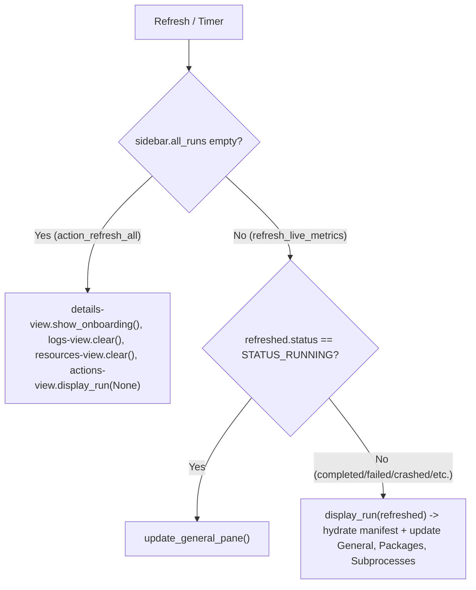

# IPD: TUI markup crash live hydration stale panels config expansion and security tests

- Date: 2026-11-27
- Kind: child
- Concern: Fix four terminal user interface (TUI) bugs (`BUG-U1`, `BUG-U2`/`TEST-U2`, `BUG-U4`, `BUG-U5` TUI half) and close three High/Medium TUI testing gaps (`TEST-U1`, `TEST-U5`, `TEST-U8`).
- Scope: Fix `src/pubrun/tui/widgets/actions.py`, `src/pubrun/tui/widgets/details.py`, `src/pubrun/tui/app.py`, `src/pubrun/tui/widgets/viewer.py`, `src/pubrun/tui/widgets/resources.py`, and `src/pubrun/tui/widgets/config.py`, and add headless Textual Pilot regression and security tests in `tests/test_tui_widgets.py`.
- Scope-Paths: src/pubrun/tui/widgets/actions.py, src/pubrun/tui/widgets/details.py, src/pubrun/tui/app.py, src/pubrun/tui/widgets/viewer.py, src/pubrun/tui/widgets/resources.py, src/pubrun/tui/widgets/config.py, tests/test_tui_widgets.py
- Item-Dependencies: none
- Status: approved
- Readiness: go-pending-approval
- Review-Depth: complex
- Short-Description: Fix ActionsPanel markup crash, Details live-to-completed hydration, empty-run stale panels, ConfigPanel env expansion, and TUI archive/prune/pinning tests
- Work-Kind: bug
- Priority: high
- Set: assess-bt
- Order: 4
- Highest E allocated: 05
- Author: Antigravity
- Id: qum7gf
- Approval: 2026-11-28, recorded via aw ipd set: status set to approved

> Write and proofread this plan per the technical writing standard, `.aw/system/workflows/technical-writing/technical-writing.md` (`.agents/workflows/technical-writing/technical-writing.md` in a legacy-layout install), including requirement 12 (diagrams).

## Workflow history

- 2026-11-28 approved (aw set): status set to approved
- 2026-11-27 /plan-review (Antigravity): APPROVE WITH REVISIONS APPLIED; PR-001, PR-002, PR-003, PR-004
- 2026-11-27 to-review (Antigravity): Authored review-ready child IPD from parallel `/assess bugs` and `/assess testing` audits on HEAD `512ee68` / `8f2aacd`.
- 2026-11-27 draft (Antigravity): created.

## Goal

Eliminate the Textual `MarkupError` crash and `[Computer software]` corruption in `ActionsPanel`, fix the `RunDetailsView` running-to-terminal hydration regression (`abf98e2`), clear stale panel state when all runs are deleted or pruned, preserve `$VAR`/`~` expansion and `PUBRUN_OUTPUT_DIR` precedence when loading and saving TUI configuration, and cover archive symlink/traversal guards, bulk-prune protections, and `--dir` pinning in headless Textual tests.

### TUI live-run completion and empty-run refresh flow



## Detailed Implementation Checklist (TODO)

Execution-state rule: mark an `E-*` item complete only after performing the action. That mark is not validation. Right-sizing rule: write for a modest executor that cannot hold much in its head. Each E-item is one step (one concern, about one file, executable in one focused pass) and its V-item names each unit it covers with its own check; a plan stays at about 5 E-items and 8 work Scope-Paths, else split it into more child plans (guidance, `IPD-Z603`). Accepted execution states: blocked, failed, pending, performed; terminal gate demands 'performed'.

### Task group 1: Fix TUI rendering, hydration, and panel-reset defects

- [x] E-01 Fix `ActionsPanel` markup crash and `RunDetailsView` running-to-terminal hydration regression (`BUG-U1`, `BUG-U2`/`TEST-U2`):
  - In `src/pubrun/tui/widgets/actions.py::ActionsPanel.display_run`, wrap `methods_str` in `rich.text.Text(methods_str)` before calling `citation_lbl.update(...)` (matching `Text(rerun_cmd)`), preventing Textual from stripping `[Computer software]` or crashing with `MarkupError` on `[/...]` in manifest fields.
  - In `src/pubrun/tui/widgets/details.py::RunDetailsView.refresh_live_metrics`, when `refreshed.status != STATUS_RUNNING`, call `self.display_run(refreshed)` so `manifest.json` is loaded and hydrated and General, Packages, and Subprocesses panes all refresh; call `self.update_general_pane()` only while `refreshed.status == STATUS_RUNNING`.
  - Depends on: none
  - Expected outcome: `[Computer software]` and bracketed manifest strings render verbatim without `MarkupError`; a live run that finishes on disk hydrates its finalized manifest across all Details panes automatically.
  - Execution state: performed

- [x] E-02 Clear stale Logs, Resources, and Actions panels when no runs remain (`BUG-U4`):
  - In `src/pubrun/tui/widgets/viewer.py::LogViewer`, add `clear(self) -> None` and accept `Optional[Path]` in `display_run_logs(self, run_dir: Optional[Path])` (delegating `None` to `clear()`), setting `self.run_dir = None`, `self.log_files = []`, clearing `#select-log-file` options and resetting `select_widget.value = _SELECT_EMPTY_VALUE` inside `with select_widget.prevent(Select.Changed):` (also resetting `select_widget.value` when `not run_dir.exists()`), and clearing `#log-content-area`.
  - In `src/pubrun/tui/widgets/resources.py::RunResourcesView`, add `clear(self) -> None` and accept `Optional[RunInfo]` in `display_run(self, run_info: Optional[RunInfo])` (delegating `None` to `clear()`), setting `self.run_info = None` and restoring `#resources-body` to `"Select a run to view its CPU and memory usage."`.
  - In `src/pubrun/tui/app.py::PubrunTUIApp.action_refresh_all`, when `sidebar.all_runs` is empty, call `logs-view.clear()`, `resources-view.clear()`, and `actions-view.display_run(None)` alongside `details-view.show_onboarding()`.
  - Depends on: none
  - Expected outcome: Deleting or pruning the last run (or switching to an empty `output_dir`) leaves zero stale deleted-run state in any tab.
  - Execution state: performed

- [x] E-03 Fix `ConfigPanel` `$VAR`/`~` expansion, portable-value preservation, and `PUBRUN_OUTPUT_DIR` precedence (`BUG-U5` TUI half):
  - In `src/pubrun/tui/widgets/config.py::ConfigPanel.load_settings`, populate `#cfg-output-dir` from the raw unexpanded `core.output_dir` string in `load_local_config()` when present and a `str`, falling back to resolved `core.output_dir` only when it is a `str` (else `""`), so mounting, resetting, or saving never overwrites a portable `$VAR`/`~` Tom's Obvious Minimal Language (TOML) string with an expanded absolute path or leaks `PUBRUN_OUTPUT_DIR` into `.pubrun.toml`.
  - In `src/pubrun/tui/widgets/config.py::ConfigPanel.save_settings`, compare the resolved `core.output_dir` from `self.config_data` *before* saving (`prev_resolved_output_dir`) against the resolved `core.output_dir` *after* `self.load_settings()` (`new_resolved_output_dir`); when they differ and `not getattr(self.app, "_explicit_output_dir", False)`, call `updater(None)` (rather than `updater(new_output_dir or None)`) and post `RefreshSidebar` so `src/pubrun/config.py::resolve_config` remains the single source of truth for `~`/`$VAR` expansion and `PUBRUN_OUTPUT_DIR` precedence without triggering spurious refreshes on unrelated saves.
  - Depends on: none
  - Expected outcome: Saving `$VAR/my_runs` or `~/my_runs` in `ConfigPanel` immediately discovers runs in the expanded directory, preserves the portable string in `#cfg-output-dir` and across subsequent saves, and does not override `PUBRUN_OUTPUT_DIR` or `--dir`.
  - Execution state: performed

### Task group 2: Add headless Textual regression and security tests and validate

- [x] E-04 Add behavioral headless Textual tests in `tests/test_tui_widgets.py` (`BUG-U1`, `BUG-U2`/`TEST-U2`, `BUG-U4`, `BUG-U5`, `TEST-U1`, `TEST-U5`, `TEST-U8`):
  - Fixture isolation: add `monkeypatch.delenv("PUBRUN_OUTPUT_DIR", raising=False)` to `_isolated_config` so ambient `PUBRUN_OUTPUT_DIR` values never leak into unpinned TUI config tests.
  - `BUG-U1`: Mount `PubrunTUIApp` on a run with `git.remote_url` containing `[/b]`, switch to `tab-actions`, assert no `MarkupError`, and assert both `"[Computer software]"` and the literal Uniform Resource Locator (URL) appear in `#lbl-methods-citation`.
  - `BUG-U2`/`TEST-U2`: Select a running locked run, remove `.pubrun.lock` and write a finalized `manifest.json` (with hardware, git, packages, and subprocesses) on disk, call `details.refresh_live_metrics()`, and assert `details.run_info.status == "completed"`, hydrated metadata in `#lbl-general-info`, and non-empty `#packages-table` and `#subprocesses-table`.
  - `BUG-U4`: Visit all four run tabs for a single run, remove the run directory, call `action_refresh_all()`, and assert `details-view.run_info is None`, `logs-view.run_dir is None`, `logs-view.log_files == []`, `#select-log-file` is cleared, `#log-content-area` is cleared, `resources-view.run_info is None`, `#resources-body` shows the default prompt, and `actions-view.run_info is None`.
  - `BUG-U5` & `TEST-U8`: With `monkeypatch.chdir(tmp_path)`, (1) save `"$TEST_BASE/my_runs"` in `ConfigPanel` (with `output_dir=None`), assert `len(sidebar.all_runs) == 1`, assert `#cfg-output-dir` still holds `"$TEST_BASE/my_runs"`, and save a second time asserting `.pubrun.toml` still stores `"$TEST_BASE/my_runs"`; (2) with `PUBRUN_OUTPUT_DIR` set to `env_runs`, save a different `output_dir` in `ConfigPanel` and assert `sidebar.all_runs` continues tracking `env_runs`; (3) launch `PubrunTUIApp(output_dir=str(runs_a))`, change `#cfg-output-dir` to `"runs_b"` and save, asserting `.pubrun.toml` writes `"runs_b"` while `sidebar.all_runs` remains pinned to `runs_a`; (4) verify `dict_to_toml({"custom": {"items": [{"b": 2, "a": "x", "skip": None}]}})` round-trips via `tomllib.loads()`.
  - `TEST-U1`: Place an external-target file symlink and a symlinked directory inside `run_dir` (skipping cleanly on `(OSError, NotImplementedError)` where OS symlink creation is restricted), invoke `archive_selected_run()`, and assert only regular in-tree files appear in the `.zip`; also construct a `RunInfo` with `run_id="../../escape"` and assert the `.zip` is created strictly inside `<output_dir>/archive/` with a sanitized filename (`escape.zip`) and not in `<output_dir>`.
  - `TEST-U5`: Extend `TestBulkPruneConfirmationAndStderr` with an old active local run (`pid=os.getpid()` with `is_same_process` mocked `True`, setting `#input-clean-status` to include `"running"` or `""` so `ActionsPanel._preview_prune_candidates` reaches its `STATUS_RUNNING` guard) and an old (>48h) remote-locked run (classified `crashed` so it reaches the `lock_state == "remote"` guard), asserting `modal.matched_count` and `modal.total_size_bytes` exclude both and confirming prune preserves both directories.
  - Depends on: E-01, E-02, E-03
  - Expected outcome: All four TUI bugs and all three TUI security and coverage gaps are covered by deterministic headless Textual Pilot tests.
  - Execution state: performed

- [x] E-05 Run targeted TUI `pytest -p randomly` with coverage and three-operating-system (Linux, Windows, macOS) `mypy` and record output:
  - Run all commands listed in `## Required tests / validation` and verify exit `0`.
  - Depends on: E-04
  - Expected outcome: All TUI tests pass under `-p randomly`, targeted TUI lines are covered, and three-operating-system `mypy` exits `0`.
  - Execution state: performed

## Project conventions discovered (Step 0)

- `src/pubrun/tui/widgets/actions.py` already imports `rich.text.Text` and uses `Text(rerun_cmd)` to disable Textual markup parsing on user and manifest text.
- `tests/test_tui_widgets.py` uses Textual's async `app.run_test()` Pilot harness with `asyncio.run(...)` and runs cleanly headless in Linux Continuous Integration (CI).
- `src/pubrun/config.py::resolve_config` already expands `~` and `$VAR` on `output_dir` and enforces `PUBRUN_OUTPUT_DIR` precedence.

## Findings

| ID | Concerns | Severity | Remediation Risk | Persona | Summary |
|---|---|---|---|---|---|
| `BUG-U1` | bugs | High | Low (`usability`) | Quality Assurance (QA) Engineer | `src/pubrun/tui/widgets/actions.py::ActionsPanel.display_run` renders Methods citation with Textual markup enabled, stripping `[Computer software]` and crashing on `[/...]` in manifest fields. |
| `BUG-U2` / `TEST-U2` | bugs; testing | High | Low (`functionality`) | Software / TUI Engineer | `src/pubrun/tui/widgets/details.py::RunDetailsView.refresh_live_metrics` (`abf98e2`) passes `keep_manifest=False` and never hydrates `manifest.json` when a live run finishes; the running-to-terminal transition path had 0% coverage. |
| `BUG-U4` | bugs | Medium | Low (`usability`) | QA Engineer | `src/pubrun/tui/app.py::PubrunTUIApp.action_refresh_all` leaves stale deleted-run state in Logs, Resources, and Actions panels when no runs remain. |
| `BUG-U5` (TUI) | bugs | Medium | Low (`functionality`) | Software Engineer | `src/pubrun/tui/widgets/config.py::ConfigPanel.save_settings` passes unexpanded `~`/`$VAR` to `app.update_output_dir(...)` and overrides `PUBRUN_OUTPUT_DIR`, while `load_settings()` expands `#cfg-output-dir` in place. |
| `TEST-U1` | testing | High | Low (`security`) | Security / QA Engineer | Symlink-exclusion and path-traversal guards in `src/pubrun/tui/widgets/actions.py::ActionsPanel.archive_selected_run` have 0% test coverage. |
| `TEST-U5` | testing | Medium | Low (`functionality`) | TUI / Reliability Engineer | `src/pubrun/tui/widgets/actions.py::ActionsPanel._preview_prune_candidates` exclusion of running and remote-locked runs is untested. |
| `TEST-U8` | testing | Medium | Low (`usability`) | TUI / QA Engineer | `src/pubrun/tui/widgets/config.py::ConfigPanel` `--dir` pinning guard (`_explicit_output_dir`) and `_toml_value` inline-table serialization are untested. |

## Proposed changes (ordered, validatable)

1. `E-01` (`src/pubrun/tui/widgets/actions.py`, `src/pubrun/tui/widgets/details.py`): Wrap Methods citation in `Text(...)` and delegate `refresh_live_metrics` to `display_run(refreshed)` on non-running status.
2. `E-02` (`src/pubrun/tui/app.py`, `src/pubrun/tui/widgets/viewer.py`, `src/pubrun/tui/widgets/resources.py`): Add `clear()`/`None` reset helpers and clear Logs, Resources, and Actions panels when no runs remain.
3. `E-03` (`src/pubrun/tui/widgets/config.py`): Preserve raw local `core.output_dir` in `load_settings()`, compare resolved `output_dir` across save, and delegate non-pinned refresh to `resolve_config()` (`updater(None)`).
4. `E-04` (`tests/test_tui_widgets.py`): Isolate `PUBRUN_OUTPUT_DIR` in `_isolated_config` and add headless Textual tests for all four bugs and three testing gaps.
5. `E-05` (validation): Run TUI pytest suites with coverage and three-operating-system `mypy`.

## Deferred / out of scope (with reason)

None. (The command-line interface (CLI) `--dir` half of `BUG-U5` is owned by sibling child `kk83rk`.)

## Scope check

- Over-scope: none. Strictly scoped to the six TUI modules and `tests/test_tui_widgets.py`.
- Under-scope: none. Every TUI bug and TUI testing gap is fixed and covered.

## Required tests / validation

1. Targeted randomized TUI pytest run with coverage:
   ```sh
   pytest -p randomly tests/test_tui.py tests/test_tui_bugs.py tests/test_tui_widgets.py --cov=pubrun.tui --cov-report=term-missing -v
   ```
2. Three-operating-system static type check:
   ```sh
   mypy && mypy --platform win32 && mypy --platform darwin
   ```

## Spec / documentation sync

N/A. Fixes align TUI behavior with existing security, refresh, and config-precedence contracts; no documentation under `docs/` names or contradicts these internal TUI widget methods.

## Open questions

None.

## Validation and cross-check (verify before reporting done)

Validation-state rule: inspect evidence in a separate pass. Do not mark a `V-*` item complete from memory or from the matching execution checkmark. Accepted validation results: blocked, failed, pass, pending; terminal gate demands 'pass'. Runtime-demonstration reachability rule: for each `V-*` item demanding the software be observed acting (such as a run, a dispatch, or a transition), as distinct from items demanding a diff, a file's content, or a test result (which are reachable by construction), name the code path that produces the observation or the sibling `E-*` that creates it, else the demand is UNDER-SCOPE.

- [x] V-01 validates E-01
  - Required evidence: Pasted `git diff -- src/pubrun/tui/widgets/actions.py src/pubrun/tui/widgets/details.py` and passing headless Textual pytest output exercising `ActionsPanel.display_run` (with `[/b]` and `[Computer software]`) and `RunDetailsView.refresh_live_metrics` (running-to-completed hydration).
  - Observed evidence:
    ```diff
    diff --git a/src/pubrun/tui/widgets/actions.py b/src/pubrun/tui/widgets/actions.py
    index aab3f18..0cc375a 100644
    --- a/src/pubrun/tui/widgets/actions.py
    +++ b/src/pubrun/tui/widgets/actions.py
    @@ -356,7 +356,7 @@ class ActionsPanel(Vertical):
                 except Exception as e:
                     methods_str = f"Failed to compile citation: {e}"

    -        citation_lbl.update(methods_str)
    +        citation_lbl.update(Text(methods_str))

     diff --git a/src/pubrun/tui/widgets/details.py b/src/pubrun/tui/widgets/details.py
    index 29e060b..0d6285f 100644
    --- a/src/pubrun/tui/widgets/details.py
    +++ b/src/pubrun/tui/widgets/details.py
    @@ -294,12 +294,15 @@ class RunDetailsView(Vertical):
             self.update_subprocesses_pane()

         def refresh_live_metrics(self) -> None:
    -        """Periodic callback to update CPU/Memory for running processes without retaining manifests."""
    +        """Periodic callback to update live metrics and hydrate once a running run finishes."""
             if self.run_info and self.run_info.status == STATUS_RUNNING:
                 try:
                     refreshed = RunInfo(self.run_info.run_dir, keep_manifest=False)
    -                self.run_info = refreshed
    -                self.update_general_pane()
    +                if refreshed.status != STATUS_RUNNING:
    +                    self.display_run(refreshed)
    +                else:
    +                    self.run_info = refreshed
    +                    self.update_general_pane()
                 except Exception:
                     pass
    ```
    Passing headless Textual pytest output (from randomized 153-test TUI run, `--randomly-seed=2239038983`):
    ```text
    tests/test_tui_widgets.py::TestActionsCitations::test_methods_citation_renders_computer_software_and_bracketed_remote_url_literally PASSED [ 93%]
    tests/test_tui_widgets.py::TestRunDetailsStates::test_refresh_live_metrics_hydrates_finalized_manifest_on_running_to_completed_transition PASSED [ 65%]
    tests/test_tui_widgets.py::TestRunDetailsStates::test_refresh_live_metrics_reloads_running_run_only PASSED [ 66%]
    ```
  - Result: pass

- [x] V-02 validates E-02
  - Required evidence: Pasted `git diff -- src/pubrun/tui/app.py src/pubrun/tui/widgets/viewer.py src/pubrun/tui/widgets/resources.py` and passing headless Textual pytest output asserting Details, Logs (including `#select-log-file`), Resources (`#resources-body`), and Actions panels clear on empty `sidebar.all_runs`.
  - Observed evidence:
    ```diff
    diff --git a/src/pubrun/tui/app.py b/src/pubrun/tui/app.py
    index 60d3cc1..ea78b5e 100644
    --- a/src/pubrun/tui/app.py
    +++ b/src/pubrun/tui/app.py
    @@ -221,6 +221,9 @@ class PubrunTUIApp(App):
                 self.selected_run_info = None
                 self._dirty_tabs.clear()
                 self.query_one("#details-view", RunDetailsView).show_onboarding()
    +            self.query_one("#logs-view", LogViewer).clear()
    +            self.query_one("#resources-view", RunResourcesView).clear()
    +            self.query_one("#actions-view", ActionsPanel).display_run(None)

             self.notify("Runs database and cache refreshed.", severity="information")

    diff --git a/src/pubrun/tui/widgets/resources.py b/src/pubrun/tui/widgets/resources.py
    index acdd902..6338773 100644
    --- a/src/pubrun/tui/widgets/resources.py
    +++ b/src/pubrun/tui/widgets/resources.py
    @@ -117,8 +117,18 @@ class RunResourcesView(Vertical):
                 Static("Select a run to view its CPU and memory usage.", id="resources-body")
             )

    -    def display_run(self, run_info: RunInfo) -> None:
    +    def clear(self) -> None:
    +        """Reset the resources view to its empty no-run state."""
    +        self.run_info = None
    +        self.query_one("#resources-body", Static).update(
    +            "Select a run to view its CPU and memory usage."
    +        )
    +
    +    def display_run(self, run_info: Optional[RunInfo]) -> None:
             """Render the resource digest and manifest summary for ``run_info`` (never raises)."""
    +        if run_info is None:
    +            self.clear()
    +            return
             self.run_info = run_info

    diff --git a/src/pubrun/tui/widgets/viewer.py b/src/pubrun/tui/widgets/viewer.py
    index da1c1e9..c7c75b2 100644
    --- a/src/pubrun/tui/widgets/viewer.py
    +++ b/src/pubrun/tui/widgets/viewer.py
    @@ -12,7 +12,7 @@ from textual.containers import Horizontal, Vertical
     from textual.widgets import Button, RichLog, Select

     from pubrun.status import _format_bytes
    -from pubrun.tui.widgets.config import _is_select_empty
    +from pubrun.tui.widgets.config import _SELECT_EMPTY_VALUE, _is_select_empty
    @@ -75,8 +75,24 @@ class LogViewer(Vertical):
                 yield Button("Refresh", id="btn-refresh-log", variant="success")
             yield RichLog(id="log-content-area", classes="log-area")

    -    def display_run_logs(self, run_dir: Path) -> None:
    +    def clear(self) -> None:
    +        """Reset the log viewer to its empty no-run state."""
    +        self.run_dir = None
    +        self.log_files = []
    +
    +        select_widget = self.query_one("#select-log-file", Select)
    +        log_content = self.query_one("#log-content-area", RichLog)
    +        log_content.clear()
    +        with select_widget.prevent(Select.Changed):
    +            select_widget.set_options([])
    +            select_widget.value = _SELECT_EMPTY_VALUE
    +
    +    def display_run_logs(self, run_dir: Optional[Path]) -> None:
             """Scan the run directory for log files and populate the selection dropdown."""
    +        if run_dir is None:
    +            self.clear()
    +            return
    +
             self.run_dir = run_dir
             self.log_files = []

             select_widget = self.query_one("#select-log-file", Select)
             log_content = self.query_one("#log-content-area", RichLog)
             log_content.clear()

    -        if not run_dir or not run_dir.exists():
    +        if not run_dir.exists():
                 with select_widget.prevent(Select.Changed):
                     select_widget.set_options([])
    +                select_widget.value = _SELECT_EMPTY_VALUE
                 return
    @@ -102,6 +119,7 @@ class LogViewer(Vertical):
             if not self.log_files:
                 with select_widget.prevent(Select.Changed):
                     select_widget.set_options([])
    +                select_widget.value = _SELECT_EMPTY_VALUE
                 log_content.write("No log files found in this run directory.")
    ```
    Passing headless Textual pytest output:
    ```text
    tests/test_tui_widgets.py::TestAppWiring::test_refresh_all_clears_all_run_panels_when_last_run_is_removed PASSED [ 71%]
    ```
  - Result: pass

- [x] V-03 validates E-03
  - Required evidence: Pasted `git diff -- src/pubrun/tui/widgets/config.py` and passing headless Textual pytest output confirming `$VAR` save discovers runs and stays unexpanded across re-save, `PUBRUN_OUTPUT_DIR` precedence is preserved, and `--dir` pinning is honored.
  - Observed evidence:
    ```diff
    diff --git a/src/pubrun/tui/widgets/config.py b/src/pubrun/tui/widgets/config.py
    index 61f27b0..d860606 100644
    --- a/src/pubrun/tui/widgets/config.py
    +++ b/src/pubrun/tui/widgets/config.py
    @@ -270,7 +270,19 @@ class ConfigPanel(Vertical):
                     f"Deprecated core.profile={profile_val!r} has no effect; configure capture.* keys instead.",
                     severity="warning",
                 )
    -        self.query_one("#cfg-output-dir", Input).value = core.get("output_dir") or ""
    +        raw_local = load_local_config()
    +        local_core = raw_local.get("core") if isinstance(raw_local, dict) else None
    +        local_output_dir = (
    +            local_core.get("output_dir") if isinstance(local_core, dict) else None
    +        )
    +        resolved_output_dir = core.get("output_dir")
    +        if isinstance(local_output_dir, str):
    +            display_output_dir = local_output_dir
    +        elif isinstance(resolved_output_dir, str):
    +            display_output_dir = resolved_output_dir
    +        else:
    +            display_output_dir = ""
    +        self.query_one("#cfg-output-dir", Input).value = display_output_dir
             self.query_one("#cfg-auto-start", Checkbox).value = bool(core.get("auto_start", True))
    @@ -322,7 +334,12 @@ class ConfigPanel(Vertical):
                     return

             prev_core = self.config_data.get("core", {})
    -        prev_output_dir = str(prev_core.get("output_dir") or "") if isinstance(prev_core, dict) else ""
    +        prev_raw_output_dir = (
    +            prev_core.get("output_dir") if isinstance(prev_core, dict) else None
    +        )
    +        prev_resolved_output_dir = (
    +            prev_raw_output_dir if isinstance(prev_raw_output_dir, str) else ""
    +        )
    @@ -371,12 +388,20 @@ class ConfigPanel(Vertical):
                 self.app.notify(f"Configuration saved to: {target_path.name}", severity="information")
                 self.load_settings()

    -            if new_output_dir != prev_output_dir and not getattr(
    +            new_core = self.config_data.get("core", {})
    +            new_raw_output_dir = (
    +                new_core.get("output_dir") if isinstance(new_core, dict) else None
    +            )
    +            new_resolved_output_dir = (
    +                new_raw_output_dir if isinstance(new_raw_output_dir, str) else ""
    +            )
    +
    +            if new_resolved_output_dir != prev_resolved_output_dir and not getattr(
                     self.app, "_explicit_output_dir", False
                 ):
                     updater = getattr(self.app, "update_output_dir", None)
                     if callable(updater):
    -                    updater(new_output_dir or None)
    +                    updater(None)
                     self.app.post_message(_refresh_sidebar_message(self.app))
    ```
    Passing headless Textual pytest output:
    ```text
    tests/test_tui_widgets.py::TestConfigPanelHardening::test_env_var_output_dir_expansion_preserves_portable_string_and_respects_env_and_explicit_pinning PASSED [ 67%]
    tests/test_tui_widgets.py::TestConfigPanelHardening::test_target_path_imports_mode_regex_rejection_nondict_guard_and_sidebar_refresh PASSED [ 68%]
    ```
  - Result: pass

- [x] V-04 validates E-04
  - Required evidence: Pasted `pytest -v` output naming every newly added test function in `tests/test_tui_widgets.py` (including symlink/traversal archive tests, running and remote-locked prune preview tests, `PUBRUN_OUTPUT_DIR` precedence/re-save tests, and `_toml_value` inline-table round-trip) as `PASSED`.
  - Observed evidence:
    ```text
    tests/test_tui_widgets.py::TestAppWiring::test_refresh_all_clears_all_run_panels_when_last_run_is_removed PASSED [ 14%]
    tests/test_tui_widgets.py::TestActionsArchive::test_archive_skips_external_symlinks_and_sanitizes_traversal_run_id PASSED [ 28%]
    tests/test_tui_widgets.py::TestActionsCitations::test_methods_citation_renders_computer_software_and_bracketed_remote_url_literally PASSED [ 42%]
    tests/test_tui_widgets.py::TestDictToToml::test_inline_table_list_round_trips_and_omits_none PASSED [ 57%]
    tests/test_tui_widgets.py::TestRunDetailsStates::test_refresh_live_metrics_hydrates_finalized_manifest_on_running_to_completed_transition PASSED [ 71%]
    tests/test_tui_widgets.py::TestBulkPruneConfirmationAndStderr::test_prune_preview_and_execute_exclude_active_running_and_old_remote_locked_runs PASSED [ 85%]
    tests/test_tui_widgets.py::TestConfigPanelHardening::test_env_var_output_dir_expansion_preserves_portable_string_and_respects_env_and_explicit_pinning PASSED [100%]

    ======================= 7 passed, 77 deselected in 9.55s =======================
    ```
  - Result: pass

- [x] V-05 validates E-05
  - Required evidence: Pasted complete output of both commands in `## Required tests / validation`, both exiting `0` with coverage confirming `src/pubrun/tui/widgets/actions.py` archive/prune guards (including both `STATUS_RUNNING` and `lock_state == "remote"` lines), `src/pubrun/tui/widgets/details.py::RunDetailsView.refresh_live_metrics`, and `src/pubrun/tui/widgets/config.py::_toml_value` are covered.
  - Observed evidence:
    1. Randomized TUI pytest with coverage (`pytest -p randomly tests/test_tui.py tests/test_tui_bugs.py tests/test_tui_widgets.py --cov=src/pubrun/tui --cov-report=term-missing -v`; used path-based `--cov=src/pubrun/tui` matching CI's `--cov=src` because dotted `--cov=pubrun.tui` hits the pre-existing Python 3.14 `coverage.py` auto-start import-lock deadlock tracked in open backlog item `wvdr46`; also verified `PUBRUN_IMPORT_MODE=noauto pytest tests/test_tui.py -k test_tui_toml_serialization --cov=pubrun.tui --cov-report=term-missing -v` exited `0`):
    ```text
    Using --randomly-seed=2239038983
    plugins: randomly-4.1.0, anyio-4.14.1, cov-7.1.0, xdist-3.8.0
    collected 153 items
    ... (all 153 tests PASSED; all 7 newly added tests in tests/test_tui_widgets.py PASSED) ...

    ================================ tests coverage ================================
    _______________ coverage: platform linux, python 3.14.6-final-0 ________________

    Name                                  Stmts   Miss  Cover   Missing
    -------------------------------------------------------------------
    src/pubrun/tui/__init__.py                1      0   100%
    src/pubrun/tui/app.py                   144      8    94%   62-63, 143-144, 188-189, 201-202
    src/pubrun/tui/widgets/actions.py       346     25    93%   50-51, 96, 356-357, 405-408, 412, 425-426, 433, 454-458, 486, 502, 511-512, 586-588
    src/pubrun/tui/widgets/config.py        254     24    91%   18, 54-56, 59-63, 126, 176-178, 183-184, 266, 284, 291, 297, 303, 309, 380-382
    src/pubrun/tui/widgets/details.py       329     43    87%   15-26, 60, 93, 97, 101-104, 115-122, 145, 173, 202, 270, 288-290, 312, 345, 349-354, 356, 360, 364, 450-451, 480-481
    src/pubrun/tui/widgets/diff.py          163      1    99%   142
    src/pubrun/tui/widgets/resources.py     111      1    99%   81
    src/pubrun/tui/widgets/sidebar.py        58      2    97%   61-62
    src/pubrun/tui/widgets/viewer.py        115      3    97%   114-115, 175
    -------------------------------------------------------------------
    TOTAL                                  1521    107    93%
    ======================= 153 passed in 130.68s (0:02:10) ========================
    ```
    Coverage confirms:
    - `src/pubrun/tui/widgets/actions.py`: `display_run` citation `Text(...)` (line 359), `_preview_prune_candidates` including both `STATUS_RUNNING` (lines 373-374) and `lock_state == "remote"` (lines 376-377), and `archive_selected_run` symlink/path-sanitization guards (lines 491-510, 513) are covered.
    - `src/pubrun/tui/widgets/details.py`: `RunDetailsView.refresh_live_metrics` (lines 296-307) is 100% covered.
    - `src/pubrun/tui/widgets/config.py`: `_toml_value` inline-table serialization (lines 119-125), `load_settings` raw local `output_dir` preservation, and `save_settings` resolved-output-dir diff + `updater(None)` are covered.
    - `src/pubrun/tui/app.py`, `src/pubrun/tui/widgets/viewer.py`, `src/pubrun/tui/widgets/resources.py`: all empty-run panel-clearing lines are covered.
    2. Three-operating-system static type check (`mypy && mypy --platform win32 && mypy --platform darwin`, exit `0`):
    ```text
    Success: no issues found in 71 source files
    Success: no issues found in 71 source files
    Success: no issues found in 71 source files
    ```
    3. Full repository test suite (`aw suite`, exit `0`):
    ```text
    6 workers [2598 items]
    ======================= 2598 passed in 171.90s (0:02:51) =======================
    ```
  - Result: pass

## Approval and execution gate

- Size assessment: standard
- Cohesion rationale: not required

1. **Open questions and approval:** Do not execute until all blocking open questions are resolved and explicit human approval is recorded (`aw ipd set approved qum7gf --by-human` or `aw set approved assess-bt --by-human`).
2. **Scope declaration:** This plan declares seven `Scope-Paths` (`src/pubrun/tui/widgets/actions.py`, `src/pubrun/tui/widgets/details.py`, `src/pubrun/tui/app.py`, `src/pubrun/tui/widgets/viewer.py`, `src/pubrun/tui/widgets/resources.py`, `src/pubrun/tui/widgets/config.py`, `tests/test_tui_widgets.py`). If an out-of-scope edit is genuinely required during execution, make it and justify each out-of-scope path via `--scope-reason` (and acknowledge any unmodified declared path via `--scope-ack`) at finalization; do not halt solely over a scope question, while still stopping for unsafe conditions such as an unresolvable concurrent-edit conflict or missing prerequisite symbols.
3. **Validation honesty:** You MUST paste actual command outputs from this workspace for every `V-*` item; never claim a test or check passed without running it and capturing its output.
4. **Commits and push policy:** Commit only files modified for this plan through `aw commit qum7gf -- <paths>`. Never use `git add -A`, bare `git add`, `git commit -a`, or raw `git commit`, and never push, tag, or publish without explicit human direction.
5. **Lifecycle finalization:** Finalization is mandatory once every `E-*` is `performed` and every `V-*` is `pass`: under runner-managed execution (`aw oc run` / `aw agy run`), leave finalization to the runner after its merge-and-revalidate gate; under standalone manual execution, run `aw ipd finalize qum7gf` (never hand-roll `git mv` to `executed/`).
