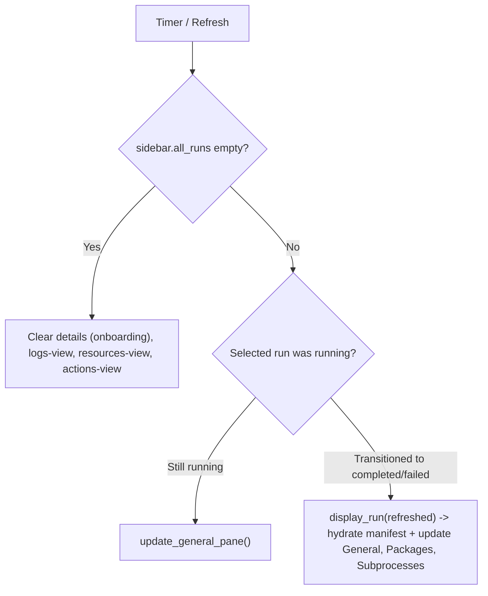

# IPD: TUI markup crash live hydration stale panels config expansion and security tests

- Date: 2026-11-27
- Kind: child
- Concern: Fix four TUI bugs (`BUG-U1`, `BUG-U2`/`TEST-U2`, `BUG-U4`, `BUG-U5` TUI half) and close three high/medium TUI testing gaps (`TEST-U1`, `TEST-U5`, `TEST-U8`).
- Scope: Fix `src/pubrun/tui/widgets/actions.py`, `src/pubrun/tui/widgets/details.py`, `src/pubrun/tui/app.py`, `src/pubrun/tui/widgets/viewer.py`, `src/pubrun/tui/widgets/resources.py`, and `src/pubrun/tui/widgets/config.py`, and add headless Textual Pilot regression and security tests in `tests/test_tui_widgets.py`.
- Scope-Paths: src/pubrun/tui/widgets/actions.py, src/pubrun/tui/widgets/details.py, src/pubrun/tui/app.py, src/pubrun/tui/widgets/viewer.py, src/pubrun/tui/widgets/resources.py, src/pubrun/tui/widgets/config.py, tests/test_tui_widgets.py
- Item-Dependencies: none
- Status: to-review
- Short-Description: Fix ActionsPanel markup crash, Details live-to-completed hydration, empty-run stale panels, ConfigPanel env expansion, and TUI archive/prune/pinning tests
- Work-Kind: bug
- Priority: high
- Set: assess-bt
- Order: 4
- Highest E allocated: 05
- Author: Antigravity
- Id: qum7gf

> Write and proofread this plan per the technical writing standard, `.aw/system/workflows/technical-writing/technical-writing.md` (`.agents/workflows/technical-writing/technical-writing.md` in a legacy-layout install), including requirement 12 (diagrams).

## Workflow history

- 2026-11-27 to-review (Antigravity): Authored review-ready child IPD from parallel `/assess bugs` and `/assess testing` audits on HEAD `512ee68` / `8f2aacd`.
- 2026-11-27 draft (Antigravity): created.

## Goal

Eliminate the Textual `MarkupError` crash and `[Computer software]` corruption in `ActionsPanel`, fix the `RunDetailsView` running-to-completed hydration regression (`abf98e2`), clear stale panel state when all runs are deleted or pruned, preserve `$VAR`/`~` expansion and `PUBRUN_OUTPUT_DIR` precedence when saving TUI config, and cover archive symlink/traversal guards, bulk-prune protections, and `--dir` pinning in headless Textual tests.

### TUI live-run completion and empty-run refresh flow



## Detailed Implementation Checklist (TODO)

Execution-state rule: mark an `E-*` item complete only after performing the action. That mark is not validation. Right-sizing rule: write for a modest executor that cannot hold much in its head. Each E-item is one step (one concern, about one file, executable in one focused pass) and its V-item names each unit it covers with its own check; a plan stays at about 5 E-items and 8 work Scope-Paths, else split it into more child plans (guidance, `IPD-Z603`). Accepted execution states: blocked, failed, pending, performed; terminal gate demands 'performed'.

### Task group 1: Fix TUI rendering, hydration, and panel-reset defects

- [ ] E-01 Fix `ActionsPanel` markup crash and `RunDetailsView` running-to-completed hydration regression (`BUG-U1`, `BUG-U2`/`TEST-U2`):
  - In `src/pubrun/tui/widgets/actions.py::ActionsPanel.display_run`, wrap `methods_str` in `rich.text.Text(methods_str)` before calling `citation_lbl.update(...)` (matching `Text(rerun_cmd)`), preventing Textual from stripping `[Computer software]` or crashing with `MarkupError` on `[/...]` in manifest fields.
  - In `src/pubrun/tui/widgets/details.py::RunDetailsView.refresh_live_metrics`, when `refreshed.status != STATUS_RUNNING`, call `self.display_run(refreshed)` so `manifest.json` is loaded/hydrated and General, Packages, and Subprocesses panes all refresh; call `self.update_general_pane()` only while `refreshed.status == STATUS_RUNNING`.
  - Depends on: none
  - Expected outcome: `[Computer software]` and bracketed manifest strings render verbatim without `MarkupError`; a live run that completes on disk hydrates its finalized manifest across all Details panes automatically.
  - Execution state: pending

- [ ] E-02 Clear stale Logs, Resources, and Actions panels when no runs remain (`BUG-U4`):
  - Add clean reset helpers (`clear()` / `display_run(None)` handling) in `src/pubrun/tui/widgets/viewer.py::LogViewer` and `src/pubrun/tui/widgets/resources.py::RunResourcesView` so `run_dir` / `run_info` become `None` and displayed content clears cleanly.
  - In `src/pubrun/tui/app.py::PubrunTUIApp.action_refresh_all`, when `sidebar.all_runs` is empty, clear `logs-view`, `resources-view`, and `actions-view` alongside `details-view.show_onboarding()`.
  - Depends on: none
  - Expected outcome: Deleting or pruning the last run (or switching to an empty `output_dir`) leaves zero stale deleted-run state in any tab.
  - Execution state: pending

- [ ] E-03 Fix `ConfigPanel.save_settings()` `$VAR`/`~` expansion and `PUBRUN_OUTPUT_DIR` precedence (`BUG-U5` TUI half):
  - In `src/pubrun/tui/widgets/config.py::ConfigPanel.save_settings`, when `not getattr(self.app, "_explicit_output_dir", False)`, call `updater(None)` rather than `updater(new_output_dir or None)` so `resolve_config()` remains the single source of truth for `~`/`$VAR` expansion and `PUBRUN_OUTPUT_DIR` precedence; also keep the raw editable `output_dir` value in `#cfg-output-dir` from the written TOML rather than silently overwriting a portable `$VAR`/`~` string with an expanded absolute path on a subsequent Save.
  - Depends on: none
  - Expected outcome: Saving `$VAR/my_runs` or `~/my_runs` in `ConfigPanel` immediately discovers runs in the expanded directory and does not clobber `PUBRUN_OUTPUT_DIR` or overwrite the portable string on re-save.
  - Execution state: pending

### Task group 2: Add headless Textual regression and security tests and validate

- [ ] E-04 Add behavioral headless Textual tests in `tests/test_tui_widgets.py` (`BUG-U1`, `BUG-U2`/`TEST-U2`, `BUG-U4`, `BUG-U5`, `TEST-U1`, `TEST-U5`, `TEST-U8`):
  - `BUG-U1`: Mount `PubrunTUIApp` on a run with `git.remote_url` containing `[/b]`, switch to `tab-actions`, assert no `MarkupError`, and assert both `"[Computer software]"` and the literal remote URL appear in `#lbl-methods-citation`.
  - `BUG-U2`/`TEST-U2`: Select a running locked run, transition it on disk to completed with a finalized `manifest.json` (hardware, git, packages, subprocesses), call `details.refresh_live_metrics()`, and assert hydrated metadata and non-empty `packages-table` / `subprocesses-table`.
  - `BUG-U4`: Visit all four run tabs for a single run, remove the run directory, call `action_refresh_all()`, and assert `logs-view.run_dir is None`, `#log-content-area` is cleared, `resources-view.run_info is None`, and `actions-view.run_info is None`.
  - `BUG-U5` & `TEST-U8`: Save `$TEST_BASE/my_runs` in `ConfigPanel` and assert `len(sidebar.all_runs) == 1`; launch `PubrunTUIApp(output_dir=str(runs_a))`, change `#cfg-output-dir` to `"runs_b"` and save, asserting `.pubrun.toml` writes `"runs_b"` while `sidebar.all_runs` remains pinned to `runs_a`; verify `dict_to_toml({"custom": {"items": [{"b": 2, "a": "x", "skip": None}]}})` round-trips via `tomllib.loads()`.
  - `TEST-U1`: Place an external-target symlink (and symlinked directory) inside `run_dir`, invoke `archive_selected_run()`, and assert only regular in-tree files appear in the `.zip`; also construct a `RunInfo` with `run_id="../../escape"` and assert the `.zip` is created strictly inside `<output_dir>/archive/` with a sanitized filename.
  - `TEST-U5`: Extend `TestBulkPruneConfirmationAndStderr` with an old active local run and an old remote-locked run, asserting `modal.matched_count` and `modal.total_size_bytes` exclude both and confirming prune preserves both directories.
  - Depends on: E-01, E-02, E-03
  - Expected outcome: All four TUI bugs and all three TUI security/coverage gaps are covered by deterministic headless Textual Pilot tests.
  - Execution state: pending

- [ ] E-05 Run targeted TUI `pytest -p randomly` with coverage and 3-OS `mypy` and record output:
  - Run all commands listed in `## Required tests / validation` and verify exit `0`.
  - Depends on: E-04
  - Expected outcome: All TUI tests pass under `-p randomly`, targeted TUI lines are covered, and 3-OS `mypy` exits `0`.
  - Execution state: pending

## Project conventions discovered (Step 0)

- `src/pubrun/tui/widgets/actions.py` already imports `rich.text.Text` and uses `Text(rerun_cmd)` to disable Textual markup parsing on user/manifest text.
- `tests/test_tui_widgets.py` uses Textual's async `app.run_test()` Pilot harness with `pytest-asyncio` / `asyncio.run(...)` and runs cleanly headless in Linux CI.
- `src/pubrun/config.py::resolve_config()` already expands `~` and `$VAR` on `output_dir` and enforces `PUBRUN_OUTPUT_DIR` precedence.

## Findings

| ID | Concerns | Severity | Remediation Risk | Persona | Summary |
|---|---|---|---|---|---|
| `BUG-U1` | bugs | High | Low (`usability`) | QA Engineer | `ActionsPanel.display_run` renders Methods citation with Textual markup enabled, stripping `[Computer software]` and crashing on `[/...]` in manifest fields. |
| `BUG-U2` / `TEST-U2` | bugs; testing | High | Low (`functionality`) | Software / TUI Engineer | `RunDetailsView.refresh_live_metrics` (`abf98e2`) passes `keep_manifest=False` and never hydrates `manifest.json` when a live run completes; function had 0% coverage. |
| `BUG-U4` | bugs | Medium | Low (`usability`) | QA Engineer | `PubrunTUIApp.action_refresh_all` leaves stale deleted-run state in Logs, Resources, and Actions panels when no runs remain. |
| `BUG-U5` (TUI) | bugs | Medium | Low (`functionality`) | Software Engineer | `ConfigPanel.save_settings()` passes unexpanded `~`/`$VAR` to `app.update_output_dir(...)` and overrides `PUBRUN_OUTPUT_DIR`. |
| `TEST-U1` | testing | High | Low (`security`) | Security / QA Engineer | Symlink-exclusion and path-traversal guards in `ActionsPanel.archive_selected_run` have 0% test coverage. |
| `TEST-U5` | testing | Medium | Low (`functionality`) | TUI / Reliability Engineer | `ActionsPanel._preview_prune_candidates` exclusion of running and remote-locked runs is untested. |
| `TEST-U8` | testing | Medium | Low (`usability`) | TUI / QA Engineer | `ConfigPanel` `--dir` pinning guard (`_explicit_output_dir`) and `_toml_value` inline-table serialization are untested. |

## Proposed changes (ordered, validatable)

1. `E-01` (`src/pubrun/tui/widgets/actions.py`, `src/pubrun/tui/widgets/details.py`): Wrap Methods citation in `Text(...)` and delegate `refresh_live_metrics` to `display_run(refreshed)` on completion.
2. `E-02` (`src/pubrun/tui/app.py`, `src/pubrun/tui/widgets/viewer.py`, `src/pubrun/tui/widgets/resources.py`): Clear Logs, Resources, and Actions panels when no runs remain.
3. `E-03` (`src/pubrun/tui/widgets/config.py`): Delegate non-pinned `output_dir` refresh to `resolve_config()` (`updater(None)`) and preserve portable `$VAR`/`~` text in the editor.
4. `E-04` (`tests/test_tui_widgets.py`): Add headless Textual tests for all four bugs and three testing gaps.
5. `E-05` (validation): Run TUI pytest suites with coverage and 3-OS `mypy`.

## Deferred / out of scope (with reason)

None. (The CLI `--dir` half of `BUG-U5` is owned by sibling child `kk83rk`.)

## Scope check

- Over-scope: none. Strictly scoped to the six TUI modules and `tests/test_tui_widgets.py`.
- Under-scope: none. Every TUI bug and TUI testing gap is fixed and covered.

## Required tests / validation

1. Targeted randomized TUI pytest run with coverage:
   ```sh
   pytest -p randomly tests/test_tui.py tests/test_tui_bugs.py tests/test_tui_widgets.py --cov=pubrun.tui --cov-report=term-missing -v
   ```
2. Three-OS static type check:
   ```sh
   mypy && mypy --platform win32 && mypy --platform darwin
   ```

## Spec / documentation sync

N/A. Fixes align TUI behavior with existing security, refresh, and config-precedence contracts.

## Open questions

None.

## Validation and cross-check (verify before reporting done)

Validation-state rule: inspect evidence in a separate pass. Do not mark a `V-*` item complete from memory or from the matching execution checkmark. Accepted validation results: blocked, failed, pass, pending; terminal gate demands 'pass'. Runtime-demonstration reachability rule: for each `V-*` item demanding the software be observed acting (such as a run, a dispatch, or a transition), as distinct from items demanding a diff, a file's content, or a test result (which are reachable by construction), name the code path that produces the observation or the sibling `E-*` that creates it, else the demand is UNDER-SCOPE.

- [ ] V-01 validates E-01
  - Required evidence: Pasted `git diff -- src/pubrun/tui/widgets/actions.py src/pubrun/tui/widgets/details.py` and passing headless Textual pytest output exercising `ActionsPanel.display_run` (with `[/b]` and `[Computer software]`) and `RunDetailsView.refresh_live_metrics` (running-to-completed hydration).
  - Observed evidence:
  - Result: pending

- [ ] V-02 validates E-02
  - Required evidence: Pasted `git diff -- src/pubrun/tui/app.py src/pubrun/tui/widgets/viewer.py src/pubrun/tui/widgets/resources.py` and passing headless Textual pytest output asserting Logs, Resources, and Actions panels clear on empty `sidebar.all_runs`.
  - Observed evidence:
  - Result: pending

- [ ] V-03 validates E-03
  - Required evidence: Pasted `git diff -- src/pubrun/tui/widgets/config.py` and passing headless Textual pytest output confirming `$VAR` save discovers runs and `--dir` pinning is honored.
  - Observed evidence:
  - Result: pending

- [ ] V-04 validates E-04
  - Required evidence: Pasted `pytest -v` output naming every newly added test function in `tests/test_tui_widgets.py` (including symlink/traversal archive tests, running/remote-locked prune preview tests, and `_toml_value` inline-table round-trip) as `PASSED`.
  - Observed evidence:
  - Result: pending

- [ ] V-05 validates E-05
  - Required evidence: Pasted complete output of both commands in `## Required tests / validation`, both exiting `0` with coverage confirming `actions.py` archive/prune guards, `details.py::refresh_live_metrics`, and `config.py::_toml_value` are covered.
  - Observed evidence:
  - Result: pending

## Approval and execution gate

- Size assessment: standard
- Cohesion rationale: not required

1. **Open questions and approval:** Do not execute until explicit human approval is recorded (`aw ipd set approved qum7gf --by-human` or `aw set approved assess-bt --by-human`).
2. **Scope declaration:** Modify only the seven declared `Scope-Paths`.
3. **Validation honesty:** Paste actual command outputs from this workspace for every `V-*` item.
4. **Commits and push policy:** Commit only files modified for this plan through `aw commit qum7gf -- <paths>`. Never push, tag, or publish.
5. **Lifecycle finalization:** Finalize via `aw ipd finalize qum7gf` (or let the runner finalize) only after every `E-*` is `performed` and every `V-*` is `pass`.
