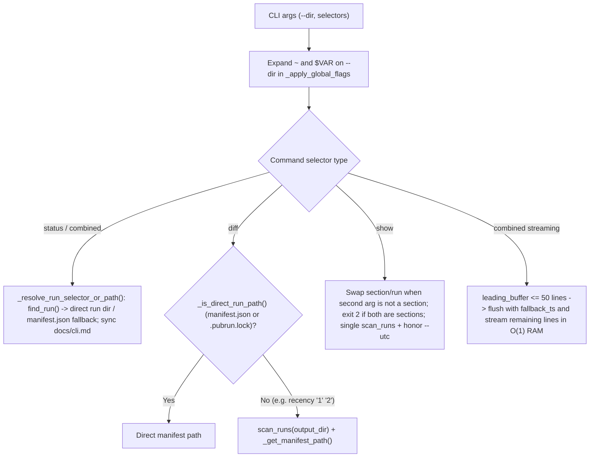

# IPD: CLI selectors combined streaming diff array rendering and diagnostics fixes

- Date: 2026-11-27
- Kind: child
- Concern: Fix command-line interface (CLI), diff-rendering, and diagnostics bugs (`BUG-U3`, `BUG-U5` CLI `--dir`, `BUG-U6`, `BUG-U7`, `BUG-U8`, `BUG-U9`, `BUG-U10`, `BUG-U11`, `BUG-U12`) and close CLI/streaming testing gaps (`TEST-U4`, `TEST-U9`).
- Scope: Fix `src/pubrun/__main__.py`, `src/pubrun/analysis/render.py`, and `src/pubrun/report/diagnostics.py`, sync `docs/cli.md` for `BUG-U3`, and add behavioral regression tests in `tests/test_cli_diff_bugs.py`, `tests/test_combined.py`, `tests/test_render.py`, `tests/test_diagnostics_seams.py`, and `tests/test_cli_negative_paths.py`.
- Scope-Paths: src/pubrun/__main__.py, src/pubrun/analysis/render.py, src/pubrun/report/diagnostics.py, docs/cli.md, tests/test_cli_diff_bugs.py, tests/test_combined.py, tests/test_render.py, tests/test_diagnostics_seams.py, tests/test_cli_negative_paths.py
- Item-Dependencies: none
- Status: approved
- Readiness: go-pending-approval
- Review-Depth: complex
- Short-Description: Fix status/combined dir paths, --dir expansion, bounded combined streaming, diff fast-path and array/ANSI render, show swap/--utc, and run signal tests
- Work-Kind: bug
- Priority: high
- Set: assess-bt
- Order: 5
- Highest E allocated: 05
- Author: Antigravity
- Id: kk83rk
- Approval: 2026-11-28, recorded via aw ipd set: status set to approved

> Write and proofread this plan per the technical writing standard, `.aw/system/workflows/technical-writing/technical-writing.md` (`.agents/workflows/technical-writing/technical-writing.md` in a legacy-layout install), including requirement 12 (diagrams).

## Workflow history

- 2026-11-28 approved (aw set): status set to approved
- 2026-11-27 reviewed (Antigravity): /plan-review (complex tier, Round 1 + Round 2 re-review after adding `docs/cli.md` to `Scope-Paths`); preserved `--last` `exit_code=1` contract, specified multiset common-first array diff and ANSI-safe truncation, clarified `leading_buffer` boundary yield and two-stage `KeyboardInterrupt` test seam, expanded validation suite, and hardened execution gate; readiness `go-pending-approval`.
- 2026-11-27 to-review (Antigravity): Authored review-ready child Implementation Plan Document (IPD) from parallel `/assess bugs` and `/assess testing` audits on HEAD `512ee68` / `8f2aacd`.
- 2026-11-27 draft (Antigravity): created.

## Goal

Restore documented CLI contracts across `status`, `combined`, `diff`, `show`, `bench`, and `resources` diagnostics (and sync `docs/cli.md` with `--help`), fix multiset array-diff mislabeling and mid-escape American National Standards Institute (ANSI) truncation in `src/pubrun/analysis/render.py`, bound `combined` streaming random-access memory (RAM) for untimestamped logs, and cover `pubrun run` signal forwarding and `combined` end-of-file (EOF) / continuation paths with behavioral tests.

### CLI selector and bounded streaming flow



## Detailed Implementation Checklist (TODO)

Execution-state rule: mark an `E-*` item complete only after performing the action. That mark is not validation. Right-sizing rule: write for a modest executor that cannot hold much in its head. Each E-item is one step (one concern, about one file, executable in one focused pass) and its V-item names each unit it covers with its own check; a plan stays at about 5 E-items and 8 work Scope-Paths, else split it into more child plans (guidance, `IPD-Z603`). Accepted execution states: blocked, failed, pending, performed; terminal gate demands 'performed'.

### Task group 1: Fix CLI selectors, streaming memory bound, show/bench contracts, and CLI docs sync

- [ ] E-01 Fix `src/pubrun/__main__.py` (`BUG-U3`, `BUG-U5` CLI, `BUG-U6`, `BUG-U7`, `BUG-U9`, `BUG-U11`, `BUG-U12`) and sync `docs/cli.md`:
  - Add `_resolve_run_selector_or_path(selector, output_dir, runs=...)` that tries `find_run(...)` first and, on `None`, expands `~`/`$VAR` on `selector` and accepts an existing run directory (or `manifest.json` file inside one) containing `manifest.json`, `.pubrun.lock`, `stdout.log`, or `stderr.log`, returning `RunInfo(candidate_dir, keep_manifest=False)`. Use it in `_run_status` and `_run_combined` (`BUG-U3`). In `_run_status(..., as_json=True)`, match `index` against `all_runs` by resolved `run_dir` path so a direct path inside `output_dir` keeps its recency index while an external path reports `index: null`. In `_run_combined`, fall back to `r.run_id or r.run_dir.name` when formatting multi-run line prefixes for log-only directories.
  - Update `docs/cli.md` lines 43-49 (`### Selecting a run`) so the selector table and explanatory paragraph state that `status` and `combined` accept a run directory path (or `manifest.json` path) alongside recency index, run-ID prefix, and directory-name substring, matching `--help` (`BUG-U3`).
  - In `_apply_global_flags`, normalize non-empty string `args.dir` with `os.path.expanduser(os.path.expandvars(args.dir))` (`BUG-U5`).
  - In `_run_combined -> _stream_log_entries`, cap `leading_buffer` at `_MAX_LEADING_UNTIMESTAMPED_LINES = 50`; once `len(leading_buffer) >= _MAX_LEADING_UNTIMESTAMPED_LINES` and another untimestamped line arrives before any timestamp, flush all buffered lines with `(fallback_ts, 0, file_idx, lead_idx, prefix + lead_line)`, clear `leading_buffer`, set `seen_first_ts = True` and `current_ts = fallback_ts`, and yield the triggering line with `(current_ts, 1, file_idx, line_idx, prefix + line_str)` so zero lines are dropped, intra-file line order is preserved, and remaining lines stream in `O(1)` RAM (`BUG-U6`).
  - In `_run_diff`, guard the two-argument direct-path fast path with `_is_direct_run_path(raw)` (expanding `~`/`$VAR` consistently, returning `True` only for a `manifest.json` file or directory containing `manifest.json` or `.pubrun.lock`) so current working directory (CWD) folders `./1` and `./2` never hijack recency selectors `1 2` (`BUG-U7`).
  - In `src/pubrun/__main__.py::main` (`show`/`report` argument normalization), when `args.run_dir in SHOW_SECTIONS`: if `args.section is None`, shift as today; if `args.section not in SHOW_SECTIONS`, swap `args.run_dir, args.section = args.section, args.run_dir`; if both are in `SHOW_SECTIONS`, emit a clear argument error via `_print_error(...)` and `sys.exit(2)` (`BUG-U9`).
  - In `_run_bench` local-benchmark path, check `target = _prepare_submission(redacted_path)` and `sys.exit(1)` when `target is None` (`BUG-U11`).
  - In `_run_report` (`RunInProgressOrCrashedError`), format `started_at_utc` as Coordinated Universal Time (UTC) with trailing `Z` (`%Y-%m-%d %H:%M:%SZ`) when `utc=True`; add optional `runs: Optional[List[Any]] = None` to `_run_report` forwarded to `_get_manifest_path(..., runs=runs)`, and pass `runs=all_runs` from `src/pubrun/__main__.py::main`'s filtered `show` loop so `scan_runs` executes once instead of `O(M)` times (`BUG-U12`).
  - Depends on: none
  - Expected outcome: All seven CLI defects in `src/pubrun/__main__.py` are resolved, `docs/cli.md` matches runtime and `--help` behavior, and existing CLI flags and JavaScript Object Notation (JSON) schemas remain intact.
  - Execution state: pending

### Task group 2: Fix diff array/ANSI rendering and upfront `--last` validation

- [ ] E-02 Fix `src/pubrun/analysis/render.py` (`BUG-U8`) and `src/pubrun/report/diagnostics.py` (`BUG-U10`):
  - In `src/pubrun/analysis/render.py`, preserve `_format_array_diff`'s seven-parameter signature (directly tested in `tests/test_render.py`). In `_render_inline`, compute `common_a` and `common_b` by `collections.Counter` multiset intersection mirroring `src/pubrun/analysis/diff.py`. In `_format_array_diff`, track common-element budgets via `collections.Counter` (consuming common occurrences first before marking excess duplicate occurrences with `+`/`-`, matching `src/pubrun/analysis/diff.py`) and key common positions by `(tag, occurrence_idx)` so unmoved later elements are not falsely flagged with `~`.
  - In `src/pubrun/analysis/render.py`, make inline value truncation ANSI-aware by counting only visible characters (copying complete Select Graphic Rendition (SGR) `\x1b\[[0-9;]*m` sequences verbatim without advancing the character budget), never slicing mid-escape, emitting zero ANSI codes when `use_color=False`, and appending `Colors.RESET` (`\x1b[0m`) before `" ... [TRUNCATED]"` whenever a truncated value contains ANSI SGR sequences.
  - In `src/pubrun/report/diagnostics.py::print_resources_report`, validate `parse_duration(last)` when `last is not None` at the top of the function before opening `events.jsonl` or writing any output to `stream`, preserving the existing `DiagnosticsError(f"Invalid duration for --last: {e}")` (`exit_code=1`) contract asserted by `tests/test_diagnostics_seams.py`, `tests/test_cli_negative_paths.py`, and `tests/test_cli_seams.py`.
  - Depends on: none
  - Expected outcome: Duplicate array items render accurately with intact ANSI escape sequences on truncation; invalid `--last` fails immediately with `exit_code=1` and empty output whether or not `events.jsonl` exists.
  - Execution state: pending

### Task group 3: Add behavioral regression and signal-supervision tests and validate

- [ ] E-03 Add CLI, combined-streaming, render, and diagnostics regression tests in `tests/test_cli_diff_bugs.py`, `tests/test_combined.py`, `tests/test_render.py`, and `tests/test_diagnostics_seams.py`:
  - In `tests/test_cli_diff_bugs.py`: add tests for `status <dir_path>` (including `--json` both inside and outside `output_dir`) and `combined <dir_path>` (`BUG-U3`), `status --dir "$TEST_RUNS_DIR" --json` (`BUG-U5`), `diff --dir <other> 1 2` with `./1` and `./2` directories in CWD (`BUG-U7`), `show --dir <runs> env 2` and double-section `show env logs` exiting `2` (`BUG-U9`), `_run_bench(..., prepare_submission=True)` exiting `1` when `_prepare_submission` returns `None` (`BUG-U11`), and `show --utc` on a locked/crashed run plus single `scan_runs` spy on filtered `show` (`BUG-U12`).
  - In `tests/test_combined.py`: add tests for bounded-memory streaming of a large untimestamped sibling log verifying zero dropped lines across the 50-line flush boundary (`BUG-U6`), EOF-fallback flushing of an untimestamped run anchored to `started_at_utc`, and mid-file untimestamped multiline traceback continuations (`TEST-U9`).
  - In `tests/test_render.py`: add tests for duplicate list diff (`['train.py', '-e', 'a', '-e', 'b']` vs `['train.py', '-e', 'a', '-e', 'b', '-e', 'c']`) marking `+'-e'` once (at the excess occurrence) with no false `~`, and ANSI truncation at `max_length=30, wrap=False, no_color=False` with `FORCE_COLOR=1` leaving zero severed SGR escapes and closing color with `\x1b[0m` before `[TRUNCATED]` (`BUG-U8`).
  - In `tests/test_diagnostics_seams.py`: add tests calling `print_resources_report(..., last="bogus", out=buf)` both without `events.jsonl` and with valid samples, asserting `DiagnosticsError` with `exit_code == 1` and `buf.getvalue() == ""` (`BUG-U10`).
  - Depends on: E-01, E-02
  - Expected outcome: Every CLI, streaming, render, and diagnostics defect has a deterministic regression test.
  - Execution state: pending

- [ ] E-04 Add `pubrun run` `SIGTERM` forwarding and `KeyboardInterrupt` escalation tests in `tests/test_cli_negative_paths.py` (`TEST-U4`):
  - Add a Portable Operating System Interface (POSIX) subprocess test (guarded with `pytest.mark.skipif(sys.platform == "win32", ...)`) launching `pubrun run -- python -c <ready-and-trap-script>`, sending `SIGTERM` to `pubrun run`, and asserting the child receives `SIGTERM` and exits cleanly with no orphan.
  - Add a fast in-process seam test using a fake `Popen` whose `wait()` raises `KeyboardInterrupt` on the initial wait, then `subprocess.TimeoutExpired` on the 3-second grace wait (verifying `terminate()`), then `subprocess.TimeoutExpired` on the 5-second termination wait (verifying `kill()`), then returns on the final reap `wait()`, asserting `SystemExit(130)`.
  - Depends on: E-01
  - Expected outcome: Both signal-supervision paths in `pubrun run` are behaviorally verified.
  - Execution state: pending

- [ ] E-05 Run targeted `pytest -p randomly` and three-operating-system (3-OS) `mypy` validation and record output:
  - Run all commands listed in `## Required tests / validation` and verify exit `0`.
  - Depends on: E-03, E-04
  - Expected outcome: All targeted suites pass under `-p randomly` and 3-OS `mypy` exits `0`.
  - Execution state: pending

## Project conventions discovered (Step 0)

- `src/pubrun/__main__.py::_get_manifest_path` and `_run_show_config` already accept direct run directory paths; `_run_status` and `_run_combined` documented the same contract in `--help` in `9d79ed4` but omitted the fallback, while `docs/cli.md` lines 43-49 still states they reject directory paths and must be synced.
- `src/pubrun/analysis/diff.py` uses `collections.Counter` for multiset list comparison; `src/pubrun/analysis/render.py` must mirror that multiset model rather than collapsing to sets while preserving `_format_array_diff`'s seven-argument signature.
- `src/pubrun/report/diagnostics.py::DiagnosticsError` defaults to `exit_code=1` (used for invalid `--last` in `print_resources_report` and asserted in `tests/test_diagnostics_seams.py`, `tests/test_cli_negative_paths.py`, and `tests/test_cli_seams.py`; `exit_code=2` is used only for unknown `section` names in `print_report`).

## Findings

| ID | Concerns | Severity | Remediation Risk | Persona | Summary |
|---|---|---|---|---|---|
| `BUG-U3` | bugs | High | Low (`functionality`) | Quality Assurance (QA) Engineer | `pubrun status <dir_path>` and `pubrun combined <dir_path>` reject directory paths despite `--help` documenting them, and `docs/cli.md` contradicts `--help`. |
| `BUG-U5` (CLI) | bugs | Medium | Low (`functionality`) | Software Engineer | CLI `--dir` forwards unexpanded `~`/`$VAR` strings, returning 0 runs. |
| `BUG-U6` | bugs | Medium | Low (`complexity`) | Software Engineer | `_run_combined._stream_log_entries` buffers an entire untimestamped log in `leading_buffer` in RAM. |
| `BUG-U7` | bugs | Medium | Low (`functionality`) | QA Engineer | `_run_diff` mistakes recency indices `1`/`2` for CWD directories `./1` and `./2`, ignoring `--dir`. |
| `BUG-U8` | bugs | Medium | Low (`usability`) | QA Engineer | `src/pubrun/analysis/render.py` mislabels duplicate list items / unmoved elements and slices ANSI escape codes mid-sequence on truncation. |
| `BUG-U9` | bugs | Medium | Low (`usability`) | QA Engineer | `pubrun show <section> <run>` silently discards `<run>` and prints the latest run. |
| `BUG-U10` | bugs | Low | Low (`usability`) | QA Engineer | `print_resources_report` validates `--last` after printing output and skips validation when no samples exist. |
| `BUG-U11` | bugs | Low | Low (`functionality`) | Software Engineer | `pubrun bench --prepare-submission` ignores `_prepare_submission()` returning `None` on local runs and exits `0`. |
| `BUG-U12` | bugs | Low | Low (`functionality`) | Software Engineer | `pubrun show --utc` ignores `--utc` for running/crashed runs, and filtered `pubrun show` rescans `output_dir` `O(M)` times. |
| `TEST-U4` | testing | Medium | Low (`functionality`) | Reliability / High-Performance Computing (HPC) Engineer | Missing tests for `pubrun run` `SIGTERM` forwarding and `KeyboardInterrupt` grace-window escalation. |
| `TEST-U9` | testing | Medium | Low (`functionality`) | CLI / Reliability Engineer | Untested streaming `combined` EOF-fallback and mid-file untimestamped continuation lines. |

## Proposed changes (ordered, validatable)

1. `E-01` (`src/pubrun/__main__.py`, `docs/cli.md`): Fix `status`/`combined` directory paths (and sync `docs/cli.md`), `--dir` expansion, bounded `leading_buffer`, `_run_diff` direct-path guard, `show <section> <run>` swap and double-section error, `bench --prepare-submission` exit `1`, and `show --utc` / single-scan loop.
2. `E-02` (`src/pubrun/analysis/render.py`, `src/pubrun/report/diagnostics.py`): Fix multiset array diff and ANSI-safe truncation; validate `--last` upfront preserving `exit_code=1`.
3. `E-03` (`tests/test_cli_diff_bugs.py`, `tests/test_combined.py`, `tests/test_render.py`, `tests/test_diagnostics_seams.py`): Add regression tests for `BUG-U3`, `BUG-U5`..`BUG-U12`, and `TEST-U9`.
4. `E-04` (`tests/test_cli_negative_paths.py`): Add `pubrun run` `SIGTERM` forwarding and `KeyboardInterrupt` escalation tests (`TEST-U4`).
5. `E-05` (validation): Run randomized pytest suites and 3-OS `mypy`.

## Deferred / out of scope (with reason)

None. (The terminal user interface (TUI) `ConfigPanel` half of `BUG-U5` is owned by sibling child `qum7gf`.)

## Scope check

- Over-scope: none. Strictly scoped to three CLI/render/diagnostics modules, one 6-line CLI documentation sync (`docs/cli.md`), and five directly paired test files.
- Under-scope: none. Every CLI, streaming, render, and diagnostics finding is fixed, synced with docs, and verified.

## Required tests / validation

1. Targeted randomized pytest run:
   ```sh
   pytest -p randomly tests/test_cli_diff_bugs.py tests/test_combined.py tests/test_render.py tests/test_diagnostics_seams.py tests/test_cli_negative_paths.py tests/test_cli_seams.py tests/test_show_sections.py tests/test_diff_usability.py tests/test_bench_command.py tests/test_resources.py -v
   ```
2. Three-OS static type check:
   ```sh
   mypy && mypy --platform win32 && mypy --platform darwin
   ```

## Spec / documentation sync

`docs/cli.md` lines 43-49 (`### Selecting a run`) is updated in `E-01` to document that `status` and `combined` accept a run directory path (or `manifest.json` path), matching `--help` and the restored runtime contract.

## Open questions

None.

## Validation and cross-check (verify before reporting done)

Validation-state rule: inspect evidence in a separate pass. Do not mark a `V-*` item complete from memory or from the matching execution checkmark. Accepted validation results: blocked, failed, pass, pending; terminal gate demands 'pass'. Runtime-demonstration reachability rule: for each `V-*` item demanding the software be observed acting (such as a run, a dispatch, or a transition), as distinct from items demanding a diff, a file's content, or a test result (which are reachable by construction), name the code path that produces the observation or the sibling `E-*` that creates it, else the demand is UNDER-SCOPE.

- [ ] V-01 validates E-01
  - Required evidence: Pasted `git diff -- src/pubrun/__main__.py docs/cli.md` and passing pytest output from `tests/test_cli_diff_bugs.py` and `tests/test_combined.py` exercising `_run_status`, `_run_combined`, `_apply_global_flags`, `_run_diff`, `show`, `_run_bench`, and `_run_report`.
  - Observed evidence:
  - Result: pending

- [ ] V-02 validates E-02
  - Required evidence: Pasted `git diff -- src/pubrun/analysis/render.py src/pubrun/report/diagnostics.py` and passing pytest output from `tests/test_render.py`, `tests/test_diagnostics_seams.py`, and `tests/test_cli_seams.py`.
  - Observed evidence:
  - Result: pending

- [ ] V-03 validates E-03
  - Required evidence: Pasted `pytest -v` output naming every newly added test function across `tests/test_cli_diff_bugs.py`, `tests/test_combined.py`, `tests/test_render.py`, and `tests/test_diagnostics_seams.py` as `PASSED`.
  - Observed evidence:
  - Result: pending

- [ ] V-04 validates E-04
  - Required evidence: Pasted `pytest -v` output from `tests/test_cli_negative_paths.py` naming both newly added `pubrun run` signal-supervision tests (`SIGTERM` forwarding `PASSED` on POSIX or `SKIPPED` on `win32`, and `KeyboardInterrupt` escalation `PASSED` on all platforms).
  - Observed evidence:
  - Result: pending

- [ ] V-05 validates E-05
  - Required evidence: Pasted complete output of both commands in `## Required tests / validation`, both exiting `0` with zero failures.
  - Observed evidence:
  - Result: pending

## Approval and execution gate

- Size assessment: exception
- Cohesion rationale: One cohesive CLI/render/diagnostics fix-and-test pass across three production modules, their five test files, and the 6-line `docs/cli.md` selector-table sync for `BUG-U3` (9 `Scope-Paths`); splitting out the doc sync would leave `docs/cli.md` contradicting `status`/`combined` runtime behavior between commits.

1. **Open questions and approval:** Do not execute until explicit human approval is recorded (`aw ipd set approved kk83rk --by-human` or `aw set approved assess-bt --by-human`).
2. **Scope declaration:** Modify only the nine declared `Scope-Paths`. Any additional path requires an explicit `--scope-reason` / `--scope-ack` justification recorded in the plan before editing.
3. **Validation honesty:** Paste actual command outputs from this workspace for every `V-*` item.
4. **Commits and push policy:** Commit only files modified for this plan through `aw commit kk83rk -- <paths>`. Never use `git add -A`, bare `git add .`, `git commit -a`, or raw `git commit`. Never push, tag, or publish.
5. **Lifecycle finalization:** When executed under a runner (`aw oc run` / `aw agy run`), leave finalization to the runner and do not call `aw ipd finalize`. When executed standalone by hand, finalize via `aw ipd finalize kk83rk` only after every `E-*` is `performed` and every `V-*` is `pass`; never hand-roll `git mv`.
