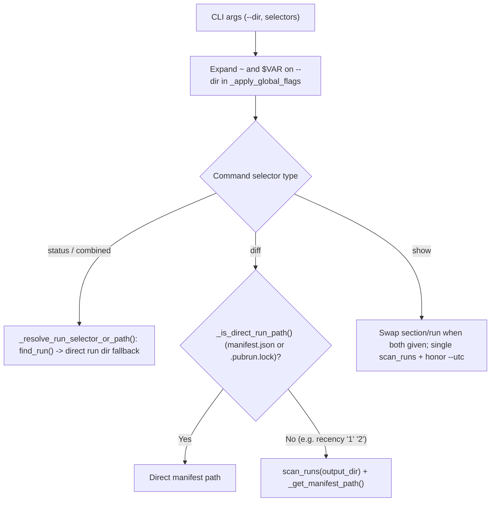

# IPD: CLI selectors combined streaming diff array rendering and diagnostics fixes

- Date: 2026-11-27
- Kind: child
- Concern: Fix CLI, diff-rendering, and diagnostics bugs (`BUG-U3`, `BUG-U5` CLI `--dir`, `BUG-U6`, `BUG-U7`, `BUG-U8`, `BUG-U9`, `BUG-U10`, `BUG-U11`, `BUG-U12`) and close CLI/streaming testing gaps (`TEST-U4`, `TEST-U9`).
- Scope: Fix `src/pubrun/__main__.py`, `src/pubrun/analysis/render.py`, and `src/pubrun/report/diagnostics.py`, and add behavioral regression tests in `tests/test_cli_diff_bugs.py`, `tests/test_combined.py`, `tests/test_render.py`, `tests/test_diagnostics_seams.py`, and `tests/test_cli_negative_paths.py`.
- Scope-Paths: src/pubrun/__main__.py, src/pubrun/analysis/render.py, src/pubrun/report/diagnostics.py, tests/test_cli_diff_bugs.py, tests/test_combined.py, tests/test_render.py, tests/test_diagnostics_seams.py, tests/test_cli_negative_paths.py
- Item-Dependencies: none
- Status: to-review
- Short-Description: Fix status/combined dir paths, --dir expansion, bounded combined streaming, diff fast-path and array/ANSI render, show swap/--utc, and run signal tests
- Work-Kind: bug
- Priority: high
- Set: assess-bt
- Order: 5
- Highest E allocated: 05
- Author: Antigravity
- Id: kk83rk

> Write and proofread this plan per the technical writing standard, `.aw/system/workflows/technical-writing/technical-writing.md` (`.agents/workflows/technical-writing/technical-writing.md` in a legacy-layout install), including requirement 12 (diagrams).

## Workflow history

- 2026-11-27 to-review (Antigravity): Authored review-ready child IPD from parallel `/assess bugs` and `/assess testing` audits on HEAD `512ee68` / `8f2aacd`.
- 2026-11-27 draft (Antigravity): created.

## Goal

Restore documented CLI contracts across `status`, `combined`, `diff`, `show`, `bench`, and `resources` diagnostics, fix multiset array-diff mislabeling and mid-escape ANSI truncation in `analysis/render.py`, bound `combined` streaming RAM for untimestamped logs, and cover `pubrun run` signal forwarding and `combined` EOF/continuation paths with behavioral tests.

### CLI selector and bounded streaming flow



## Detailed Implementation Checklist (TODO)

Execution-state rule: mark an `E-*` item complete only after performing the action. That mark is not validation. Right-sizing rule: write for a modest executor that cannot hold much in its head. Each E-item is one step (one concern, about one file, executable in one focused pass) and its V-item names each unit it covers with its own check; a plan stays at about 5 E-items and 8 work Scope-Paths, else split it into more child plans (guidance, `IPD-Z603`). Accepted execution states: blocked, failed, pending, performed; terminal gate demands 'performed'.

### Task group 1: Fix CLI selectors, streaming memory bound, show/bench contracts

- [ ] E-01 Fix `src/pubrun/__main__.py` (`BUG-U3`, `BUG-U5` CLI, `BUG-U6`, `BUG-U7`, `BUG-U9`, `BUG-U11`, `BUG-U12`):
  - Add `_resolve_run_selector_or_path(selector, output_dir, runs=...)` that tries `find_run(...)` first and, on `None`, accepts an existing run directory (or `manifest.json` inside one) containing `manifest.json`, `.pubrun.lock`, `stdout.log`, or `stderr.log`, returning `RunInfo(candidate_dir, keep_manifest=False)`. Use it in `_run_status` and `_run_combined` (`BUG-U3`).
  - In `_apply_global_flags`, normalize non-empty `args.dir` with `os.path.expanduser(os.path.expandvars(args.dir))` (`BUG-U5`).
  - In `_run_combined -> _stream_log_entries`, cap `leading_buffer` at `_MAX_LEADING_UNTIMESTAMPED_LINES = 50`; once exceeded without seeing a timestamp, flush buffered lines with `fallback_ts`, set `seen_first_ts = True` and `current_ts = fallback_ts`, and stream remaining lines in `O(1)` memory (`BUG-U6`).
  - In `_run_diff`, guard the direct-path fast path with `_is_direct_run_path(raw)` (True only for a `manifest.json` file or directory containing `manifest.json` or `.pubrun.lock`) so `./1` and `./2` in CWD never hijack recency selectors `1 2` (`BUG-U7`).
  - In `main` (`show`/`report` argument normalization), when `args.run_dir in SHOW_SECTIONS`: if `args.section is None`, shift as today; if `args.section not in SHOW_SECTIONS`, swap `args.run_dir, args.section = args.section, args.run_dir`; if both are section names, exit with a clear argument error (`BUG-U9`).
  - In `_run_bench` local-benchmark path, check `target = _prepare_submission(redacted_path)` and `sys.exit(1)` when `target is None` (`BUG-U11`).
  - In `_run_report` (`RunInProgressOrCrashedError`), format `started_at_utc` as UTC with `Z` when `utc=True`; in `main` filtered `show` loop, pass `runs=all_runs` (or resolve directly from `r.run_dir`) so `scan_runs` executes once instead of `O(M)` times (`BUG-U12`).
  - Depends on: none
  - Expected outcome: All seven CLI defects in `src/pubrun/__main__.py` are resolved without regressing existing CLI flags or output schemas.
  - Execution state: pending

### Task group 2: Fix diff array/ANSI rendering and upfront `--last` validation

- [ ] E-02 Fix `src/pubrun/analysis/render.py` (`BUG-U8`) and `src/pubrun/report/diagnostics.py` (`BUG-U10`):
  - In `src/pubrun/analysis/render.py` (`_render_inline` and `_format_array_diff`), use `collections.Counter` multiset matching (mirroring `diff.py`) so duplicate elements only mark excess occurrences with `+`/`-` and occurrence-indexed positions do not falsely flag unmoved later elements with `~`.
  - In `src/pubrun/analysis/render.py::_render_inline`, truncate ANSI-colored strings by visible character budget (ignoring SGR `\x1b[...m` sequences) and always append `Colors.RESET` before `" ... [TRUNCATED]"` when `use_color=True`.
  - In `src/pubrun/report/diagnostics.py::print_resources_report`, validate `parse_duration(last)` (raising `DiagnosticsError(..., exit_code=2)` on `ValueError`) at the top of the function before opening `events.jsonl` or writing any output.
  - Depends on: none
  - Expected outcome: Duplicate array items render accurately with intact ANSI escape sequences on truncation; invalid `--last` fails immediately with empty stdout whether or not `events.jsonl` exists.
  - Execution state: pending

### Task group 3: Add behavioral regression and signal-supervision tests and validate

- [ ] E-03 Add CLI, combined-streaming, render, and diagnostics regression tests in `tests/test_cli_diff_bugs.py`, `tests/test_combined.py`, `tests/test_render.py`, and `tests/test_diagnostics_seams.py`:
  - In `tests/test_cli_diff_bugs.py`: add tests for `status <dir_path>` (including `--json`) and `combined <dir_path>` (`BUG-U3`), `status --dir "$TEST_RUNS_DIR" --json` (`BUG-U5`), `diff --dir <other> 1 2` with `./1` and `./2` directories in CWD (`BUG-U7`), `show --dir <runs> env 2` (`BUG-U9`), `_run_bench(..., prepare_submission=True)` exiting `1` when `_prepare_submission` returns `None` (`BUG-U11`), and `show --utc` on a locked/crashed run plus single `scan_runs` spy on filtered `show` (`BUG-U12`).
  - In `tests/test_combined.py`: add tests for bounded-memory streaming of a large untimestamped sibling log (`BUG-U6`), EOF-fallback flushing of an untimestamped run anchored to `started_at_utc`, and mid-file untimestamped multiline traceback continuations (`TEST-U9`).
  - In `tests/test_render.py`: add tests for duplicate list diff (`['train.py', '-e', 'a', '-e', 'b']` vs `['train.py', '-e', 'a', '-e', 'b', '-e', 'c']`) marking `+'-e'` once with no false `~`, and ANSI truncation at `max_length=30, wrap=False, no_color=False` with `FORCE_COLOR=1` leaving zero severed SGR escapes and closing color with `\x1b[0m` before `[TRUNCATED]` (`BUG-U8`).
  - In `tests/test_diagnostics_seams.py`: add tests calling `print_resources_report(..., last="bogus", out=buf)` both without `events.jsonl` and with samples, asserting `DiagnosticsError` and `buf.getvalue() == ""` (`BUG-U10`).
  - Depends on: E-01, E-02
  - Expected outcome: Every CLI, streaming, render, and diagnostics defect has a deterministic regression test.
  - Execution state: pending

- [ ] E-04 Add `pubrun run` SIGTERM forwarding and `KeyboardInterrupt` escalation tests in `tests/test_cli_negative_paths.py` (`TEST-U4`):
  - Add a POSIX subprocess test (guarded with `skipif(sys.platform == "win32")`) launching `pubrun run -- python -c <ready-and-trap-script>`, sending `SIGTERM` to `pubrun run`, and asserting the child receives `SIGTERM` and exits cleanly with no orphan.
  - Add a fast in-process seam test using a fake `Popen` whose `wait()` raises `KeyboardInterrupt` then `TimeoutExpired` to verify `terminate()` -> `kill()` escalation and `SystemExit(130)`.
  - Depends on: E-01
  - Expected outcome: Both signal-supervision paths in `pubrun run` are behaviorally verified.
  - Execution state: pending

- [ ] E-05 Run targeted `pytest -p randomly` and 3-OS `mypy` validation and record output:
  - Run all commands listed in `## Required tests / validation` and verify exit `0`.
  - Depends on: E-03, E-04
  - Expected outcome: All targeted suites pass under `-p randomly` and 3-OS `mypy` exits `0`.
  - Execution state: pending

## Project conventions discovered (Step 0)

- `src/pubrun/__main__.py::_get_manifest_path` and `_run_show_config` already accept direct run directory paths; `_run_status` and `_run_combined` documented the same contract in `9d79ed4` but omitted the fallback.
- `src/pubrun/analysis/diff.py` uses `collections.Counter` for multiset list comparison; `render.py` must mirror that multiset model rather than collapsing to sets.
- `src/pubrun/report/diagnostics.py::DiagnosticsError` carries `exit_code=2` for invalid CLI option values such as malformed `--last` durations.

## Findings

| ID | Concerns | Severity | Remediation Risk | Persona | Summary |
|---|---|---|---|---|---|
| `BUG-U3` | bugs | High | Low (`functionality`) | QA Engineer | `pubrun status <dir_path>` and `pubrun combined <dir_path>` reject directory paths despite `--help` documenting them. |
| `BUG-U5` (CLI) | bugs | Medium | Low (`functionality`) | Software Engineer | CLI `--dir` forwards unexpanded `~`/`$VAR` strings, returning 0 runs. |
| `BUG-U6` | bugs | Medium | Low (`complexity`) | Software Engineer | `_run_combined._stream_log_entries` buffers an entire untimestamped log in `leading_buffer` in RAM. |
| `BUG-U7` | bugs | Medium | Low (`functionality`) | QA Engineer | `_run_diff` mistakes recency indices `1`/`2` for CWD directories `./1` and `./2`, ignoring `--dir`. |
| `BUG-U8` | bugs | Medium | Low (`usability`) | QA Engineer | `analysis/render.py` mislabels duplicate list items / unmoved elements and slices ANSI escape codes mid-sequence on truncation. |
| `BUG-U9` | bugs | Medium | Low (`usability`) | QA Engineer | `pubrun show <section> <run>` silently discards `<run>` and prints the latest run. |
| `BUG-U10` | bugs | Low | Low (`usability`) | QA Engineer | `print_resources_report` validates `--last` after printing output and skips validation when no samples exist. |
| `BUG-U11` | bugs | Low | Low (`functionality`) | Software Engineer | `pubrun bench --prepare-submission` ignores `_prepare_submission()` returning `None` on local runs and exits `0`. |
| `BUG-U12` | bugs | Low | Low (`functionality`) | Software Engineer | `pubrun show --utc` ignores `--utc` for running/crashed runs, and filtered `pubrun show` rescans `output_dir` `O(M)` times. |
| `TEST-U4` | testing | Medium | Low (`functionality`) | Reliability / HPC Engineer | Missing tests for `pubrun run` `SIGTERM` forwarding and `KeyboardInterrupt` grace-window escalation. |
| `TEST-U9` | testing | Medium | Low (`functionality`) | CLI / Reliability Engineer | Untested streaming `combined` EOF-fallback and mid-file untimestamped continuation lines. |

## Proposed changes (ordered, validatable)

1. `E-01` (`src/pubrun/__main__.py`): Fix `status`/`combined` directory paths, `--dir` expansion, bounded `leading_buffer`, `_run_diff` direct-path guard, `show <section> <run>` swap, `bench --prepare-submission` exit 1, and `show --utc` / single-scan loop.
2. `E-02` (`src/pubrun/analysis/render.py`, `src/pubrun/report/diagnostics.py`): Fix multiset array diff and ANSI-safe truncation; validate `--last` upfront.
3. `E-03` (`tests/test_cli_diff_bugs.py`, `tests/test_combined.py`, `tests/test_render.py`, `tests/test_diagnostics_seams.py`): Add regression tests for `BUG-U3`, `BUG-U5`..`BUG-U12`, and `TEST-U9`.
4. `E-04` (`tests/test_cli_negative_paths.py`): Add `pubrun run` `SIGTERM` forwarding and `KeyboardInterrupt` escalation tests (`TEST-U4`).
5. `E-05` (validation): Run randomized pytest suites and 3-OS `mypy`.

## Deferred / out of scope (with reason)

None. (The TUI `ConfigPanel` half of `BUG-U5` is owned by sibling child `qum7gf`.)

## Scope check

- Over-scope: none. Strictly scoped to three CLI/render/diagnostics modules and five directly paired test files.
- Under-scope: none. Every CLI, streaming, render, and diagnostics finding is fixed and verified.

## Required tests / validation

1. Targeted randomized pytest run:
   ```sh
   pytest -p randomly tests/test_cli_diff_bugs.py tests/test_combined.py tests/test_render.py tests/test_diagnostics_seams.py tests/test_cli_negative_paths.py tests/test_show_sections.py tests/test_diff_usability.py -v
   ```
2. Three-OS static type check:
   ```sh
   mypy && mypy --platform win32 && mypy --platform darwin
   ```

## Spec / documentation sync

N/A. Fixes bring runtime behavior into conformance with existing `--help` text and documented CLI contracts.

## Open questions

None.

## Validation and cross-check (verify before reporting done)

Validation-state rule: inspect evidence in a separate pass. Do not mark a `V-*` item complete from memory or from the matching execution checkmark. Accepted validation results: blocked, failed, pass, pending; terminal gate demands 'pass'. Runtime-demonstration reachability rule: for each `V-*` item demanding the software be observed acting (such as a run, a dispatch, or a transition), as distinct from items demanding a diff, a file's content, or a test result (which are reachable by construction), name the code path that produces the observation or the sibling `E-*` that creates it, else the demand is UNDER-SCOPE.

- [ ] V-01 validates E-01
  - Required evidence: Pasted `git diff -- src/pubrun/__main__.py` and passing pytest output from `tests/test_cli_diff_bugs.py` and `tests/test_combined.py` exercising `_run_status`, `_run_combined`, `_apply_global_flags`, `_run_diff`, `show`, `_run_bench`, and `_run_report`.
  - Observed evidence:
  - Result: pending

- [ ] V-02 validates E-02
  - Required evidence: Pasted `git diff -- src/pubrun/analysis/render.py src/pubrun/report/diagnostics.py` and passing pytest output from `tests/test_render.py` and `tests/test_diagnostics_seams.py`.
  - Observed evidence:
  - Result: pending

- [ ] V-03 validates E-03
  - Required evidence: Pasted `pytest -v` output naming every newly added test function across `tests/test_cli_diff_bugs.py`, `tests/test_combined.py`, `tests/test_render.py`, and `tests/test_diagnostics_seams.py` as `PASSED`.
  - Observed evidence:
  - Result: pending

- [ ] V-04 validates E-04
  - Required evidence: Pasted `pytest -v` output from `tests/test_cli_negative_paths.py` naming both newly added `pubrun run` signal-supervision tests (`SIGTERM` forwarding and `KeyboardInterrupt` escalation) as `PASSED`.
  - Observed evidence:
  - Result: pending

- [ ] V-05 validates E-05
  - Required evidence: Pasted complete output of both commands in `## Required tests / validation`, both exiting `0` with zero failures.
  - Observed evidence:
  - Result: pending

## Approval and execution gate

- Size assessment: standard
- Cohesion rationale: not required

1. **Open questions and approval:** Do not execute until explicit human approval is recorded (`aw ipd set approved kk83rk --by-human` or `aw set approved assess-bt --by-human`).
2. **Scope declaration:** Modify only the eight declared `Scope-Paths`.
3. **Validation honesty:** Paste actual command outputs from this workspace for every `V-*` item.
4. **Commits and push policy:** Commit only files modified for this plan through `aw commit kk83rk -- <paths>`. Never push, tag, or publish.
5. **Lifecycle finalization:** Finalize via `aw ipd finalize kk83rk` (or let the runner finalize) only after every `E-*` is `performed` and every `V-*` is `pass`.
