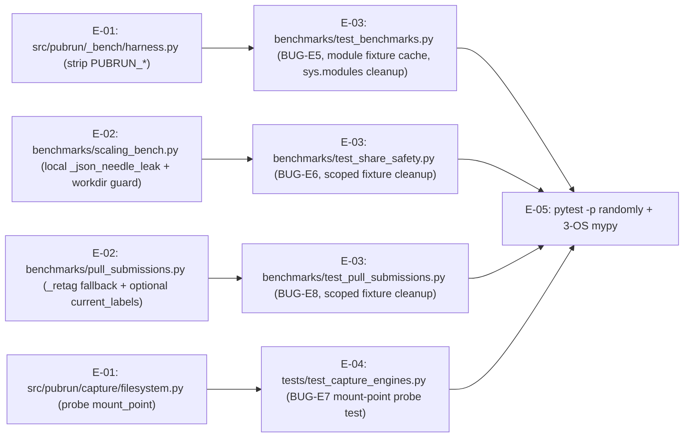

# IPD: Bench env isolation filesystem live probing scaling scrub and submission retag

- Date: 2026-11-27
- Kind: child
- Concern: Fix four benchmark/capture bugs (`BUG-E5`, `BUG-E6`, `BUG-E7`, `BUG-E8`) and close benchmark test-suite performance and collection-isolation gaps (`TEST-I5` benchmarks, `TEST-I6` redundant harness runs).
- Scope: Fix `src/pubrun/_bench/harness.py`, `src/pubrun/capture/filesystem.py`, `benchmarks/scaling_bench.py`, and `benchmarks/pull_submissions.py`, and add regression tests plus fixture caching / `sys.path` cleanup in `benchmarks/test_benchmarks.py`, `benchmarks/test_share_safety.py`, `benchmarks/test_pull_submissions.py`, and `tests/test_capture_engines.py`.
- Scope-Paths: src/pubrun/_bench/harness.py, src/pubrun/capture/filesystem.py, benchmarks/scaling_bench.py, benchmarks/pull_submissions.py, benchmarks/test_benchmarks.py, benchmarks/test_share_safety.py, benchmarks/test_pull_submissions.py, tests/test_capture_engines.py
- Item-Dependencies: none
- Status: reviewed
- Readiness: go-pending-approval
- Review-Depth: complex
- Short-Description: Fix bench PUBRUN_* leakage, mount-point live probing, scaling_bench scrub key mismatch, pull_submissions retag, and benchmark suite caching
- Work-Kind: bug
- Priority: medium
- Set: assess-bt
- Order: 6
- Highest E allocated: 05
- Author: Antigravity
- Id: n39jh9

> Write and proofread this plan per the technical writing standard, `.aw/system/workflows/technical-writing/technical-writing.md` (`.agents/workflows/technical-writing/technical-writing.md` in a legacy-layout install), including requirement 12 (diagrams).

## Workflow history

- 2026-11-27 /plan-review (Antigravity): APPROVE WITH REVISIONS APPLIED; PR-001, PR-002, PR-003, PR-004
- 2026-11-27 to-review (Antigravity): Authored review-ready child IPD from parallel `/assess bugs` and `/assess testing` audits on HEAD `512ee68` / `8f2aacd`.
- 2026-11-27 draft (Antigravity): created.

## Goal

Prevent ambient `PUBRUN_*` environment variables from polluting `pubrun bench` child runs, probe mounted filesystems by mount point rather than uncreated child paths in `filesystem.probe_paths_live`, align `scaling_bench.py` share-safety skip keys, protected literals, and workdir needle guards, fix `pull_submissions.py` re-tagging of previously rejected issues, and eliminate ~10x redundant harness executions and collection-time `sys.path`/`sys.modules` leaks in the benchmark test suite.

### Bench, filesystem, and submission hardening scope



## Detailed Implementation Checklist (TODO)

Execution-state rule: mark an `E-*` item complete only after performing the action. That mark is not validation. Right-sizing rule: write for a modest executor that cannot hold much in its head. Each E-item is one step (one concern, about one file, executable in one focused pass) and its V-item names each unit it covers with its own check; a plan stays at about 5 E-items and 8 work Scope-Paths, else split it into more child plans (guidance, `IPD-Z603`). Accepted execution states: blocked, failed, pending, performed; terminal gate demands 'performed'.

### Task group 1: Fix packaged bench isolation and filesystem mount probing

- [ ] E-01 Fix `src/pubrun/_bench/harness.py` (`BUG-E5`) and `src/pubrun/capture/filesystem.py` (`BUG-E7`):
  - In `src/pubrun/_bench/harness.py::_child_env_with_checkout_src`, strip all ambient `PUBRUN_*` keys (`not k.startswith("PUBRUN_")`) from the copied child environment before scenarios apply explicit `scn.env` and `PUBRUN_IMPORT_MODE` (isolating both `_build_child_command` measured runs and `_run_baseline_pass` pass-0 runs); in `_run_pass`, set `env["PUBRUN_PROFILE"] = "default"` unconditionally so ambient `PUBRUN_OUTPUT_DIR`, `PUBRUN_RUN_MODE_OVERRIDE`, `PUBRUN_PROFILE`, `PUBRUN_AUTO_START`, and `PUBRUN_BENCH_IO_TARGET` cannot pollute benchmark runs.
  - In `src/pubrun/capture/filesystem.py::probe_paths_live`, validate `isinstance(mp, str) and mp` (where `mp = entry.get("mount_point") or entry.get("path")`) and launch `probe_filesystem_live(mp, wait_budget_s)` against `mp` rather than `entry.get("path", mp)`, falling back to `entry.get("path")` only when `mount_point` is absent or empty.
  - Depends on: none
  - Expected outcome: Benchmark child runs (measured and baseline) are isolated from ambient `PUBRUN_*` overrides while preserving explicit `scn.env`; an uncreated `results_dir` sharing a mounted filesystem never poisons live probe results for sibling paths on that mount.
  - Execution state: pending

### Task group 2: Fix `scaling_bench.py` share-safety validation and `pull_submissions.py` retag

- [ ] E-02 Fix `benchmarks/scaling_bench.py` (`BUG-E6`) and `benchmarks/pull_submissions.py` (`BUG-E8`):
  - In `benchmarks/scaling_bench.py`: add a local `_json_needle_leak(obj, needles, path_needles)` helper that uses `scaling_bench._SCRUB_SKIP_KEYS` (covering `"schema_version"`, `"started_at_utc"`, `"finished_at_utc"`, `"mode"`, `"python_version"`, `"python_implementation"`, `"architecture"`, `"pubrun_version"`, `"git_revision"`, `"workdir_kind"`, `"workdir_fstype"`, `"fstype"`, `"status"`) AND `scaling_bench._needles_found` (which respects `scaling_bench._PROTECTED_RE` including `SCHEMA_VERSION`), and call it from `_validate_share_safety` instead of `_sb._json_needle_leak`; in `main` (extracting a small helper if helpful for direct testing), guard raw `args.workdir` with `if "/" in args.workdir or "\\" in args.workdir:` before adding it to `extra_needles` alongside `str(Path(args.workdir).resolve())`.
  - In `benchmarks/pull_submissions.py::_retag` and `_process_issue`: add an optional keyword-only parameter `current_labels: Optional[Sequence[str]] = None` to `_retag` (preserving backward compatibility for callers and existing tests that omit it). When `current_labels is None`, try attempts in order: `["--add-label", add, "--remove-label", remove, "--remove-label", _LABEL_PENDING]`, `["--add-label", add, "--remove-label", _LABEL_PENDING]`, `["--add-label", add, "--remove-label", remove]`, `["--add-label", add]`. When `current_labels is not None` (passed by `_process_issue` via `current_labels=issue.get("labels")`), emit `--remove-label` only for labels in `(remove, _LABEL_PENDING)` actually present in `current_labels`, keeping `["--add-label", add]` as the final fallback in case labels changed concurrently on GitHub.
  - Depends on: none
  - Expected outcome: `scaling_bench.py` does not false-fail share-safety on `--mode quick` / `--workdir quick` or usernames/hostnames colliding with fixed vocabulary keys while remaining fail-closed on real leaks; `pull_submissions.py` never leaves re-accepted issues dual-labeled `status:accepted` + `status:needs-fix` and preserves existing `_retag` call signatures.
  - Execution state: pending

### Task group 3: Add regression tests, cache benchmark harness fixtures, and validate

- [ ] E-03 Add regression tests and harness caching / import isolation in `benchmarks/test_benchmarks.py`, `benchmarks/test_share_safety.py`, and `benchmarks/test_pull_submissions.py` (`BUG-E5`, `BUG-E6`, `BUG-E8`, `TEST-I5`, `TEST-I6`):
  - In `benchmarks/test_benchmarks.py`: add regression test for `BUG-E5` setting `PUBRUN_OUTPUT_DIR`, `PUBRUN_RUN_MODE_OVERRIDE`, `PUBRUN_PROFILE`, `PUBRUN_AUTO_START`, and `PUBRUN_BENCH_IO_TARGET` via `monkeypatch` and verifying `_build_child_command` and `_child_env_with_checkout_src` strip them while keeping explicit `scn.env` (for example `PUBRUN_BENCH_IO_TARGET` on `io-baseline-devnull`) and `PUBRUN_IMPORT_MODE`; refactor read-only harness output tests across BOTH `TestSchema5Shape` (8 tests) and `TestSchema5Validation` (`test_fresh_result_and_redaction_conform`, `test_broken_result_is_rejected` using `copy.deepcopy`) to share ONE module-scoped cached benchmark run fixture so the suite executes the harness once instead of 10 times (`TEST-I6`); restore `sys.modules` entries registered by `_load(...)` on fixture/test teardown (`TEST-I5`).
  - In `benchmarks/test_share_safety.py`: replace collection-time `sys.modules["share_safety"] = ss` registration with a module-scoped fixture that restores `sys.modules` on teardown (`TEST-I5`); add regression tests for `BUG-E6` loading `benchmarks/scaling_bench.py` inside a scoped fixture/test that restores `sys.path` and added `sys.modules` entries, verifying (a) `_scrub_obj` + `_scrub_string` + `_validate_share_safety` with `extra_needles=["quick"]` and simulated usernames `"ext4"` / `"temporary"` returns `ok is True` with `redacted["mode"] == "quick"`, `redacted["workdir_fstype"] == "ext4"`, and `redacted["workdir_kind"] == "temporary"` intact, (b) bare relative `workdir="quick"` is excluded from raw `extra_needles` while its resolved path is included, and (c) an actual unredacted username/hostname in a non-skipped key is still rejected (`ok is False`, fail-closed).
  - In `benchmarks/test_pull_submissions.py`: replace collection-time `ps = _load_pull()` with a module-scoped fixture that snapshots and restores `sys.path` and added `sys.modules` keys on teardown (`TEST-I5`); add regression tests for `BUG-E8` mocking `_run_gh` to fail whenever `--remove-label` names an absent label on an issue initially labeled `{"type:benchmark-submission", "status:needs-fix"}`, exercising both `_process_issue` (`current_labels` passed) and direct `_retag(..., current_labels=None)` fallback, and asserting final labels contain `"status:accepted"` and not `"status:needs-fix"`.
  - Depends on: E-01, E-02
  - Expected outcome: All benchmark script bugs have deterministic behavioral regression tests, extra-suite runtime drops from ~10 redundant harness runs to 1 cached run, and collection-time `sys.path`/`sys.modules` leaks are removed.
  - Execution state: pending

- [ ] E-04 Add `probe_paths_live` mount-point regression test in `tests/test_capture_engines.py` (`BUG-E7`):
  - Pass an `fs_data` dict whose first entry is a non-existent `results_dir` path (`str(tmp_path / "does-not-exist-yet")`) and whose second entry is an existing `install_dir` path (`str(tmp_path)`), both sharing `mount_point=str(tmp_path)` (portable across Linux, macOS, and Windows), call `probe_paths_live(fs_data)`, and assert both entries receive `live["status"] == "complete"` with valid capacity metrics.
  - Depends on: E-01
  - Expected outcome: `BUG-E7` is covered by a deterministic, cross-platform behavioral regression test.
  - Execution state: pending

- [ ] E-05 Run targeted `pytest -p randomly` and 3-OS `mypy` validation and record complete output (including benchmark suite runtime):
  - Run all commands listed in `## Required tests / validation` and verify exit `0`.
  - Depends on: E-03, E-04
  - Expected outcome: All benchmark, intake, and capture tests pass under `-p randomly` and 3-OS `mypy` exits `0`.
  - Execution state: pending

## Project conventions discovered (Step 0)

- `benchmarks/startup_breakdown.py` already strips ambient `PUBRUN_*` keys when spawning isolated children and guards bare relative `args.workdir` with `if "/" in args.workdir or "\\" in args.workdir:`.
- `benchmarks/test_benchmarks.py`, `benchmarks/test_share_safety.py`, and `benchmarks/test_pull_submissions.py` are run as extra suites alongside `tests/` (empirically 346.52s on baseline `512ee68` due to 10 redundant harness invocations in `benchmarks/test_benchmarks.py`).
- `benchmarks/test_pull_submissions.py` tests `ps._retag` directly without `current_labels` (`test_retag_dry_run_makes_no_gh_call`, `test_retag_apply_accepts_drops_pending_argv`, `test_retag_apply_rejection_comments`), so `current_labels` on `_retag` must remain optional with a default of `None`.

## Findings

| ID | Concerns | Severity | Remediation Risk | Persona | Summary |
|---|---|---|---|---|---|
| `BUG-E5` | bugs | Medium | Low (`functionality`) | QA / Software Engineer | `src/pubrun/_bench/harness.py` does not strip ambient `PUBRUN_*` variables (`PUBRUN_OUTPUT_DIR`, `PUBRUN_RUN_MODE_OVERRIDE`, `PUBRUN_PROFILE`, `PUBRUN_AUTO_START`, `PUBRUN_BENCH_IO_TARGET`). |
| `BUG-E6` | bugs | Medium | Low (`functionality`) | QA / Software Engineer | `benchmarks/scaling_bench.py::_validate_share_safety` delegates to `startup_breakdown._json_needle_leak` (missing `scaling_bench`'s skip keys and protected schema literal) and appends bare relative `args.workdir` to `extra_needles`. |
| `BUG-E7` | bugs | Medium | Low (`functionality`) | QA / Software Engineer | `filesystem.probe_paths_live` deduplicates by `mount_point` but probes `entry["path"]`, so an uncreated `results_dir` poisons all sibling paths on that mount. |
| `BUG-E8` | bugs | Medium | Low (`functionality`) | QA / Software Engineer | `benchmarks/pull_submissions.py::_retag` omits `["--add-label", add, "--remove-label", remove]` and does not filter removals against `issue["labels"]`, leaving re-submitted accepted issues dual-labeled with `status:needs-fix`. |
| `TEST-I5` (benchmarks) | testing | Medium | Low (`complexity`) | Testing Expert | Uncleaned collection-time `sys.path`/`sys.modules` mutations in `benchmarks/test_benchmarks.py`, `benchmarks/test_share_safety.py`, and `benchmarks/test_pull_submissions.py`. |
| `TEST-I6` (benchmarks) | testing | Medium | Low (`complexity`) | Testing / CI Engineer | `benchmarks/test_benchmarks.py` invokes the full benchmark harness 10x redundantly (~346s runtime). |

## Proposed changes (ordered, validatable)

1. `E-01` (`src/pubrun/_bench/harness.py`, `src/pubrun/capture/filesystem.py`): Strip `PUBRUN_*` in bench child env (`_child_env_with_checkout_src`, `_run_pass`) and probe `mp` (`mount_point`) in `probe_paths_live`.
2. `E-02` (`benchmarks/scaling_bench.py`, `benchmarks/pull_submissions.py`): Add local `_json_needle_leak` with `scaling_bench._SCRUB_SKIP_KEYS` and `_needles_found`, guard bare relative `args.workdir`, and fix `_retag` label transitions with optional `current_labels`.
3. `E-03` (`benchmarks/test_benchmarks.py`, `benchmarks/test_share_safety.py`, `benchmarks/test_pull_submissions.py`): Add `BUG-E5`/`BUG-E6`/`BUG-E8` regression tests, share one module-scoped harness fixture across `TestSchema5Shape` and `TestSchema5Validation`, and clean up `sys.path`/`sys.modules` leaks.
4. `E-04` (`tests/test_capture_engines.py`): Add cross-platform `probe_paths_live` mount-point regression test.
5. `E-05` (validation): Run randomized pytest on benchmark, intake, and capture suites and 3-OS `mypy`.

## Deferred / out of scope (with reason)

None.

## Scope check

- Over-scope: none. Strictly scoped to the four affected bench/filesystem modules and four directly paired test files.
- Under-scope: none. Every finding listed in `## Findings` has a concrete fix and behavioral regression test.

## Required tests / validation

1. Targeted randomized pytest run across benchmark suites, bench CLI/intake tests, and capture engines:
   ```sh
   python3 -m pytest -p randomly benchmarks/test_benchmarks.py benchmarks/test_share_safety.py benchmarks/test_pull_submissions.py tests/test_bench_command.py tests/test_benchmark_intake_bugs.py tests/test_capture_engines.py -v
   ```
2. Three-OS static type check:
   ```sh
   python3 -m mypy && python3 -m mypy --platform win32 && python3 -m mypy --platform darwin
   ```

## Spec / documentation sync

Not applicable. Fixes align benchmark isolation, live filesystem probing, share-safety validation, and submission re-tagging with existing documented behavior; no command-line interface (CLI) flags, configuration keys, manifest schema fields, or public application programming interface (API) signatures change.

## Open questions

None.

## Validation and cross-check (verify before reporting done)

Validation-state rule: inspect evidence in a separate pass. Do not mark a `V-*` item complete from memory or from the matching execution checkmark. Accepted validation results: blocked, failed, pass, pending; terminal gate demands 'pass'. Runtime-demonstration reachability rule: for each `V-*` item demanding the software be observed acting (such as a run, a dispatch, or a transition), as distinct from items demanding a diff, a file's content, or a test result (which are reachable by construction), name the code path that produces the observation or the sibling `E-*` that creates it, else the demand is UNDER-SCOPE.

- [ ] V-01 validates E-01
  - Required evidence: Pasted `git diff -- src/pubrun/_bench/harness.py src/pubrun/capture/filesystem.py` and passing `python3 -m pytest` output exercising `src/pubrun/_bench/harness.py::_child_env_with_checkout_src` / `_build_child_command` env stripping (`BUG-E5`) and `src/pubrun/capture/filesystem.py::probe_paths_live` mount-point probing (`BUG-E7`).
  - Observed evidence:
  - Result: pending

- [ ] V-02 validates E-02
  - Required evidence: Pasted `git diff -- benchmarks/scaling_bench.py benchmarks/pull_submissions.py` and passing `python3 -m pytest` output from `benchmarks/test_share_safety.py` (exercising local `_json_needle_leak`, workdir needle guard, and fail-closed leak rejection updated in `E-02`) and `benchmarks/test_pull_submissions.py` (exercising `_retag` with and without `current_labels` updated in `E-02`).
  - Observed evidence:
  - Result: pending

- [ ] V-03 validates E-03
  - Required evidence: Pasted `git diff -- benchmarks/test_benchmarks.py benchmarks/test_share_safety.py benchmarks/test_pull_submissions.py` confirming module-scoped harness fixture reuse and restored `sys.path`/`sys.modules` loading, plus passing `python3 -m pytest -p randomly benchmarks/test_benchmarks.py benchmarks/test_share_safety.py benchmarks/test_pull_submissions.py -v` output showing elapsed runtime and the passing `BUG-E5`/`BUG-E6`/`BUG-E8` regression tests (re-deriving active test node names at execution time).
  - Observed evidence:
  - Result: pending

- [ ] V-04 validates E-04
  - Required evidence: Pasted `python3 -m pytest -p randomly tests/test_capture_engines.py -v` output exiting `0` and confirming the new `probe_paths_live` mount-point regression test passes (re-deriving active test node name at execution time).
  - Observed evidence:
  - Result: pending

- [ ] V-05 validates E-05
  - Required evidence: Pasted complete output of Command 1 (all six pytest files under `-p randomly`) and Command 2 (`mypy` on Linux, `win32`, and `darwin`) from `## Required tests / validation`, both exiting `0` with zero failures.
  - Observed evidence:
  - Result: pending

## Approval and execution gate

- Size assessment: standard
- Cohesion rationale: not required

1. **Open questions and approval:** This plan is a proposal and must not be executed until all blocking open questions are resolved (none remain) and explicit human approval is recorded (`aw ipd set approved n39jh9 --by-human` or `aw set approved assess-bt --by-human`).
2. **Scope declaration:** `- Scope-Paths:` declares the expected files this plan modifies (`src/pubrun/_bench/harness.py`, `src/pubrun/capture/filesystem.py`, `benchmarks/scaling_bench.py`, `benchmarks/pull_submissions.py`, `benchmarks/test_benchmarks.py`, `benchmarks/test_share_safety.py`, `benchmarks/test_pull_submissions.py`, `tests/test_capture_engines.py`). Keep changes within this scope; if execution genuinely requires editing an additional file or leaving a declared file untouched, make the necessary change and justify the delta at finalization with `--scope-reason` (per out-of-scope path) or `--scope-ack` (per declared-but-unmodified path) rather than stopping mid-run. Stop and report only on a genuinely unsafe condition (such as an unresolvable concurrent-edit conflict or missing prerequisite symbols).
3. **Validation honesty (hard requirement):** Every `V-*` item must paste actual runner output from this workspace confirming exit `0` and the required behavior; never claim passing tests or type checks that were not actually run.
4. **Commits and push policy:** Commit only files modified for this plan through `aw commit n39jh9 -- <paths>` (never `git add -A`, bare `git add`, `git commit -a`, or raw `git commit`). Never push, tag, or publish.
5. **Lifecycle finalization:** On completion, finalize this plan to `.aw/records/plans/executed/` only after every `E-*` item is `performed` and every `V-*` item is `pass`. When run under `aw oc run` or `aw agy run`, the runner owns `aw ipd finalize n39jh9`; when executed manually outside a runner, the executor runs `aw ipd finalize n39jh9` (never hand-roll `git mv` to `executed/`).
