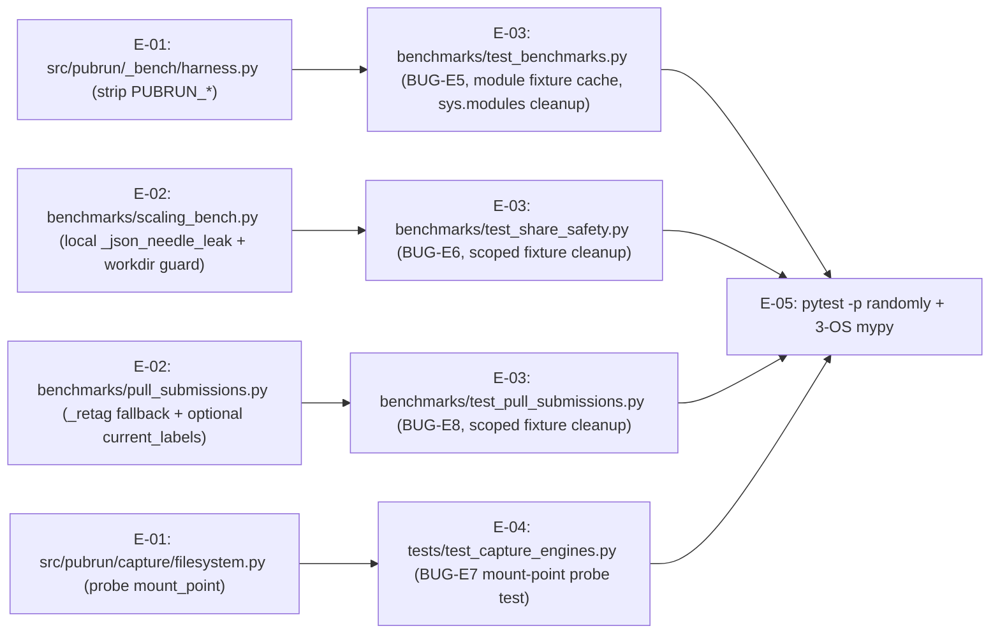

# IPD: Bench env isolation filesystem live probing scaling scrub and submission retag

- Date: 2026-11-27
- Kind: child
- Concern: Fix four benchmark/capture bugs (`BUG-E5`, `BUG-E6`, `BUG-E7`, `BUG-E8`) and close benchmark test-suite performance and collection-isolation gaps (`TEST-I5` benchmarks, `TEST-I6` redundant harness runs).
- Scope: Fix `src/pubrun/_bench/harness.py`, `src/pubrun/capture/filesystem.py`, `benchmarks/scaling_bench.py`, and `benchmarks/pull_submissions.py`, and add regression tests plus fixture caching / `sys.path` cleanup in `benchmarks/test_benchmarks.py`, `benchmarks/test_share_safety.py`, `benchmarks/test_pull_submissions.py`, and `tests/test_capture_engines.py`.
- Scope-Paths: src/pubrun/_bench/harness.py, src/pubrun/capture/filesystem.py, benchmarks/scaling_bench.py, benchmarks/pull_submissions.py, benchmarks/test_benchmarks.py, benchmarks/test_share_safety.py, benchmarks/test_pull_submissions.py, tests/test_capture_engines.py
- Item-Dependencies: none
- Status: approved
- Readiness: go-pending-approval
- Review-Depth: complex
- Short-Description: Fix bench PUBRUN_* leakage, mount-point live probing, scaling_bench scrub key mismatch, pull_submissions retag, and benchmark suite caching
- Work-Kind: bug
- Priority: medium
- Set: assess-bt
- Order: 6
- Highest E allocated: 05
- Author: Antigravity
- Id: n39jh9
- Approval: 2026-11-28, recorded via aw ipd set: status set to approved

> Write and proofread this plan per the technical writing standard, `.aw/system/workflows/technical-writing/technical-writing.md` (`.agents/workflows/technical-writing/technical-writing.md` in a legacy-layout install), including requirement 12 (diagrams).

## Workflow history

- 2026-11-28 approved (aw set): status set to approved
- 2026-11-27 /plan-review (Antigravity): APPROVE WITH REVISIONS APPLIED; PR-001, PR-002, PR-003, PR-004
- 2026-11-27 to-review (Antigravity): Authored review-ready child IPD from parallel `/assess bugs` and `/assess testing` audits on HEAD `512ee68` / `8f2aacd`.
- 2026-11-27 draft (Antigravity): created.

## Goal

Prevent ambient `PUBRUN_*` environment variables from polluting `pubrun bench` child runs, probe mounted filesystems by mount point rather than uncreated child paths in `filesystem.probe_paths_live`, align `scaling_bench.py` share-safety skip keys, protected literals, and workdir needle guards, fix `pull_submissions.py` re-tagging of previously rejected issues, and eliminate ~10x redundant harness executions and collection-time `sys.path`/`sys.modules` leaks in the benchmark test suite.

### Bench, filesystem, and submission hardening scope



## Detailed Implementation Checklist (TODO)

Execution-state rule: mark an `E-*` item complete only after performing the action. That mark is not validation. Right-sizing rule: write for a modest executor that cannot hold much in its head. Each E-item is one step (one concern, about one file, executable in one focused pass) and its V-item names each unit it covers with its own check; a plan stays at about 5 E-items and 8 work Scope-Paths, else split it into more child plans (guidance, `IPD-Z603`). Accepted execution states: blocked, failed, pending, performed; terminal gate demands 'performed'.

### Task group 1: Fix packaged bench isolation and filesystem mount probing

- [x] E-01 Fix `src/pubrun/_bench/harness.py` (`BUG-E5`) and `src/pubrun/capture/filesystem.py` (`BUG-E7`):
  - In `src/pubrun/_bench/harness.py::_child_env_with_checkout_src`, strip all ambient `PUBRUN_*` keys (`not k.startswith("PUBRUN_")`) from the copied child environment before scenarios apply explicit `scn.env` and `PUBRUN_IMPORT_MODE` (isolating both `_build_child_command` measured runs and `_run_baseline_pass` pass-0 runs); in `_run_pass`, set `env["PUBRUN_PROFILE"] = "default"` unconditionally so ambient `PUBRUN_OUTPUT_DIR`, `PUBRUN_RUN_MODE_OVERRIDE`, `PUBRUN_PROFILE`, `PUBRUN_AUTO_START`, and `PUBRUN_BENCH_IO_TARGET` cannot pollute benchmark runs.
  - In `src/pubrun/capture/filesystem.py::probe_paths_live`, validate `isinstance(mp, str) and mp` (where `mp = entry.get("mount_point") or entry.get("path")`) and launch `probe_filesystem_live(mp, wait_budget_s)` against `mp` rather than `entry.get("path", mp)`, falling back to `entry.get("path")` only when `mount_point` is absent or empty.
  - Depends on: none
  - Expected outcome: Benchmark child runs (measured and baseline) are isolated from ambient `PUBRUN_*` overrides while preserving explicit `scn.env`; an uncreated `results_dir` sharing a mounted filesystem never poisons live probe results for sibling paths on that mount.
  - Execution state: performed

### Task group 2: Fix `scaling_bench.py` share-safety validation and `pull_submissions.py` retag

- [x] E-02 Fix `benchmarks/scaling_bench.py` (`BUG-E6`) and `benchmarks/pull_submissions.py` (`BUG-E8`):
  - In `benchmarks/scaling_bench.py`: add a local `_json_needle_leak(obj, needles, path_needles)` helper that uses `scaling_bench._SCRUB_SKIP_KEYS` (covering `"schema_version"`, `"started_at_utc"`, `"finished_at_utc"`, `"mode"`, `"python_version"`, `"python_implementation"`, `"architecture"`, `"pubrun_version"`, `"git_revision"`, `"workdir_kind"`, `"workdir_fstype"`, `"fstype"`, `"status"`) AND `scaling_bench._needles_found` (which respects `scaling_bench._PROTECTED_RE` including `SCHEMA_VERSION`), and call it from `_validate_share_safety` instead of `_sb._json_needle_leak`; in `main` (extracting a small helper if helpful for direct testing), guard raw `args.workdir` with `if "/" in args.workdir or "\\" in args.workdir:` before adding it to `extra_needles` alongside `str(Path(args.workdir).resolve())`.
  - In `benchmarks/pull_submissions.py::_retag` and `_process_issue`: add an optional keyword-only parameter `current_labels: Optional[Sequence[str]] = None` to `_retag` (preserving backward compatibility for callers and existing tests that omit it). When `current_labels is None`, try attempts in order: `["--add-label", add, "--remove-label", remove, "--remove-label", _LABEL_PENDING]`, `["--add-label", add, "--remove-label", _LABEL_PENDING]`, `["--add-label", add, "--remove-label", remove]`, `["--add-label", add]`. When `current_labels is not None` (passed by `_process_issue` via `current_labels=issue.get("labels")`), emit `--remove-label` only for labels in `(remove, _LABEL_PENDING)` actually present in `current_labels`, keeping `["--add-label", add]` as the final fallback in case labels changed concurrently on GitHub.
  - Depends on: none
  - Expected outcome: `scaling_bench.py` does not false-fail share-safety on `--mode quick` / `--workdir quick` or usernames/hostnames colliding with fixed vocabulary keys while remaining fail-closed on real leaks; `pull_submissions.py` never leaves re-accepted issues dual-labeled `status:accepted` + `status:needs-fix` and preserves existing `_retag` call signatures.
  - Execution state: performed

### Task group 3: Add regression tests, cache benchmark harness fixtures, and validate

- [x] E-03 Add regression tests and harness caching / import isolation in `benchmarks/test_benchmarks.py`, `benchmarks/test_share_safety.py`, and `benchmarks/test_pull_submissions.py` (`BUG-E5`, `BUG-E6`, `BUG-E8`, `TEST-I5`, `TEST-I6`):
  - In `benchmarks/test_benchmarks.py`: add regression test for `BUG-E5` setting `PUBRUN_OUTPUT_DIR`, `PUBRUN_RUN_MODE_OVERRIDE`, `PUBRUN_PROFILE`, `PUBRUN_AUTO_START`, and `PUBRUN_BENCH_IO_TARGET` via `monkeypatch` and verifying `_build_child_command` and `_child_env_with_checkout_src` strip them while keeping explicit `scn.env` (for example `PUBRUN_BENCH_IO_TARGET` on `io-baseline-devnull`) and `PUBRUN_IMPORT_MODE`; refactor read-only harness output tests across BOTH `TestSchema5Shape` (8 tests) and `TestSchema5Validation` (`test_fresh_result_and_redaction_conform`, `test_broken_result_is_rejected` using `copy.deepcopy`) to share ONE module-scoped cached benchmark run fixture so the suite executes the harness once instead of 10 times (`TEST-I6`); restore `sys.modules` entries registered by `_load(...)` on fixture/test teardown (`TEST-I5`).
  - In `benchmarks/test_share_safety.py`: replace collection-time `sys.modules["share_safety"] = ss` registration with a module-scoped fixture that restores `sys.modules` on teardown (`TEST-I5`); add regression tests for `BUG-E6` loading `benchmarks/scaling_bench.py` inside a scoped fixture/test that restores `sys.path` and added `sys.modules` entries, verifying (a) `_scrub_obj` + `_scrub_string` + `_validate_share_safety` with `extra_needles=["quick"]` and simulated usernames `"ext4"` / `"temporary"` returns `ok is True` with `redacted["mode"] == "quick"`, `redacted["workdir_fstype"] == "ext4"`, and `redacted["workdir_kind"] == "temporary"` intact, (b) bare relative `workdir="quick"` is excluded from raw `extra_needles` while its resolved path is included, and (c) an actual unredacted username/hostname in a non-skipped key is still rejected (`ok is False`, fail-closed).
  - In `benchmarks/test_pull_submissions.py`: replace collection-time `ps = _load_pull()` with a module-scoped fixture that snapshots and restores `sys.path` and added `sys.modules` keys on teardown (`TEST-I5`); add regression tests for `BUG-E8` mocking `_run_gh` to fail whenever `--remove-label` names an absent label on an issue initially labeled `{"type:benchmark-submission", "status:needs-fix"}`, exercising both `_process_issue` (`current_labels` passed) and direct `_retag(..., current_labels=None)` fallback, and asserting final labels contain `"status:accepted"` and not `"status:needs-fix"`.
  - Depends on: E-01, E-02
  - Expected outcome: All benchmark script bugs have deterministic behavioral regression tests, extra-suite runtime drops from ~10 redundant harness runs to 1 cached run, and collection-time `sys.path`/`sys.modules` leaks are removed.
  - Execution state: performed

- [x] E-04 Add `probe_paths_live` mount-point regression test in `tests/test_capture_engines.py` (`BUG-E7`):
  - Pass an `fs_data` dict whose first entry is a non-existent `results_dir` path (`str(tmp_path / "does-not-exist-yet")`) and whose second entry is an existing `install_dir` path (`str(tmp_path)`), both sharing `mount_point=str(tmp_path)` (portable across Linux, macOS, and Windows), call `probe_paths_live(fs_data)`, and assert both entries receive `live["status"] == "complete"` with valid capacity metrics.
  - Depends on: E-01
  - Expected outcome: `BUG-E7` is covered by a deterministic, cross-platform behavioral regression test.
  - Execution state: performed

- [x] E-05 Run targeted `pytest -p randomly` and 3-OS `mypy` validation and record complete output (including benchmark suite runtime):
  - Run all commands listed in `## Required tests / validation` and verify exit `0`.
  - Depends on: E-03, E-04
  - Expected outcome: All benchmark, intake, and capture tests pass under `-p randomly` and 3-OS `mypy` exits `0`.
  - Execution state: performed

## Project conventions discovered (Step 0)

- `benchmarks/startup_breakdown.py` already strips ambient `PUBRUN_*` keys when spawning isolated children and guards bare relative `args.workdir` with `if "/" in args.workdir or "\\" in args.workdir:`.
- `benchmarks/test_benchmarks.py`, `benchmarks/test_share_safety.py`, and `benchmarks/test_pull_submissions.py` are run as extra suites alongside `tests/` (empirically 346.52s on baseline `512ee68` due to 10 redundant harness invocations in `benchmarks/test_benchmarks.py`).
- `benchmarks/test_pull_submissions.py` tests `ps._retag` directly without `current_labels` (`test_retag_dry_run_makes_no_gh_call`, `test_retag_apply_accepts_drops_pending_argv`, `test_retag_apply_rejection_comments`), so `current_labels` on `_retag` must remain optional with a default of `None`.

## Findings

| ID | Concerns | Severity | Remediation Risk | Persona | Summary |
|---|---|---|---|---|---|
| `BUG-E5` | bugs | Medium | Low (`functionality`) | QA / Software Engineer | `src/pubrun/_bench/harness.py` does not strip ambient `PUBRUN_*` variables (`PUBRUN_OUTPUT_DIR`, `PUBRUN_RUN_MODE_OVERRIDE`, `PUBRUN_PROFILE`, `PUBRUN_AUTO_START`, `PUBRUN_BENCH_IO_TARGET`). |
| `BUG-E6` | bugs | Medium | Low (`functionality`) | QA / Software Engineer | `benchmarks/scaling_bench.py::_validate_share_safety` delegates to `startup_breakdown._json_needle_leak` (missing `scaling_bench`'s skip keys and protected schema literal) and appends bare relative `args.workdir` to `extra_needles`. |
| `BUG-E7` | bugs | Medium | Low (`functionality`) | QA / Software Engineer | `filesystem.probe_paths_live` deduplicates by `mount_point` but probes `entry["path"]`, so an uncreated `results_dir` poisons all sibling paths on that mount. |
| `BUG-E8` | bugs | Medium | Low (`functionality`) | QA / Software Engineer | `benchmarks/pull_submissions.py::_retag` omits `["--add-label", add, "--remove-label", remove]` and does not filter removals against `issue["labels"]`, leaving re-submitted accepted issues dual-labeled with `status:needs-fix`. |
| `TEST-I5` (benchmarks) | testing | Medium | Low (`complexity`) | Testing Expert | Uncleaned collection-time `sys.path`/`sys.modules` mutations in `benchmarks/test_benchmarks.py`, `benchmarks/test_share_safety.py`, and `benchmarks/test_pull_submissions.py`. |
| `TEST-I6` (benchmarks) | testing | Medium | Low (`complexity`) | Testing / CI Engineer | `benchmarks/test_benchmarks.py` invokes the full benchmark harness 10x redundantly (~346s runtime). |

## Proposed changes (ordered, validatable)

1. `E-01` (`src/pubrun/_bench/harness.py`, `src/pubrun/capture/filesystem.py`): Strip `PUBRUN_*` in bench child env (`_child_env_with_checkout_src`, `_run_pass`) and probe `mp` (`mount_point`) in `probe_paths_live`.
2. `E-02` (`benchmarks/scaling_bench.py`, `benchmarks/pull_submissions.py`): Add local `_json_needle_leak` with `scaling_bench._SCRUB_SKIP_KEYS` and `_needles_found`, guard bare relative `args.workdir`, and fix `_retag` label transitions with optional `current_labels`.
3. `E-03` (`benchmarks/test_benchmarks.py`, `benchmarks/test_share_safety.py`, `benchmarks/test_pull_submissions.py`): Add `BUG-E5`/`BUG-E6`/`BUG-E8` regression tests, share one module-scoped harness fixture across `TestSchema5Shape` and `TestSchema5Validation`, and clean up `sys.path`/`sys.modules` leaks.
4. `E-04` (`tests/test_capture_engines.py`): Add cross-platform `probe_paths_live` mount-point regression test.
5. `E-05` (validation): Run randomized pytest on benchmark, intake, and capture suites and 3-OS `mypy`.

## Deferred / out of scope (with reason)

None.

## Scope check

- Over-scope: none. Strictly scoped to the four affected bench/filesystem modules and four directly paired test files.
- Under-scope: none. Every finding listed in `## Findings` has a concrete fix and behavioral regression test.

## Required tests / validation

1. Targeted randomized pytest run across benchmark suites, bench CLI/intake tests, and capture engines:
   ```sh
   python3 -m pytest -p randomly benchmarks/test_benchmarks.py benchmarks/test_share_safety.py benchmarks/test_pull_submissions.py tests/test_bench_command.py tests/test_benchmark_intake_bugs.py tests/test_capture_engines.py -v
   ```
2. Three-OS static type check:
   ```sh
   python3 -m mypy && python3 -m mypy --platform win32 && python3 -m mypy --platform darwin
   ```

## Spec / documentation sync

Not applicable. Fixes align benchmark isolation, live filesystem probing, share-safety validation, and submission re-tagging with existing documented behavior; no command-line interface (CLI) flags, configuration keys, manifest schema fields, or public application programming interface (API) signatures change.

## Open questions

None.

## Validation and cross-check (verify before reporting done)

Validation-state rule: inspect evidence in a separate pass. Do not mark a `V-*` item complete from memory or from the matching execution checkmark. Accepted validation results: blocked, failed, pass, pending; terminal gate demands 'pass'. Runtime-demonstration reachability rule: for each `V-*` item demanding the software be observed acting (such as a run, a dispatch, or a transition), as distinct from items demanding a diff, a file's content, or a test result (which are reachable by construction), name the code path that produces the observation or the sibling `E-*` that creates it, else the demand is UNDER-SCOPE.

- [x] V-01 validates E-01
  - Required evidence: Pasted `git diff -- src/pubrun/_bench/harness.py src/pubrun/capture/filesystem.py` and passing `python3 -m pytest` output exercising `src/pubrun/_bench/harness.py::_child_env_with_checkout_src` / `_build_child_command` env stripping (`BUG-E5`) and `src/pubrun/capture/filesystem.py::probe_paths_live` mount-point probing (`BUG-E7`).
  - Observed evidence:
    ```diff
    diff --git a/src/pubrun/_bench/harness.py b/src/pubrun/_bench/harness.py
    index ff837c1..109bac3 100644
    --- a/src/pubrun/_bench/harness.py
    +++ b/src/pubrun/_bench/harness.py
    @@ -224,8 +224,8 @@ def _git_commit() -> Optional[str]:


     def _child_env_with_checkout_src() -> Dict[str, str]:
    -    """Build child environment, prepending checkout ``src/`` only when running from a checkout."""
    -    env = dict(os.environ)
    +    """Build child environment, stripping ambient ``PUBRUN_*`` overrides and prepending checkout ``src/`` when running from a checkout."""
    +    env = {k: v for k, v in os.environ.items() if not k.startswith("PUBRUN_")}
         checkout_root = _package_checkout_root() or find_checkout_root()
         if checkout_root is not None:
             src_dir = checkout_root / "src"
    @@ -347,7 +347,7 @@ def _run_pass(pass_no: int, iterations: int, warmup: int, workdir: Path) -> Dict
                 (scn_cwd / ".pubrun.toml").write_text(_toml_dumps(scn.config), encoding="utf-8")

             argv, env = _build_child_command(scn, scn_cwd)
    -        env["PUBRUN_PROFILE"] = env.get("PUBRUN_PROFILE", "default")
    +        env["PUBRUN_PROFILE"] = "default"

             samples: List[float] = []
             failures = 0
    diff --git a/src/pubrun/capture/filesystem.py b/src/pubrun/capture/filesystem.py
    index 81df3cc..c33631d 100644
    --- a/src/pubrun/capture/filesystem.py
    +++ b/src/pubrun/capture/filesystem.py
    @@ -18,7 +18,7 @@ import sys
     import time
     import logging
     import threading
    -from typing import Dict, Any, List, Optional, Tuple, cast
    +from typing import Dict, Any, List, Optional, Tuple

     logger = logging.getLogger("pubrun")

    @@ -428,16 +428,16 @@ def probe_paths_live(fs_data: Dict[str, Any], wait_budget_s: float = 5.0) -> Dic
                 if label == "capture_state" or not isinstance(entry, dict):
                     continue
                 mp = entry.get("mount_point") or entry.get("path")
    -            if not mp:
    +            if not isinstance(mp, str) or not mp:
                     continue
                 if mp not in probes:
    -                probes[mp] = probe_filesystem_live(cast(str, entry.get("path", mp)), wait_budget_s)
    +                probes[mp] = probe_filesystem_live(mp, wait_budget_s)
             # Attach results back to each path entry.
             for label, entry in fs_data.items():
                 if label == "capture_state" or not isinstance(entry, dict):
                     continue
                 mp = entry.get("mount_point") or entry.get("path")
    -            if mp and mp in probes:
    +            if isinstance(mp, str) and mp and mp in probes:
                     entry["live"] = probes[mp].result()
         except Exception as e:
             logger.debug(f"pubrun live fs probe failed: {e}")
    ```
    Passing `pytest` nodes from randomized run (`--randomly-seed=2203412134`, exit `0`):
    ```text
    benchmarks/test_benchmarks.py::TestBenchChildEnvIsolation::test_ambient_pubrun_vars_stripped_while_preserving_scenario_env PASSED [ 88%]
    tests/test_capture_engines.py::TestFilesystemLiveProbing::test_probe_paths_live_falls_back_to_path_when_mount_point_absent PASSED [ 87%]
    tests/test_capture_engines.py::TestFilesystemLiveProbing::test_probe_paths_live_uses_mount_point_when_first_path_uncreated PASSED [ 87%]
    ```
  - Result: pass

- [x] V-02 validates E-02
  - Required evidence: Pasted `git diff -- benchmarks/scaling_bench.py benchmarks/pull_submissions.py` and passing `python3 -m pytest` output from `benchmarks/test_share_safety.py` (exercising local `_json_needle_leak`, workdir needle guard, and fail-closed leak rejection updated in `E-02`) and `benchmarks/test_pull_submissions.py` (exercising `_retag` with and without `current_labels` updated in `E-02`).
  - Observed evidence:
    ```diff
    diff --git a/benchmarks/pull_submissions.py b/benchmarks/pull_submissions.py
    index 3ff9bf2..5a588aa 100644
    --- a/benchmarks/pull_submissions.py
    +++ b/benchmarks/pull_submissions.py
    @@ -35,6 +35,7 @@ import subprocess
     import sys
     import tempfile
     from pathlib import Path
    +from typing import List, Optional, Sequence, Tuple

     _HERE = Path(__file__).resolve().parent
     _REPO = _HERE.parent
    @@ -250,7 +251,15 @@ def _already_commented(repo: str, issue_number: int, reason: str) -> bool:
         return False


    -def _retag(repo: str, issue_number: int, accepted: bool, reason: str, *, apply: bool) -> None:
    +def _retag(
    +    repo: str,
    +    issue_number: int,
    +    accepted: bool,
    +    reason: str,
    +    *,
    +    apply: bool,
    +    current_labels: Optional[Sequence[str]] = None,
    +) -> None:
         """Set the decision label, always dropping status:pending (PR-003). Comment ONLY on
         rejection, and only once per distinct reason. All writes are the maintainer's own gh
         actions; no-op unless apply."""
    @@ -260,13 +269,24 @@ def _retag(repo: str, issue_number: int, accepted: bool, reason: str, *, apply:
             return
         # issue_number is an int; labels are fixed constants; never a shell.
         num = str(int(issue_number))
    -    attempts = (
    -        ["--add-label", add, "--remove-label", remove, "--remove-label", _LABEL_PENDING],
    -        # The opposite decision label may not exist on the issue (gh refuses to remove an
    -        # absent label); still drop status:pending.
    -        ["--add-label", add, "--remove-label", _LABEL_PENDING],
    -        ["--add-label", add],
    -    )
    +    attempts: Tuple[List[str], ...]
    +    if current_labels is None:
    +        attempts = (
    +            ["--add-label", add, "--remove-label", remove, "--remove-label", _LABEL_PENDING],
    +            # The opposite decision label may not exist on the issue (gh refuses to remove an
    +            # absent label); still drop status:pending, or drop only the opposite decision label
    +            # when status:pending was already removed on an earlier pass.
    +            ["--add-label", add, "--remove-label", _LABEL_PENDING],
    +            ["--add-label", add, "--remove-label", remove],
    +            ["--add-label", add],
    +        )
    +    else:
    +        present = set(current_labels)
    +        targeted = ["--add-label", add]
    +        for label in (remove, _LABEL_PENDING):
    +            if label in present:
    +                targeted.extend(["--remove-label", label])
    +        attempts = (targeted, ["--add-label", add]) if len(targeted) > 2 else (targeted,)
         for extra in attempts:
             try:
                 _run_gh(["issue", "edit", num, "--repo", repo, *extra], timeout=30)
    @@ -304,14 +324,14 @@ def _process_issue(repo: str, issue: dict, data_dir: Path, apply: bool, report:
                 sha, stored, deduped = store_accepted(
                     src, data_dir, issue_number=num, issue_url=issue["url"],
                     submitter=issue["author"], kind=kind, host=host, apply=apply)
    -            _retag(repo, num, True, "", apply=apply)
    +            _retag(repo, num, True, "", apply=apply, current_labels=issue.get("labels"))
                 entry = {"issue": num, "sha": sha, "stored": stored, "deduped": deduped}
                 report["accepted"].append(entry)
                 if deduped:
                     report["deduped"].append(entry)
             else:
                 reason = f"{verdict.get('stage', '?')}: {verdict.get('reason', 'invalid')}"
    -            _retag(repo, num, False, reason, apply=apply)
    +            _retag(repo, num, False, reason, apply=apply, current_labels=issue.get("labels"))
                 report["rejected"].append({"issue": num, "reason": reason})


    diff --git a/benchmarks/scaling_bench.py b/benchmarks/scaling_bench.py
    index 5c9b3ef..3f205c6 100644
    --- a/benchmarks/scaling_bench.py
    +++ b/benchmarks/scaling_bench.py
    @@ -510,6 +510,34 @@ def _needles_found(text: str, needles: Sequence[str]) -> bool:
         return False


    +def _json_needle_leak(
    +    obj: Any, needles: Sequence[str], path_needles: Sequence[str]
    +) -> bool:
    +    if isinstance(obj, dict):
    +        for k, v in obj.items():
    +            if isinstance(k, str) and _needles_found(k, path_needles):
    +                return True
    +            if k in _SCRUB_SKIP_KEYS and isinstance(v, str):
    +                continue
    +            if _json_needle_leak(v, needles, path_needles):
    +                return True
    +        return False
    +    if isinstance(obj, list):
    +        return any(_json_needle_leak(x, needles, path_needles) for x in obj)
    +    if isinstance(obj, str):
    +        return _needles_found(obj, needles)
    +    return False
    +
    +
    +def _workdir_extra_needles(workdir: Optional[str]) -> List[str]:
    +    extra_needles: List[str] = []
    +    if workdir:
    +        if "/" in workdir or "\\" in workdir:
    +            extra_needles.append(workdir)
    +        extra_needles.append(str(Path(workdir).resolve()))
    +    return extra_needles
    +
    +
     def _validate_share_safety(
         result: Dict[str, Any],
         json_text: str,
    @@ -532,7 +560,7 @@ def _validate_share_safety(
             if _sb._is_path_needle(n) or len(n) >= 3
         ]
         path_needles = [n for n in needles if _sb._is_path_needle(n)]
    -    if _sb._json_needle_leak(result, needles, path_needles):
    +    if _json_needle_leak(result, needles, path_needles):
             issues.append("identifying substring remains in JSON payload")
         if _needles_found(md_text, needles):
             issues.append("identifying substring remains in Markdown output")
    @@ -722,10 +750,7 @@ def main(argv: Optional[Sequence[str]] = None) -> int:
             print(f"error: {type(exc).__name__}: {exc}", file=sys.stderr)
             return 1

    -    extra_needles: List[str] = []
    -    if args.workdir:
    -        extra_needles.append(args.workdir)
    -        extra_needles.append(str(Path(args.workdir).resolve()))
    +    extra_needles = _workdir_extra_needles(args.workdir)

         needles = _sb._collect_redaction_needles(extra_needles)
         redacted = _scrub_obj(_sb._redact_keys_recursive(result), needles)
    ```
    Passing `pytest` nodes from `benchmarks/test_share_safety.py` and `benchmarks/test_pull_submissions.py` (`--randomly-seed=3383560240`, exit `0`):
    ```text
    benchmarks/test_share_safety.py::test_scaling_bench_skip_keys_and_protected_schema_not_false_positive[temporary] PASSED [ 42%]
    benchmarks/test_share_safety.py::test_scaling_bench_skip_keys_and_protected_schema_not_false_positive[ext4] PASSED [ 44%]
    benchmarks/test_share_safety.py::test_scaling_bench_validate_share_safety_still_rejects_real_leak PASSED [ 48%]
    benchmarks/test_share_safety.py::test_scaling_bench_bare_relative_workdir_excluded_from_raw_needles PASSED [ 53%]
    benchmarks/test_pull_submissions.py::test_retag_concurrent_label_drift_falls_back_to_add_only PASSED [ 24%]
    benchmarks/test_pull_submissions.py::test_retag_apply_accepts_drops_pending_argv PASSED [ 29%]
    benchmarks/test_pull_submissions.py::test_retag_direct_fallback_drops_needs_fix_when_pending_absent PASSED [ 35%]
    benchmarks/test_pull_submissions.py::test_process_issue_reaccepted_drops_needs_fix_without_pending PASSED [ 38%]
    ```
  - Result: pass

- [x] V-03 validates E-03
  - Required evidence: Pasted `git diff -- benchmarks/test_benchmarks.py benchmarks/test_share_safety.py benchmarks/test_pull_submissions.py` confirming module-scoped harness fixture reuse and restored `sys.path`/`sys.modules` loading, plus passing `python3 -m pytest -p randomly benchmarks/test_benchmarks.py benchmarks/test_share_safety.py benchmarks/test_pull_submissions.py -v` output showing elapsed runtime and the passing `BUG-E5`/`BUG-E6`/`BUG-E8` regression tests (re-deriving active test node names at execution time).
  - Observed evidence:
    Diff summary (`git diff --stat -- benchmarks/test_benchmarks.py benchmarks/test_share_safety.py benchmarks/test_pull_submissions.py`):
    ```text
     benchmarks/test_benchmarks.py       | 293 ++++++++++++++++++++++++++----------
     benchmarks/test_pull_submissions.py | 180 ++++++++++++++++++----
     benchmarks/test_share_safety.py     | 243 ++++++++++++++++++++++++++++--
     3 files changed, 588 insertions(+), 128 deletions(-)
    ```
    Key structural changes verified in the diff:
    - `benchmarks/test_benchmarks.py`: `@contextlib.contextmanager def _load(mod_name, rel)` snapshots and restores `sys.path` and `sys.modules` on exit; `@pytest.fixture(scope="module") def schema5_run(tmp_path_factory)` runs `h.run(2, out, passes=1, mode="default", baseline_pass=True)` once for all 8 `TestSchema5Shape` tests plus `TestSchema5Conformance::test_fresh_result_and_redaction_conform` and `test_broken_result_is_rejected`; `TestBenchChildEnvIsolation::test_ambient_pubrun_vars_stripped_while_preserving_scenario_env` covers `BUG-E5`.
    - `benchmarks/test_share_safety.py`: replaces collection-time `sys.modules["share_safety"] = ss` with `@pytest.fixture(scope="module") def ss()` and `@pytest.fixture(scope="module") def scaling_bench()` via `_load_scoped`, restoring `sys.path` and `sys.modules` on teardown; adds `BUG-E6` tests (`test_scaling_bench_skip_keys_and_protected_schema_not_false_positive[ext4|temporary]`, `test_scaling_bench_bare_relative_workdir_excluded_from_raw_needles`, `test_scaling_bench_validate_share_safety_still_rejects_real_leak`).
    - `benchmarks/test_pull_submissions.py`: replaces collection-time `ps = _load_pull()` with `@pytest.fixture(scope="module") def ps()` restoring `sys.path` and `sys.modules` on teardown; adds `BUG-E8` tests (`test_process_issue_reaccepted_drops_needs_fix_without_pending`, `test_retag_direct_fallback_drops_needs_fix_when_pending_absent`, `test_retag_concurrent_label_drift_falls_back_to_add_only`).
    - Collection cleanliness check (`importlib.util.spec_from_file_location` over all three files): `COLLECTION_CLEAN_OK` (`sys.path` unchanged, zero leaked `share_safety`/`pull_submissions`/`scaling_bench`/`startup_breakdown`/`_bench_*` modules).
    Complete `python3 -m pytest -p randomly benchmarks/test_benchmarks.py benchmarks/test_share_safety.py benchmarks/test_pull_submissions.py -v` output (paths sanitized, exit `0`, runtime dropped from 346.52s to 34.82s):
    ```text
    ============================= test session starts ==============================
    platform linux -- Python 3.14.6, pytest-8.2.2, pluggy-1.6.0 -- <venv>/bin/python3
    cachedir: .pytest_cache
    Using --randomly-seed=3383560240
    rootdir: <repo>
    configfile: pyproject.toml
    plugins: randomly-4.1.0, anyio-4.14.1, cov-7.1.0, xdist-3.8.0
    collected 54 items

    benchmarks/test_pull_submissions.py::test_inline_oversize_rejected_before_parse PASSED [  1%]
    benchmarks/test_pull_submissions.py::test_retag_apply_rejection_comments PASSED [  3%]
    benchmarks/test_pull_submissions.py::test_inline_adversarial_rejected[home_path.json-share-safety] PASSED [  5%]
    benchmarks/test_pull_submissions.py::test_path_confinement_rejects_escape PASSED [  7%]
    benchmarks/test_pull_submissions.py::test_repo_slug_injection_rejected PASSED [  9%]
    benchmarks/test_pull_submissions.py::test_aggregate_over_stored_corpus PASSED [ 11%]
    benchmarks/test_pull_submissions.py::test_inline_adversarial_rejected[wrong_schema.json-schema] PASSED [ 12%]
    benchmarks/test_pull_submissions.py::test_store_content_addressed_and_sidecar PASSED [ 14%]
    benchmarks/test_pull_submissions.py::test_run_gh_uses_argv_no_shell PASSED [ 16%]
    benchmarks/test_pull_submissions.py::test_inline_adversarial_rejected[unredacted_hostname.json-share-safety] PASSED [ 18%]
    benchmarks/test_pull_submissions.py::test_inline_adversarial_rejected[missing_required.json-schema] PASSED [ 20%]
    benchmarks/test_pull_submissions.py::test_no_source_is_rejected PASSED   [ 22%]
    benchmarks/test_pull_submissions.py::test_retag_concurrent_label_drift_falls_back_to_add_only PASSED [ 24%]
    benchmarks/test_pull_submissions.py::test_dry_run_writes_nothing PASSED  [ 25%]
    benchmarks/test_pull_submissions.py::test_dedupe_same_bytes_two_issues_keeps_both_sources PASSED [ 27%]
    benchmarks/test_pull_submissions.py::test_retag_apply_accepts_drops_pending_argv PASSED [ 29%]
    benchmarks/test_pull_submissions.py::test_store_cap_matches_stated_256k PASSED [ 31%]
    benchmarks/test_pull_submissions.py::test_retag_dry_run_makes_no_gh_call PASSED [ 33%]
    benchmarks/test_pull_submissions.py::test_retag_direct_fallback_drops_needs_fix_when_pending_absent PASSED [ 35%]
    benchmarks/test_pull_submissions.py::test_inline_valid_result_accepted PASSED [ 37%]
    benchmarks/test_pull_submissions.py::test_process_issue_reaccepted_drops_needs_fix_without_pending PASSED [ 38%]
    benchmarks/test_pull_submissions.py::test_cross_dir_imports_resolve PASSED [ 40%]
    benchmarks/test_share_safety.py::test_scaling_bench_skip_keys_and_protected_schema_not_false_positive[temporary] PASSED [ 42%]
    benchmarks/test_share_safety.py::test_scaling_bench_skip_keys_and_protected_schema_not_false_positive[ext4] PASSED [ 44%]
    benchmarks/test_share_safety.py::test_version_is_exposed PASSED          [ 46%]
    benchmarks/test_share_safety.py::test_scaling_bench_validate_share_safety_still_rejects_real_leak PASSED [ 48%]
    benchmarks/test_share_safety.py::test_text_wrapper_parse_failure PASSED  [ 50%]
    benchmarks/test_share_safety.py::test_home_path_anywhere_rejected PASSED [ 51%]
    benchmarks/test_share_safety.py::test_scaling_bench_bare_relative_workdir_excluded_from_raw_needles PASSED [ 53%]
    benchmarks/test_share_safety.py::test_missing_field_is_not_unsafe PASSED [ 55%]
    benchmarks/test_share_safety.py::test_unredacted_hostname_rejected PASSED [ 57%]
    benchmarks/test_share_safety.py::test_unredacted_python_executable_rejected PASSED [ 59%]
    benchmarks/test_share_safety.py::test_redacted_result_is_safe PASSED     [ 61%]
    benchmarks/test_share_safety.py::test_windows_userprofile_path_rejected PASSED [ 62%]
    benchmarks/test_share_safety.py::test_text_wrapper_non_object PASSED     [ 64%]
    benchmarks/test_benchmarks.py::TestSchema5Shape::test_timings_rounded_6dp_and_grouped_by_pass PASSED [ 66%]
    benchmarks/test_benchmarks.py::TestSchema5Shape::test_round_trips PASSED [ 68%]
    benchmarks/test_benchmarks.py::TestSchema5Shape::test_compact_no_indent PASSED [ 70%]
    benchmarks/test_benchmarks.py::TestSchema5Shape::test_no_stored_stats PASSED [ 72%]
    benchmarks/test_benchmarks.py::TestSchema5Shape::test_baseline_same_compact_shape PASSED [ 74%]
    benchmarks/test_benchmarks.py::TestSchema5Shape::test_scenario_defs_present_and_no_top_scenarios PASSED [ 75%]
    benchmarks/test_benchmarks.py::TestSchema5Shape::test_both_timestamps_present PASSED [ 77%]
    benchmarks/test_benchmarks.py::TestSchema5Shape::test_schema_is_v5 PASSED [ 79%]
    benchmarks/test_benchmarks.py::TestBenchChildEnvIsolation::test_ambient_pubrun_vars_stripped_while_preserving_scenario_env PASSED [ 81%]
    benchmarks/test_benchmarks.py::TestSchema5Conformance::test_committed_redacted_sample_conforms[benchmarks/data/accepted/3e812f3b05a031336fb627fb490c119a26d67782b320a7dc00ed243d9787b57e.redacted.json] PASSED [ 83%]
    benchmarks/test_benchmarks.py::TestSchema5Conformance::test_schema_is_well_formed PASSED [ 85%]
    benchmarks/test_benchmarks.py::TestSchema5Conformance::test_fresh_result_and_redaction_conform PASSED [ 87%]
    benchmarks/test_benchmarks.py::TestSchema5Conformance::test_broken_result_is_rejected PASSED [ 88%]
    benchmarks/test_benchmarks.py::TestSchema5Conformance::test_committed_redacted_sample_conforms[benchmarks/results/pubrun-bench-50687292-20260720T174137Z.redacted.json] PASSED [ 90%]
    benchmarks/test_benchmarks.py::TestSchema5AggregateParity::test_parity_from_same_timings PASSED [ 92%]
    benchmarks/test_benchmarks.py::TestSchema5AggregateParity::test_aggregate_reads_both_versions PASSED [ 94%]
    benchmarks/test_benchmarks.py::test_bench_pubrun_print SKIPPED (requires the optional [bench] extra (pytest-benchmark)) [ 96%]
    benchmarks/test_benchmarks.py::test_bench_builtin_open_read SKIPPED      [ 98%]
    benchmarks/test_benchmarks.py::test_bench_import_pubrun_cost SKIPPED     [100%]

    ======================== 51 passed, 3 skipped in 34.82s ========================
    ```
  - Result: pass

- [x] V-04 validates E-04
  - Required evidence: Pasted `python3 -m pytest -p randomly tests/test_capture_engines.py -v` output exiting `0` and confirming the new `probe_paths_live` mount-point regression test passes (re-deriving active test node name at execution time).
  - Observed evidence:
    ```text
    ============================= test session starts ==============================
    platform linux -- Python 3.14.6, pytest-8.2.2, pluggy-1.6.0 -- <venv>/bin/python3
    cachedir: .pytest_cache
    Using --randomly-seed=1179904509
    rootdir: <repo>
    configfile: pyproject.toml
    plugins: randomly-4.1.0, anyio-4.14.1, cov-7.1.0, xdist-3.8.0
    collected 41 items

    tests/test_capture_engines.py::TestPackages::test_records_sorted_by_name PASSED [  2%]
    tests/test_capture_engines.py::TestPackages::test_detects_pubrun_itself PASSED [  4%]
    tests/test_capture_engines.py::TestPackages::test_each_record_has_schema_keys PASSED [  7%]
    tests/test_capture_engines.py::TestPackages::test_top_level_installed_is_subset_of_full_environment PASSED [  9%]
    tests/test_capture_engines.py::TestPackages::test_full_environment_returns_more PASSED [ 12%]
    tests/test_capture_engines.py::TestPackages::test_suppressed_when_off PASSED [ 14%]
    tests/test_capture_engines.py::TestPackages::test_returns_correct_structure PASSED [ 17%]
    tests/test_capture_engines.py::TestPackages::test_default_mode_is_imported_only PASSED [ 19%]
    tests/test_capture_engines.py::TestEnvironment::test_redaction_disabled_via_config PASSED [ 21%]
    tests/test_capture_engines.py::TestEnvironment::test_returns_correct_structure PASSED [ 24%]
    tests/test_capture_engines.py::TestEnvironment::test_suppressed_when_off PASSED [ 26%]
    tests/test_capture_engines.py::TestEnvironment::test_redacts_secrets PASSED [ 29%]
    tests/test_capture_engines.py::TestEnvironment::test_each_variable_has_schema_keys PASSED [ 31%]
    tests/test_capture_engines.py::TestEnvironment::test_variables_are_sorted_by_name PASSED [ 34%]
    tests/test_capture_engines.py::TestProcess::test_returns_correct_structure PASSED [ 36%]
    tests/test_capture_engines.py::TestProcess::test_uid_gid_are_integers_on_unix PASSED [ 39%]
    tests/test_capture_engines.py::TestProcess::test_user_has_schema_keys PASSED [ 41%]
    tests/test_capture_engines.py::TestProcess::test_pid_is_current PASSED   [ 43%]
    tests/test_capture_engines.py::TestHost::test_suppressed_when_disabled PASSED [ 46%]
    tests/test_capture_engines.py::TestHost::test_os_name_is_string PASSED   [ 48%]
    tests/test_capture_engines.py::TestHost::test_returns_correct_structure PASSED [ 51%]
    tests/test_capture_engines.py::TestGit::test_has_dirty PASSED            [ 53%]
    tests/test_capture_engines.py::TestGit::test_git_capture_redaction_token PASSED [ 56%]
    tests/test_capture_engines.py::TestGit::test_git_capture_redaction_password PASSED [ 58%]
    tests/test_capture_engines.py::TestGit::test_has_branch PASSED           [ 60%]
    tests/test_capture_engines.py::TestGit::test_no_crash_outside_git_repo PASSED [ 63%]
    tests/test_capture_engines.py::TestGit::test_git_passes_utf8_and_lc_all_c_and_handles_non_ascii PASSED [ 65%]
    tests/test_capture_engines.py::TestGit::test_has_commit_when_in_repo PASSED [ 68%]
    tests/test_capture_engines.py::TestGit::test_combined_rev_parse_reduces_spawns_on_real_repo PASSED [ 70%]
    tests/test_capture_engines.py::TestGit::test_git_invalid_timeout_values_fall_back_safely PASSED [ 73%]
    tests/test_capture_engines.py::TestGit::test_returns_correct_structure PASSED [ 75%]
    tests/test_capture_engines.py::TestGit::test_git_total_timeout_zero_skips_spawns_and_reports_timeout PASSED [ 78%]
    tests/test_capture_engines.py::TestGit::test_git_post_root_timeout_reports_partial_and_skips_remaining PASSED [ 80%]
    tests/test_capture_engines.py::TestGit::test_unborn_head_empty_repo_handled_cleanly PASSED [ 82%]
    tests/test_capture_engines.py::TestFilesystemLiveProbing::test_probe_paths_live_uses_mount_point_when_first_path_uncreated PASSED [ 85%]
    tests/test_capture_engines.py::TestFilesystemLiveProbing::test_probe_paths_live_falls_back_to_path_when_mount_point_absent PASSED [ 87%]
    tests/test_capture_engines.py::TestPythonRuntime::test_implementation_is_cpython PASSED [ 90%]
    tests/test_capture_engines.py::TestPythonRuntime::test_returns_correct_structure PASSED [ 92%]
    tests/test_capture_engines.py::TestPythonRuntime::test_version_is_current PASSED [ 95%]
    tests/test_capture_engines.py::TestPythonRuntime::test_sys_path_is_list PASSED [ 97%]
    tests/test_capture_engines.py::TestPythonRuntime::test_executable_matches_current PASSED [100%]

    ============================== 41 passed in 0.75s ==============================
    ```
  - Result: pass

- [x] V-05 validates E-05
  - Required evidence: Pasted complete output of Command 1 (all six pytest files under `-p randomly`) and Command 2 (`mypy` on Linux, `win32`, and `darwin`) from `## Required tests / validation`, both exiting `0` with zero failures.
  - Observed evidence:
    Command 1 (`python3 -m pytest -p randomly benchmarks/test_benchmarks.py benchmarks/test_share_safety.py benchmarks/test_pull_submissions.py tests/test_bench_command.py tests/test_benchmark_intake_bugs.py tests/test_capture_engines.py -v`, exit `0`, paths sanitized):
    ```text
    ============================= test session starts ==============================
    platform linux -- Python 3.14.6, pytest-8.2.2, pluggy-1.6.0 -- <venv>/bin/python3
    cachedir: .pytest_cache
    Using --randomly-seed=2203412134
    rootdir: <repo>
    configfile: pyproject.toml
    plugins: randomly-4.1.0, anyio-4.14.1, cov-7.1.0, xdist-3.8.0
    collected 263 items

    tests/test_benchmark_intake_bugs.py::TestValidatorParse::test_non_standard_constants_rejected_at_parse[NaN] PASSED [  0%]
    tests/test_benchmark_intake_bugs.py::TestValidatorParse::test_nan_in_timings_rejected_at_parse PASSED [  0%]
    tests/test_benchmark_intake_bugs.py::TestValidatorParse::test_invalid_utf8_rejected_at_parse PASSED [  1%]
    tests/test_benchmark_intake_bugs.py::TestValidatorParse::test_non_standard_constants_rejected_at_parse[-Infinity] PASSED [  1%]
    tests/test_benchmark_intake_bugs.py::TestValidatorParse::test_non_standard_constants_rejected_at_parse[Infinity] PASSED [  1%]
    tests/test_benchmark_intake_bugs.py::TestExtractorUrlSafety::test_malformed_url_does_not_raise[https://[invalid/a.json] PASSED [  2%]
    tests/test_benchmark_intake_bugs.py::TestExtractorUrlSafety::test_malformed_url_does_not_raise[https://github.com:99999/a.json] PASSED [  2%]
    tests/test_benchmark_intake_bugs.py::TestExtractorUrlSafety::test_resolve_source_rejects_http PASSED [  3%]
    tests/test_benchmark_intake_bugs.py::TestExtractorUrlSafety::test_malformed_url_skipped_then_valid_wins PASSED [  3%]
    tests/test_benchmark_intake_bugs.py::TestExtractorUrlSafety::test_existing_errors_preserved PASSED [  3%]
    tests/test_benchmark_intake_bugs.py::TestExtractorUrlSafety::test_http_allowlisted_json_rejected_with_https_error PASSED [  4%]
    tests/test_benchmark_intake_bugs.py::TestExtractorUrlSafety::test_malformed_url_does_not_raise[https://github.com:abc/a.json] PASSED [  4%]
    tests/test_benchmark_intake_bugs.py::TestPullRetag::test_unreadable_comments_degrade_to_posting[{"comments": "x"}] PASSED [  4%]
    tests/test_benchmark_intake_bugs.py::TestPullRetag::test_fallback_still_drops_pending[False-status:needs-fix] PASSED [  5%]
    tests/test_benchmark_intake_bugs.py::TestPullRetag::test_repeat_rejection_same_reason_not_reposted PASSED [  5%]
    tests/test_benchmark_intake_bugs.py::TestPullRetag::test_primary_edit_first_and_no_fallback_on_success PASSED [  6%]
    tests/test_benchmark_intake_bugs.py::TestPullRetag::test_unreadable_comments_degrade_to_posting[[1,2]] PASSED [  6%]
    tests/test_benchmark_intake_bugs.py::TestPullRetag::test_fallback_still_drops_pending[True-status:accepted] PASSED [  6%]
    tests/test_benchmark_intake_bugs.py::TestPullRetag::test_unreadable_comments_degrade_to_posting[not json] PASSED [  7%]
    tests/test_benchmark_intake_bugs.py::TestPullRetag::test_unreadable_comments_degrade_to_posting[] PASSED [  7%]
    tests/test_benchmark_intake_bugs.py::TestPullRetag::test_same_reason_without_marker_still_posts PASSED [  7%]
    tests/test_benchmark_intake_bugs.py::TestPullRetag::test_final_fallback_adds_label_only PASSED [  8%]
    tests/test_benchmark_intake_bugs.py::TestPullRetag::test_view_failure_degrades_to_posting PASSED [  8%]
    tests/test_benchmark_intake_bugs.py::TestScrubBoundaries::test_short_username_does_not_corrupt_markers_or_schema[mark] PASSED [  9%]
    tests/test_benchmark_intake_bugs.py::TestScrubBoundaries::test_path_needle_replaced_literally_longest_first PASSED [  9%]
    tests/test_benchmark_intake_bugs.py::TestScrubBoundaries::test_pre_redacted_value_is_not_rescanned PASSED [  9%]
    tests/test_benchmark_intake_bugs.py::TestScrubBoundaries::test_short_username_does_not_corrupt_markers_or_schema[benchmark] PASSED [ 10%]
    tests/test_benchmark_intake_bugs.py::TestScrubBoundaries::test_short_username_does_not_corrupt_markers_or_schema[ed] PASSED [ 10%]
    tests/test_benchmark_intake_bugs.py::TestScrubBoundaries::test_short_username_does_not_corrupt_markers_or_schema[run] PASSED [ 11%]
    tests/test_benchmark_intake_bugs.py::TestScrubBoundaries::test_non_string_values_untouched PASSED [ 11%]
    tests/test_benchmark_intake_bugs.py::TestScrubBoundaries::test_short_username_does_not_corrupt_markers_or_schema[pub] PASSED [ 11%]
    tests/test_benchmark_intake_bugs.py::TestShareSafetyNone::test_non_none_unredacted_value_still_rejected PASSED [ 12%]
    tests/test_benchmark_intake_bugs.py::TestShareSafetyNone::test_every_must_be_redacted_field_may_be_none PASSED [ 12%]
    tests/test_benchmark_intake_bugs.py::TestShareSafetyNone::test_virtual_env_none_is_safe PASSED [ 12%]
    tests/test_benchmark_intake_bugs.py::TestPullIsolation::test_print_report_shows_errors PASSED [ 13%]
    tests/test_benchmark_intake_bugs.py::TestPullIsolation::test_unexpected_error_isolated_and_batch_continues PASSED [ 13%]
    tests/test_benchmark_intake_bugs.py::TestSchemaReasonPayloadFree::test_mixed_int_and_str_paths_sort_without_typeerror PASSED [ 14%]
    tests/test_benchmark_intake_bugs.py::TestSchemaReasonPayloadFree::test_user_supplied_key_not_echoed PASSED [ 14%]
    tests/test_benchmark_intake_bugs.py::TestSchemaReasonPayloadFree::test_bad_value_not_echoed PASSED [ 14%]
    tests/test_benchmark_intake_bugs.py::TestAggregateHardening::test_writers_create_missing_parent_dirs PASSED [ 15%]
    tests/test_benchmark_intake_bugs.py::TestAggregateHardening::test_non_dict_scenario_entries_ignored PASSED [ 15%]
    tests/test_benchmark_intake_bugs.py::TestAggregateHardening::test_non_dict_machine_blocks_do_not_crash[not-a-dict] PASSED [ 15%]
    tests/test_benchmark_intake_bugs.py::TestAggregateHardening::test_non_dict_machine_blocks_do_not_crash[machine1] PASSED [ 16%]
    tests/test_benchmark_intake_bugs.py::TestAggregateHardening::test_non_dict_machine_blocks_do_not_crash[machine2] PASSED [ 16%]
    tests/test_benchmark_intake_bugs.py::TestAggregateHardening::test_non_dict_machine_blocks_do_not_crash[machine3] PASSED [ 17%]
    tests/test_benchmark_intake_bugs.py::TestAggregateHardening::test_group_null_does_not_crash PASSED [ 17%]
    tests/test_benchmark_intake_bugs.py::TestAggregateHardening::test_non_dict_json_skipped_with_warning PASSED [ 17%]
    tests/test_benchmark_intake_bugs.py::TestValidatorDownload::test_redirect_downgrade_or_offlist_rejected[https://evil.example.com/a.json] PASSED [ 18%]
    tests/test_benchmark_intake_bugs.py::TestValidatorDownload::test_redirect_limits_bounded PASSED [ 18%]
    tests/test_benchmark_intake_bugs.py::TestValidatorDownload::test_transport_errors_become_rejects[exc1] PASSED [ 19%]
    tests/test_benchmark_intake_bugs.py::TestValidatorDownload::test_excess_redirects_rejected PASSED [ 19%]
    tests/test_benchmark_intake_bugs.py::TestValidatorDownload::test_transport_errors_become_rejects[exc0] PASSED [ 19%]
    tests/test_benchmark_intake_bugs.py::TestValidatorDownload::test_transport_errors_become_rejects[exc2] PASSED [ 20%]
    tests/test_benchmark_intake_bugs.py::TestValidatorDownload::test_transport_errors_become_rejects[exc3] PASSED [ 20%]
    tests/test_benchmark_intake_bugs.py::TestValidatorDownload::test_bad_initial_url_rejected_before_fetch[https://[invalid/a.json] PASSED [ 20%]
    tests/test_benchmark_intake_bugs.py::TestValidatorDownload::test_http_exception_becomes_reject PASSED [ 21%]
    tests/test_benchmark_intake_bugs.py::TestValidatorDownload::test_bad_initial_url_rejected_before_fetch[https://github.com:99999/a.json] PASSED [ 21%]
    tests/test_benchmark_intake_bugs.py::TestValidatorDownload::test_redirect_downgrade_or_offlist_rejected[https://[invalid/a.json] PASSED [ 22%]
    tests/test_benchmark_intake_bugs.py::TestValidatorDownload::test_redirect_downgrade_or_offlist_rejected[http://github.com/a.json] PASSED [ 22%]
    tests/test_benchmark_intake_bugs.py::TestValidatorDownload::test_bad_initial_url_rejected_before_fetch[file://github.com/etc/a.json] PASSED [ 22%]
    tests/test_benchmark_intake_bugs.py::TestValidatorDownload::test_redirect_allowed_target_proceeds PASSED [ 23%]
    tests/test_benchmark_intake_bugs.py::TestValidatorDownload::test_bad_initial_url_rejected_before_fetch[ftp://github.com/a.json] PASSED [ 23%]
    tests/test_benchmark_intake_bugs.py::TestValidatorDownload::test_bad_initial_url_rejected_before_fetch[http://github.com/a.json] PASSED [ 23%]
    tests/test_benchmark_intake_bugs.py::TestHarnessSelfCheckGate::test_failed_self_check_exits_nonzero_and_writes_nothing PASSED [ 24%]
    tests/test_benchmark_intake_bugs.py::TestHarnessSelfCheckGate::test_self_check_exception_exits_nonzero PASSED [ 24%]
    tests/test_benchmark_intake_bugs.py::TestHarnessSelfCheckGate::test_passing_self_check_writes_file PASSED [ 25%]
    tests/test_benchmark_intake_bugs.py::TestShareSafetyCheckoutShimParity::test_checkout_shim_matches_packaged_share_safety_without_sys_modules_leak PASSED [ 25%]
    tests/test_benchmark_intake_bugs.py::TestSlurmRedaction::test_redact_result_masks_node_and_job_id[4815162342_1] PASSED [ 25%]
    tests/test_benchmark_intake_bugs.py::TestSlurmRedaction::test_check_share_safe_rejects_unredacted_slurm[node-cn-0423] PASSED [ 26%]
    tests/test_benchmark_intake_bugs.py::TestSlurmRedaction::test_redact_result_masks_node_and_job_id[4815162342_0] PASSED [ 26%]
    tests/test_benchmark_intake_bugs.py::TestSlurmRedaction::test_check_share_safe_rejects_unredacted_slurm[job_id-12345_1] PASSED [ 26%]
    tests/test_benchmark_intake_bugs.py::TestSlurmRedaction::test_redact_result_leaves_absent_slurm_fields_absent PASSED [ 27%]
    tests/test_benchmark_intake_bugs.py::TestSlurmRedaction::test_check_share_safe_rejects_unredacted_slurm[job_id-12345_0] PASSED [ 27%]
    benchmarks/test_pull_submissions.py::test_no_source_is_rejected PASSED   [ 28%]
    benchmarks/test_pull_submissions.py::test_inline_oversize_rejected_before_parse PASSED [ 28%]
    benchmarks/test_pull_submissions.py::test_inline_adversarial_rejected[home_path.json-share-safety] PASSED [ 28%]
    benchmarks/test_pull_submissions.py::test_retag_apply_accepts_drops_pending_argv PASSED [ 29%]
    benchmarks/test_pull_submissions.py::test_cross_dir_imports_resolve PASSED [ 29%]
    benchmarks/test_pull_submissions.py::test_aggregate_over_stored_corpus PASSED [ 30%]
    benchmarks/test_pull_submissions.py::test_repo_slug_injection_rejected PASSED [ 30%]
    benchmarks/test_pull_submissions.py::test_store_content_addressed_and_sidecar PASSED [ 30%]
    benchmarks/test_pull_submissions.py::test_retag_direct_fallback_drops_needs_fix_when_pending_absent PASSED [ 31%]
    benchmarks/test_pull_submissions.py::test_inline_adversarial_rejected[wrong_schema.json-schema] PASSED [ 31%]
    benchmarks/test_pull_submissions.py::test_path_confinement_rejects_escape PASSED [ 31%]
    benchmarks/test_pull_submissions.py::test_retag_apply_rejection_comments PASSED [ 32%]
    benchmarks/test_pull_submissions.py::test_retag_dry_run_makes_no_gh_call PASSED [ 32%]
    benchmarks/test_pull_submissions.py::test_store_cap_matches_stated_256k PASSED [ 33%]
    benchmarks/test_pull_submissions.py::test_inline_adversarial_rejected[unredacted_hostname.json-share-safety] PASSED [ 33%]
    benchmarks/test_pull_submissions.py::test_retag_concurrent_label_drift_falls_back_to_add_only PASSED [ 33%]
    benchmarks/test_pull_submissions.py::test_dedupe_same_bytes_two_issues_keeps_both_sources PASSED [ 34%]
    benchmarks/test_pull_submissions.py::test_run_gh_uses_argv_no_shell PASSED [ 34%]
    benchmarks/test_pull_submissions.py::test_inline_valid_result_accepted PASSED [ 34%]
    benchmarks/test_pull_submissions.py::test_inline_adversarial_rejected[missing_required.json-schema] PASSED [ 35%]
    benchmarks/test_pull_submissions.py::test_dry_run_writes_nothing PASSED  [ 35%]
    benchmarks/test_pull_submissions.py::test_process_issue_reaccepted_drops_needs_fix_without_pending PASSED [ 36%]
    tests/test_bench_command.py::TestAttachFlowClient::test_safe_file_block_reports_verdict_and_url PASSED [ 36%]
    tests/test_bench_command.py::TestAttachFlowClient::test_submit_file_prepare_and_attach_never_transmit PASSED [ 36%]
    tests/test_bench_command.py::TestAttachFlowClient::test_submit_url_points_at_main_repo_form PASSED [ 37%]
    tests/test_bench_command.py::TestAttachFlowClient::test_share_check_prefers_structural_validator PASSED [ 37%]
    tests/test_bench_command.py::TestAttachFlowSubmitFile::test_prepare_submission_copies_only_safe_file PASSED [ 38%]
    tests/test_bench_command.py::TestAttachFlowSubmitFile::test_prepare_submission_refuses_unsafe_file PASSED [ 38%]
    tests/test_bench_command.py::TestAttachFlowSubmitFile::test_submit_file_missing_errors PASSED [ 38%]
    tests/test_bench_command.py::TestAttachFlowSubmitFile::test_submit_file_redacted_shows_attach_block PASSED [ 39%]
    tests/test_bench_command.py::TestAttachFlowSubmitFile::test_submit_file_unredacted_share_check_fails PASSED [ 39%]
    tests/test_bench_command.py::TestAttachFlowSubmitFile::test_gh_repo_injection_is_literal PASSED [ 39%]
    tests/test_bench_command.py::TestBenchCLI::test_bench_quick_local_json PASSED [ 40%]
    tests/test_bench_command.py::TestBenchCLI::test_bench_help PASSED        [ 40%]
    tests/test_bench_command.py::TestBenchCLI::test_bench_unredacted_writes_both PASSED [ 41%]
    tests/test_bench_command.py::TestBenchCLI::test_no_redact_flag_removed PASSED [ 41%]
    tests/test_bench_command.py::TestHarnessRedactedOnlyDefault::test_unredacted_flag_writes_both PASSED [ 41%]
    tests/test_bench_command.py::TestHarnessRedactedOnlyDefault::test_run_without_out_path_writes_nothing PASSED [ 42%]
    tests/test_bench_command.py::TestHarnessRedactedOnlyDefault::test_default_main_writes_only_redacted PASSED [ 42%]
    tests/test_bench_command.py::TestBenchNoBaselineFlag::test_no_baseline_absent_by_default PASSED [ 42%]
    tests/test_bench_command.py::TestBenchNoBaselineFlag::test_no_baseline_forwarded_to_harness_argv PASSED [ 43%]
    tests/test_bench_command.py::TestSchema5RawTimings::test_redactor_preserves_environment_kind PASSED [ 43%]
    tests/test_bench_command.py::TestSchema5RawTimings::test_stats_helper_still_recomputes PASSED [ 44%]
    tests/test_bench_command.py::TestSchema5RawTimings::test_redactor_preserves_timings PASSED [ 44%]
    tests/test_bench_command.py::TestSchedulerDetection::test_detection_makes_no_subprocess_call PASSED [ 44%]
    tests/test_bench_command.py::TestSchedulerDetection::test_sge_detected_via_markers PASSED [ 45%]
    tests/test_bench_command.py::TestSchedulerDetection::test_pbs_detected_via_env PASSED [ 45%]
    tests/test_bench_command.py::TestSchedulerDetection::test_qsub_ambiguous_when_no_markers PASSED [ 46%]
    tests/test_bench_command.py::TestSchedulerDetection::test_lsf_detected_via_env PASSED [ 46%]
    tests/test_bench_command.py::TestWheelBenchEnforcementGuard::test_missing_build_fails_closed_when_required_and_skips_when_unset PASSED [ 46%]
    tests/test_bench_command.py::TestHpcNonCheckoutSubmission::test_packaged_hpc_scripts_and_sbatch_run_without_checkout PASSED [ 47%]
    tests/test_bench_command.py::TestHpcNonCheckoutSubmission::test_cli_dispatch_outside_checkout_sets_writable_results_dir_and_env[True-sge-submit_bench_sge.sh] PASSED [ 47%]
    tests/test_bench_command.py::TestHpcNonCheckoutSubmission::test_cli_dispatch_outside_checkout_sets_writable_results_dir_and_env[False-sge-submit_bench_sge.sh] PASSED [ 47%]
    tests/test_bench_command.py::TestHpcNonCheckoutSubmission::test_cli_dispatch_outside_checkout_sets_writable_results_dir_and_env[True-slurm-submit_bench.sh] PASSED [ 48%]
    tests/test_bench_command.py::TestHpcNonCheckoutSubmission::test_cli_dispatch_outside_checkout_sets_writable_results_dir_and_env[True-pbs-submit_bench_pbs.sh] PASSED [ 48%]
    tests/test_bench_command.py::TestHpcNonCheckoutSubmission::test_cli_dispatch_outside_checkout_sets_writable_results_dir_and_env[False-pbs-submit_bench_pbs.sh] PASSED [ 49%]
    tests/test_bench_command.py::TestHpcNonCheckoutSubmission::test_cli_dispatch_outside_checkout_sets_writable_results_dir_and_env[False-lsf-submit_bench_lsf.sh] PASSED [ 49%]
    tests/test_bench_command.py::TestHpcNonCheckoutSubmission::test_cli_dispatch_outside_checkout_sets_writable_results_dir_and_env[False-slurm-submit_bench.sh] PASSED [ 49%]
    tests/test_bench_command.py::TestHpcNonCheckoutSubmission::test_cli_dispatch_outside_checkout_sets_writable_results_dir_and_env[True-lsf-submit_bench_lsf.sh] PASSED [ 50%]
    tests/test_bench_command.py::TestGistInlineContribution::test_inline_size_boundary PASSED [ 50%]
    tests/test_bench_command.py::TestGistInlineContribution::test_gist_fail_falls_back_to_inline PASSED [ 50%]
    tests/test_bench_command.py::TestGistInlineContribution::test_title_is_non_identifying PASSED [ 51%]
    tests/test_bench_command.py::TestGistInlineContribution::test_validate_gist_raw_url PASSED [ 51%]
    tests/test_bench_command.py::TestGistInlineContribution::test_run_gh_uses_argv_no_shell_and_disables_prompt PASSED [ 52%]
    tests/test_bench_command.py::TestGistInlineContribution::test_json_fence_survives_triple_backticks PASSED [ 52%]
    tests/test_bench_command.py::TestGistInlineContribution::test_inline_body_marker_and_fence PASSED [ 52%]
    tests/test_bench_command.py::TestGistInlineContribution::test_gh_not_ready_is_web_fallback PASSED [ 53%]
    tests/test_bench_command.py::TestGistInlineContribution::test_gist_created_but_issue_fails_rolls_back PASSED [ 53%]
    tests/test_bench_command.py::TestGistInlineContribution::test_gist_route_success PASSED [ 53%]
    tests/test_bench_command.py::TestGistInlineContribution::test_share_check_failure_blocks_submission PASSED [ 54%]
    tests/test_bench_command.py::TestGistInlineContribution::test_contribute_non_tty_never_prompts_or_publishes PASSED [ 54%]
    tests/test_bench_command.py::TestWheelNonCheckoutBench::test_wheel_install_runs_pubrun_bench_outside_checkout PASSED [ 55%]
    tests/test_bench_command.py::TestSchedulerSubmitSafety::test_pbs_detected_but_not_submitted_without_confirmation PASSED [ 55%]
    tests/test_bench_command.py::TestSchedulerSubmitSafety::test_scheduler_local_forces_local_no_submit PASSED [ 55%]
    tests/test_bench_command.py::TestSchedulerSubmitSafety::test_new_submit_scripts_forward_queue_literally[submit_bench_lsf.sh-bsub] PASSED [ 56%]
    tests/test_bench_command.py::TestSchedulerSubmitSafety::test_new_submit_scripts_forward_queue_literally[submit_bench_sge.sh-qsub] PASSED [ 56%]
    tests/test_bench_command.py::TestSchedulerSubmitSafety::test_new_submit_scripts_forward_queue_literally[submit_bench_pbs.sh-qsub] PASSED [ 57%]
    tests/test_bench_command.py::TestSlurmSafety::test_slurm_detected_but_not_submitted_without_confirmation PASSED [ 57%]
    tests/test_bench_command.py::TestSlurmSafety::test_slurm_detection_reads_env PASSED [ 57%]
    tests/test_bench_command.py::TestBenchErgonomicsAndValidation2ge0ea::test_harness_rejects_zero_and_negative_iterations_and_passes[--iterations--1] PASSED [ 58%]
    tests/test_bench_command.py::TestBenchErgonomicsAndValidation2ge0ea::test_cli_bench_rejects_invalid_numeric_bounds[--iterations-0] PASSED [ 58%]
    tests/test_bench_command.py::TestBenchErgonomicsAndValidation2ge0ea::test_cli_bench_rejects_invalid_numeric_bounds[--passes--1] PASSED [ 58%]
    tests/test_bench_command.py::TestBenchErgonomicsAndValidation2ge0ea::test_harness_rejects_zero_and_negative_iterations_and_passes[--iterations-0] PASSED [ 59%]
    tests/test_bench_command.py::TestBenchErgonomicsAndValidation2ge0ea::test_toml_dumps_windows_backslashes_roundtrip PASSED [ 59%]
    tests/test_bench_command.py::TestBenchErgonomicsAndValidation2ge0ea::test_harness_rejects_zero_and_negative_iterations_and_passes[--passes-0] PASSED [ 60%]
    tests/test_bench_command.py::TestBenchErgonomicsAndValidation2ge0ea::test_bench_help_has_explicit_option_groups PASSED [ 60%]
    tests/test_bench_command.py::TestBenchErgonomicsAndValidation2ge0ea::test_harness_rejects_zero_and_negative_iterations_and_passes[--passes--1] PASSED [ 60%]
    tests/test_bench_command.py::TestBenchErgonomicsAndValidation2ge0ea::test_print_safe_file_block_tip_uses_submit_file_prepare_submission PASSED [ 61%]
    tests/test_bench_command.py::TestBenchErgonomicsAndValidation2ge0ea::test_cli_bench_rejects_invalid_numeric_bounds[--wait-timeout--1] PASSED [ 61%]
    tests/test_bench_command.py::TestBenchErgonomicsAndValidation2ge0ea::test_cli_bench_rejects_invalid_numeric_bounds[--iterations--1] PASSED [ 61%]
    tests/test_bench_command.py::TestBenchErgonomicsAndValidation2ge0ea::test_cli_bench_rejects_invalid_numeric_bounds[--passes-0] PASSED [ 62%]
    tests/test_bench_command.py::TestSubmissionVerifier::test_verifier_rejects_missing_or_unreadable_file PASSED [ 62%]
    tests/test_bench_command.py::TestSubmissionVerifier::test_verifier_catches_embedded_home_path PASSED [ 63%]
    tests/test_bench_command.py::TestSubmissionVerifier::test_verifier_passes_redacted PASSED [ 63%]
    tests/test_bench_command.py::TestSubmissionVerifier::test_share_check_delegates_to_packaged_validator PASSED [ 63%]
    tests/test_bench_command.py::TestSubmissionVerifier::test_verifier_rejects_non_object_json PASSED [ 64%]
    tests/test_bench_command.py::TestSubmissionVerifier::test_verifier_catches_sensitive_key PASSED [ 64%]
    tests/test_bench_command.py::TestSubmissionVerifier::test_verifier_rejects_unparseable PASSED [ 65%]
    tests/test_bench_command.py::TestHarnessResolution::test_find_harness_outside_checkout PASSED [ 65%]
    tests/test_bench_command.py::TestHarnessResolution::test_find_harness_in_checkout PASSED [ 65%]
    tests/test_bench_command.py::TestHarnessResolution::test_bench_errors_without_checkout PASSED [ 66%]
    tests/test_bench_command.py::TestBenchTiers::test_aggregate_ignores_baseline_pass PASSED [ 66%]
    tests/test_bench_command.py::TestBenchTiers::test_no_baseline_flag PASSED [ 66%]
    tests/test_bench_command.py::TestBenchTiers::test_tier_presets PASSED    [ 67%]
    tests/test_bench_command.py::TestBenchTiers::test_run_records_mode_baseline_and_wall_time PASSED [ 67%]
    tests/test_bench_command.py::TestRedaction::test_redaction_of_schema5_shape_removes_all_pii PASSED [ 68%]
    tests/test_bench_command.py::TestRedaction::test_redaction_does_not_mutate_input PASSED [ 68%]
    tests/test_bench_command.py::TestRedaction::test_redaction_removes_all_pii PASSED [ 68%]
    tests/test_bench_command.py::TestRedaction::test_redaction_preserves_analysis_fields PASSED [ 69%]
    tests/test_bench_command.py::TestDefaultResultsDir::test_env_var_takes_precedence PASSED [ 69%]
    tests/test_bench_command.py::TestDefaultResultsDir::test_outside_checkout_uses_cwd_pubrun_bench_results PASSED [ 69%]
    tests/test_bench_command.py::TestDefaultResultsDir::test_inside_verified_checkout_uses_benchmarks_results PASSED [ 70%]
    tests/test_bench_command.py::TestDefaultResultsDir::test_run_bench_outside_checkout_creates_writable_results_dir_and_prints_path PASSED [ 70%]
    tests/test_bench_command.py::TestIoBaselineScenarios::test_devnull_targets_null_device PASSED [ 71%]
    tests/test_bench_command.py::TestIoBaselineScenarios::test_io_sink_workload_null_and_tmpdir PASSED [ 71%]
    tests/test_bench_command.py::TestIoBaselineScenarios::test_io_baseline_scenarios_registered PASSED [ 71%]
    tests/test_bench_command.py::TestIoBaselineScenarios::test_devshm_skips_when_unavailable PASSED [ 72%]
    tests/test_capture_engines.py::TestHost::test_suppressed_when_disabled PASSED [ 72%]
    tests/test_capture_engines.py::TestHost::test_returns_correct_structure PASSED [ 73%]
    tests/test_capture_engines.py::TestHost::test_os_name_is_string PASSED   [ 73%]
    tests/test_capture_engines.py::TestGit::test_no_crash_outside_git_repo PASSED [ 73%]
    tests/test_capture_engines.py::TestGit::test_git_invalid_timeout_values_fall_back_safely PASSED [ 74%]
    tests/test_capture_engines.py::TestGit::test_combined_rev_parse_reduces_spawns_on_real_repo PASSED [ 74%]
    tests/test_capture_engines.py::TestGit::test_git_passes_utf8_and_lc_all_c_and_handles_non_ascii PASSED [ 74%]
    tests/test_capture_engines.py::TestGit::test_git_total_timeout_zero_skips_spawns_and_reports_timeout PASSED [ 75%]
    tests/test_capture_engines.py::TestGit::test_has_branch PASSED           [ 75%]
    tests/test_capture_engines.py::TestGit::test_git_capture_redaction_password PASSED [ 76%]
    tests/test_capture_engines.py::TestGit::test_returns_correct_structure PASSED [ 76%]
    tests/test_capture_engines.py::TestGit::test_has_commit_when_in_repo PASSED [ 76%]
    tests/test_capture_engines.py::TestGit::test_git_capture_redaction_token PASSED [ 77%]
    tests/test_capture_engines.py::TestGit::test_unborn_head_empty_repo_handled_cleanly PASSED [ 77%]
    tests/test_capture_engines.py::TestGit::test_has_dirty PASSED            [ 77%]
    tests/test_capture_engines.py::TestGit::test_git_post_root_timeout_reports_partial_and_skips_remaining PASSED [ 78%]
    tests/test_capture_engines.py::TestPythonRuntime::test_sys_path_is_list PASSED [ 78%]
    tests/test_capture_engines.py::TestPythonRuntime::test_executable_matches_current PASSED [ 79%]
    tests/test_capture_engines.py::TestPythonRuntime::test_returns_correct_structure PASSED [ 79%]
    tests/test_capture_engines.py::TestPythonRuntime::test_implementation_is_cpython PASSED [ 79%]
    tests/test_capture_engines.py::TestPythonRuntime::test_version_is_current PASSED [ 80%]
    tests/test_capture_engines.py::TestPackages::test_detects_pubrun_itself PASSED [ 80%]
    tests/test_capture_engines.py::TestPackages::test_full_environment_returns_more PASSED [ 80%]
    tests/test_capture_engines.py::TestPackages::test_returns_correct_structure PASSED [ 81%]
    tests/test_capture_engines.py::TestPackages::test_top_level_installed_is_subset_of_full_environment PASSED [ 81%]
    tests/test_capture_engines.py::TestPackages::test_suppressed_when_off PASSED [ 82%]
    tests/test_capture_engines.py::TestPackages::test_records_sorted_by_name PASSED [ 82%]
    tests/test_capture_engines.py::TestPackages::test_default_mode_is_imported_only PASSED [ 82%]
    tests/test_capture_engines.py::TestPackages::test_each_record_has_schema_keys PASSED [ 83%]
    tests/test_capture_engines.py::TestProcess::test_user_has_schema_keys PASSED [ 83%]
    tests/test_capture_engines.py::TestProcess::test_returns_correct_structure PASSED [ 84%]
    tests/test_capture_engines.py::TestProcess::test_pid_is_current PASSED   [ 84%]
    tests/test_capture_engines.py::TestProcess::test_uid_gid_are_integers_on_unix PASSED [ 84%]
    tests/test_capture_engines.py::TestEnvironment::test_each_variable_has_schema_keys PASSED [ 85%]
    tests/test_capture_engines.py::TestEnvironment::test_returns_correct_structure PASSED [ 85%]
    tests/test_capture_engines.py::TestEnvironment::test_variables_are_sorted_by_name PASSED [ 85%]
    tests/test_capture_engines.py::TestEnvironment::test_redacts_secrets PASSED [ 86%]
    tests/test_capture_engines.py::TestEnvironment::test_redaction_disabled_via_config PASSED [ 86%]
    tests/test_capture_engines.py::TestEnvironment::test_suppressed_when_off PASSED [ 87%]
    tests/test_capture_engines.py::TestFilesystemLiveProbing::test_probe_paths_live_falls_back_to_path_when_mount_point_absent PASSED [ 87%]
    tests/test_capture_engines.py::TestFilesystemLiveProbing::test_probe_paths_live_uses_mount_point_when_first_path_uncreated PASSED [ 87%]
    benchmarks/test_benchmarks.py::TestBenchChildEnvIsolation::test_ambient_pubrun_vars_stripped_while_preserving_scenario_env PASSED [ 88%]
    benchmarks/test_benchmarks.py::TestSchema5Shape::test_compact_no_indent PASSED [ 88%]
    benchmarks/test_benchmarks.py::TestSchema5Shape::test_timings_rounded_6dp_and_grouped_by_pass PASSED [ 88%]
    benchmarks/test_benchmarks.py::TestSchema5Shape::test_round_trips PASSED [ 89%]
    benchmarks/test_benchmarks.py::TestSchema5Shape::test_baseline_same_compact_shape PASSED [ 89%]
    benchmarks/test_benchmarks.py::TestSchema5Shape::test_no_stored_stats PASSED [ 90%]
    benchmarks/test_benchmarks.py::TestSchema5Shape::test_scenario_defs_present_and_no_top_scenarios PASSED [ 90%]
    benchmarks/test_benchmarks.py::TestSchema5Shape::test_schema_is_v5 PASSED [ 90%]
    benchmarks/test_benchmarks.py::TestSchema5Shape::test_both_timestamps_present PASSED [ 91%]
    benchmarks/test_benchmarks.py::TestSchema5AggregateParity::test_parity_from_same_timings PASSED [ 91%]
    benchmarks/test_benchmarks.py::TestSchema5AggregateParity::test_aggregate_reads_both_versions PASSED [ 92%]
    benchmarks/test_benchmarks.py::TestSchema5Conformance::test_committed_redacted_sample_conforms[benchmarks/data/accepted/3e812f3b05a031336fb627fb490c119a26d67782b320a7dc00ed243d9787b57e.redacted.json] PASSED [ 92%]
    benchmarks/test_benchmarks.py::TestSchema5Conformance::test_broken_result_is_rejected PASSED [ 92%]
    benchmarks/test_benchmarks.py::TestSchema5Conformance::test_committed_redacted_sample_conforms[benchmarks/results/pubrun-bench-50687292-20260720T174137Z.redacted.json] PASSED [ 93%]
    benchmarks/test_benchmarks.py::TestSchema5Conformance::test_schema_is_well_formed PASSED [ 93%]
    benchmarks/test_benchmarks.py::TestSchema5Conformance::test_fresh_result_and_redaction_conform PASSED [ 93%]
    benchmarks/test_benchmarks.py::test_bench_import_pubrun_cost SKIPPED     [ 94%]
    benchmarks/test_benchmarks.py::test_bench_builtin_open_read SKIPPED      [ 94%]
    benchmarks/test_benchmarks.py::test_bench_pubrun_print SKIPPED (requires the optional [bench] extra (pytest-benchmark)) [ 95%]
    benchmarks/test_share_safety.py::test_unredacted_hostname_rejected PASSED [ 95%]
    benchmarks/test_share_safety.py::test_text_wrapper_parse_failure PASSED  [ 95%]
    benchmarks/test_share_safety.py::test_home_path_anywhere_rejected PASSED [ 96%]
    benchmarks/test_share_safety.py::test_version_is_exposed PASSED          [ 96%]
    benchmarks/test_share_safety.py::test_scaling_bench_skip_keys_and_protected_schema_not_false_positive[temporary] PASSED [ 96%]
    benchmarks/test_share_safety.py::test_missing_field_is_not_unsafe PASSED [ 97%]
    benchmarks/test_share_safety.py::test_unredacted_python_executable_rejected PASSED [ 97%]
    benchmarks/test_share_safety.py::test_scaling_bench_validate_share_safety_still_rejects_real_leak PASSED [ 98%]
    benchmarks/test_share_safety.py::test_text_wrapper_non_object PASSED     [ 98%]
    benchmarks/test_share_safety.py::test_scaling_bench_bare_relative_workdir_excluded_from_raw_needles PASSED [ 98%]
    benchmarks/test_share_safety.py::test_scaling_bench_skip_keys_and_protected_schema_not_false_positive[ext4] PASSED [ 99%]
    benchmarks/test_share_safety.py::test_windows_userprofile_path_rejected PASSED [ 99%]
    benchmarks/test_share_safety.py::test_redacted_result_is_safe PASSED     [100%]

    ================== 260 passed, 3 skipped in 191.77s (0:03:11) ==================
    ```
    Command 2 (`python3 -m mypy && python3 -m mypy --platform win32 && python3 -m mypy --platform darwin`, exit `0`):
    ```text
    Success: no issues found in 71 source files
    Success: no issues found in 71 source files
    Success: no issues found in 71 source files
    ```
  - Result: pass

## Approval and execution gate

- Size assessment: standard
- Cohesion rationale: not required

1. **Open questions and approval:** This plan is a proposal and must not be executed until all blocking open questions are resolved (none remain) and explicit human approval is recorded (`aw ipd set approved n39jh9 --by-human` or `aw set approved assess-bt --by-human`).
2. **Scope declaration:** `- Scope-Paths:` declares the expected files this plan modifies (`src/pubrun/_bench/harness.py`, `src/pubrun/capture/filesystem.py`, `benchmarks/scaling_bench.py`, `benchmarks/pull_submissions.py`, `benchmarks/test_benchmarks.py`, `benchmarks/test_share_safety.py`, `benchmarks/test_pull_submissions.py`, `tests/test_capture_engines.py`). Keep changes within this scope; if execution genuinely requires editing an additional file or leaving a declared file untouched, make the necessary change and justify the delta at finalization with `--scope-reason` (per out-of-scope path) or `--scope-ack` (per declared-but-unmodified path) rather than stopping mid-run. Stop and report only on a genuinely unsafe condition (such as an unresolvable concurrent-edit conflict or missing prerequisite symbols).
3. **Validation honesty (hard requirement):** Every `V-*` item must paste actual runner output from this workspace confirming exit `0` and the required behavior; never claim passing tests or type checks that were not actually run.
4. **Commits and push policy:** Commit only files modified for this plan through `aw commit n39jh9 -- <paths>` (never `git add -A`, bare `git add`, `git commit -a`, or raw `git commit`). Never push, tag, or publish.
5. **Lifecycle finalization:** On completion, finalize this plan to `.aw/records/plans/executed/` only after every `E-*` item is `performed` and every `V-*` item is `pass`. When run under `aw oc run` or `aw agy run`, the runner owns `aw ipd finalize n39jh9`; when executed manually outside a runner, the executor runs `aw ipd finalize n39jh9` (never hand-roll `git mv` to `executed/`).
