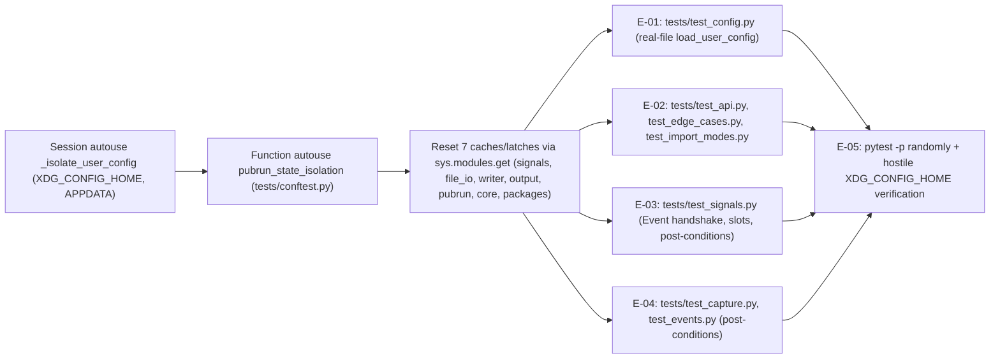

# IPD: Global test isolation assertion hardening and sleep or pinning cleanup

- Date: 2026-11-27
- Kind: child
- Concern: Close global test-isolation leaks (`TEST-C7`, `TEST-I4`), tighten vacuous/hedged/does-not-throw assertions (`TEST-C8`, `TEST-I10`), and eliminate fixed-sleep synchronization and private-slot pinning in `tests/test_signals.py` (`TEST-C9`, `TEST-I7`).
- Scope: Harden `tests/conftest.py` (user-config isolation + resetting 7 omitted module-level caches/latches), add real-file `load_user_config()` tests in `tests/test_config.py`, and tighten assertions / replace sleeps and private pinning across `tests/test_api.py`, `tests/test_edge_cases.py`, `tests/test_import_modes.py`, `tests/test_signals.py`, `tests/test_capture.py`, and `tests/test_events.py`.
- Scope-Paths: tests/conftest.py, tests/test_config.py, tests/test_api.py, tests/test_edge_cases.py, tests/test_import_modes.py, tests/test_signals.py, tests/test_capture.py, tests/test_events.py
- Item-Dependencies: none
- Status: reviewed
- Readiness: go-pending-approval
- Review-Depth: complex
- Short-Description: Isolate host user config and reset 7 module caches in conftest.py, tighten vacuous assertions, and replace fixed sleeps and private slot pins
- Work-Kind: followup
- Priority: medium
- Set: assess-bt
- Order: 8
- Highest E allocated: 05
- Author: Antigravity
- Id: kgoymu

> Write and proofread this plan per the technical writing standard, `.aw/system/workflows/technical-writing/technical-writing.md` (`.agents/workflows/technical-writing/technical-writing.md` in a legacy-layout install), including requirement 12 (diagrams).

## Workflow history

- 2026-11-27 /plan-review (Antigravity): APPROVE WITH REVISIONS APPLIED; PR-001, PR-002, PR-003, PR-004
- 2026-11-27 to-review (Antigravity): Authored review-ready child IPD from `/assess testing` Slices 1 and 3 on HEAD `512ee68` / `8f2aacd`.
- 2026-11-27 draft (Antigravity): created.

## Goal

Ensure the test suite is hermetically isolated from host `~/.config/pubrun/config.toml` and cross-test module-level cache/latch state under arbitrary `pytest-randomly` orderings, replace vacuous or hedged assertions with exact behavioral contract checks, and remove fixed-sleep thread races and private `__slots__` pinning in `tests/test_signals.py`.

### Test isolation and hardening scope



## Detailed Implementation Checklist (TODO)

Execution-state rule: mark an `E-*` item complete only after performing the action. That mark is not validation. Right-sizing rule: write for a modest executor that cannot hold much in its head. Each E-item is one step (one concern, about one file, executable in one focused pass) and its V-item names each unit it covers with its own check; a plan stays at about 5 E-items and 8 work Scope-Paths, else split it into more child plans (guidance, `IPD-Z603`). Accepted execution states: blocked, failed, pending, performed; terminal gate demands 'performed'.

### Task group 1: Hermetic `conftest.py` isolation and user-config coverage

- [ ] E-01 Isolate host user config and reset all 7 omitted module-level caches/latches in `tests/conftest.py`, and add real-file `load_user_config()` tests in `tests/test_config.py` (`TEST-C7`, `TEST-I4`):
  - In `tests/conftest.py`, add a **session-scoped** `autouse=True` fixture (for example `_isolate_user_config(tmp_path_factory)`) that sets `os.environ["XDG_CONFIG_HOME"]` and `os.environ["APPDATA"]` to a clean empty directory from `tmp_path_factory.mktemp("pubrun_xdg_config")` and restores their prior values on session teardown. Session scope guarantees the isolated paths are active before function-scoped `pubrun_state_isolation` captures `_env_snapshot = dict(os.environ)`, so per-test `monkeypatch.setenv` / `delenv` overrides still work and revert to the clean empty directory after each test.
  - In `tests/conftest.py::pubrun_state_isolation` (in `_reset()`, running on both setup and teardown), reset all 7 omitted module-level caches/latches strictly via `sys.modules.get(...)` (never eagerly importing unloaded modules, except `pubrun` and `pubrun.capture.signals` which `conftest.py` already imports):
    1. `pubrun.capture.signals`: clear `_timed_out_locks` (`_signals._timed_out_locks.clear()`).
    2. `pubrun.capture.file_io`: if loaded, acquire `_warn_lock` and clear `_warned_invalid_algorithms`.
    3. `pubrun.writer`: if loaded, acquire `_durability_warn_lock` and clear `_warned_invalid_durability`.
    4. `pubrun.report.output`: if loaded, call `set_debug(None)` (resets `_debug_enabled`).
    5. `pubrun`: call `pubrun._reset_version_cache()` (resets `_cached_version` and pops `__version__`).
    6. `pubrun.core`: if loaded, reset `_INACTIVE_POLICY_CACHE = None`, `_USER_CONFIG_PATH_MEMO = None`, and `_LOCAL_CONFIG_PATHS_MEMO = None`.
    7. `pubrun.capture.packages`: if loaded, call `invalidate_package_cache()` (resets `_CACHED_FINGERPRINT`, `_CACHED_INDEX`, and `_CACHED_PROVIDER`).
  - In `tests/test_config.py`, add real-file behavioral tests for `load_user_config()` covering (a) missing file returns `None`, (b) valid TOML under temporary `XDG_CONFIG_HOME` returns the parsed dict, (c) malformed TOML under temporary `XDG_CONFIG_HOME` returns `None` and logs `"ignoring malformed config file"` via `caplog`, and (d) Windows `APPDATA` resolution via `monkeypatch.setattr(sys, "platform", "win32")` + `monkeypatch.setenv("APPDATA", ...)`.
  - Depends on: none
  - Expected outcome: Running the suite with a hostile host `XDG_CONFIG_HOME/pubrun/config.toml` (`profile = "deep"`, `on_inactive_annotate = "error"`) stays 100% green, `tests/test_config_capture_modes.py::TestGlobalConfigDir` stays green, and cross-test cache/warning-latch leakage across all 7 modules is eliminated without eagerly importing lazy modules.
  - Execution state: pending

### Task group 2: Tighten vacuous assertions and clean up sleeps and private pinning

- [ ] E-02 Tighten vacuous and drifted assertions in `tests/test_api.py`, `tests/test_edge_cases.py`, and `tests/test_import_modes.py` (`TEST-C8`, `TEST-I10`):
  - In `tests/test_api.py`: in `TestDiff.test_diff_with_ignores`, assert ignored prefixes (`"timing"`, `"run"`, `"capture"`) do not appear in `set(result["modified"]) | set(result["added"]) | set(result["removed"])`; in `TestPhase.test_phase_context_manager` and `test_phase_with_exception`, assert exact `"phase_start"` and `"phase_end"` event types and `end_events[0]["payload"]["error"] == "ValueError"`; in `TestManifestSchema.test_capture_state_present_in_sections`, assert `isinstance(data, dict)` unconditionally before checking `"capture_state" in data`; add concrete post-condition assertions to the three "does-not-throw" tests (`TestStop.test_stop_without_active_run_no_crash` asserting `get_current_run() is None` after `stop()`; `TestAnnotate.test_annotate_without_active_run_no_crash` and `TestPhase.test_phase_without_active_run_no_crash` asserting `get_current_run() is None` and zero `"No active run"` warnings via `caplog` under default `ignore` policy).
  - In `tests/test_edge_cases.py`: in `TestDiffRobustness.test_unflatten_prefix_collision`, assert exact collision-preservation output (`assert result == {"a": {"b": 1}, "a.b.c": 2}`, matching `src/pubrun/analysis/diff.py::unflatten_manifest`) rather than bare `assert result`.
  - In `tests/test_import_modes.py`: align allowed-mode tuples in `TestImportMetadataInManifest.test_manifest_imports_has_correct_mode` and `test_lock_file_contains_import_mode` with `VALID_MODES` (including `"full"`).
  - Depends on: E-01
  - Expected outcome: Every tightened test fails when its contract is broken rather than passing vacuously.
  - Execution state: pending

- [ ] E-03 Clean up `tests/test_signals.py` (`TEST-C9`, `TEST-I7`, `TEST-I10`):
  - Remove the private tuple-equality pin `finalization_lock.__slots__ == ("_lock", "_timeout", "_acquired")` in `TestSignalHardeningAndRecovery.test_finalization_lock_uses_slots_and_releases_on_exception` while keeping `assert not hasattr(ctx, "__dict__")` and behavioral exception-release checks (`TEST-C9`).
  - Replace the two fixed-sleep thread handshakes (`time.sleep(0.05)` in `test_sigterm_finalizes_while_lock_held` for `write_lock_vs_hw_refresh` and `errors_lock_vs_hw_refresh`, around lines 715 and 727) with deterministic `threading.Event` coordination (`TEST-I7`): wrap `run.writer.write_startup_manifest` (for `write_lock_vs_hw_refresh`) and `run._check_section_failed` (for `errors_lock_vs_hw_refresh`) to set an `entering = threading.Event()` right before delegating to the real method, and wait on `assert entering.wait(5)` instead of `time.sleep(0.05)` after `assert ready.wait(5)`.
  - Add concrete post-condition assertions to the three "does-not-throw" tests in `tests/test_signals.py` (`TEST-I10`): `test_double_install_is_safe` (assert `cap._installed is True` after both `install()` calls and `False` after `uninstall()`, with original handlers restored), `test_double_uninstall_is_safe` (assert `cap._installed is False` after both `uninstall()` calls), and `test_finalize_active_run_no_crash_without_active_run` (assert `signals._finalizing_active_run is False` and `signals._timed_out_locks == set()` after the call).
  - Depends on: E-01
  - Expected outcome: `tests/test_signals.py` tests observable locking and signal outcomes without fixed-sleep handshake races or private-slot tuple coupling.
  - Execution state: pending

- [ ] E-04 Add post-condition assertions to "does-not-throw" tests in `tests/test_capture.py` and `tests/test_events.py` (`TEST-I10`):
  - In `tests/test_capture.py`: tighten `TestTqdmSafeTeeBrokenPipe.test_flush_catches_broken_pipe` to assert that `BrokenFlush.flush` was actually invoked (via a call counter) and that `"data\n"` was persisted to `log_file.getvalue()`, plus audit any remaining assertion-free tests in `tests/test_capture.py`.
  - In `tests/test_events.py`: tighten `TestEventStreamClose.test_close_idempotent` (assert `stream._file is None` after both closes and `events.jsonl` still contains the 1 `"test"` event), `TestEventStreamClose.test_emit_after_close_is_silent` (assert `stream._file is None` and `events.jsonl` remains empty), and `TestEventStreamConstructorFailure.test_emit_after_open_failure_is_silent` (assert `stream._file is None` and `(tmp_path / "events.jsonl")` does not exist).
  - Depends on: E-01
  - Expected outcome: Every test in `tests/test_capture.py` and `tests/test_events.py` asserts an observable post-condition.
  - Execution state: pending

### Task group 3: Validate under hostile host config and randomized ordering

- [ ] E-05 Run targeted `pytest -p randomly` both normally and under a hostile temporary `XDG_CONFIG_HOME` and record complete output:
  - Run both commands listed in `## Required tests / validation` and verify exit `0`.
  - Depends on: E-02, E-03, E-04
  - Expected outcome: All targeted test files (including `tests/test_config_capture_modes.py`) pass under `-p randomly` even when host `XDG_CONFIG_HOME` and `APPDATA` contain hostile pubrun settings.
  - Execution state: pending

## Project conventions discovered (Step 0)

- `tests/conftest.py::pubrun_state_isolation` must avoid importing optional or lazy submodules that were not yet loaded by the test (`sys.modules.get(...)` pattern) so lazy-import tests stay accurate.
- `tests/conftest.py::pubrun_state_isolation` snapshots `os.environ` at function-fixture setup and restores it at teardown, so isolating `XDG_CONFIG_HOME` and `APPDATA` in a **session-scoped** `autouse=True` fixture ensures `_env_snapshot` captures the isolated empty directory rather than the host user's config path while keeping `tests/test_config_capture_modes.py::TestGlobalConfigDir` (`isolated_home`) compatible.
- `tests/test_api.py::TestInactivePolicyCache` previously needed a local `empty_user_config_dir` fixture specifically because `tests/conftest.py` did not isolate `XDG_CONFIG_HOME` / `APPDATA`.
- The 7 omitted module-level caches/latches live in `src/pubrun/capture/signals.py::_timed_out_locks`, `src/pubrun/capture/file_io.py::_warned_invalid_algorithms` (`_warn_lock`), `src/pubrun/writer.py::_warned_invalid_durability` (`_durability_warn_lock`), `src/pubrun/report/output.py::_debug_enabled` (`set_debug(None)`), `src/pubrun/__init__.py::_cached_version` (`_reset_version_cache()`), `src/pubrun/core.py` (`_INACTIVE_POLICY_CACHE`, `_USER_CONFIG_PATH_MEMO`, `_LOCAL_CONFIG_PATHS_MEMO`), and `src/pubrun/capture/packages.py::_CACHED_INDEX` (`invalidate_package_cache()`).

## Findings

| ID | Concerns | Severity | Remediation Risk | Persona | Summary |
|---|---|---|---|---|---|
| `TEST-C7` | testing | Medium | Low (`functionality`) | Testing Expert | `tests/conftest.py` does not isolate `XDG_CONFIG_HOME`/`APPDATA`, letting host `~/.config/pubrun/config.toml` break multiple tests. |
| `TEST-I4` | testing | Medium | Low (`functionality`) | Testing Expert | `tests/conftest.py` omits 7 module-level caches/latches (`signals._timed_out_locks`, `file_io._warned_invalid_algorithms`, `writer._warned_invalid_durability`, `report.output._debug_enabled`, `pubrun._cached_version`, `core._INACTIVE_POLICY_CACHE`/`_USER_CONFIG_PATH_MEMO`/`_LOCAL_CONFIG_PATHS_MEMO`, `packages._CACHED_INDEX`) from per-test reset. |
| `TEST-C8` | testing | Medium | Low (`functionality`) | QA / Testing Expert | Vacuous, hedged, and drifted assertions in `test_api.py`, `test_edge_cases.py`, and `test_import_modes.py`. |
| `TEST-C9` (`test_signals.py`) | testing | Low | Low (`complexity`) | Testing Expert | Private `__slots__` tuple equality pin in `tests/test_signals.py::test_finalization_lock_uses_slots_and_releases_on_exception`. |
| `TEST-I7` (`test_signals.py`) | testing | Medium | Low (`functionality`) | Testing Expert | Fixed-sleep thread handshakes in `tests/test_signals.py`. |
| `TEST-I10` | testing | Low | Low (`functionality`) | QA Engineer | Assertion-free "does-not-throw" tests lacking observable post-condition assertions across `test_api.py`, `test_capture.py`, `test_events.py`, and `test_signals.py`. |

## Proposed changes (ordered, validatable)

1. `E-01` (`tests/conftest.py`, `tests/test_config.py`): Add session-scoped `XDG_CONFIG_HOME`/`APPDATA` isolation, reset all 7 omitted caches/latches via `sys.modules.get(...)` in `pubrun_state_isolation`, and add real-file `load_user_config()` tests.
2. `E-02` (`tests/test_api.py`, `tests/test_edge_cases.py`, `tests/test_import_modes.py`): Tighten vacuous/hedged/drifted assertions and add post-conditions to inactive no-crash tests.
3. `E-03` (`tests/test_signals.py`): Remove private `__slots__` tuple equality, replace fixed sleeps at lines 715 and 727 with deterministic `threading.Event` entry handshakes, and add post-conditions.
4. `E-04` (`tests/test_capture.py`, `tests/test_events.py`): Add observable post-condition assertions to does-not-throw tests.
5. `E-05` (validation): Run randomized pytest normally (including `tests/test_config_capture_modes.py`) and under a hostile temporary `XDG_CONFIG_HOME`/`APPDATA`.

## Deferred / out of scope (with reason)

None.

## Scope check

- Over-scope: none. Test-only changes strictly limited to the eight declared files.
- Under-scope: none. All global isolation, cache-reset, assertion-hardening, and signal-sleep/pinning findings are covered.

## Required tests / validation

1. Randomized pytest run across all modified suites (plus `tests/test_config_capture_modes.py` to confirm `TestGlobalConfigDir` compatibility with session user-config isolation):
   ```sh
   python3 -m pytest -p randomly tests/test_config.py tests/test_config_capture_modes.py tests/test_api.py tests/test_edge_cases.py tests/test_import_modes.py tests/test_signals.py tests/test_capture.py tests/test_events.py -v
   ```
2. Hostile host user-config isolation verification:
   ```sh
   python3 -c 'import os, subprocess, sys, tempfile
   from pathlib import Path
   with tempfile.TemporaryDirectory() as td:
       cfg = Path(td) / "pubrun" / "config.toml"
       cfg.parent.mkdir(parents=True)
       cfg.write_text("[core]\nprofile = \"deep\"\n[events]\non_inactive_annotate = \"error\"\n", encoding="utf-8")
       env = dict(os.environ, XDG_CONFIG_HOME=td, APPDATA=td)
       rc = subprocess.call([sys.executable, "-m", "pytest", "-p", "randomly", "-q", "tests/test_config.py", "tests/test_api.py", "tests/test_edge_cases.py"], env=env)
       assert rc == 0, f"failed with hostile user config: rc={rc}"
       print("HOSTILE_USER_CONFIG_ISOLATION_OK")'
   ```

## Spec / documentation sync

Not applicable. Test-only isolation and assertion hardening; no production code, command-line interface (CLI), configuration key, manifest schema, or public application programming interface (API) changes.

## Open questions

None.

## Validation and cross-check (verify before reporting done)

Validation-state rule: inspect evidence in a separate pass. Do not mark a `V-*` item complete from memory or from the matching execution checkmark. Accepted validation results: blocked, failed, pass, pending; terminal gate demands 'pass'. Runtime-demonstration reachability rule: for each `V-*` item demanding the software be observed acting (such as a run, a dispatch, or a transition), as distinct from items demanding a diff, a file's content, or a test result (which are reachable by construction), name the code path that produces the observation or the sibling `E-*` that creates it, else the demand is UNDER-SCOPE.

- [ ] V-01 validates E-01
  - Required evidence: Pasted `git diff -- tests/conftest.py tests/test_config.py` confirming session-scoped `XDG_CONFIG_HOME`/`APPDATA` isolation, all 7 module cache/latch resets via `sys.modules.get(...)` (`signals._timed_out_locks`, `file_io._warned_invalid_algorithms`, `writer._warned_invalid_durability`, `report.output.set_debug(None)`, `pubrun._reset_version_cache()`, `core._INACTIVE_POLICY_CACHE`/`_USER_CONFIG_PATH_MEMO`/`_LOCAL_CONFIG_PATHS_MEMO`, `packages.invalidate_package_cache()`), and real-file `load_user_config()` tests, plus passing output from Command 2 (`HOSTILE_USER_CONFIG_ISOLATION_OK`, exercising `tests/conftest.py::_isolate_user_config` and `pubrun_state_isolation` updated in `E-01`) and `python3 -m pytest tests/test_config.py tests/test_config_capture_modes.py -v` exiting `0`.
  - Observed evidence:
  - Result: pending

- [ ] V-02 validates E-02
  - Required evidence: Pasted `git diff -- tests/test_api.py tests/test_edge_cases.py tests/test_import_modes.py` confirming tightened assertions, exact `unflatten_manifest` collision equality, inactive no-crash post-conditions, and `VALID_MODES` alignment, plus passing `python3 -m pytest -p randomly tests/test_api.py tests/test_edge_cases.py tests/test_import_modes.py -v` output exiting `0` (re-deriving active test node names at execution time).
  - Observed evidence:
  - Result: pending

- [ ] V-03 validates E-03
  - Required evidence: Pasted `git diff -- tests/test_signals.py` confirming removal of private `__slots__` tuple equality, replacement of the two `time.sleep(0.05)` handshakes with deterministic `threading.Event` entry coordination, and added post-conditions on double-install/uninstall and inactive `_finalize_active_run()`, plus passing `python3 -m pytest -p randomly tests/test_signals.py -v` output exiting `0`.
  - Observed evidence:
  - Result: pending

- [ ] V-04 validates E-04
  - Required evidence: Pasted `git diff -- tests/test_capture.py tests/test_events.py` confirming observable post-condition assertions added to the broken-pipe flush and closed/failed-open `EventStream` tests, plus passing `python3 -m pytest -p randomly tests/test_capture.py tests/test_events.py -v` output exiting `0`.
  - Observed evidence:
  - Result: pending

- [ ] V-05 validates E-05
  - Required evidence: Pasted complete output of Command 1 (all eight pytest files under `-p randomly`) and Command 2 (hostile `XDG_CONFIG_HOME`/`APPDATA` isolation subprocess printing `HOSTILE_USER_CONFIG_ISOLATION_OK`, exercising `tests/conftest.py::_isolate_user_config` and `pubrun_state_isolation` updated in `E-01`) from `## Required tests / validation`, both exiting `0`.
  - Observed evidence:
  - Result: pending

## Approval and execution gate

- Size assessment: standard
- Cohesion rationale: not required

1. **Open questions and approval:** This plan is a proposal and must not be executed until all blocking open questions are resolved (none remain) and explicit human approval is recorded (`aw ipd set approved kgoymu --by-human` or `aw set approved assess-bt --by-human`).
2. **Scope declaration:** `- Scope-Paths:` declares the expected files this plan modifies (`tests/conftest.py`, `tests/test_config.py`, `tests/test_api.py`, `tests/test_edge_cases.py`, `tests/test_import_modes.py`, `tests/test_signals.py`, `tests/test_capture.py`, `tests/test_events.py`). Keep changes within this scope; if execution genuinely requires editing an additional file or leaving a declared file untouched, make the necessary change and justify the delta at finalization with `--scope-reason` (per out-of-scope path) or `--scope-ack` (per declared-but-unmodified path) rather than stopping mid-run. Stop and report only on a genuinely unsafe condition (such as an unresolvable concurrent-edit conflict or missing prerequisite symbols).
3. **Validation honesty (hard requirement):** Every `V-*` item must paste actual runner output from this workspace confirming exit `0` and the required behavior; never claim passing tests that were not actually run.
4. **Commits and push policy:** Commit only files modified for this plan through `aw commit kgoymu -- <paths>` (never `git add -A`, bare `git add`, `git commit -a`, or raw `git commit`). Never push, tag, or publish.
5. **Lifecycle finalization:** On completion, finalize this plan to `.aw/records/plans/executed/` only after every `E-*` item is `performed` and every `V-*` item is `pass`. When run under `aw oc run` or `aw agy run`, the runner owns `aw ipd finalize kgoymu`; when executed manually outside a runner, the executor runs `aw ipd finalize kgoymu` (never hand-roll `git mv` to `executed/`).
