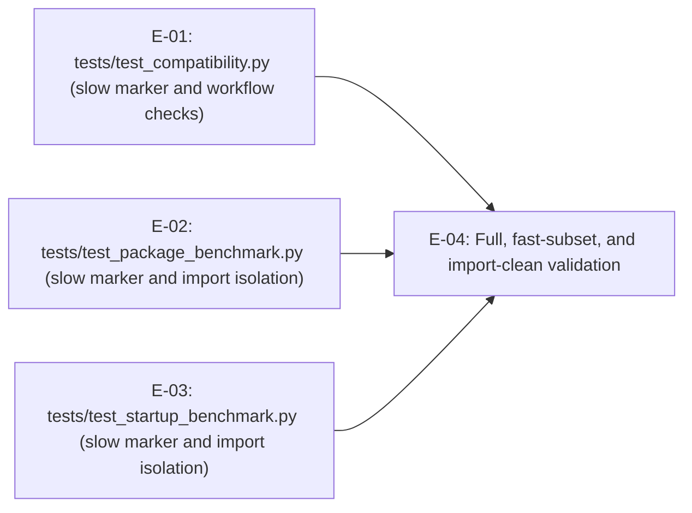

# IPD: Slow test markers and workflow or benchmark test isolation cleanup

- Date: 2026-11-27
- Kind: child
- Concern: Add missing `@pytest.mark.slow` markers (`TEST-I6`), replace brittle workflow raw-substring pins in `tests/test_compatibility.py` (`TEST-I8`), and clean up global `sys.path` and `sys.modules` mutations in `tests/test_package_benchmark.py` and `tests/test_startup_benchmark.py` (`TEST-I5`).
- Scope: Update `tests/test_compatibility.py`, `tests/test_package_benchmark.py`, and `tests/test_startup_benchmark.py` (test-only changes; no production source edits).
- Scope-Paths: tests/test_compatibility.py, tests/test_package_benchmark.py, tests/test_startup_benchmark.py
- Item-Dependencies: none
- Status: reviewed
- Readiness: go-pending-approval
- Review-Depth: standard
- Short-Description: Add @pytest.mark.slow markers, harden workflow assertions in test_compatibility.py, and isolate sys.path/sys.modules in benchmark tests
- Work-Kind: followup
- Priority: low
- Set: assess-bt
- Order: 10
- Highest E allocated: 04
- Author: Antigravity
- Id: 37sth0

> Write and proofread this plan per the technical writing standard, `.aw/system/workflows/technical-writing/technical-writing.md` (`.agents/workflows/technical-writing/technical-writing.md` in a legacy-layout install), including requirement 12 (diagrams).

## Workflow history

- 2026-11-27 /plan-review (Antigravity): APPROVE WITH REVISIONS APPLIED; PR-001, PR-002, PR-003, PR-004
- 2026-11-27 to-review (Antigravity): Authored review-ready child IPD from `/assess testing` Slice 3 audit on HEAD `512ee68` / `8f2aacd`.
- 2026-11-27 draft (Antigravity): created.

## Goal

Make `pytest -m "not slow"` accurately deselect multi-subprocess benchmark workloads across `tests/test_compatibility.py`, `tests/test_package_benchmark.py`, and `tests/test_startup_benchmark.py` using the `slow` marker already registered in `pyproject.toml`. Replace brittle verbatim-substring workflow checks in `tests/test_compatibility.py` with formatting-tolerant structural checks (preserving zero-dependency standard-library execution when PyYAML is absent) and structured PyYAML cross-checks, and ensure `_load_module` helpers in `tests/test_package_benchmark.py` and `tests/test_startup_benchmark.py` restore `sys.path` and `sys.modules` cleanly on exit.

### Slow marker and test isolation workflow



## Detailed Implementation Checklist (TODO)

Execution-state rule: mark an `E-*` item complete only after performing the action. That mark is not validation. Right-sizing rule: write for a modest executor that cannot hold much in its head. Each E-item is one step (one concern, about one file, executable in one focused pass) and its V-item names each unit it covers with its own check; a plan stays at about 5 E-items and 8 work Scope-Paths, else split it into more child plans (guidance, `IPD-Z603`). Accepted execution states: blocked, failed, pending, performed; terminal gate demands 'performed'.

### Task group 1: Mark slow tests and remove brittle substring/module-state coupling

- [ ] E-01 Update `tests/test_compatibility.py` (`TEST-I6`, `TEST-I8`):
  - Apply `@pytest.mark.slow` to `tests/test_compatibility.py::test_scaling_benchmark_quick_smoke_and_share_safety` (the sole multi-subprocess benchmark test in the file), leaving the three fast workflow tests (`test_ci_workflow_compatibility_matrix_structural`, `test_dependency_audit_workflow_structural`, and `test_workflows_pyyaml_crosscheck_when_available`) unmarked so `pytest -m "not slow"` still executes them.
  - Harden the zero-dependency standard-library structural tests (`test_ci_workflow_compatibility_matrix_structural` and `test_dependency_audit_workflow_structural`, which MUST keep running without PyYAML because Continuous Integration (CI)'s 21-cell `test` job in `.github/workflows/ci.yml` does not install `pyyaml`): make `_extract_job_block` tolerant of valid YAML indentation/trailing comments and replace brittle verbatim quoted-string pins (such as `'"3.10"'`, `'"scaling_bench.py"'`, `'.[dev,bench]'`, `'install -e ".[tui]"'`, and exact flag-ordered `pubrun bench ...` lines) with formatting-tolerant semantic token/flag checks that survive single-vs-double quoting, list reflow, extra ordering, and flag reordering.
  - In `test_workflows_pyyaml_crosscheck_when_available` (kept guarded by `pytest.importorskip("yaml")`), replace the remaining verbatim quoted-string substring checks (`'"scaling_bench.py"'`, exact flag order in `pubrun bench`, and literal `'.[dev,bench]'`/`'.[tui]'`) with parsed step/token assertions over `yaml.safe_load` output.
  - Depends on: none
  - Expected outcome: `test_scaling_benchmark_quick_smoke_and_share_safety` is deselected by `-m "not slow"`, workflow checks pass both with and without PyYAML installed, and benign YAML/shell reformatting does not trigger false failures.
  - Execution state: pending

- [ ] E-02 Update `tests/test_package_benchmark.py` (`TEST-I5`, `TEST-I6`):
  - Apply `@pytest.mark.slow` at the class level to `tests/test_package_benchmark.py::TestPackageCaptureBenchRun` so all eight methods sharing the module-scoped `bench_run` fixture are deselected under `-m "not slow"` and the slow `benchmarks/package_capture_bench.py` fixture never runs in fast mode; keep `TestPackageCaptureBenchCli.test_rejects_non_positive_repetitions`, `TestSyntheticEnvironmentBuilder`, and `TestTransitiveScenario` unmarked so fast Command-Line Interface (CLI) validation and unit tests still run.
  - Replace bare `tests/test_package_benchmark.py::_load_module` with a context manager (for example `_loaded_module(mod_name, rel_path)`) or fixture that snapshots `list(sys.path)` and `dict(sys.modules)` before `spec.loader.exec_module(mod)` and restores `sys.path[:]` plus any added or replaced `sys.modules` keys (covering both synthetic `mod_name` entries and side effects from `benchmarks/package_capture_bench.py` inserting `benchmarks/` and `src/` into `sys.path` and `benchmarks/scenarios.py` registering `_pubrun_bench_scenarios_standalone`) in a `finally` block while keeping all tests deterministic under `-p randomly`.
  - Depends on: none
  - Expected outcome: `TestPackageCaptureBenchRun` is deselected under `-m "not slow"`, fast unit/CLI-validation tests remain active, and running the tests leaves `sys.path` and `sys.modules` unchanged.
  - Execution state: pending

- [ ] E-03 Update `tests/test_startup_benchmark.py` (`TEST-I5`, `TEST-I6`):
  - Apply `@pytest.mark.slow` at the class level to `tests/test_startup_benchmark.py::TestBreakdownEndToEnd` (three multi-subprocess end-to-end tests) AND at the method level to `tests/test_startup_benchmark.py::TestBreakdownScrubBoundaries.test_cli_with_short_username_emits_intact_output` (two parametrized full-benchmark subprocess cases); keep `TestStartupAutoDefaultScenario`, `TestBreakdownStatisticsAndRedaction`, `TestBreakdownCLIValidation`, and the eight non-CLI unit tests in `TestBreakdownScrubBoundaries` unmarked so all fast unit and flag-validation tests run under `-m "not slow"`.
  - Replace bare `tests/test_startup_benchmark.py::_load_module` with a context manager (or fixture) that snapshots `list(sys.path)` and `dict(sys.modules)` before `spec.loader.exec_module(mod)` and restores `sys.path[:]` plus any added or replaced `sys.modules` keys (covering synthetic `mod_name` entries, `benchmarks/startup_breakdown.py`'s `sys.path` insertions of `benchmarks/` and `src/` plus transitive `share_safety` import, and `benchmarks/scenarios.py`'s `_pubrun_bench_scenarios_standalone` entry) in a `finally` block while keeping all tests deterministic under `-p randomly`.
  - Depends on: none
  - Expected outcome: All five multi-subprocess startup-breakdown benchmark tests are deselected under `-m "not slow"`, fast unit and CLI-validation tests remain active, and running the tests leaves `sys.path` and `sys.modules` unchanged.
  - Execution state: pending

### Task group 2: Validate full execution, `-m "not slow"` selection, and clean import state

- [ ] E-04 Run targeted `python3 -m pytest -p randomly` (full and `-m "not slow"`) plus import-state isolation check and record complete output:
  - Run Commands 1, 2, and 3 listed in `## Required tests / validation` and verify exit `0`, confirming `-m "not slow"` deselects the slow benchmark tests, runs only the fast subset, and leaves `sys.path` and `sys.modules` unchanged.
  - Depends on: E-01, E-02, E-03
  - Expected outcome: All tests pass under `-p randomly`, `-m "not slow"` reports deselected slow tests with exit `0`, and `BENCH_TESTS_IMPORT_CLEAN_OK` exits `0`.
  - Execution state: pending

## Project conventions discovered (Step 0)

- `pyproject.toml` already registers the marker `slow: runs the benchmark harness or another multi-subprocess workload (deselect with -m 'not slow')` under `[tool.pytest.ini_options]`, so no `pyproject.toml` edit is required.
- `.github/workflows/ci.yml`'s `test` job installs `.[dev,tui]` without `pyyaml`, while `extra-suites` installs `.[dev,bench]` plus `pyyaml`; therefore `tests/test_compatibility.py` keeps its stdlib structural workflow checks dependency-free and guards `test_workflows_pyyaml_crosscheck_when_available` with `pytest.importorskip("yaml")`.
- `tests/test_compatibility.py` reads `.github/workflows/ci.yml` and `.github/workflows/dependency-audit.yml` (it does not inspect `pyproject.toml`).
- Importing `benchmarks/package_capture_bench.py`, `benchmarks/startup_breakdown.py`, and `benchmarks/scenarios.py` mutates `sys.path` (`benchmarks/`, `src/`) and registers transitive `sys.modules` entries (`share_safety`, `_pubrun_bench_scenarios_standalone`), so `_load_module` cleanup must snapshot and restore both `sys.path` and `sys.modules`.

## Findings

| ID | Concerns | Severity | Remediation Risk | Persona | Summary |
|---|---|---|---|---|---|
| `TEST-I5` (`test_*_benchmark.py`) | testing | Medium | Low (`complexity`) | Testing Expert | `_load_module` helpers in `tests/test_package_benchmark.py` and `tests/test_startup_benchmark.py` insert synthetic modules into `sys.modules` and trigger `sys.path` / transitive `sys.modules` mutations without cleanup. |
| `TEST-I6` (`@pytest.mark.slow`) | testing | Medium | Low (`complexity`) | Testing / CI Engineer | Multi-subprocess benchmark tests in `tests/test_compatibility.py`, `tests/test_package_benchmark.py`, and `tests/test_startup_benchmark.py` lack `@pytest.mark.slow` despite the marker being registered in `pyproject.toml`. |
| `TEST-I8` (`test_compatibility.py`) | testing | Low | Low (`complexity`) | Testing Expert | Brittle raw-text workflow substring pinning in `tests/test_compatibility.py` against `.github/workflows/ci.yml` and `.github/workflows/dependency-audit.yml`. |

## Proposed changes (ordered, validatable)

1. `E-01` (`tests/test_compatibility.py`): Add `@pytest.mark.slow` on `test_scaling_benchmark_quick_smoke_and_share_safety` and replace brittle verbatim workflow substring pins with formatting-tolerant stdlib checks and structured PyYAML assertions (preserving PyYAML optionality).
2. `E-02` (`tests/test_package_benchmark.py`): Add `@pytest.mark.slow` on `TestPackageCaptureBenchRun` and snapshot/restore `sys.path` and `sys.modules` around `_load_module`.
3. `E-03` (`tests/test_startup_benchmark.py`): Add `@pytest.mark.slow` on `TestBreakdownEndToEnd` and `TestBreakdownScrubBoundaries.test_cli_with_short_username_emits_intact_output`, and snapshot/restore `sys.path` and `sys.modules` around `_load_module`.
4. `E-04` (validation): Run randomized pytest fully and with `-m "not slow"`, plus verify `sys.path` and `sys.modules` cleanliness after running the benchmark unit tests.

## Deferred / out of scope (with reason)

None.

## Scope check

- Over-scope: none. Test-only plan modifying strictly three test files (`tests/test_compatibility.py`, `tests/test_package_benchmark.py`, `tests/test_startup_benchmark.py`), mutually disjoint from all other children in Set `assess-bt`.
- Under-scope: none. All remaining `TEST-I5`, `TEST-I6`, and `TEST-I8` items assigned to Order 10 are covered.

## Required tests / validation

1. Full randomized pytest run across all three files:
   ```sh
   python3 -m pytest -p randomly tests/test_compatibility.py tests/test_package_benchmark.py tests/test_startup_benchmark.py -v
   ```
2. Fast-subset marker selection check:
   ```sh
   python3 -m pytest -p randomly -m "not slow" tests/test_compatibility.py tests/test_package_benchmark.py tests/test_startup_benchmark.py -v
   ```
3. Verify fast-subset execution of `tests/test_package_benchmark.py` and `tests/test_startup_benchmark.py` leaves `sys.path` and synthetic/transitive `sys.modules` entries clean:
   ```sh
   python3 -c 'import sys, pytest
   before_path = list(sys.path)
   before_mods = set(sys.modules)
   rc = pytest.main(["-m", "not slow", "-q", "tests/test_package_benchmark.py", "tests/test_startup_benchmark.py"])
   assert rc == 0, rc
   assert list(sys.path) == before_path, ("sys.path mutated:", set(sys.path) - set(before_path))
   leaked = sorted(
       m for m in (set(sys.modules) - before_mods)
       if m.startswith("_test_") or m in ("share_safety", "_pubrun_bench_scenarios_standalone")
   )
   assert not leaked, f"sys.modules leaked: {leaked}"
   print("BENCH_TESTS_IMPORT_CLEAN_OK")'
   ```

## Spec / documentation sync

Not applicable. Uses the existing `slow` marker already documented in `pyproject.toml` and modifies only test files with no production code, CLI, or user-facing documentation changes.

## Open questions

None.

## Validation and cross-check (verify before reporting done)

Validation-state rule: inspect evidence in a separate pass. Do not mark a `V-*` item complete from memory or from the matching execution checkmark. Accepted validation results: blocked, failed, pass, pending; terminal gate demands 'pass'. Runtime-demonstration reachability rule: for each `V-*` item demanding the software be observed acting (such as a run, a dispatch, or a transition), as distinct from items demanding a diff, a file's content, or a test result (which are reachable by construction), name the code path that produces the observation or the sibling `E-*` that creates it, else the demand is UNDER-SCOPE.

- [ ] V-01 validates E-01
  - Required evidence: Pasted `git diff -- tests/test_compatibility.py` confirming `@pytest.mark.slow` on `test_scaling_benchmark_quick_smoke_and_share_safety`, formatting-tolerant zero-dependency stdlib workflow checks, and structured `pytest.importorskip("yaml")` cross-checks, plus execution-time passing pytest output for `tests/test_compatibility.py`.
  - Observed evidence:
  - Result: pending

- [ ] V-02 validates E-02
  - Required evidence: Pasted `git diff -- tests/test_package_benchmark.py` confirming `@pytest.mark.slow` on `TestPackageCaptureBenchRun` and scoped `sys.path`/`sys.modules` snapshot-and-restore in `_load_module`, plus passing execution-time pytest output for `tests/test_package_benchmark.py` and `BENCH_TESTS_IMPORT_CLEAN_OK` from Command 3.
  - Observed evidence:
  - Result: pending

- [ ] V-03 validates E-03
  - Required evidence: Pasted `git diff -- tests/test_startup_benchmark.py` confirming `@pytest.mark.slow` on `TestBreakdownEndToEnd` and `TestBreakdownScrubBoundaries.test_cli_with_short_username_emits_intact_output` plus scoped `sys.path`/`sys.modules` snapshot-and-restore in `_load_module`, along with passing execution-time pytest output for `tests/test_startup_benchmark.py` and `BENCH_TESTS_IMPORT_CLEAN_OK` from Command 3.
  - Observed evidence:
  - Result: pending

- [ ] V-04 validates E-04
  - Required evidence: Pasted complete execution-time output of Commands 1, 2, and 3 in `## Required tests / validation` (exercising `python3 -m pytest -p randomly` and `pytest.main(["-m", "not slow", ...])`), confirming exit `0`, all collected tests passing in Command 1, all marked slow tests visibly deselected (`deselected`) while fast tests pass in Command 2, and `BENCH_TESTS_IMPORT_CLEAN_OK` in Command 3.
  - Observed evidence:
  - Result: pending

## Approval and execution gate

- Size assessment: standard
- Cohesion rationale: not required

1. **Open questions and approval:** Do not execute until explicit human approval is recorded (`aw ipd set approved 37sth0 --by-human` or `aw set approved assess-bt --by-human`).
2. **Scope declaration:** `- Scope-Paths:` declares the expected three test files this plan modifies (`tests/test_compatibility.py`, `tests/test_package_benchmark.py`, `tests/test_startup_benchmark.py`). Keep changes within this scope; if execution genuinely requires editing an additional file or leaving a declared file untouched, make the necessary change and justify the delta at finalization with `--scope-reason` (per out-of-scope path) or `--scope-ack` (per declared-but-unmodified path) rather than stopping mid-run. Stop and report only on a genuinely unsafe condition (such as an unresolvable concurrent-edit conflict or missing prerequisite symbols).
3. **Validation honesty:** You MUST run every validation command listed in `## Required tests / validation` in this workspace and paste the actual runner output verbatim into each corresponding `V-*` item. Never claim tests passed without running them.
4. **Commits and push policy:** Commit only files modified for this plan through `aw commit 37sth0 -- <paths>` (never `git add -A`, `git commit -a`, or raw `git commit`). Never push, tag, or publish without explicit human instruction.
5. **Lifecycle finalization:** Mark each `E-*` item `performed` only after completing the work, and mark each `V-*` item `pass` only after inspecting actual pasted evidence in a separate pass. When executed by a runner (`aw oc run` or `aw agy run`), leave finalization to the runner's post-execution lifecycle transition; when executed manually by an agent outside a runner, finalize via `aw ipd finalize 37sth0` (never a hand-rolled `git mv` to `executed/`).
