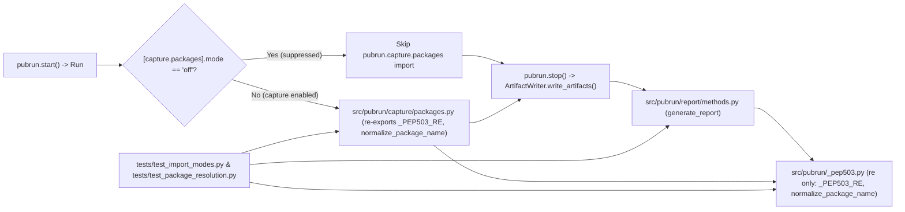

# IPD: Avoid loading pubrun.capture.packages from report/methods.py

- Date: 2026-11-27
- Kind: child
- Concern: Startup and finalization import isolation for disabled package capture (backlog item `b3dejs`, filed as follow-up to executed Implementation Plan Document (IPD) `p4ueaj`): `src/pubrun/report/methods.py` imports `normalize_package_name` from `src/pubrun/capture/packages.py` at module top level, so every `pubrun.stop()` loads `pubrun.capture.packages` even when `[capture.packages].mode == "off"`.
- Scope: Extract the Python Enhancement Proposal 503 (PEP 503) package-name normalization helper into a lightweight standard-library module `src/pubrun/_pep503.py`, re-export it from `src/pubrun/capture/packages.py` for backward compatibility, switch `src/pubrun/report/methods.py` to import from `pubrun._pep503`, and add fresh-subprocess and unit regression tests in `tests/test_import_modes.py` and `tests/test_package_resolution.py`.
- Scope-Paths: src/pubrun/_pep503.py, src/pubrun/capture/packages.py, src/pubrun/report/methods.py, tests/test_import_modes.py, tests/test_package_resolution.py
- Item-Dependencies: executed:p4ueaj
- Status: reviewed
- Readiness: go-pending-approval
- Review-Depth: standard
- Short-Description: Extract PEP 503 package-name normalization to a shared standard-library helper so report/methods.py never loads pubrun.capture.packages when package capture is off
- Work-Kind: followup
- Priority: low
- From-Backlog: b3dejs
- Set: b3dejs
- Order: 1
- Highest E allocated: 04
- Author: Antigravity
- Id: 3u1xgk

> Write and proofread this plan per the technical writing standard, `.aw/system/workflows/technical-writing/technical-writing.md` (`.agents/workflows/technical-writing/technical-writing.md` in a legacy-layout install), including requirement 12 (diagrams).

## Workflow history

- 2026-11-27 /plan-review (Antigravity): APPROVE WITH REVISIONS APPLIED; PR-001, PR-002, PR-003
- 2026-11-27 to-review (Antigravity): Authored review-ready IPD graduating backlog item b3dejs
- 2026-11-27 draft (Antigravity): created.

## Goal

Keep `pubrun.capture.packages` out of `sys.modules` across a full `pubrun.start()` and `pubrun.stop()` cycle when `[capture.packages].mode == "off"`, and keep both `pubrun.capture.packages` and `importlib.metadata` out of `sys.modules` when callers import and use `pubrun.report.methods` directly under a non-auto-start import mode (`pubrun.minimal`, `pubrun.noauto`, or `PUBRUN_IMPORT_MODE=minimal` / `noauto`). Move the PEP 503 normalization helper into a shared standard-library module (`src/pubrun/_pep503.py`) while preserving `pubrun.capture.packages.normalize_package_name` as a backward-compatible re-export.

### Module import and run-stop dependency flow

## Detailed Implementation Checklist (TODO)

Execution-state rule: mark an `E-*` item complete only after performing the action. That mark is not validation. Right-sizing rule: write for a modest executor that cannot hold much in its head. Each E-item is one step (one concern, about one file, executable in one focused pass) and its V-item names each unit it covers with its own check; a plan stays at about 5 E-items and 8 work Scope-Paths, else split it into more child plans (guidance, `IPD-Z603`). Accepted execution states: blocked, failed, pending, performed; terminal gate demands 'performed'.

### Task group 1: Shared PEP 503 helper and import decoupling

- [ ] E-01 Create the lightweight standard-library helper module `src/pubrun/_pep503.py`:
  - Import only `re` from the Python standard library. Do not import `importlib.metadata` or any `pubrun.capture.*` module.
  - Define `_PEP503_RE = re.compile(r"[-_.]+")` and `def normalize_package_name(name: str) -> str:` returning `_PEP503_RE.sub("-", name).lower()`.
  - Keep type annotations compatible with Python 3.8 through 3.14 (matching `pyproject.toml` `requires-python = ">=3.8"` and `src/pubrun/py.typed`), and add concise module and function docstrings.
  - Depends on: none
  - Expected outcome: `src/pubrun/_pep503.py` exists, exposes `_PEP503_RE` and `normalize_package_name`, loads without importing `importlib.metadata` or `pubrun.capture.packages`, and passes `mypy`.
  - Execution state: pending

- [ ] E-02 Re-export `normalize_package_name` and `_PEP503_RE` in `src/pubrun/capture/packages.py` from `src/pubrun/_pep503.py`:
  - Remove the local `_PEP503_RE = re.compile(r"[-_.]+")` definition and the local `def normalize_package_name(name: str) -> str:` definition from `src/pubrun/capture/packages.py`.
  - Import them with explicit Python Enhancement Proposal 561 (PEP 561) re-export aliases: `from pubrun._pep503 import _PEP503_RE as _PEP503_RE, normalize_package_name as normalize_package_name`.
  - Keep all internal calls to `normalize_package_name` in `src/pubrun/capture/packages.py` unchanged so existing downstream callers (`src/pubrun/report/reproducibility.py`, `tests/test_package_resolution.py`, `tests/test_package_lifecycle.py`, `tests/test_package_transitive.py`, and `tests/test_reproducibility_preflight.py`) keep identical behavior and strict typing under `mypy --no-implicit-reexport`.
  - Depends on: E-01
  - Expected outcome: `pubrun.capture.packages.normalize_package_name is pubrun._pep503.normalize_package_name`, `pubrun.capture.packages._PEP503_RE is pubrun._pep503._PEP503_RE`, and all existing package-capture and preflight tests pass without edits.
  - Execution state: pending

- [ ] E-03 Update `src/pubrun/report/methods.py` to import `normalize_package_name` from `pubrun._pep503`:
  - Replace `from pubrun.capture.packages import normalize_package_name` at the top of `src/pubrun/report/methods.py` with `from pubrun._pep503 import normalize_package_name`.
  - Leave `_NORMALIZED_HIGHLIGHTS`, `_extract_valid_packages`, `extract_highlighted_packages`, `generate_report`, and `generate_report_multi` behavior unchanged.
  - Depends on: E-01
  - Expected outcome: Importing `pubrun.report.methods` under a non-auto-start import mode (`pubrun.minimal`, `pubrun.noauto`, or `PUBRUN_IMPORT_MODE=minimal`) and calling `generate_report` or `extract_highlighted_packages` leaves both `pubrun.capture.packages` and `importlib.metadata` out of `sys.modules`; running `pubrun.start()` followed by `pubrun.stop()` with `[capture.packages].mode == "off"` writes `methods.md` while keeping `pubrun.capture.packages` out of `sys.modules`.
  - Execution state: pending

### Task group 2: Subprocess and unit regression tests

- [ ] E-04 Add regression tests in `tests/test_import_modes.py` and `tests/test_package_resolution.py`:
  - Update `tests/test_import_modes.py::TestModePep561AndColdStart::test_packages_mode_off_keeps_packages_module_unloaded` so the fresh-subprocess script also captures `"pubrun.capture.packages" in sys.modules` after `pubrun.stop()` and asserts that `loaded_after_stop` is `False`. Verify in the same test that `methods.md` exists inside `run.run_dir` and contains `"Package capture was disabled by configuration."`, proving `src/pubrun/writer.py::ArtifactWriter.write_artifacts` imported and ran `pubrun.report.methods::generate_report`.
  - Add a fresh-subprocess test in `tests/test_import_modes.py::TestModePep561AndColdStart` that imports `pubrun.minimal` first (preventing `src/pubrun/__init__.py::_execute_boot_sequence` from auto-starting a run under default `auto` mode), then imports `pubrun.report.methods` and calls `extract_highlighted_packages` and `generate_report` on (a) a manifest containing highlighted `"Scikit_Learn"` (`v1.5.0`) and (b) a manifest containing only non-highlighted `"zope.interface"` (`v6.0`). Assert `"pubrun.capture.packages" not in sys.modules`, `"importlib.metadata" not in sys.modules`, `"scikit-learn (v1.5.0)"` in the highlighted report, and `"zope-interface (v6.0)"` in the non-highlighted report.
  - Update `tests/test_package_resolution.py::test_normalize_package_name_pep503` (or add a companion test beside it) to assert `pubrun._pep503.normalize_package_name is pubrun.capture.packages.normalize_package_name` and check PEP 503 normalization directly on `pubrun._pep503.normalize_package_name`.
  - Test observable runtime behavior only (imports, function calls, generated artifacts, and `sys.modules` membership); do not inspect source text with `ast`, `inspect`, regex, or substring matching.
  - Run all commands in `## Required tests / validation`.
  - Depends on: E-02, E-03
  - Expected outcome: All targeted `pytest` suites, subpackage integrity tests, three-platform `mypy`, and downstream `mypy --strict --no-implicit-reexport` pass with exit `0`.
  - Execution state: pending

## Project conventions discovered (Step 0)

- `pyproject.toml` sets `requires-python = ">=3.8"`, ships `src/pubrun/py.typed` (PEP 561), and packages all modules under `src/pubrun` (`[tool.hatch.build.targets.wheel]` `packages = ["src/pubrun"]`), so a new `src/pubrun/_pep503.py` module is automatically included in wheels and source distributions.
- Private shared helper modules already live directly under `src/pubrun/` (`src/pubrun/_bootstrap.py`, `src/pubrun/_config_boot.py`, `src/pubrun/_modes.py`). Placing `_pep503.py` at `src/pubrun/_pep503.py` avoids any import edge from `src/pubrun/report/` into `src/pubrun/capture/` and passes `tests/test_report_subpackage_integrity.py::test_no_mode_module_shadows_a_pubrun_subpackage`.
- `src/pubrun/tracker.py::_call_get_packages` and `src/pubrun/tracker.py::Run._refresh_packages_at_finalization` already bypass `pubrun.capture.packages` when `[capture.packages].mode == "off"` (implemented in executed IPD `p4ueaj`). The remaining eager import occurs in `src/pubrun/writer.py::ArtifactWriter.write_artifacts` when it runs `from pubrun.report.methods import generate_report`, which triggers `from pubrun.capture.packages import normalize_package_name` at the top of `src/pubrun/report/methods.py`.
- During `pubrun.start()`, `src/pubrun/tracker.py::Run.to_manifest_dict` reads `pubrun.__version__`, which resolves lazily through `src/pubrun/__init__.py::_get_version` via `importlib.metadata.version("pubrun")`. As a result, `importlib.metadata` is already loaded during `pubrun.start()` regardless of `[capture.packages].mode`. In addition, `src/pubrun/_bootstrap.py::is_mode_submodule_import_in_progress` defers root boot only for the six mode submodules (`pubrun.auto`, `pubrun.noauto`, `pubrun.nopatch`, `pubrun.noconsole`, `pubrun.minimal`, `pubrun.full`), so importing `pubrun._pep503` or `pubrun.report.methods` without first selecting a non-auto-start mode (`pubrun.minimal`, `pubrun.noauto`, or `PUBRUN_IMPORT_MODE=minimal` with `PUBRUN_RUN_MODE_OVERRIDE=""`) auto-starts a run under default `auto` mode. Under a non-auto-start mode, importing `pubrun._pep503` or `pubrun.report.methods` leaves both `pubrun.capture.packages` and `importlib.metadata` unloaded once `src/pubrun/report/methods.py` stops importing `pubrun.capture.packages`.
- `src/pubrun/report/reproducibility.py` imports `normalize_package_name` alongside `get_installed_distribution_versions` from `pubrun.capture.packages` inside a function only when assessing recorded packages; keeping the explicit re-export in `src/pubrun/capture/packages.py` preserves that import and all test imports (`tests/test_reproducibility_preflight.py`, `tests/test_package_lifecycle.py`, `tests/test_package_transitive.py`, and `tests/test_package_resolution.py`).
- `src/pubrun/capture/_markers.py` defines a private `_PEP503_RE` and `_normalize_name` using only `re`; it is lazily loaded only for transitive and top-level-installed package capture and is never imported by `src/pubrun/report/methods.py` or when `[capture.packages].mode == "off"`, so leaving it untouched avoids unrelated churn outside backlog item `b3dejs`.
- `tests/test_import_modes.py::TestModePep561AndColdStart::test_packages_mode_off_keeps_packages_module_unloaded` currently checks `"pubrun.capture.packages" in sys.modules` after `pubrun.start()` and `run._finalize_state()` but stops before checking after `pubrun.stop()` specifically because of this defect.

## Findings

| ID | Concerns | Severity | Remediation Risk | Persona | Summary |
|---|---|---|---|---|---|
| `B3-01` | performance; modularity | Low | Low (`usability`) | Architect / Power user | `src/pubrun/report/methods.py` imports `normalize_package_name` from `src/pubrun/capture/packages.py` at module top level, causing `src/pubrun/writer.py::ArtifactWriter.write_artifacts` during `pubrun.stop()` to load `pubrun.capture.packages` even when `[capture.packages].mode == "off"`. |

## Proposed changes (ordered, validatable)

1. `E-01` (`src/pubrun/_pep503.py`): Create a pure standard-library module defining `_PEP503_RE` and `normalize_package_name(name: str) -> str` using only `re`.
2. `E-02` (`src/pubrun/capture/packages.py`): Replace the local `_PEP503_RE` and `normalize_package_name` definitions with explicit PEP 561 re-exports from `pubrun._pep503`.
3. `E-03` (`src/pubrun/report/methods.py`): Change the top-level import of `normalize_package_name` from `pubrun.capture.packages` to `pubrun._pep503`.
4. `E-04` (`tests/test_import_modes.py`, `tests/test_package_resolution.py`): Extend the `[capture.packages].mode == "off"` subprocess test to assert `"pubrun.capture.packages" not in sys.modules` after `pubrun.stop()` and verify `methods.md` generation; add a direct `pubrun.report.methods` subprocess isolation test; and assert shared callable identity in `tests/test_package_resolution.py`.

## Deferred / out of scope (with reason)

None. All requirements of backlog item `b3dejs` are covered in this plan.

## Scope check

- Over-scope: none. Every declared file maps directly to extracting `normalize_package_name`, decoupling `src/pubrun/report/methods.py` from `src/pubrun/capture/packages.py`, and verifying the fix with fresh-subprocess and unit regression tests.
- Under-scope: none. The helper extraction (`E-01`), backward-compatible re-export (`E-02`), `report/methods.py` import fix (`E-03`), and full-lifecycle plus direct-import subprocess regression tests (`E-04`) cover every requirement in backlog item `b3dejs`.

## Required tests / validation

1. `python3 -m pytest tests/test_import_modes.py tests/test_package_resolution.py tests/test_package_lifecycle.py tests/test_package_transitive.py tests/test_reports.py tests/test_methods_multi.py tests/test_reproducibility_preflight.py tests/test_report_subpackage_integrity.py tests/test_writer.py -v`
2. `python3 -m mypy && python3 -m mypy --platform win32 && python3 -m mypy --platform darwin`
3. `MYPYPATH=src python3 -m mypy --config-file /dev/null --strict --no-implicit-reexport --follow-imports=silent -c "from pubrun._pep503 import normalize_package_name as n1; from pubrun.capture.packages import normalize_package_name as n2; x: str = n1('Scikit_Learn'); y: str = n2('zope.interface')"`

## Spec / documentation sync

Not applicable. No user-facing command-line interface (CLI) flags, configuration keys, manifest schema fields, or public application programming interface (API) signatures change. `pubrun._pep503` is a private internal helper module, and `pubrun.capture.packages.normalize_package_name` remains exported unchanged.

## Open questions

None. Backlog item `b3dejs` specifies moving the PEP 503 helper to a lightweight shared module and verifying `"pubrun.capture.packages" not in sys.modules` after `pubrun.stop()` in a fresh subprocess; all existing caller contracts and repository conventions are verified directly in the workspace.

## Validation and cross-check (verify before reporting done)

Validation-state rule: inspect evidence in a separate pass. Do not mark a `V-*` item complete from memory or from the matching execution checkmark. Accepted validation results: blocked, failed, pass, pending; terminal gate demands 'pass'. Runtime-demonstration reachability rule: for each `V-*` item demanding the software be observed acting (such as a run, a dispatch, or a transition), as distinct from items demanding a diff, a file's content, or a test result (which are reachable by construction), name the code path that produces the observation or the sibling `E-*` that creates it, else the demand is UNDER-SCOPE.

- [ ] V-01 validates E-01
  - Required evidence: Pasted output of a fresh-subprocess check under non-auto-start mode (`PUBRUN_IMPORT_MODE=minimal PUBRUN_RUN_MODE_OVERRIDE="" PYTHONPATH=src python3 -c "import sys; from pubrun._pep503 import normalize_package_name; assert normalize_package_name('Scikit_Learn') == 'scikit-learn'; assert normalize_package_name('zope.interface') == 'zope-interface'; assert normalize_package_name('Foo__Bar--Baz..Qux') == 'foo-bar-baz-qux'; assert 'importlib.metadata' not in sys.modules; assert 'pubrun.capture.packages' not in sys.modules; print('PEP503_OK')"`) printing `PEP503_OK` with exit `0` (exercising `src/pubrun/_pep503.py::normalize_package_name` created in `E-01`), plus `python3 -m mypy src/pubrun/_pep503.py` exiting `0`.
  - Observed evidence:
  - Result: pending

- [ ] V-02 validates E-02
  - Required evidence: Pasted output of `PUBRUN_IMPORT_MODE=minimal PUBRUN_RUN_MODE_OVERRIDE="" PYTHONPATH=src python3 -c "import pubrun._pep503 as p, pubrun.capture.packages as pkg; assert pkg.normalize_package_name is p.normalize_package_name; assert pkg._PEP503_RE is p._PEP503_RE; print('REEXPORT_OK')"` printing `REEXPORT_OK` with exit `0` (exercising the re-export in `src/pubrun/capture/packages.py` updated in `E-02`), pasted output of `python3 -m pytest tests/test_package_resolution.py tests/test_package_lifecycle.py tests/test_package_transitive.py tests/test_reproducibility_preflight.py -v` exiting `0`, and Command 3 (`mypy --strict --no-implicit-reexport`) exiting `0`.
  - Observed evidence:
  - Result: pending

- [ ] V-03 validates E-03
  - Required evidence: Pasted output of two fresh-subprocess checks exiting `0` without leaving `runs/` artifacts in the workspace: (1) `PUBRUN_RUN_MODE_OVERRIDE="" PYTHONPATH=src python3 -c "import pathlib, sys, tempfile; import pubrun.minimal as pubrun; td = tempfile.TemporaryDirectory(); run = pubrun.start(output_dir=td.name, capture={'packages': {'mode': 'off'}, 'hardware': {'depth': 'off'}}); pubrun.stop(); assert 'pubrun.capture.packages' not in sys.modules; methods_text = (pathlib.Path(run.run_dir) / 'methods.md').read_text(encoding='utf-8'); assert 'Package capture was disabled by configuration.' in methods_text; td.cleanup(); print('STOP_ISOLATED_OK')"` (exercising `src/pubrun/writer.py::ArtifactWriter.write_artifacts` -> `src/pubrun/report/methods.py::generate_report` -> `src/pubrun/_pep503.py::normalize_package_name` updated in `E-03`), (2) `PUBRUN_IMPORT_MODE=minimal PUBRUN_RUN_MODE_OVERRIDE="" PYTHONPATH=src python3 -c "import sys; import pubrun.report.methods as m; assert m.extract_highlighted_packages({'packages': {'records': [{'name': 'Scikit_Learn', 'version': '1.5.0'}]}}) == ['scikit-learn (v1.5.0)']; assert 'zope-interface (v6.0)' in m.generate_report({'packages': {'records': [{'name': 'zope.interface', 'version': '6.0'}]}}); assert 'pubrun.capture.packages' not in sys.modules; assert 'importlib.metadata' not in sys.modules; print('METHODS_ISOLATED_OK')"` (exercising direct `src/pubrun/report/methods.py` import isolation under non-auto-start mode), plus `python3 -m pytest tests/test_reports.py tests/test_methods_multi.py tests/test_report_subpackage_integrity.py tests/test_writer.py -v` exiting `0`.
  - Observed evidence:
  - Result: pending

- [ ] V-04 validates E-04
  - Required evidence: Pasted output of Command 1 (all nine targeted `pytest` test files exiting `0`, pinning (a) fresh-subprocess `[capture.packages].mode == "off"` lifecycle isolation through `pubrun.stop()` with `methods.md` containing `"Package capture was disabled by configuration."`, (b) fresh-subprocess direct `pubrun.report.methods` import isolation under `pubrun.minimal` keeping `pubrun.capture.packages` and `importlib.metadata` unloaded while rendering normalized highlighted and non-highlighted package names, and (c) shared callable identity and PEP 503 unit assertions in `tests/test_package_resolution.py`; re-deriving the active test node names at execution time, e.g. `test_packages_mode_off_keeps_packages_module_unloaded` and `test_normalize_package_name_pep503`), Command 2 (`mypy` on Linux, `win32`, and `darwin`), and Command 3 (downstream `mypy --strict --no-implicit-reexport`) all exiting `0`.
  - Observed evidence:
  - Result: pending

## Approval and execution gate

- Size assessment: standard
- Cohesion rationale: not required

1. **Open questions and approval:** This plan is a proposal and must not be executed until all blocking open questions are resolved (none remain) and explicit human approval is recorded (`aw ipd set approved 3u1xgk --by-human`).
2. **Scope declaration:** `- Scope-Paths:` declares the expected files this plan modifies (`src/pubrun/_pep503.py`, `src/pubrun/capture/packages.py`, `src/pubrun/report/methods.py`, `tests/test_import_modes.py`, `tests/test_package_resolution.py`). Keep changes within this scope; if execution genuinely requires editing an additional file or leaving a declared file untouched, make the necessary change and justify the delta at finalization with `--scope-reason` (per out-of-scope path) or `--scope-ack` (per declared-but-unmodified path) rather than stopping mid-run. Stop and report only on a genuinely unsafe condition (such as an unresolvable concurrent-edit conflict or missing prerequisite symbols).
3. **Validation honesty (hard requirement):** Every `V-*` item must paste actual runner output from this workspace confirming exit `0` and the required behavior; never claim passing tests or type checks that were not actually run.
4. **Commits and push policy:** Commit only files changed for this plan using `aw commit 3u1xgk -- <paths>` (never `git add -A`, bare `git add`, `git commit -a`, or raw `git commit`). Never push, tag, or publish.
5. **Lifecycle finalization:** On completion, finalize this plan to `.aw/records/plans/executed/` only after every `E-*` item is `performed` and every `V-*` item is `pass`. When run under `aw oc run` or `aw agy run`, the runner owns `aw ipd finalize 3u1xgk`; when executed manually outside a runner, the executor runs `aw ipd finalize 3u1xgk` (never hand-roll `git mv` to `executed/`).
