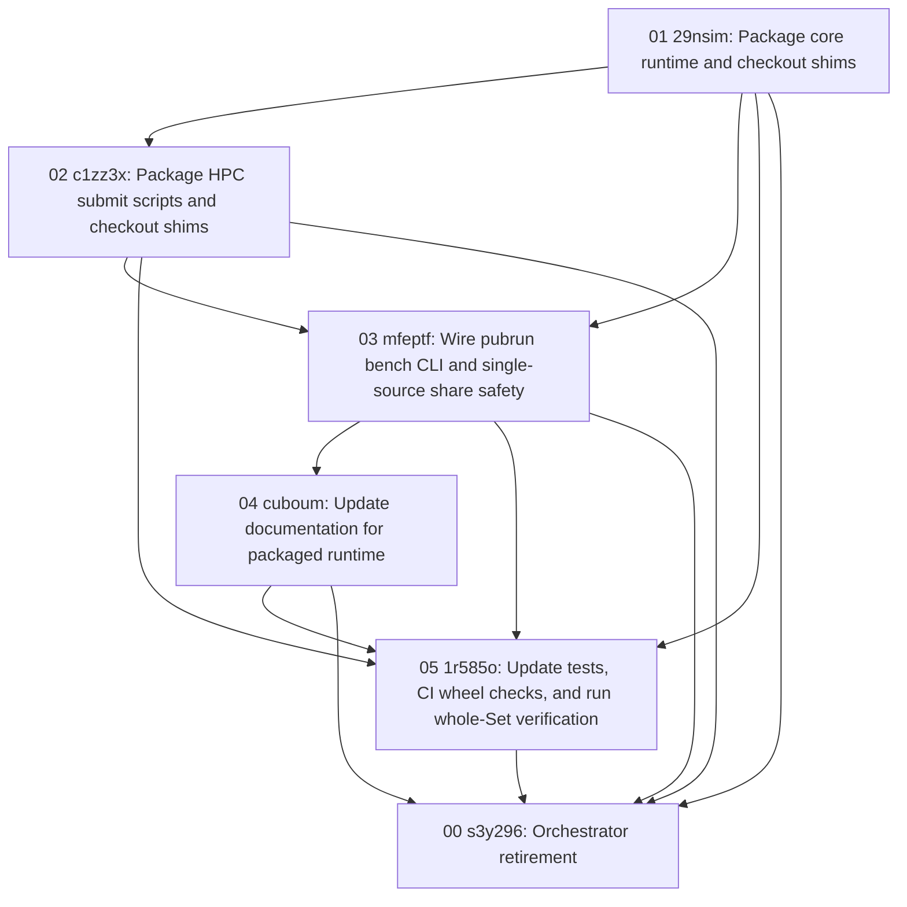

# IPD: Package benchmark runtime harness in wheel

- Date: 2026-11-27
- Kind: orchestrator
- Concern: Backlog item `bej1qz`: the `pubrun` wheel ships the `pubrun bench` command-line interface (CLI) subcommand in `src/pubrun/__main__.py`, but `pyproject.toml` excludes `benchmarks/` from the wheel. A `pip`-installed `pubrun` outside a Git source checkout exits with an error because `src/pubrun/__main__.py::_find_bench_harness` cannot find `benchmarks/harness.py`, and `src/pubrun/__main__.py` maintains a duplicated share-safety fallback (`_verify_redacted`) because `benchmarks/share_safety.py` is not packaged.
- Scope: Coordination of five child plans for Set `bej1qz`: `29nsim` (package core benchmark runtime modules and workloads under `src/pubrun/_bench/` with checkout shims), `c1zz3x` (package high-performance computing (HPC) submission scripts under `src/pubrun/_bench/scripts/` with checkout shims), `mfeptf` (wire `src/pubrun/__main__.py` to the packaged runtime, writable default output directory, and single-source share-safety validator), `cuboum` (update documentation across `docs/`, `benchmarks/README.md`, and `README.md`), and `1r585o` (update benchmark tests, add non-checkout and wheel tests, update Continuous Integration (CI) packaging checks, and execute whole-Set acceptance verification). This orchestrator modifies no product code, scripts, tests, CI configuration, or documentation.
- Scope-Paths: .aw/records/plans/pending/20261127-bej1qz-00-s3y296-package-benchmark-runtime-harness-in-wheel.ipd.md
- Item-Dependencies: executed:29nsim, executed:c1zz3x, executed:mfeptf, executed:cuboum, executed:1r585o
- Status: to-review
- Coverage: pass
- Coverage-Fingerprint: 40208be506dec1230fe57a4265735b117c8532d7516baec786e638f56e181bb0
- Coverage-Checked: 2026-11-27 by uri/its_direct/pt3-claude-opus-5.5-1m-us
- Short-Description: Orchestrate packaging the benchmark runtime harness into the pubrun wheel so pip-installed pubrun bench works without a source checkout
- Work-Kind: bug
- Priority: high
- From-Backlog: bej1qz
- Blocks-Release: g2qtg5
- Set: bej1qz
- Order: 0
- Highest E allocated: 05
- Author: Antigravity
- Id: s3y296

> Write and proofread this plan per the technical writing standard, `.aw/system/workflows/technical-writing/technical-writing.md` (`.agents/workflows/technical-writing/technical-writing.md` in a legacy-layout install), including requirement 12 (diagrams).

## Workflow history

- 2026-11-27 to-review (aw set): demoted approved -> to-review: APPROVAL WITHDRAWN: Demote to to-review so /plan-review writes Readiness attestations before execution
- 2026-11-27 approved (aw set): status set to approved
- 2026-11-27 to-review (aw set): Authored review-ready orchestrator plan from backlog item bej1qz
- 2026-11-27 coverage pass (aw oc run): fingerprint 40208be506de, model uri/its_direct/pt3-claude-opus-5.5-1m-us
- 2026-11-27 draft (Antigravity): created.

## Goal

Deliver all requirements and acceptance criteria of open backlog item `bej1qz` through five right-sized child plans so a user who installs `pubrun` from a wheel can run `pubrun bench` from any working directory without a source checkout, while keeping non-runtime benchmark artifacts out of the wheel and keeping direct source-checkout invocations working.

### Set dependency architecture

## Detailed Implementation Checklist (TODO)

Execution-state rule: mark an `E-*` item complete only after performing the action. That mark is not validation. Right-sizing rule: write for a modest executor that cannot hold much in its head. Each E-item is one step (one concern, about one file, executable in one focused pass) and its V-item names each unit it covers with its own check; a plan stays at about 5 E-items and 8 work Scope-Paths, else split it into more child plans (guidance, `IPD-Z603`). Accepted execution states: blocked, failed, pending, performed; terminal gate demands 'performed'.

### Task group 1: Child plan execution confirmation

- [ ] E-01 CONFIRM 29nsim REACHED executed
  - Depends on: none
  - Expected outcome: `.aw/records/plans/executed/20261127-bej1qz-01-29nsim-package-benchmark-core-runtime-and-checkout-shims.ipd.md` exists with `- Status: executed`, all `E-*` items `performed`, and all `V-*` items `pass`.
  - Execution state: pending

- [ ] E-02 CONFIRM c1zz3x REACHED executed
  - Depends on: E-01
  - Expected outcome: `.aw/records/plans/executed/20261127-bej1qz-02-c1zz3x-package-hpc-submission-scripts-and-checkout-shims.ipd.md` exists with `- Status: executed`, all `E-*` items `performed`, and all `V-*` items `pass`.
  - Execution state: pending

- [ ] E-03 CONFIRM mfeptf REACHED executed
  - Depends on: E-01, E-02
  - Expected outcome: `.aw/records/plans/executed/20261127-bej1qz-03-mfeptf-wire-pubrun-bench-cli-to-packaged-runtime-and-single-source.ipd.md` exists with `- Status: executed`, all `E-*` items `performed`, and all `V-*` items `pass`.
  - Execution state: pending

- [ ] E-04 CONFIRM cuboum REACHED executed
  - Depends on: E-03
  - Expected outcome: `.aw/records/plans/executed/20261127-bej1qz-04-cuboum-update-benchmark-documentation-for-packaged-wheel-runtime.ipd.md` exists with `- Status: executed`, all `E-*` items `performed`, and all `V-*` items `pass`.
  - Execution state: pending

- [ ] E-05 CONFIRM 1r585o REACHED executed
  - Depends on: E-01, E-02, E-03, E-04
  - Expected outcome: `.aw/records/plans/executed/20261127-bej1qz-05-1r585o-add-benchmark-packaging-tests-ci-checks-and-end-to-end-verif.ipd.md` exists with `- Status: executed`, all `E-*` items `performed`, and all `V-*` items `pass`.
  - Execution state: pending

## Child IPDs, sequence, and dependencies

| Order | Id | File | What it does | Depends on |
|---|---|---|---|---|
| 01 | `29nsim` | `20261127-bej1qz-01-29nsim-package-benchmark-core-runtime-and-checkout-shims.ipd.md` | Package standard-library benchmark core (`harness.py`, `scenarios.py`, `share_safety.py`, `workloads/`) under `src/pubrun/_bench/` and keep `benchmarks/` shims and `benchmarks/startup_breakdown.py` working. | none |
| 02 | `c1zz3x` | `20261127-bej1qz-02-c1zz3x-package-hpc-submission-scripts-and-checkout-shims.ipd.md` | Package Slurm, PBS, LSF, and SGE benchmark submission scripts under `src/pubrun/_bench/scripts/` using `python -m pubrun._bench.harness` and explicit `PUBRUN_RESULTS_DIR`, and keep `benchmarks/` script shims working. | 01 |
| 03 | `mfeptf` | `20261127-bej1qz-03-mfeptf-wire-pubrun-bench-cli-to-packaged-runtime-and-single-source.ipd.md` | Wire `src/pubrun/__main__.py` (`pubrun bench`) to resolve `src/pubrun/_bench/` first, choose a writable default results directory outside a checkout, pass explicit `PUBRUN_RESULTS_DIR` to HPC scripts, and replace `_load_share_safety`/`_verify_redacted` with direct `pubrun._bench.share_safety.check_share_safe_text`. | 01, 02 |
| 04 | `cuboum` | `20261127-bej1qz-04-cuboum-update-benchmark-documentation-for-packaged-wheel-runtime.ipd.md` | Update `docs/cli.md`, `docs/performance.md`, `benchmarks/README.md`, `docs/hpc.md`, `docs/functional_spec.md`, and `README.md` to remove source-checkout requirements for `pubrun bench` and document the packaged runtime and writable default output directory. | 01, 02, 03 |
| 05 | `1r585o` | `20261127-bej1qz-05-1r585o-add-benchmark-packaging-tests-ci-checks-and-end-to-end-verif.ipd.md` | Update `tests/test_bench_command.py` and `tests/test_benchmark_intake_bugs.py`, add wheel/non-checkout, writable-output, HPC-script, and single-source `share_safety` tests, update `.github/workflows/ci.yml` wheel checks, and run the whole-Set end-to-end wheel and test verification suite. | 01, 02, 03, 04 |

## Completion criteria (the whole Set is done only when)

- The Python standard-library benchmark runtime (`harness.py`, `scenarios.py`, `share_safety.py`, and `workloads/`) is packaged under `src/pubrun/_bench/` with zero new runtime dependencies, and direct source-checkout invocations of `benchmarks/harness.py`, `benchmarks/share_safety.py`, `benchmarks/scenarios.py`, `benchmarks/workloads/`, and `benchmarks/startup_breakdown.py` continue to work. Owner: `29nsim`.
- All five HPC scheduler scripts (`run_bench.sbatch`, `submit_bench.sh`, `submit_bench_pbs.sh`, `submit_bench_lsf.sh`, `submit_bench_sge.sh`) are packaged under `src/pubrun/_bench/scripts/`, invoke `python -m pubrun._bench.harness` with an explicit writable results directory instead of `$PUBRUN_REPO/benchmarks/harness.py`, and retain working checkout shims under `benchmarks/`. Owner: `c1zz3x`.
- `src/pubrun/__main__.py` resolves the packaged `pubrun._bench` runtime first without requiring a source checkout, defaults to a writable `./pubrun-bench-results/` directory outside a checkout (preserving `benchmarks/results/` inside a checkout), passes explicit results directory and packaged script paths on HPC submission, and imports `pubrun._bench.share_safety.check_share_safe_text` directly with `_load_share_safety` and `_verify_redacted` removed. Owner: `mfeptf`.
- `docs/cli.md`, `docs/performance.md`, `benchmarks/README.md`, `docs/hpc.md`, `docs/functional_spec.md`, and `README.md` accurately describe wheel-installed `pubrun bench` execution, the default writable output directory, and packaged HPC scripts with no stale "requires a source checkout" claim. Owner: `cuboum`.
- Installing the built wheel (`dist/pubrun-*.whl`) into a clean temporary virtual environment and running `pubrun bench --quick --local` from a temporary directory outside any `pubrun` source checkout exits `0` and writes a share-safe redacted JavaScript Object Notation (JSON) file whose path is printed to the user; `python3 -m twine check --strict dist/*` passes; the wheel contains none of `benchmarks/results/`, `benchmarks/data/`, `.aw/`, or non-runtime benchmark scripts/tests; `python benchmarks/harness.py --quick` passes inside a checkout; automated tests cover wheel/non-checkout execution, default writable output directory selection, HPC submit script command generation without a checkout, and single-source `share_safety` validation; and `tests/test_bench_command.py`, `benchmarks/test_benchmarks.py`, full `pytest` with coverage, three-platform `mypy`, and path-leak sanitization all pass. Owner: `1r585o`.

## Cross-IPD validation

- `1r585o` verifies that the wheel built from the combined changes of `29nsim`, `c1zz3x`, `mfeptf`, and `cuboum` contains all packaged runtime files (`pubrun/_bench/` modules, workloads, and HPC scripts) and excludes all non-runtime benchmark artifacts (`benchmarks/results/`, `benchmarks/data/`, `plot.py`, `aggregate.py`, `pull_submissions.py`, `startup_breakdown.py`, `package_capture_bench.py`, benchmark tests, and `.aw/`).
- `1r585o` verifies end-to-end wheel installation in a clean temporary virtual environment with zero extra dependencies installed, confirming `pubrun bench --quick --local` exits `0` outside any checkout and writes a share-safe redacted JSON file to `./pubrun-bench-results/`.
- `1r585o` verifies that checkout compatibility (`python benchmarks/harness.py --quick`, `.github/scripts/validate_benchmark_submission.py` via `benchmarks/share_safety.py`, `benchmarks/test_benchmarks.py`, `benchmarks/test_share_safety.py`, and `benchmarks/submit_bench*.sh`) stays green alongside the packaged runtime.
- `1r585o` verifies repository-wide quality gates across all modified modules: `pytest tests/ -p randomly --cov=src --cov-fail-under=78`, `mypy` on Linux, `win32`, and `darwin`, `tests/test_report_subpackage_integrity.py`, and `python3 scripts/sanitize_paths.py --check --all`.

## Deferred / out of scope (with reason)

- Packaging non-runtime analysis, plotting, archival, or micro-benchmark tooling (`benchmarks/results/`, `benchmarks/data/`, `benchmarks/plot.py`, `benchmarks/aggregate.py`, `benchmarks/pull_submissions.py`, `benchmarks/startup_breakdown.py`, `benchmarks/package_capture_bench.py`, `benchmarks/test_*.py`) into the wheel is explicitly excluded by backlog item `bej1qz` requirement 2 to keep the wheel lightweight and zero-dependency.
  - Carrier-Declined: Exclusion is an explicit requirement of backlog item `bej1qz`; no follow-up is wanted.
- Live execution of PBS, LSF, or SGE submission scripts against real cluster schedulers is out of scope in CI because no live PBS/LSF/SGE scheduler exists in the test environment; `1r585o` validates script invocation and argument handling with stub scheduler binaries.
  - Carrier-Declined: Hardware/cluster environment boundary; stub-scheduler verification covers script contract behavior deterministically.

## Scope check

- Over-scope: none. Every child plan maps directly to requirements 1 through 8 and the five acceptance criteria of backlog item `bej1qz`, plus consistency updates in `docs/hpc.md`, `docs/functional_spec.md`, `README.md`, and `.github/workflows/ci.yml` so no stale checkout-only claim or unguarded wheel packaging regression remains.
- Under-scope: none. Every requirement and acceptance criterion in backlog item `bej1qz` is assigned to an explicit child plan in `## Child IPDs, sequence, and dependencies`.

## Required tests / validation

This orchestrator executes no commands directly. Each child runs its own targeted checks during execution (`29nsim`, `c1zz3x`, `mfeptf`, `cuboum`), and child `1r585o` executes the whole-Set acceptance and regression suite: wheel build, `twine check --strict`, wheel content inspection, clean virtual-environment non-checkout `pubrun bench --quick --local`, source-checkout `python benchmarks/harness.py --quick`, `pytest` (including `tests/test_bench_command.py`, `tests/test_benchmark_intake_bugs.py`, `benchmarks/test_benchmarks.py`, `benchmarks/test_share_safety.py`, `.github/scripts/`, and `--cov=src --cov-fail-under=78`), three-platform `mypy`, and `scripts/sanitize_paths.py --check --all`.

## Open questions

None. All design choices (internal package location `src/pubrun/_bench/`, non-checkout default directory `./pubrun-bench-results/`, checkout shim preservation, and single-source `share_safety`) are established by backlog item `bej1qz` and verified repository conventions.

## Validation and cross-check (verify before reporting the Set complete)

Validation-state rule: inspect evidence in a separate pass. Do not mark a `V-*` item complete from memory or from the matching execution checkmark. Accepted validation results: blocked, failed, pass, pending; terminal gate demands 'pass'. Runtime-demonstration reachability rule: for each `V-*` item demanding the software be observed acting (such as a run, a dispatch, or a transition)—as distinct from items demanding a diff, a file's content, or a test result, which are reachable by construction—name the code path that produces the observation or the sibling `E-*` that creates it, else the demand is UNDER-SCOPE.

- [ ] V-01 validates E-01
  - Required evidence: Pasted confirmation that `.aw/records/plans/executed/20261127-bej1qz-01-29nsim-package-benchmark-core-runtime-and-checkout-shims.ipd.md` exists, carries `- Status: executed`, has all `E-*` performed and all `V-*` passed, and passes `aw ipd lint --phase post-transition`.
  - Observed evidence:
  - Result: pending

- [ ] V-02 validates E-02
  - Required evidence: Pasted confirmation that `.aw/records/plans/executed/20261127-bej1qz-02-c1zz3x-package-hpc-submission-scripts-and-checkout-shims.ipd.md` exists, carries `- Status: executed`, has all `E-*` performed and all `V-*` passed, and passes `aw ipd lint --phase post-transition`.
  - Observed evidence:
  - Result: pending

- [ ] V-03 validates E-03
  - Required evidence: Pasted confirmation that `.aw/records/plans/executed/20261127-bej1qz-03-mfeptf-wire-pubrun-bench-cli-to-packaged-runtime-and-single-source.ipd.md` exists, carries `- Status: executed`, has all `E-*` performed and all `V-*` passed, and passes `aw ipd lint --phase post-transition`.
  - Observed evidence:
  - Result: pending

- [ ] V-04 validates E-04
  - Required evidence: Pasted confirmation that `.aw/records/plans/executed/20261127-bej1qz-04-cuboum-update-benchmark-documentation-for-packaged-wheel-runtime.ipd.md` exists, carries `- Status: executed`, has all `E-*` performed and all `V-*` passed, and passes `aw ipd lint --phase post-transition`.
  - Observed evidence:
  - Result: pending

- [ ] V-05 validates E-05
  - Required evidence: Pasted confirmation that `.aw/records/plans/executed/20261127-bej1qz-05-1r585o-add-benchmark-packaging-tests-ci-checks-and-end-to-end-verif.ipd.md` exists, carries `- Status: executed`, has all `E-*` performed and all `V-*` passed, and passes `aw ipd lint --phase post-transition`.
  - Observed evidence:
  - Result: pending

## Approval and execution gate

- Size assessment: standard
- Cohesion rationale: not required

This orchestrator coordinates Set `bej1qz` and is retired to `.aw/records/plans/executed/` only after all five child plans (`29nsim`, `c1zz3x`, `mfeptf`, `cuboum`, `1r585o`) reach `executed` on disk and pass `aw ipd lint`. Commits follow `aw commit` with explicit paths only. Do not push, tag, or publish a release without explicit human authorization.
