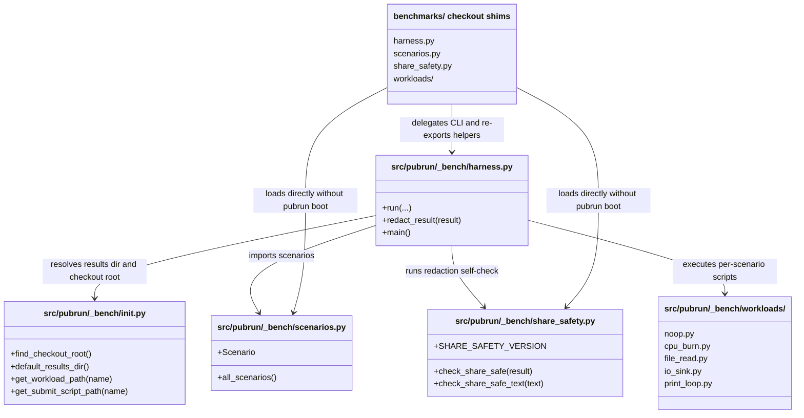

# IPD: Package benchmark core runtime and checkout shims

- Date: 2026-11-27
- Kind: child
- Concern: Backlog item `bej1qz` requirements 1, 2, 3, 4, and 5: the core runtime benchmark modules (`benchmarks/harness.py`, `benchmarks/scenarios.py`, `benchmarks/share_safety.py`, and `benchmarks/workloads/`) live outside `src/pubrun/`, so `hatchling` excludes them from the wheel. Moving them into `src/pubrun/_bench/` requires removing checkout-only assumptions (`_REPO_ROOT / "src"`, `_HERE / "results"`, unconditional Git invocation), preserving Python 3.8+ compatibility and `mypy` cleanliness across Linux, Windows, and macOS, and keeping source-checkout entry points working without triggering `pubrun` auto-start side effects.
- Scope: Create the internal standard-library subpackage `src/pubrun/_bench/` (`__init__.py`, `share_safety.py`, `scenarios.py`, `harness.py`, and `workloads/`), convert `benchmarks/share_safety.py`, `benchmarks/scenarios.py`, `benchmarks/harness.py`, and `benchmarks/workloads/` into checkout shims, and update `benchmarks/startup_breakdown.py` to locate the canonical packaged workloads.
- Scope-Paths: src/pubrun/_bench, benchmarks/share_safety.py, benchmarks/scenarios.py, benchmarks/harness.py, benchmarks/workloads, benchmarks/startup_breakdown.py
- Item-Dependencies: none
- Status: approved
- Short-Description: Create src/pubrun/_bench core runtime modules and workloads and add checkout shims under benchmarks/
- Work-Kind: bug
- Priority: high
- From-Backlog: bej1qz
- Blocks-Release: g2qtg5
- Set: bej1qz
- Order: 1
- Highest E allocated: 05
- Author: Antigravity
- Id: 29nsim
- Approval: 2026-11-27, recorded via aw ipd set: status set to approved

> Write and proofread this plan per the technical writing standard, `.aw/system/workflows/technical-writing/technical-writing.md` (`.agents/workflows/technical-writing/technical-writing.md` in a legacy-layout install), including requirement 12 (diagrams).

## Workflow history

- 2026-11-27 approved (aw set): status set to approved
- 2026-11-27 to-review (aw set): Authored review-ready child plan from backlog item bej1qz
- 2026-11-27 draft (Antigravity): created.

## Goal

Package the Python standard-library benchmark runtime (`share_safety.py`, `scenarios.py`, `harness.py`, and `workloads/`) inside `src/pubrun/_bench/` so wheel installations include it automatically via `pyproject.toml`, while keeping every direct source-checkout invocation (`benchmarks/harness.py`, `benchmarks/share_safety.py`, `benchmarks/scenarios.py`, `benchmarks/workloads/`, `benchmarks/startup_breakdown.py`, and `.github/scripts/validate_benchmark_submission.py`) working with a single canonical implementation and no unintended `pubrun` auto-start.

### Packaged runtime and checkout shim layout



## Detailed Implementation Checklist (TODO)

Execution-state rule: mark an `E-*` item complete only after performing the action. That mark is not validation. Right-sizing rule: write for a modest executor that cannot hold much in its head. Each E-item is one step (one concern, about one file, executable in one focused pass) and its V-item names each unit it covers with its own check; a plan stays at about 5 E-items and 8 work Scope-Paths, else split it into more child plans (guidance, `IPD-Z603`). Accepted execution states: blocked, failed, pending, performed; terminal gate demands 'performed'.

### Task group 1: Create packaged helpers, share-safety, scenarios, and workloads

- [ ] E-01 Create `src/pubrun/_bench/__init__.py`, `src/pubrun/_bench/share_safety.py`, and `src/pubrun/_bench/scenarios.py`:
  - In `src/pubrun/_bench/__init__.py`, keep imports standard-library only and side-effect free (must never import `pubrun.core` or select an import mode, so `tests/test_report_subpackage_integrity.py::test_no_mode_module_shadows_a_pubrun_subpackage` passes under every import mode). Provide typed helpers:
    - `find_checkout_root(start: Optional[Path] = None) -> Optional[Path]`: return the verified `pubrun` repository root when either the `pubrun` package directory lives under `<repo>/src/pubrun` (verified via `pubrun._is_verified_source_checkout`) or `start` (default `Path.cwd()`) contains `benchmarks/harness.py` and a `pyproject.toml` declaring `name = "pubrun"`. Return `None` outside a verified checkout.
    - `default_results_dir(cwd: Optional[Path] = None) -> Path`: honor `PUBRUN_RESULTS_DIR` environment variable when set and non-empty; otherwise return `<checkout_root>/benchmarks/results` when inside a verified `pubrun` checkout (`find_checkout_root` returns a root and `(root / "benchmarks").is_dir()`); otherwise return `(cwd or Path.cwd()) / "pubrun-bench-results"`.
    - `get_workload_path(filename: str) -> Path`: return `Path(__file__).resolve().parent / "workloads" / filename`.
    - `get_submit_script_path(filename: str) -> Path`: return `Path(__file__).resolve().parent / "scripts" / filename`.
  - Move the canonical structural validator from `benchmarks/share_safety.py` into `src/pubrun/_bench/share_safety.py`, keeping it standard-library only, Python 3.8+ compatible, and `mypy`-clean, and updating its module docstring to reflect that it is packaged inside `pubrun._bench` and shared by the CLI and the GitHub Actions intake validator.
  - Move the canonical scenario definitions from `benchmarks/scenarios.py` into `src/pubrun/_bench/scenarios.py`, keeping it standard-library only, Python 3.8+ compatible, and `mypy`-clean.
  - Depends on: none
  - Expected outcome: `src/pubrun/_bench/__init__.py`, `src/pubrun/_bench/share_safety.py`, and `src/pubrun/_bench/scenarios.py` exist, import cleanly with zero third-party dependencies, and pass `mypy`.
  - Execution state: pending

- [ ] E-02 Move the five runtime workloads into `src/pubrun/_bench/workloads/`:
  - Create empty `src/pubrun/_bench/workloads/__init__.py`.
  - Copy `noop.py`, `cpu_burn.py`, `file_read.py`, `io_sink.py`, and `print_loop.py` from `benchmarks/workloads/` into `src/pubrun/_bench/workloads/`.
  - Keep `noop.py` completely free of imports (`if __name__ == "__main__": pass`) and ensure all five files remain Python 3.8+ compatible, standard-library only (with lazy `import pubrun` in `file_read.py` only for non-baseline modes), and `mypy`-clean across Linux, `win32`, and `darwin`.
  - Depends on: E-01
  - Expected outcome: All five workloads live under `src/pubrun/_bench/workloads/` alongside `__init__.py` and pass `mypy` on all three platforms.
  - Execution state: pending

### Task group 2: Create packaged benchmark harness

- [ ] E-03 Create `src/pubrun/_bench/harness.py` from `benchmarks/harness.py` and remove source-checkout assumptions:
  - Import `platform` at module top level (fixing the unimported `platform.node()` call in `redact_result` so hostname scrubbing works and `mypy` passes).
  - Replace the `sys.path.insert` sibling imports with `from pubrun._bench import scenarios as _scenarios`, `from pubrun._bench import share_safety as _ss`, and `from pubrun._bench import default_results_dir, find_checkout_root, get_workload_path`.
  - In `_build_child_command` and `_run_baseline_pass`, resolve `workload_path = get_workload_path(scn.workload)`. Prepend `<checkout_root>/src` to child `PYTHONPATH` only when `find_checkout_root()` returns a path whose `src/` directory exists; in a wheel installation, inherit the caller's environment without adding a bogus `PYTHONPATH` entry.
  - In `_git_commit()`, run `git rev-parse --short HEAD` only when `find_checkout_root()` returns a path; return `None` with zero `git` subprocess spawns in a wheel installation.
  - Update `_filesystem_context(results_dir: Optional[Path] = None)` to probe the actual target `results_dir` (defaulting to `default_results_dir()`) instead of `Path(__file__).resolve().parent / "results"`.
  - Update `_default_out()` to place default output under `default_results_dir()` rather than `_HERE / "results"`.
  - In `main()`, always execute `_ss.check_share_safe(redacted)` directly (no optional `ImportError` bypass) and ensure `python -m pubrun._bench.harness` exits `0` from any working directory without auto-starting a tracked run (already guarded by `src/pubrun/core.py::_is_pubrun_cli_invocation` because `mod_name` starts with `"pubrun."`).
  - Ensure all type annotations are `mypy`-clean on Linux, `win32`, and `darwin` (and compatible with Python 3.8 via `from __future__ import annotations` and `typing` imports).
  - Depends on: E-01, E-02
  - Expected outcome: `src/pubrun/_bench/harness.py` runs via `python3 -m pubrun._bench.harness` from any working directory, writes a share-safe redacted JSON file to `default_results_dir()` (or `--redacted-out`), and passes `mypy`.
  - Execution state: pending

### Task group 3: Convert checkout files to shims and update startup breakdown

- [ ] E-04 Convert `benchmarks/share_safety.py`, `benchmarks/scenarios.py`, `benchmarks/harness.py`, and `benchmarks/workloads/` into source-checkout compatibility shims and update `benchmarks/startup_breakdown.py`:
  - `benchmarks/share_safety.py`: load `src/pubrun/_bench/share_safety.py` directly by file path (`importlib.util.spec_from_file_location`) or reuse `sys.modules["pubrun._bench.share_safety"]` when already loaded, re-exporting every symbol (including `_HOME_PATH_RE`, `SHARE_SAFETY_VERSION`, `REDACTED`, `check_share_safe`, `check_share_safe_text`). Do NOT trigger `import pubrun` in this shim, so `.github/scripts/validate_benchmark_submission.py` (which runs in CI with only `jsonschema` installed and without `pubrun` installed), `benchmarks/startup_breakdown.py`, and `benchmarks/test_share_safety.py` work with zero auto-start side effects.
  - `benchmarks/scenarios.py`: load `src/pubrun/_bench/scenarios.py` directly by file path (or reuse `sys.modules["pubrun._bench.scenarios"]` when already loaded) without triggering `import pubrun`, re-exporting `Scenario`, `all_scenarios`, and module helpers.
  - `benchmarks/harness.py`: prepend `_REPO_ROOT / "src"` to `sys.path` if `pubrun` is not already importable, re-export `pubrun._bench.harness` attributes (including `run`, `redact_result`, `_stats`, `_TIERS`, `_scrub_pii_substrings`, `main`, `_default_out`, `_default_redacted_out`) so `benchmarks/test_benchmarks.py` continues to work unchanged, and inside `if __name__ == "__main__":` import `pubrun.minimal` (when `"pubrun"` is not in `sys.modules`) before calling `main()` so `python benchmarks/harness.py` does not auto-start a tracked run.
  - `benchmarks/workloads/`: keep `noop.py` as the zero-import `if __name__ == "__main__": pass` stub; convert `cpu_burn.py`, `file_read.py`, `io_sink.py`, and `print_loop.py` to thin checkout shims that load and forward to `src/pubrun/_bench/workloads/<name>.py` (supporting both direct CLI execution such as `file_read.py --measure-detail` and `importlib` loading of `_work()` / `measure_detail()`).
  - `benchmarks/startup_breakdown.py`: resolve `noop_path` and `cpu_burn_path` from `_SRC_ROOT / "pubrun" / "_bench" / "workloads"` (with fallback to `_HERE / "workloads"`) so breakdown measurements execute the canonical packaged workloads directly.
  - Depends on: E-01, E-02, E-03
  - Expected outcome: Single canonical source in `src/pubrun/_bench/`; direct checkout invocations and CI validation scripts without `pubrun` installed all work without auto-starting a tracked run.
  - Execution state: pending

### Task group 4: Verify core runtime, shims, typing, and integrity tests

- [ ] E-05 Run all verification checks listed in `## Required tests / validation`:
  - Run `mypy`, `mypy --platform win32`, and `mypy --platform darwin`.
  - Run `pytest tests/test_report_subpackage_integrity.py benchmarks/test_share_safety.py .github/scripts/ -v`.
  - Run a smoke invocation of `python3 -m pubrun._bench.harness --iterations 1 --passes 1 --no-baseline` from a temporary directory outside the repository and confirm it writes a valid redacted JSON file under `<tmp>/pubrun-bench-results/` without creating a `runs/` directory in `<tmp>`.
  - Run a smoke invocation of `python3 benchmarks/harness.py --iterations 1 --passes 1 --no-baseline --redacted-out <tmp>/checkout.redacted.json` inside the checkout and verify it exits `0` and writes a share-safe file.
  - Verify `benchmarks/share_safety.py` loads in an isolated Python subprocess with `PYTHONPATH=""` and without `pubrun` imported (`"pubrun" not in sys.modules`), matching `.github/workflows/benchmark-intake.yml`.
  - Depends on: E-01, E-02, E-03, E-04
  - Expected outcome: Every check exits `0` with expected behavior and zero regressions.
  - Execution state: pending

## Project conventions discovered (Step 0)

- `pyproject.toml` sets `[tool.hatch.build.targets.wheel] packages = ["src/pubrun"]`, so every file inside `src/pubrun/_bench/` is automatically included in both the wheel and sdist (`[tool.hatch.build.targets.sdist]` includes `"/src"`), while `benchmarks/` remains outside the wheel.
- `pyproject.toml` configures `[tool.mypy] files = ["src/pubrun"]`, and `.github/workflows/ci.yml` runs `mypy`, `mypy --platform win32`, and `mypy --platform darwin`; every `.py` module placed under `src/pubrun/_bench/` must therefore pass strict cross-platform `mypy`.
- `tests/test_report_subpackage_integrity.py::test_no_mode_module_shadows_a_pubrun_subpackage` discovers every subpackage via `pkgutil.iter_modules(pubrun.__path__)` and imports `pubrun.<name>` under all six import modes (`auto`, `noauto`, `full`, `nopatch`, `noconsole`, `minimal`); `src/pubrun/_bench/__init__.py` must remain lightweight and side-effect free.
- `src/pubrun/core.py::_is_pubrun_cli_invocation` already returns `True` when invoked via `python -m <mod>` for any module name starting with `"pubrun."` (`_is_pubrun_module_name`), preventing auto-start for `python -m pubrun._bench.harness`.
- `.github/workflows/benchmark-intake.yml` installs only `jsonschema` (not `pubrun`) and runs `.github/scripts/validate_benchmark_submission.py`, which imports `benchmarks/share_safety.py` via `sys.path.insert(0, str(_REPO / "benchmarks"))`.
- `benchmarks/startup_breakdown.py` imports `share_safety` (accessing `check_share_safe` and `_HOME_PATH_RE`) and executes `workloads/noop.py` and `workloads/cpu_burn.py`.
- `benchmarks/harness.py::redact_result` currently references `platform.node()` without a top-level `import platform` (silently swallowed by `except Exception: pass`); moving it under `src/pubrun/` surfaces this under `mypy` and fixing it restores hostname substring scrubbing.

## Findings

| ID | Severity | Remediation Risk | Persona | Evidence | Finding |
|---|---|---|---|---|---|
| F-01 | High | Medium | End User | `pyproject.toml` (`[tool.hatch.build.targets.wheel]`) vs `benchmarks/harness.py` | Runtime benchmark files live in `benchmarks/`, which is excluded from the wheel. |
| F-02 | Medium | Low | Maintainer | `benchmarks/harness.py::_build_child_command`, `_git_commit`, `_filesystem_context`, `_default_out` | Harness assumes a writable checkout tree (`_REPO_ROOT / "src"`, `_HERE / "results"`, Git repo at `_REPO_ROOT`). |
| F-03 | Medium | Low | Security / CI | `.github/workflows/benchmark-intake.yml` vs `.github/scripts/validate_benchmark_submission.py` | Intake CI imports `benchmarks/share_safety.py` without installing `pubrun`, so the checkout shim must not require `import pubrun`. |
| F-04 | Low | Low | Maintainer | `benchmarks/harness.py::redact_result` | `platform.node()` is called without top-level `import platform`, which silently fails at runtime and fails `mypy` inside `src/pubrun/`. |

## Proposed changes (ordered, validatable)

1. Create `src/pubrun/_bench/__init__.py`, `src/pubrun/_bench/share_safety.py`, and `src/pubrun/_bench/scenarios.py` (E-01; Remediation Risk: Low).
2. Move runtime workloads into `src/pubrun/_bench/workloads/` with `__init__.py` (E-02; Remediation Risk: Low).
3. Create `src/pubrun/_bench/harness.py` with checkout-free runtime resolution, writable default output directory, top-level `import platform`, and direct `share_safety` import (E-03; Remediation Risk: Medium).
4. Convert `benchmarks/{share_safety,scenarios,harness}.py` and `benchmarks/workloads/` into checkout shims and update `benchmarks/startup_breakdown.py` (E-04; Remediation Risk: Low).
5. Verify with cross-platform `mypy`, subpackage integrity tests, `share_safety` isolation check, and both module and checkout harness smoke runs (E-05; Remediation Risk: Low).

## Deferred / out of scope (with reason)

- Packaging the five HPC submission scripts (`run_bench.sbatch`, `submit_bench*.sh`) is deferred to child `c1zz3x` (Order 02) to keep Scope-Paths bounded.
  - Carrier: c1zz3x
- Wiring `src/pubrun/__main__.py` to `src/pubrun/_bench` and removing `_verify_redacted` is deferred to child `mfeptf` (Order 03).
  - Carrier: mfeptf
- Updating documentation is deferred to child `cuboum` (Order 04).
  - Carrier: cuboum
- Updating `tests/test_bench_command.py`, `tests/test_benchmark_intake_bugs.py`, `.github/workflows/ci.yml`, and running end-to-end wheel tests is deferred to child `1r585o` (Order 05).
  - Carrier: 1r585o

## Scope check

- Over-scope: none. Only the core runtime subpackage `src/pubrun/_bench/` and its direct checkout shims (`benchmarks/{share_safety,scenarios,harness}.py`, `benchmarks/workloads/`, `benchmarks/startup_breakdown.py`) are touched.
- Under-scope: none. All Python runtime benchmark files named in backlog item `bej1qz` requirement 1 are packaged here, and non-runtime files in `benchmarks/` stay out of `src/pubrun/`.

## Required tests / validation

1. **Cross-platform static type checking** (must exit `0` with 0 errors):

   ```sh
   mypy && mypy --platform win32 && mypy --platform darwin
   ```

2. **Subpackage integrity, share-safety, and intake validator tests** (must exit `0`):

   ```sh
   pytest tests/test_report_subpackage_integrity.py benchmarks/test_share_safety.py .github/scripts/ -v
   ```

3. **Zero-`pubrun`-import checkout shim check for `benchmarks/share_safety.py`** (must exit `0` and print `ok`):

   ```sh
   python3 -c 'import sys; sys.path.insert(0, "benchmarks"); import share_safety; assert "pubrun" not in sys.modules; ok, reasons = share_safety.check_share_safe({"machine": {"host": {"hostname": "<redacted>"}}}); assert ok and not reasons; print("ok")'
   ```

4. **Non-checkout packaged harness execution check** (run from a temporary directory outside the repository; must exit `0`, create `<tmp>/pubrun-bench-results/*.redacted.json`, pass `share_safety`, and not create `<tmp>/runs`):

   ```sh
   python3 -c 'import os, subprocess, sys, tempfile; from pathlib import Path; src = str(Path("src").resolve()); td = Path(tempfile.mkdtemp(prefix="pubrun-bench-smoke-")); env = dict(os.environ); env["PYTHONPATH"] = src; proc = subprocess.run([sys.executable, "-m", "pubrun._bench.harness", "--iterations", "1", "--passes", "1", "--no-baseline"], cwd=str(td), env=env, capture_output=True, text=True, timeout=180); print("rc=", proc.returncode); print(proc.stderr[-500:]); files = list((td / "pubrun-bench-results").glob("*.redacted.json")); print("files=", [f.name for f in files]); print("runs_exists=", (td / "runs").exists()); assert proc.returncode == 0 and len(files) == 1 and not (td / "runs").exists()'
   ```

5. **Direct source-checkout `benchmarks/harness.py` smoke check** (must exit `0` and write a redacted file):

   ```sh
   python3 -c 'import subprocess, sys, tempfile; from pathlib import Path; td = Path(tempfile.mkdtemp(prefix="pubrun-checkout-smoke-")); out = td / "out.redacted.json"; proc = subprocess.run([sys.executable, "benchmarks/harness.py", "--iterations", "1", "--passes", "1", "--no-baseline", "--redacted-out", str(out)], capture_output=True, text=True, timeout=180); print("rc=", proc.returncode, "exists=", out.is_file()); assert proc.returncode == 0 and out.is_file()'
   ```

## Spec / documentation sync

N/A for this child plan; child `cuboum` (Order 04) updates all user-facing and benchmark documentation after `c1zz3x` and `mfeptf` land.

## Open questions

None.

## Validation and cross-check (verify before reporting done)

Validation-state rule: inspect evidence in a separate pass. Do not mark a `V-*` item complete from memory or from the matching execution checkmark. Accepted validation results: blocked, failed, pass, pending; terminal gate demands 'pass'. Runtime-demonstration reachability rule: for each `V-*` item demanding the software be observed acting (such as a run, a dispatch, or a transition)—as distinct from items demanding a diff, a file's content, or a test result, which are reachable by construction—name the code path that produces the observation or the sibling `E-*` that creates it, else the demand is UNDER-SCOPE.

- [ ] V-01 validates E-01
  - Required evidence: Pasted file listing of `src/pubrun/_bench/{__init__,share_safety,scenarios}.py` and pasted output of `mypy && mypy --platform win32 && mypy --platform darwin` plus `pytest tests/test_report_subpackage_integrity.py -v` passing with exit code `0`.
  - Observed evidence:
  - Result: pending

- [ ] V-02 validates E-02
  - Required evidence: Pasted file listing of `src/pubrun/_bench/workloads/` showing `__init__.py` and all five workload scripts (`noop.py`, `cpu_burn.py`, `file_read.py`, `io_sink.py`, `print_loop.py`), confirmation that `noop.py` has no imports, and `mypy` passing across all three platforms.
  - Observed evidence:
  - Result: pending

- [ ] V-03 validates E-03
  - Required evidence: Pasted output of validation command 4 (`python3 -m pubrun._bench.harness --iterations 1 --passes 1 --no-baseline` run from an outside temp dir via `src/pubrun/_bench/harness.py::main`, created by E-03) showing `rc= 0`, one `*.redacted.json` file under `pubrun-bench-results/`, and `runs_exists= False`.
  - Observed evidence:
  - Result: pending

- [ ] V-04 validates E-04
  - Required evidence: Pasted output of validation commands 2, 3, and 5 showing `benchmarks/test_share_safety.py` and `.github/scripts/` passing, `benchmarks/share_safety.py` loading with `"pubrun" not in sys.modules`, and `python3 benchmarks/harness.py` (delegating to `src/pubrun/_bench/harness.py::main` created by E-03/E-04) exiting `0` and writing a redacted file.
  - Observed evidence:
  - Result: pending

- [ ] V-05 validates E-05
  - Required evidence: Pasted output of all five commands in `## Required tests / validation` exiting `0`.
  - Observed evidence:
  - Result: pending

## Approval and execution gate

- Size assessment: standard
- Cohesion rationale: not required

Execute E-01 through E-05 only after this plan is `approved`. Commit only files within `- Scope-Paths:` through `aw commit 29nsim -- <paths>`. Do not push, tag, or publish. After all `E-*` items are `performed` and all `V-*` items are `pass`, move the plan through the post-gate transition to `.aw/records/plans/executed/`.
