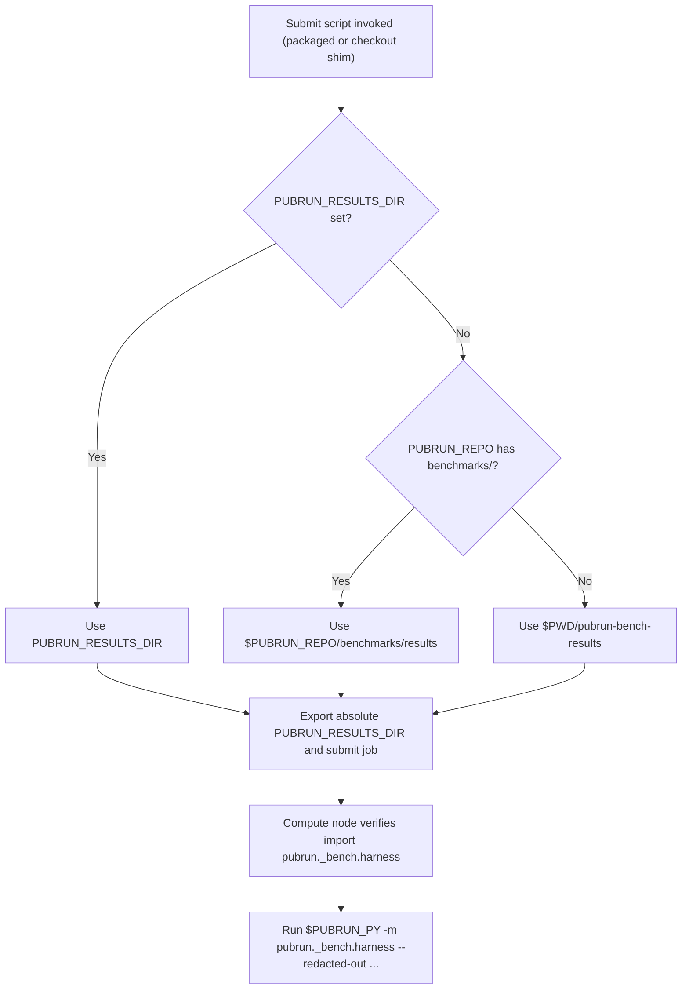

# IPD: Package HPC submission scripts and checkout shims

- Date: 2026-11-27
- Kind: child
- Concern: Backlog item `bej1qz` requirements 1, 4, and 6: the five high-performance computing (HPC) submission scripts (`benchmarks/run_bench.sbatch`, `benchmarks/submit_bench.sh`, `benchmarks/submit_bench_pbs.sh`, `benchmarks/submit_bench_lsf.sh`, and `benchmarks/submit_bench_sge.sh`) are not packaged in the wheel, unconditionally change directory into `$PUBRUN_REPO`, write to `$PUBRUN_REPO/benchmarks/results`, and invoke `$PUBRUN_PY benchmarks/harness.py`. In a wheel installation outside a source checkout, none of those paths exist or are writable.
- Scope: Create `src/pubrun/_bench/scripts/` (`__init__.py`, `run_bench.sbatch`, `submit_bench.sh`, `submit_bench_pbs.sh`, `submit_bench_lsf.sh`, `submit_bench_sge.sh`) invoking `python -m pubrun._bench.harness` with an explicit writable `PUBRUN_RESULTS_DIR`, and replace the five `benchmarks/` copies with checkout shims that preserve direct source-checkout invocation.
- Scope-Paths: src/pubrun/_bench/scripts, benchmarks/run_bench.sbatch, benchmarks/submit_bench.sh, benchmarks/submit_bench_pbs.sh, benchmarks/submit_bench_lsf.sh, benchmarks/submit_bench_sge.sh
- Item-Dependencies: executed:29nsim
- Status: to-review
- Short-Description: Package Slurm, PBS, LSF, and SGE benchmark submission scripts under src/pubrun/_bench/scripts and keep benchmarks/ shims working
- Work-Kind: bug
- Priority: high
- From-Backlog: bej1qz
- Blocks-Release: g2qtg5
- Set: bej1qz
- Order: 2
- Highest E allocated: 04
- Author: Antigravity
- Id: c1zz3x

> Write and proofread this plan per the technical writing standard, `.aw/system/workflows/technical-writing/technical-writing.md` (`.agents/workflows/technical-writing/technical-writing.md` in a legacy-layout install), including requirement 12 (diagrams).

## Workflow history

- 2026-11-27 to-review (aw set): Authored review-ready child plan from backlog item bej1qz
- 2026-11-27 draft (Antigravity): created.

## Goal

Package all five HPC benchmark submission scripts inside `src/pubrun/_bench/scripts/` so they run cleanly from a wheel installation without a source checkout, using `python -m pubrun._bench.harness` and an explicit writable results directory (`PUBRUN_RESULTS_DIR`), while keeping direct checkout invocations (`benchmarks/submit_bench*.sh` and `sbatch benchmarks/run_bench.sbatch`) working via thin shims.

### HPC script resolution and results-directory flow



## Detailed Implementation Checklist (TODO)

Execution-state rule: mark an `E-*` item complete only after performing the action. That mark is not validation. Right-sizing rule: write for a modest executor that cannot hold much in its head. Each E-item is one step (one concern, about one file, executable in one focused pass) and its V-item names each unit it covers with its own check; a plan stays at about 5 E-items and 8 work Scope-Paths, else split it into more child plans (guidance, `IPD-Z603`). Accepted execution states: blocked, failed, pending, performed; terminal gate demands 'performed'.

### Task group 1: Package Slurm scripts under `src/pubrun/_bench/scripts/`

- [ ] E-01 Create `src/pubrun/_bench/scripts/__init__.py`, `src/pubrun/_bench/scripts/run_bench.sbatch`, and `src/pubrun/_bench/scripts/submit_bench.sh`:
  - Create empty `src/pubrun/_bench/scripts/__init__.py` so `hatchling` and `importlib.resources` treat `pubrun._bench.scripts` as a proper subpackage and `mypy` passes.
  - Author `src/pubrun/_bench/scripts/run_bench.sbatch` (executable mode `0755`):
    - Keep the existing `#SBATCH` resource directives (`--job-name`, `--nodes=1`, `--ntasks=1`, `--cpus-per-task=4`, `--mem=4G`, `--time=00:30:00`, `--output=pubrun-bench-%N-%j.out`).
    - Do NOT assume `PUBRUN_REPO` exists or unconditionally `cd "$PUBRUN_REPO"`.
    - Resolve `RESULTS_DIR`: use `PUBRUN_RESULTS_DIR` when non-empty; else if `PUBRUN_REPO` is non-empty and `-d "$PUBRUN_REPO/benchmarks"`, use `"$PUBRUN_REPO/benchmarks/results"`; else use `"${PWD}/pubrun-bench-results"`. Create `RESULTS_DIR` with `mkdir -p`.
    - Verify `"$PUBRUN_PY" -c "import pubrun._bench.harness" 2>/dev/null`. If that fails and `PUBRUN_REPO` is non-empty and `-d "$PUBRUN_REPO/src"`, prepend `"$PUBRUN_REPO/src"` to `PYTHONPATH` and re-check; otherwise print a clear install error naming `"$PUBRUN_PY"` and exit `1`.
    - Preserve `PUBRUN_REDACTED_OUT` (defaulting to `"$RESULTS_DIR/pubrun-bench-${ANON_ID}-${STAMP}.redacted.json"`) and opt-in `PUBRUN_UNREDACTED` (`--out "$RESULTS_DIR/${NODE}-${STAMP}.unredacted.json"`).
    - Invoke `"$PUBRUN_PY" -m pubrun._bench.harness "${HARNESS_OUT_ARGS[@]}" $PUBRUN_BENCH_ARGS`.
  - Author `src/pubrun/_bench/scripts/submit_bench.sh` (executable mode `0755`):
    - Locate `SBATCH_FILE="$HERE/run_bench.sbatch"`.
    - Keep `sinfo` idle-node discovery, `PUBRUN_PARTITION`, `PUBRUN_EXCLUDE`, `SBATCH_OPTS=(--parsable)`, and argv-array `sbatch` invocation.
    - Do NOT set `PUBRUN_REPO` to `$HERE/..` when `$HERE/..` is inside `site-packages` (only default `PUBRUN_REPO` when `PUBRUN_REPO` is already set; otherwise leave it empty).
    - Resolve and export absolute `PUBRUN_RESULTS_DIR`: keep caller's `PUBRUN_RESULTS_DIR` if non-empty; else if `PUBRUN_REPO` is set and `-d "$PUBRUN_REPO/benchmarks"`, use `"$PUBRUN_REPO/benchmarks/results"`; else use `"${PWD}/pubrun-bench-results"`.
    - Export `ALL,PUBRUN_REPO,PUBRUN_PY,PUBRUN_RESULTS_DIR,PUBRUN_BENCH_ARGS,PUBRUN_REDACTED_OUT,PUBRUN_UNREDACTED` to `sbatch --export`.
  - Depends on: none
  - Expected outcome: Packaged Slurm scripts invoke `python -m pubrun._bench.harness` with an explicit writable `PUBRUN_RESULTS_DIR` and work without any source checkout.
  - Execution state: pending

### Task group 2: Package PBS, LSF, and SGE scripts under `src/pubrun/_bench/scripts/`

- [ ] E-02 Create `src/pubrun/_bench/scripts/submit_bench_pbs.sh`, `src/pubrun/_bench/scripts/submit_bench_lsf.sh`, and `src/pubrun/_bench/scripts/submit_bench_sge.sh` (executable mode `0755`):
  - Preserve each scheduler's `STARTING POINT` site-adaptation header note, environment knobs (`PUBRUN_QUEUE`, `PUBRUN_ACCOUNT`, `PUBRUN_PROJECT`, `PUBRUN_PE`, `PUBRUN_PY`, `PUBRUN_REPO`), and argv-array option construction (`QSUB_OPTS=(...)`, `BSUB_OPTS=(...)`).
  - Resolve and export absolute `PUBRUN_RESULTS_DIR` at submission time using the same rule as E-01 (`PUBRUN_RESULTS_DIR` if set, else `$PUBRUN_REPO/benchmarks/results` when `$PUBRUN_REPO/benchmarks` exists, else `${PWD}/pubrun-bench-results`), and export `PUBRUN_REDACTED_OUT` and `PUBRUN_UNREDACTED`.
  - In each embedded job script body:
    - Do NOT unconditionally `cd "$PUBRUN_REPO"` or hardcode `$PUBRUN_REPO/benchmarks/results` or `benchmarks/harness.py`.
    - Use `RESULTS_DIR="${PUBRUN_RESULTS_DIR:-${PWD}/pubrun-bench-results}"` and `mkdir -p "$RESULTS_DIR"`.
    - Verify `"$PUBRUN_PY" -c "import pubrun._bench.harness" 2>/dev/null` (with optional `PYTHONPATH="$PUBRUN_REPO/src"` fallback only when `PUBRUN_REPO` is non-empty and `-d "$PUBRUN_REPO/src"`).
    - Invoke `"$PUBRUN_PY" -m pubrun._bench.harness "${HARNESS_OUT_ARGS[@]}" $PUBRUN_BENCH_ARGS`.
  - Depends on: E-01
  - Expected outcome: Packaged PBS, LSF, and SGE scripts run `python -m pubrun._bench.harness` with an explicit writable results directory and work without a source checkout.
  - Execution state: pending

### Task group 3: Convert checkout scripts in `benchmarks/` to shims

- [ ] E-03 Convert `benchmarks/submit_bench.sh`, `benchmarks/submit_bench_pbs.sh`, `benchmarks/submit_bench_lsf.sh`, `benchmarks/submit_bench_sge.sh`, and `benchmarks/run_bench.sbatch` into source-checkout shims (preserving executable mode `0755`):
  - For each of `benchmarks/submit_bench.sh`, `benchmarks/submit_bench_pbs.sh`, `benchmarks/submit_bench_lsf.sh`, and `benchmarks/submit_bench_sge.sh`: set `PUBRUN_REPO="${PUBRUN_REPO:-$(cd "$HERE/.." && pwd)}"` and `PUBRUN_RESULTS_DIR="${PUBRUN_RESULTS_DIR:-$PUBRUN_REPO/benchmarks/results}"` and `exec bash "$PUBRUN_REPO/src/pubrun/_bench/scripts/<same-name>" "$@"`.
  - For `benchmarks/run_bench.sbatch`: retain the `#SBATCH` header lines at the top so `sbatch benchmarks/run_bench.sbatch` parses directives directly, set checkout defaults for `PUBRUN_REPO` and `PUBRUN_RESULTS_DIR`, and delegate execution via `exec bash "$PUBRUN_REPO/src/pubrun/_bench/scripts/run_bench.sbatch"`.
  - Depends on: E-01, E-02
  - Expected outcome: Direct checkout invocations of all five scripts work identically to before and execute the single canonical packaged implementation.
  - Execution state: pending

### Task group 4: Validate syntax and stub-scheduler execution

- [ ] E-04 Run all verification checks listed in `## Required tests / validation`:
  - Run `bash -n` on all ten shell/sbatch files (`src/pubrun/_bench/scripts/*` and `benchmarks/{run_bench.sbatch,submit_bench*.sh}`).
  - Execute each packaged submit script from a temporary non-checkout directory with stub `sinfo`/`sbatch`/`qsub`/`bsub` binaries on `PATH` and verify: exit code `0`, `PUBRUN_RESULTS_DIR` defaults to `<tmp>/pubrun-bench-results`, `PUBRUN_REPO` is not set to `site-packages`, and the generated job body invokes `-m pubrun._bench.harness` (never `benchmarks/harness.py`).
  - Execute each checkout shim script from the repository root with stub scheduler binaries and verify `PUBRUN_RESULTS_DIR` defaults to `<repo>/benchmarks/results`.
  - Run `mypy` and `pytest tests/test_report_subpackage_integrity.py -v`.
  - Depends on: E-01, E-02, E-03
  - Expected outcome: All syntax checks, stub-scheduler checks (packaged non-checkout and checkout shim), `mypy`, and subpackage integrity tests pass.
  - Execution state: pending

## Project conventions discovered (Step 0)

- `src/pubrun/__main__.py::_run_bench` invokes submit scripts as `["bash", str(submit_script)] + extra` with `PUBRUN_PY`, `PUBRUN_REDACTED_OUT`, and `PUBRUN_UNREDACTED` in `env`.
- `benchmarks/submit_bench.sh` uses `sbatch --parsable` so `_run_bench` can parse the bare job ID from stdout for Slurm submit-and-wait polling.
- `benchmarks/submit_bench_{pbs,lsf,sge}.sh` construct scheduler flags in Bash arrays (`QSUB_OPTS=(...)`, `BSUB_OPTS=(...)`) rather than string interpolation and carry a `STARTING POINT` site-adaptation comment.
- All four existing submit scripts already write only `--redacted-out "$REDACTED_OUT"` by default and add `--out "$UNREDACTED_OUT"` only when `PUBRUN_UNREDACTED` is non-empty.

## Findings

| ID | Severity | Remediation Risk | Persona | Evidence | Finding |
|---|---|---|---|---|---|
| F-01 | High | Low | HPC User | `benchmarks/run_bench.sbatch`, `benchmarks/submit_bench*.sh` | All five scripts hardcode `cd "$PUBRUN_REPO"`, `RESULTS_DIR="$PUBRUN_REPO/benchmarks/results"`, and `"$PUBRUN_PY" benchmarks/harness.py`, failing outside a source checkout. |
| F-02 | Medium | Low | HPC User | `benchmarks/submit_bench.sh` (`_EXPORT`) | `submit_bench.sh` does not export `PUBRUN_RESULTS_DIR` to the Slurm compute job. |

## Proposed changes (ordered, validatable)

1. Create `src/pubrun/_bench/scripts/__init__.py`, `run_bench.sbatch`, and `submit_bench.sh` using `-m pubrun._bench.harness` and `PUBRUN_RESULTS_DIR` (E-01; Remediation Risk: Low).
2. Create packaged `submit_bench_pbs.sh`, `submit_bench_lsf.sh`, and `submit_bench_sge.sh` under `src/pubrun/_bench/scripts/` (E-02; Remediation Risk: Low).
3. Convert `benchmarks/{run_bench.sbatch,submit_bench*.sh}` into checkout shims delegating to `src/pubrun/_bench/scripts/` (E-03; Remediation Risk: Low).
4. Validate Bash syntax, stub-scheduler execution from both non-checkout and checkout directories, `mypy`, and subpackage integrity (E-04; Remediation Risk: Low).

## Deferred / out of scope (with reason)

- Updating `src/pubrun/__main__.py::_run_bench` to resolve `src/pubrun/_bench/scripts/` and pass `PUBRUN_RESULTS_DIR` is deferred to child `mfeptf` (Order 03).
- Updating `tests/test_bench_command.py` to add permanent automated stub-scheduler tests is deferred to child `1r585o` (Order 05).

## Scope check

- Over-scope: none. Only the packaged HPC scripts under `src/pubrun/_bench/scripts/` and their five checkout shims under `benchmarks/` are modified.
- Under-scope: none. All five HPC scripts listed in backlog item `bej1qz` requirements 1 and 6 are covered.

## Required tests / validation

1. **Bash syntax validation on all packaged and shim scripts** (must exit `0`):

   ```sh
   bash -n src/pubrun/_bench/scripts/run_bench.sbatch src/pubrun/_bench/scripts/submit_bench.sh src/pubrun/_bench/scripts/submit_bench_pbs.sh src/pubrun/_bench/scripts/submit_bench_lsf.sh src/pubrun/_bench/scripts/submit_bench_sge.sh benchmarks/run_bench.sbatch benchmarks/submit_bench.sh benchmarks/submit_bench_pbs.sh benchmarks/submit_bench_lsf.sh benchmarks/submit_bench_sge.sh
   ```

2. **Stub-scheduler non-checkout verification** (invoke each packaged script from an isolated temp directory with stub `sinfo`/`sbatch`/`qsub`/`bsub` recording argv, env, and stdin; must exit `0`, default `PUBRUN_RESULTS_DIR` to `<tmp>/pubrun-bench-results`, and invoke `-m pubrun._bench.harness` rather than `benchmarks/harness.py`):

   ```sh
   python3 -c 'import os, stat, subprocess, tempfile; from pathlib import Path; repo = Path.cwd(); td = Path(tempfile.mkdtemp(prefix="pubrun-hpc-stub-")); bin_dir = td / "bin"; bin_dir.mkdir(); log = td / "calls.log"; stub = "#!/bin/bash\necho \"CMD=$0 ARGS=$* RESULTS=$PUBRUN_RESULTS_DIR REPO=$PUBRUN_REPO\" >> " + str(log) + "\ncat >> " + str(log) + "\necho 98765\n"; sinfo = "#!/bin/bash\necho node01\n"; (bin_dir / "sinfo").write_text(sinfo); (bin_dir / "sinfo").chmod(0o755); [((bin_dir / n).write_text(stub), (bin_dir / n).chmod(0o755)) for n in ("sbatch", "qsub", "bsub")]; env = dict(os.environ); env["PATH"] = str(bin_dir) + os.pathsep + env.get("PATH", ""); env.pop("PUBRUN_REPO", None); env.pop("PUBRUN_RESULTS_DIR", None); [subprocess.run(["bash", str(repo / "src/pubrun/_bench/scripts" / s), "--quick"], cwd=str(td), env=env, check=True, capture_output=True, text=True) for s in ("submit_bench.sh", "submit_bench_pbs.sh", "submit_bench_lsf.sh", "submit_bench_sge.sh")]; text = log.read_text(); print(text); assert str(td / "pubrun-bench-results") in text; assert "-m pubrun._bench.harness" in text; assert "benchmarks/harness.py" not in text'
   ```

3. **Checkout shim verification** (invoke `benchmarks/submit_bench.sh` with stub `sinfo`/`sbatch` from repo root and confirm `PUBRUN_RESULTS_DIR` resolves to `<repo>/benchmarks/results`):

   ```sh
   python3 -c 'import os, subprocess, tempfile; from pathlib import Path; repo = Path.cwd(); td = Path(tempfile.mkdtemp(prefix="pubrun-hpc-shim-")); bin_dir = td / "bin"; bin_dir.mkdir(); log = td / "calls.log"; (bin_dir / "sinfo").write_text("#!/bin/bash\necho node01\n"); (bin_dir / "sinfo").chmod(0o755); (bin_dir / "sbatch").write_text("#!/bin/bash\necho \"RESULTS=$PUBRUN_RESULTS_DIR REPO=$PUBRUN_REPO\" > " + str(log) + "\necho 12345\n"); (bin_dir / "sbatch").chmod(0o755); env = dict(os.environ); env["PATH"] = str(bin_dir) + os.pathsep + env.get("PATH", ""); env.pop("PUBRUN_REPO", None); env.pop("PUBRUN_RESULTS_DIR", None); subprocess.run(["bash", "benchmarks/submit_bench.sh", "--quick"], env=env, check=True, capture_output=True, text=True); out = log.read_text().strip(); print(out); assert str(repo / "benchmarks" / "results") in out'
   ```

4. **Type-check and subpackage integrity** (must exit `0`):

   ```sh
   mypy && pytest tests/test_report_subpackage_integrity.py -v
   ```

## Spec / documentation sync

N/A for this child plan; child `cuboum` (Order 04) updates HPC and CLI documentation.

## Open questions

None.

## Validation and cross-check (verify before reporting done)

Validation-state rule: inspect evidence in a separate pass. Do not mark a `V-*` item complete from memory or from the matching execution checkmark. Accepted validation results: blocked, failed, pass, pending; terminal gate demands 'pass'. Runtime-demonstration reachability rule: for each `V-*` item demanding the software be observed acting (such as a run, a dispatch, or a transition)—as distinct from items demanding a diff, a file's content, or a test result, which are reachable by construction—name the code path that produces the observation or the sibling `E-*` that creates it, else the demand is UNDER-SCOPE.

- [ ] V-01 validates E-01
  - Required evidence: Pasted `bash -n` output and stub-scheduler verification output from `src/pubrun/_bench/scripts/submit_bench.sh` (created by E-01) confirming exit code `0`, `PUBRUN_RESULTS_DIR` defaulting to `<tmp>/pubrun-bench-results`, and `run_bench.sbatch` invoking `-m pubrun._bench.harness`.
  - Observed evidence:
  - Result: pending

- [ ] V-02 validates E-02
  - Required evidence: Pasted `bash -n` output and stub-scheduler verification output from `src/pubrun/_bench/scripts/submit_bench_{pbs,lsf,sge}.sh` (created by E-02) confirming exit code `0`, `PUBRUN_RESULTS_DIR` defaulting to `<tmp>/pubrun-bench-results`, and embedded job bodies invoking `-m pubrun._bench.harness`.
  - Observed evidence:
  - Result: pending

- [ ] V-03 validates E-03
  - Required evidence: Pasted `bash -n` output and checkout shim verification output from `benchmarks/submit_bench.sh` (updated by E-03) confirming `PUBRUN_RESULTS_DIR` defaults to `<repo>/benchmarks/results`.
  - Observed evidence:
  - Result: pending

- [ ] V-04 validates E-04
  - Required evidence: Pasted output of all four commands in `## Required tests / validation` exiting `0`.
  - Observed evidence:
  - Result: pending

## Approval and execution gate

- Size assessment: standard
- Cohesion rationale: not required

Execute E-01 through E-04 only after this plan is `approved` and `29nsim` has reached `executed`. Commit only files within `- Scope-Paths:` through `aw commit c1zz3x -- <paths>`. Do not push, tag, or publish. After all `E-*` items are `performed` and all `V-*` items are `pass`, move the plan through the post-gate transition to `.aw/records/plans/executed/`.
