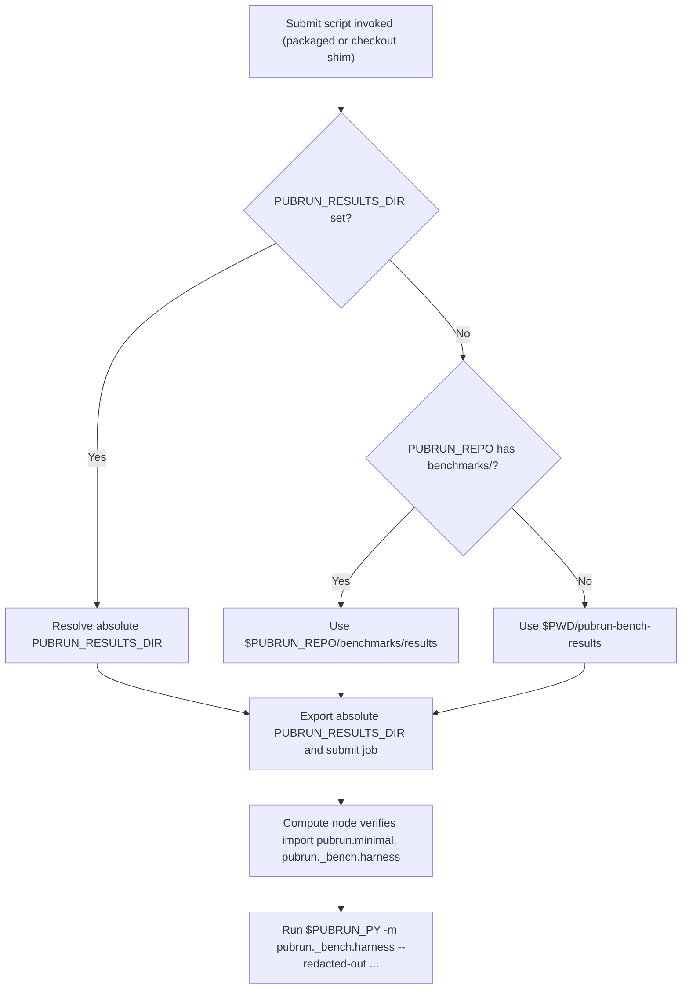

# IPD: Package HPC submission scripts and checkout shims

- Date: 2026-11-27
- Kind: child
- Concern: Backlog item `bej1qz` requirements 1, 4, and 6: the five high-performance computing (HPC) submission scripts (`benchmarks/run_bench.sbatch`, `benchmarks/submit_bench.sh`, `benchmarks/submit_bench_pbs.sh`, `benchmarks/submit_bench_lsf.sh`, and `benchmarks/submit_bench_sge.sh`) are not packaged in the wheel, unconditionally change directory into `$PUBRUN_REPO`, write to `$PUBRUN_REPO/benchmarks/results`, and invoke `$PUBRUN_PY benchmarks/harness.py`. In a wheel installation outside a source checkout, none of those paths exist or are writable.
- Scope: Create `src/pubrun/_bench/scripts/` (`__init__.py`, `run_bench.sbatch`, `submit_bench.sh`, `submit_bench_pbs.sh`, `submit_bench_lsf.sh`, `submit_bench_sge.sh`) invoking `python -m pubrun._bench.harness` with an explicit writable `PUBRUN_RESULTS_DIR`, and replace the five `benchmarks/` copies with checkout shims that preserve direct source-checkout invocation.
- Scope-Paths: src/pubrun/_bench/scripts, benchmarks/run_bench.sbatch, benchmarks/submit_bench.sh, benchmarks/submit_bench_pbs.sh, benchmarks/submit_bench_lsf.sh, benchmarks/submit_bench_sge.sh
- Item-Dependencies: executed:29nsim
- Status: approved
- Readiness: go-pending-approval
- Review-Depth: complex
- Short-Description: Package Slurm, PBS, LSF, and SGE benchmark submission scripts under src/pubrun/_bench/scripts and keep benchmarks/ shims working
- Work-Kind: bug
- Priority: high
- From-Backlog: bej1qz
- Blocks-Release: g2qtg5
- Set: bej1qz
- Order: 2
- Highest E allocated: 04
- Author: Antigravity
- Id: c1zz3x
- Approval: 2026-11-27, recorded via aw ipd set: status set to approved

> Write and proofread this plan per the technical writing standard, `.aw/system/workflows/technical-writing/technical-writing.md` (`.agents/workflows/technical-writing/technical-writing.md` in a legacy-layout install), including requirement 12 (diagrams).

## Workflow history

- 2026-11-27 approved (aw set): status set to approved
- 2026-11-27 /plan-review (Antigravity): APPROVE WITH REVISIONS APPLIED; PR-001, PR-002, PR-003, PR-004, PR-005; review record `.aw/records/reviews/20261127-bej1qz-02-c1zz3x-package-hpc-submission-scripts-and-checkout-shims.review.md`.
- 2026-11-27 to-review (aw set): demoted approved -> to-review: APPROVAL WITHDRAWN: Demote to to-review so /plan-review writes Readiness attestations before execution
- 2026-11-27 approved (aw set): status set to approved
- 2026-11-27 to-review (aw set): Authored review-ready child plan from backlog item bej1qz
- 2026-11-27 draft (Antigravity): created.

## Goal

Package all five HPC benchmark submission scripts (Slurm, Portable Batch System (PBS), Load Sharing Facility (LSF), and Sun Grid Engine (SGE)) inside `src/pubrun/_bench/scripts/` so they run cleanly from a wheel installation without a source checkout, using `python -m pubrun._bench.harness` and an explicit writable results directory (`PUBRUN_RESULTS_DIR`), while keeping direct checkout invocations (`benchmarks/submit_bench*.sh` and `sbatch benchmarks/run_bench.sbatch`) working via thin shims.

### HPC script resolution and results-directory flow



## Detailed Implementation Checklist (TODO)

Execution-state rule: mark an `E-*` item complete only after performing the action. That mark is not validation. Right-sizing rule: write for a modest executor that cannot hold much in its head. Each E-item is one step (one concern, about one file, executable in one focused pass) and its V-item names each unit it covers with its own check; a plan stays at about 5 E-items and 8 work Scope-Paths, else split it into more child plans (guidance, `IPD-Z603`). Accepted execution states: blocked, failed, pending, performed; terminal gate demands 'performed'.

### Task group 1: Package Slurm scripts under `src/pubrun/_bench/scripts/`

- [ ] E-01 Create `src/pubrun/_bench/scripts/__init__.py`, `src/pubrun/_bench/scripts/run_bench.sbatch`, and `src/pubrun/_bench/scripts/submit_bench.sh`:
  - Create empty `src/pubrun/_bench/scripts/__init__.py` so `hatchling` and `importlib.resources` treat `pubrun._bench.scripts` as a proper subpackage and `mypy` passes.
  - Author `src/pubrun/_bench/scripts/run_bench.sbatch` (executable mode `0755`):
    - Keep `set -euo pipefail` and the existing `#SBATCH` resource directives (`--job-name`, `--nodes=1`, `--ntasks=1`, `--cpus-per-task=4`, `--mem=4G`, `--time=00:30:00`, `--output=pubrun-bench-%N-%j.out`).
    - Initialize all optional environment variables safely under `set -u`: `PUBRUN_REPO="${PUBRUN_REPO:-}"`, `PUBRUN_RESULTS_DIR="${PUBRUN_RESULTS_DIR:-}"`, `PUBRUN_PY="${PUBRUN_PY:-python3}"`, `PUBRUN_BENCH_ARGS="${PUBRUN_BENCH_ARGS:-}"`, `PUBRUN_REDACTED_OUT="${PUBRUN_REDACTED_OUT:-}"`, and `PUBRUN_UNREDACTED="${PUBRUN_UNREDACTED:-}"`.
    - Do NOT assume `PUBRUN_REPO` exists or unconditionally `cd "$PUBRUN_REPO"`.
    - Resolve `RESULTS_DIR`: use `PUBRUN_RESULTS_DIR` when non-empty (normalizing a relative path against `${PWD}` so it stays unambiguous); else if `PUBRUN_REPO` is non-empty and `-d "$PUBRUN_REPO/benchmarks"`, use `"$PUBRUN_REPO/benchmarks/results"`; else use `"${PWD}/pubrun-bench-results"`. Create `RESULTS_DIR` with `mkdir -p`.
    - Verify `"$PUBRUN_PY" -c "import pubrun.minimal, pubrun._bench.harness" 2>/dev/null` (importing `pubrun.minimal` first so the `-c` preflight check never triggers `pubrun` auto-start or creates `runs/`). If that fails and `PUBRUN_REPO` is non-empty and `-d "$PUBRUN_REPO/src"`, prepend `"$PUBRUN_REPO/src"` to `PYTHONPATH` and re-check with `"$PUBRUN_PY" -c "import pubrun.minimal, pubrun._bench.harness" 2>/dev/null`; otherwise print a clear install error naming `"$PUBRUN_PY"` and exit `1`.
    - Preserve `PUBRUN_REDACTED_OUT` (defaulting to `"$RESULTS_DIR/pubrun-bench-${ANON_ID}-${STAMP}.redacted.json"`) and opt-in `PUBRUN_UNREDACTED` (`--out "$RESULTS_DIR/${NODE}-${STAMP}.unredacted.json"`).
    - Invoke `"$PUBRUN_PY" -m pubrun._bench.harness "${HARNESS_OUT_ARGS[@]}" $PUBRUN_BENCH_ARGS`.
  - Author `src/pubrun/_bench/scripts/submit_bench.sh` (executable mode `0755`):
    - Locate `SBATCH_FILE="$HERE/run_bench.sbatch"`.
    - Keep `sinfo` idle-node discovery, `PUBRUN_PARTITION`, `PUBRUN_EXCLUDE`, `SBATCH_OPTS=(--parsable)`, and argv-array `sbatch` invocation.
    - Do NOT set `PUBRUN_REPO` to `$HERE/..` when `$HERE/..` is inside `site-packages`: initialize `export PUBRUN_REPO="${PUBRUN_REPO:-}"` (leaving it empty when unset).
    - Resolve and export absolute `PUBRUN_RESULTS_DIR`: keep caller's `PUBRUN_RESULTS_DIR` if non-empty (normalizing relative paths via `case "$PUBRUN_RESULTS_DIR" in /*) ;; *) PUBRUN_RESULTS_DIR="${PWD}/${PUBRUN_RESULTS_DIR}" ;; esac`); else if `PUBRUN_REPO` is non-empty and `-d "$PUBRUN_REPO/benchmarks"`, use `"$PUBRUN_REPO/benchmarks/results"`; else use `"${PWD}/pubrun-bench-results"`.
    - Export `ALL,PUBRUN_REPO,PUBRUN_PY,PUBRUN_RESULTS_DIR,PUBRUN_BENCH_ARGS,PUBRUN_REDACTED_OUT,PUBRUN_UNREDACTED` to `sbatch --export`.
  - Depends on: none
  - Expected outcome: Packaged Slurm scripts invoke `python -m pubrun._bench.harness` with an explicit absolute writable `PUBRUN_RESULTS_DIR`, safe `set -u` handling, zero auto-start during preflight, and no source-checkout requirement.
  - Execution state: pending

### Task group 2: Package PBS, LSF, and SGE scripts under `src/pubrun/_bench/scripts/`

- [ ] E-02 Create `src/pubrun/_bench/scripts/submit_bench_pbs.sh`, `src/pubrun/_bench/scripts/submit_bench_lsf.sh`, and `src/pubrun/_bench/scripts/submit_bench_sge.sh` (executable mode `0755`):
  - Preserve each scheduler's `STARTING POINT` site-adaptation header note, environment knobs (`PUBRUN_QUEUE`, `PUBRUN_ACCOUNT`, `PUBRUN_PROJECT`, `PUBRUN_PE`, `PUBRUN_PY`, `PUBRUN_REPO`), and argv-array option construction (`QSUB_OPTS=(...)`, `BSUB_OPTS=(...)`).
  - Do NOT default `PUBRUN_REPO` to `$HERE/..`: initialize `export PUBRUN_REPO="${PUBRUN_REPO:-}"` (leaving it empty when unset).
  - Resolve and export absolute `PUBRUN_RESULTS_DIR` at submission time using the same rule and relative-path normalization as E-01 (`PUBRUN_RESULTS_DIR` if set, else `$PUBRUN_REPO/benchmarks/results` when `$PUBRUN_REPO` is non-empty and `-d "$PUBRUN_REPO/benchmarks"`, else `${PWD}/pubrun-bench-results`), and export `PUBRUN_REDACTED_OUT="${PUBRUN_REDACTED_OUT:-}"` and `PUBRUN_UNREDACTED="${PUBRUN_UNREDACTED:-}"`.
  - In each embedded job script body (under `set -euo pipefail`):
    - Initialize optional variables safely under `set -u`: `PUBRUN_REPO="${PUBRUN_REPO:-}"`, `PUBRUN_RESULTS_DIR="${PUBRUN_RESULTS_DIR:-}"`, `PUBRUN_PY="${PUBRUN_PY:-python3}"`, `PUBRUN_BENCH_ARGS="${PUBRUN_BENCH_ARGS:-}"`, `PUBRUN_REDACTED_OUT="${PUBRUN_REDACTED_OUT:-}"`, and `PUBRUN_UNREDACTED="${PUBRUN_UNREDACTED:-}"`.
    - Do NOT unconditionally `cd "$PUBRUN_REPO"` or hardcode `$PUBRUN_REPO/benchmarks/results` or `benchmarks/harness.py`.
    - Use `RESULTS_DIR="${PUBRUN_RESULTS_DIR:-${PWD}/pubrun-bench-results}"` and `mkdir -p "$RESULTS_DIR"`.
    - Verify `"$PUBRUN_PY" -c "import pubrun.minimal, pubrun._bench.harness" 2>/dev/null` (importing `pubrun.minimal` first so the `-c` check never triggers `pubrun` auto-start), with optional `PYTHONPATH="$PUBRUN_REPO/src${PYTHONPATH:+:$PYTHONPATH}"` fallback only when `PUBRUN_REPO` is non-empty and `-d "$PUBRUN_REPO/src"`.
    - Invoke `"$PUBRUN_PY" -m pubrun._bench.harness "${HARNESS_OUT_ARGS[@]}" $PUBRUN_BENCH_ARGS`.
  - Depends on: E-01
  - Expected outcome: Packaged PBS, LSF, and SGE scripts run `python -m pubrun._bench.harness` with an explicit absolute writable results directory, safe `set -u` handling, zero auto-start during preflight, and no source-checkout requirement.
  - Execution state: pending

### Task group 3: Convert checkout scripts in `benchmarks/` to shims

- [ ] E-03 Convert `benchmarks/submit_bench.sh`, `benchmarks/submit_bench_pbs.sh`, `benchmarks/submit_bench_lsf.sh`, `benchmarks/submit_bench_sge.sh`, and `benchmarks/run_bench.sbatch` into source-checkout shims (preserving executable mode `0755`):
  - For each of `benchmarks/submit_bench.sh`, `benchmarks/submit_bench_pbs.sh`, `benchmarks/submit_bench_lsf.sh`, and `benchmarks/submit_bench_sge.sh`: set `export PUBRUN_REPO="${PUBRUN_REPO:-$(cd "$HERE/.." && pwd)}"` and `export PUBRUN_RESULTS_DIR="${PUBRUN_RESULTS_DIR:-$PUBRUN_REPO/benchmarks/results}"` and `exec bash "$PUBRUN_REPO/src/pubrun/_bench/scripts/<same-name>" "$@"`.
  - For `benchmarks/submit_bench_pbs.sh`, `benchmarks/submit_bench_lsf.sh`, and `benchmarks/submit_bench_sge.sh`, retain the honest `# STARTING POINT` site-adaptation header comment noting delegation to the canonical packaged script (and its `QSUB_OPTS=()` or `BSUB_OPTS=()` argv-array option handling), so `tests/test_bench_command.py::TestSchedulerSubmitSafety::test_new_submit_scripts_exist_and_quote_vars` stays green before Order 05 (`1r585o`) replaces that legacy text check with behavioral stub-scheduler tests.
  - For `benchmarks/run_bench.sbatch`: retain the `#SBATCH` header lines at the top so `sbatch benchmarks/run_bench.sbatch` parses directives directly, and resolve the canonical packaged `run_bench.sbatch` safely even when Slurm copies the script to a spool directory (`/var/spool/slurmd/...`) where `BASH_SOURCE[0]` is not inside `benchmarks/`:
    - Resolve `PUBRUN_REPO` from (1) non-empty `PUBRUN_REPO`, else (2) `$(cd "$(dirname "${BASH_SOURCE[0]:-$0}")/.." && pwd)` when `-f "<dir>/src/pubrun/_bench/scripts/run_bench.sbatch"`, else (3) `${SLURM_SUBMIT_DIR:-}` when `-f "$SLURM_SUBMIT_DIR/src/pubrun/_bench/scripts/run_bench.sbatch"`, else (4) `"$(cd "$SLURM_SUBMIT_DIR/.." && pwd)"` when `-f "$SLURM_SUBMIT_DIR/../src/pubrun/_bench/scripts/run_bench.sbatch"`.
    - When `PUBRUN_REPO` resolves to a checkout, set `export PUBRUN_REPO` and `export PUBRUN_RESULTS_DIR="${PUBRUN_RESULTS_DIR:-$PUBRUN_REPO/benchmarks/results}"` and `exec bash "$PUBRUN_REPO/src/pubrun/_bench/scripts/run_bench.sbatch"`.
    - Otherwise (fallback when spooled from outside the repo), locate the packaged script via `"${PUBRUN_PY:-python3}" -c "import pubrun.minimal, pubrun._bench; print(pubrun._bench.get_submit_script_path('run_bench.sbatch'))"` and `exec bash` it (or print a clear error naming `PUBRUN_REPO` and exit `1`).
  - Depends on: E-01, E-02
  - Expected outcome: Direct checkout invocations of all five scripts (including spooled `sbatch benchmarks/run_bench.sbatch`) work identically to before, keep `TestSchedulerSubmitSafety` green, and execute the single canonical packaged implementation.
  - Execution state: pending

### Task group 4: Validate syntax and stub-scheduler execution

- [ ] E-04 Run all verification checks listed in `## Required tests / validation`:
  - Run `bash -n` and executable-bit checks on all ten shell/sbatch files (`src/pubrun/_bench/scripts/*` and `benchmarks/{run_bench.sbatch,submit_bench*.sh}`).
  - Execute each packaged submit script from a temporary non-checkout directory with stub `sinfo`/`sbatch`/`qsub`/`bsub` binaries on `PATH` and `stdin=DEVNULL` and verify per script: exit code `0`, `PUBRUN_RESULTS_DIR` defaults to `<tmp>/pubrun-bench-results`, `PUBRUN_REPO` is empty (never `site-packages`), PBS/LSF/SGE job bodies check `import pubrun.minimal, pubrun._bench.harness` and invoke `-m pubrun._bench.harness` (never `benchmarks/harness.py` or `cd "$PUBRUN_REPO"`), and executing `src/pubrun/_bench/scripts/run_bench.sbatch` with a stub `PUBRUN_PY` runs the same preflight and `-m pubrun._bench.harness` without creating `<tmp>/runs`.
  - Execute all five checkout shim scripts (`benchmarks/submit_bench{,_pbs,_lsf,_sge}.sh` and `benchmarks/run_bench.sbatch`, including a spooled-copy simulation with `SLURM_SUBMIT_DIR=<repo>`) from the repository root with stub scheduler/Python binaries and verify `PUBRUN_RESULTS_DIR` defaults to `<repo>/benchmarks/results` and `PUBRUN_REPO` defaults to `<repo>`.
  - Run three-platform `mypy` (`mypy`, `mypy --platform win32`, `mypy --platform darwin`), `pytest tests/test_report_subpackage_integrity.py`, and `pytest tests/test_bench_command.py::TestSchedulerSubmitSafety`.
  - Depends on: E-01, E-02, E-03
  - Expected outcome: All syntax checks, stub-scheduler checks (packaged non-checkout, `run_bench.sbatch`, and all five checkout shims), three-platform `mypy`, subpackage integrity tests, and scheduler safety tests pass with zero stray temp dirs.
  - Execution state: pending

## Project conventions discovered (Step 0)

- `src/pubrun/__main__.py::_run_bench` invokes submit scripts as `["bash", str(submit_script)] + extra` with `PUBRUN_PY`, `PUBRUN_REDACTED_OUT`, and `PUBRUN_UNREDACTED` in `env` (never depending solely on execute bits when extracted from a wheel, though `0755` is preserved for direct checkout invocation).
- `benchmarks/submit_bench.sh` uses `sbatch --parsable` so `_run_bench` can parse the bare job ID from stdout for Slurm submit-and-wait polling.
- `benchmarks/submit_bench_{pbs,lsf,sge}.sh` construct scheduler flags in Bash arrays (`QSUB_OPTS=(...)`, `BSUB_OPTS=(...)`) rather than string interpolation and carry a `STARTING POINT` site-adaptation comment, which `tests/test_bench_command.py::TestSchedulerSubmitSafety::test_new_submit_scripts_exist_and_quote_vars` inspects until Order 05 (`1r585o`) replaces it with behavioral stub-scheduler tests.
- All four existing submit scripts already write only `--redacted-out "$REDACTED_OUT"` by default and add `--out "$UNREDACTED_OUT"` only when `PUBRUN_UNREDACTED` is non-empty.
- Under `python -c "import pubrun._bench.harness"`, `src/pubrun/core.py::_is_pubrun_cli_invocation` returns `False` (`sys.argv[0] == "-c"`), so compute-node preflight checks must import `pubrun.minimal` first (`import pubrun.minimal, pubrun._bench.harness`) to prevent auto-starting a tracked run.
- Slurm copies `sbatch` scripts to a spool path (`/var/spool/slurmd/...`) before executing them on a compute node, so `benchmarks/run_bench.sbatch` cannot rely solely on `dirname "${BASH_SOURCE[0]}"` to locate `PUBRUN_REPO` and must also inspect `SLURM_SUBMIT_DIR`.

## Findings

| ID | Severity | Remediation Risk | Persona | Evidence | Finding |
|---|---|---|---|---|---|
| F-01 | High | Low | HPC User | `benchmarks/run_bench.sbatch`, `benchmarks/submit_bench*.sh` | All five scripts hardcode `cd "$PUBRUN_REPO"`, `RESULTS_DIR="$PUBRUN_REPO/benchmarks/results"`, and `"$PUBRUN_PY" benchmarks/harness.py`, failing outside a source checkout. |
| F-02 | Medium | Low | HPC User | `benchmarks/submit_bench.sh` (`_EXPORT`) | `submit_bench.sh` does not export `PUBRUN_RESULTS_DIR` to the Slurm compute job. |

## Proposed changes (ordered, validatable)

1. Create `src/pubrun/_bench/scripts/__init__.py`, `run_bench.sbatch`, and `submit_bench.sh` using `import pubrun.minimal, pubrun._bench.harness`, `-m pubrun._bench.harness`, absolute `PUBRUN_RESULTS_DIR`, and `set -u`-safe defaults (E-01; Remediation Risk: Low).
2. Create packaged `submit_bench_pbs.sh`, `submit_bench_lsf.sh`, and `submit_bench_sge.sh` under `src/pubrun/_bench/scripts/` with the same checkout-free, `set -u`-safe, no-auto-start preflight rules (E-02; Remediation Risk: Low).
3. Convert `benchmarks/{run_bench.sbatch,submit_bench*.sh}` into checkout shims delegating to `src/pubrun/_bench/scripts/`, handling Slurm spooling in `benchmarks/run_bench.sbatch` and keeping `TestSchedulerSubmitSafety` green (E-03; Remediation Risk: Low).
4. Validate Bash syntax, executable bits, per-script stub-scheduler execution for all packaged scripts and all five checkout shims, three-platform `mypy`, subpackage integrity, and `TestSchedulerSubmitSafety` (E-04; Remediation Risk: Low).

## Deferred / out of scope (with reason)

- Updating `src/pubrun/__main__.py::_run_bench` to resolve `src/pubrun/_bench/scripts/` and pass `PUBRUN_RESULTS_DIR` is deferred to child `mfeptf` (Order 03).
  - Carrier: mfeptf
- Updating `tests/test_bench_command.py` to add permanent automated stub-scheduler tests is deferred to child `1r585o` (Order 05).
  - Carrier: 1r585o

## Scope check

- Over-scope: none. Only the packaged HPC scripts under `src/pubrun/_bench/scripts/` and their five checkout shims under `benchmarks/` are modified.
- Under-scope: none. All five HPC scripts listed in backlog item `bej1qz` requirements 1 and 6 are covered.

## Required tests / validation

1. **Bash syntax and executable-mode validation on all packaged and shim scripts** (must exit `0` and print `ok`):

   ```sh
   bash -n src/pubrun/_bench/scripts/run_bench.sbatch src/pubrun/_bench/scripts/submit_bench.sh src/pubrun/_bench/scripts/submit_bench_pbs.sh src/pubrun/_bench/scripts/submit_bench_lsf.sh src/pubrun/_bench/scripts/submit_bench_sge.sh benchmarks/run_bench.sbatch benchmarks/submit_bench.sh benchmarks/submit_bench_pbs.sh benchmarks/submit_bench_lsf.sh benchmarks/submit_bench_sge.sh && python3 -c 'import os; from pathlib import Path; files = [Path("src/pubrun/_bench/scripts") / n for n in ("run_bench.sbatch", "submit_bench.sh", "submit_bench_pbs.sh", "submit_bench_lsf.sh", "submit_bench_sge.sh")] + [Path("benchmarks") / n for n in ("run_bench.sbatch", "submit_bench.sh", "submit_bench_pbs.sh", "submit_bench_lsf.sh", "submit_bench_sge.sh")]; bad = [str(p) for p in files if not os.access(p, os.X_OK)]; assert not bad, bad; print("ok")'
   ```

2. **Per-script stub-scheduler and `run_bench.sbatch` non-checkout verification** (invokes each packaged submit script and `run_bench.sbatch` from an isolated temp directory with `stdin=DEVNULL` and stub `sinfo`/`sbatch`/`qsub`/`bsub`/`python`; must exit `0`, default `PUBRUN_RESULTS_DIR` to `<tmp>/pubrun-bench-results`, leave `PUBRUN_REPO` empty, verify `import pubrun.minimal, pubrun._bench.harness` and `-m pubrun._bench.harness`, and clean up `<tmp>`):

   ```sh
   python3 - <<'PY'
   import os, subprocess, tempfile
   from pathlib import Path

   repo = Path.cwd().resolve()
   with tempfile.TemporaryDirectory(prefix="pubrun-hpc-stub-") as td_str:
       td = Path(td_str)
       bin_dir = td / "bin"
       bin_dir.mkdir()
       (bin_dir / "sinfo").write_text("#!/bin/bash\necho node01\n", encoding="utf-8")
       (bin_dir / "sinfo").chmod(0o755)
       (bin_dir / "sbatch").write_text(
           '#!/bin/bash\necho "ARGS=$* RESULTS=$PUBRUN_RESULTS_DIR REPO=$PUBRUN_REPO" > "$STUB_LOG"\necho 98765\n',
           encoding="utf-8",
       )
       (bin_dir / "sbatch").chmod(0o755)
       for name in ("qsub", "bsub"):
           p = bin_dir / name
           p.write_text(
               '#!/bin/bash\necho "ARGS=$* RESULTS=$PUBRUN_RESULTS_DIR REPO=$PUBRUN_REPO" > "$STUB_LOG"\ncat >> "$STUB_LOG"\necho 98765\n',
               encoding="utf-8",
           )
           p.chmod(0o755)
       stub_py = bin_dir / "stub_py"
       stub_py.write_text('#!/bin/bash\necho "PY_ARGS=$*" >> "$STUB_LOG"\nexit 0\n', encoding="utf-8")
       stub_py.chmod(0o755)

       expected_res = str(td / "pubrun-bench-results")
       base_env = {k: v for k, v in os.environ.items() if not k.startswith("PUBRUN_")}
       base_env["PATH"] = str(bin_dir) + os.pathsep + base_env.get("PATH", "")

       for sc in ("submit_bench.sh", "submit_bench_pbs.sh", "submit_bench_lsf.sh", "submit_bench_sge.sh"):
           log = td / f"{sc}.log"
           env = {**base_env, "STUB_LOG": str(log)}
           r = subprocess.run(
               ["bash", str(repo / "src/pubrun/_bench/scripts" / sc), "--quick"],
               cwd=str(td), env=env, stdin=subprocess.DEVNULL, capture_output=True, text=True, check=True,
           )
           txt = log.read_text(encoding="utf-8")
           first = txt.splitlines()[0]
           print(f"{sc}: {first}")
           assert f"RESULTS={expected_res} REPO=" in first and first.endswith("REPO="), first
           if sc == "submit_bench.sh":
               assert "PUBRUN_RESULTS_DIR" in first and "src/pubrun/_bench/scripts/run_bench.sbatch" in first, first
               assert r.stdout.strip() == "98765", r.stdout
           else:
               assert "import pubrun.minimal, pubrun._bench.harness" in txt, txt
               assert "-m pubrun._bench.harness" in txt, txt
               assert "benchmarks/harness.py" not in txt, txt
               assert 'cd "$PUBRUN_REPO"' not in txt, txt

       sbatch_log = td / "run_bench.log"
       sbatch_env = {**base_env, "STUB_LOG": str(sbatch_log), "PUBRUN_PY": str(stub_py), "PUBRUN_BENCH_ARGS": "--quick"}
       subprocess.run(
           ["bash", str(repo / "src/pubrun/_bench/scripts/run_bench.sbatch")],
           cwd=str(td), env=sbatch_env, stdin=subprocess.DEVNULL, capture_output=True, text=True, check=True,
       )
       sbatch_txt = sbatch_log.read_text(encoding="utf-8")
       print("run_bench.sbatch:", sbatch_txt.strip())
       assert "import pubrun.minimal, pubrun._bench.harness" in sbatch_txt, sbatch_txt
       assert "-m pubrun._bench.harness" in sbatch_txt, sbatch_txt
       assert expected_res in sbatch_txt, sbatch_txt
       assert not (td / "runs").exists()
       print("ok")
   PY
   ```

3. **All five checkout shims verification (including spooled `run_bench.sbatch`)** (must exit `0`, default `PUBRUN_RESULTS_DIR` to `<repo>/benchmarks/results` and `PUBRUN_REPO` to `<repo>`, and clean up `<tmp>`):

   ```sh
   python3 - <<'PY'
   import os, shutil, subprocess, tempfile
   from pathlib import Path

   repo = Path.cwd().resolve()
   expected_res = str(repo / "benchmarks" / "results")
   with tempfile.TemporaryDirectory(prefix="pubrun-hpc-shim-") as td_str:
       td = Path(td_str)
       bin_dir = td / "bin"
       bin_dir.mkdir()
       (bin_dir / "sinfo").write_text("#!/bin/bash\necho node01\n", encoding="utf-8")
       (bin_dir / "sinfo").chmod(0o755)
       (bin_dir / "sbatch").write_text(
           '#!/bin/bash\necho "RESULTS=$PUBRUN_RESULTS_DIR REPO=$PUBRUN_REPO ARGS=$*" > "$STUB_LOG"\necho 12345\n',
           encoding="utf-8",
       )
       (bin_dir / "sbatch").chmod(0o755)
       for name in ("qsub", "bsub"):
           p = bin_dir / name
           p.write_text(
               '#!/bin/bash\necho "RESULTS=$PUBRUN_RESULTS_DIR REPO=$PUBRUN_REPO ARGS=$*" > "$STUB_LOG"\ncat >> "$STUB_LOG"\necho 12345\n',
               encoding="utf-8",
           )
           p.chmod(0o755)
       stub_py = bin_dir / "stub_py"
       stub_py.write_text('#!/bin/bash\necho "PY_ARGS=$*" >> "$STUB_LOG"\nexit 0\n', encoding="utf-8")
       stub_py.chmod(0o755)

       base_env = {k: v for k, v in os.environ.items() if not k.startswith("PUBRUN_")}
       base_env["PATH"] = str(bin_dir) + os.pathsep + base_env.get("PATH", "")

       for sc in ("submit_bench.sh", "submit_bench_pbs.sh", "submit_bench_lsf.sh", "submit_bench_sge.sh"):
           log = td / f"shim_{sc}.log"
           env = {**base_env, "STUB_LOG": str(log)}
           subprocess.run(
               ["bash", f"benchmarks/{sc}", "--quick"],
               cwd=str(repo), env=env, stdin=subprocess.DEVNULL, capture_output=True, text=True, check=True,
           )
           first = log.read_text(encoding="utf-8").splitlines()[0]
           print(f"shim {sc}: {first}")
           assert f"RESULTS={expected_res}" in first and f"REPO={repo}" in first, first

       # Simulate Slurm spooling benchmarks/run_bench.sbatch to an unrelated spool dir with SLURM_SUBMIT_DIR=<repo>.
       spooled = td / "slurm_script"
       shutil.copyfile(repo / "benchmarks" / "run_bench.sbatch", spooled)
       sbatch_log = td / "shim_sbatch.log"
       sbatch_env = {
           **base_env,
           "STUB_LOG": str(sbatch_log),
           "PUBRUN_PY": str(stub_py),
           "SLURM_SUBMIT_DIR": str(repo),
       }
       subprocess.run(
           ["bash", str(spooled)],
           cwd=str(td), env=sbatch_env, stdin=subprocess.DEVNULL, capture_output=True, text=True, check=True,
       )
       sbatch_txt = sbatch_log.read_text(encoding="utf-8")
       print("shim spooled run_bench.sbatch:", sbatch_txt.strip())
       assert "-m pubrun._bench.harness" in sbatch_txt and expected_res in sbatch_txt, sbatch_txt
       print("ok")
   PY
   ```

4. **Three-platform type-check, subpackage integrity, and scheduler safety tests** (must exit `0`):

   ```sh
   mypy && mypy --platform win32 && mypy --platform darwin && pytest tests/test_report_subpackage_integrity.py tests/test_bench_command.py::TestSchedulerSubmitSafety -v
   ```

## Spec / documentation sync

N/A for this child plan; child `cuboum` (Order 04) updates HPC and command-line interface (CLI) documentation.

## Open questions

None.

## Validation and cross-check (verify before reporting done)

Validation-state rule: inspect evidence in a separate pass. Do not mark a `V-*` item complete from memory or from the matching execution checkmark. Accepted validation results: blocked, failed, pass, pending; terminal gate demands 'pass'. Runtime-demonstration reachability rule: for each `V-*` item demanding the software be observed acting (such as a run, a dispatch, or a transition)—as distinct from items demanding a diff, a file's content, or a test result, which are reachable by construction—name the code path that produces the observation or the sibling `E-*` that creates it, else the demand is UNDER-SCOPE.

- [ ] V-01 validates E-01
  - Required evidence: Pasted output of validation commands 1 and 2 showing `bash -n` and executable mode passing on `src/pubrun/_bench/scripts/{run_bench.sbatch,submit_bench.sh}`, `submit_bench.sh` (created by E-01) defaulting `PUBRUN_RESULTS_DIR` to `<tmp>/pubrun-bench-results` with empty `PUBRUN_REPO`, exporting `PUBRUN_RESULTS_DIR`, and printing bare job id `98765`, and `run_bench.sbatch` (created by E-01) running `import pubrun.minimal, pubrun._bench.harness` and `-m pubrun._bench.harness` without creating `<tmp>/runs`.
  - Observed evidence:
  - Result: pending

- [ ] V-02 validates E-02
  - Required evidence: Pasted output of validation commands 1 and 2 showing `bash -n` and executable mode passing on `src/pubrun/_bench/scripts/submit_bench_{pbs,lsf,sge}.sh` (created by E-02), each script defaulting `PUBRUN_RESULTS_DIR` to `<tmp>/pubrun-bench-results` with empty `PUBRUN_REPO`, and each embedded job body running `import pubrun.minimal, pubrun._bench.harness` and `-m pubrun._bench.harness` without `benchmarks/harness.py` or `cd "$PUBRUN_REPO"`.
  - Observed evidence:
  - Result: pending

- [ ] V-03 validates E-03
  - Required evidence: Pasted output of validation commands 1, 3, and 4 showing `bash -n` and executable mode passing on all five `benchmarks/` shims, all four `benchmarks/submit_bench*.sh` shims and the spooled `benchmarks/run_bench.sbatch` shim (updated by E-03) defaulting `PUBRUN_RESULTS_DIR` to `<repo>/benchmarks/results` and `PUBRUN_REPO` to `<repo>`, and `tests/test_bench_command.py::TestSchedulerSubmitSafety` passing.
  - Observed evidence:
  - Result: pending

- [ ] V-04 validates E-04
  - Required evidence: Pasted output of all four commands in `## Required tests / validation` exiting `0`.
  - Observed evidence:
  - Result: pending

## Approval and execution gate

- Size assessment: standard
- Cohesion rationale: not required

1. **Preconditions:** Execute E-01 through E-04 only after this plan carries `- Status: approved`, `29nsim` has reached `executed`, and all blocking open questions are resolved.
2. **Scope declaration:** `- Scope-Paths:` declares the authorized file set (`src/pubrun/_bench/scripts, benchmarks/run_bench.sbatch, benchmarks/submit_bench.sh, benchmarks/submit_bench_pbs.sh, benchmarks/submit_bench_lsf.sh, benchmarks/submit_bench_sge.sh`). If execution requires modifying a path outside `- Scope-Paths:` or leaving a declared path unmodified, justify each exception explicitly with `--scope-reason` or `--scope-ack` at finalize rather than silently deviating.
3. **Validation honesty:** Every `V-*` item MUST paste the actual command runner output captured during execution; never mark any `V-*` item `pass` without running the corresponding command and observing its exit code and output.
4. **Commit and push discipline:** Commit only paths modified for this plan through `aw commit c1zz3x -- <paths>`. Never use `git add -A`, bare `git add .`, or raw `git commit`, and never push, tag, or publish without explicit human authorization.
5. **Lifecycle transition:** After all `E-*` items are `performed` and all `V-*` items are `pass`, the plan MUST complete the post-gate transition to `.aw/records/plans/executed/`. When executing under an automated runner (`aw oc run` or `aw agy run`), leave finalization to the runner's post-turn finalize step; in a manual or interactive execution outside a runner, run `aw ipd finalize c1zz3x` (never hand-roll `git mv` to `executed/`).
