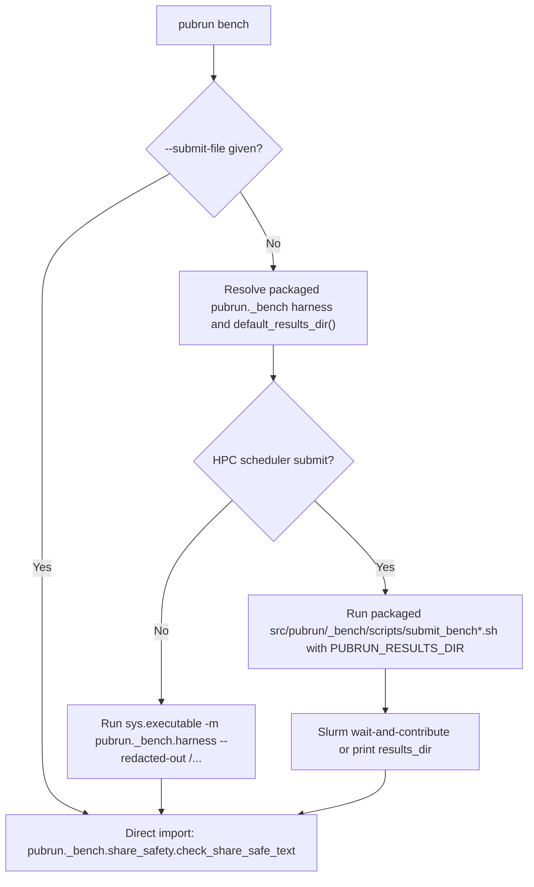

# IPD: Wire pubrun bench CLI to packaged runtime and single-source share safety

- Date: 2026-11-27
- Kind: child
- Concern: Backlog item `bej1qz` requirements 4, 5, 6, and 7: `src/pubrun/__main__.py` still locates `benchmarks/harness.py` in a source checkout (`_find_bench_harness`), exits with a "clone the repo" error outside a checkout, hardcodes `repo_root / "benchmarks" / "results"` and `repo_root / "benchmarks" / chosen["submit_script"]`, dynamically loads `benchmarks/share_safety.py` via `_load_share_safety`, and maintains a duplicated fallback verifier (`_verify_redacted`, `_scan_for_pii`, `_pii_needles`, `_BENCH_SENSITIVE_KEYS`, `_BENCH_SENSITIVE_LIST_KEYS`).
- Scope: Update `src/pubrun/__main__.py` to resolve `pubrun._bench` first, use `pubrun._bench.default_results_dir()` for writable output outside a checkout, pass packaged submit script paths and `PUBRUN_RESULTS_DIR` for HPC submission, invoke `python -m pubrun._bench.harness` locally, replace `_load_share_safety` and `_verify_redacted` with direct `pubrun._bench.share_safety.check_share_safe_text` in `_share_check`, and update the `bench` CLI subparser help text.
- Scope-Paths: src/pubrun/__main__.py
- Item-Dependencies: executed:29nsim, executed:c1zz3x
- Status: approved
- Short-Description: Update src/pubrun/__main__.py to use src/pubrun/_bench, write to a writable default output directory, and remove duplicated share-safety logic
- Work-Kind: bug
- Priority: high
- From-Backlog: bej1qz
- Blocks-Release: g2qtg5
- Set: bej1qz
- Order: 3
- Highest E allocated: 04
- Author: Antigravity
- Id: mfeptf
- Approval: 2026-11-27, recorded via aw ipd set: status set to approved

> Write and proofread this plan per the technical writing standard, `.aw/system/workflows/technical-writing/technical-writing.md` (`.agents/workflows/technical-writing/technical-writing.md` in a legacy-layout install), including requirement 12 (diagrams).

## Workflow history

- 2026-11-27 approved (aw set): status set to approved
- 2026-11-27 to-review (aw set): Authored review-ready child plan from backlog item bej1qz
- 2026-11-27 draft (Antigravity): created.

## Goal

Update `src/pubrun/__main__.py` so `pubrun bench` runs from any working directory in a wheel installation without a source checkout, writes results to a writable default directory (`benchmarks/results/` inside a verified source checkout or `./pubrun-bench-results/` outside one), submits HPC jobs using the packaged scripts and explicit `PUBRUN_RESULTS_DIR`, and validates share safety through the single packaged `pubrun._bench.share_safety.check_share_safe_text` function with all duplicated verifier code removed.

### `pubrun bench` CLI dispatch flow



## Detailed Implementation Checklist (TODO)

Execution-state rule: mark an `E-*` item complete only after performing the action. That mark is not validation. Right-sizing rule: write for a modest executor that cannot hold much in its head. Each E-item is one step (one concern, about one file, executable in one focused pass) and its V-item names each unit it covers with its own check; a plan stays at about 5 E-items and 8 work Scope-Paths, else split it into more child plans (guidance, `IPD-Z603`). Accepted execution states: blocked, failed, pending, performed; terminal gate demands 'performed'.

### Task group 1: Remove duplicated share-safety verifier

- [ ] E-01 Replace `_load_share_safety` and `_verify_redacted` in `src/pubrun/__main__.py` with direct packaged `share_safety` validation:
  - Delete `_BENCH_SENSITIVE_KEYS`, `_BENCH_SENSITIVE_LIST_KEYS`, `_pii_needles`, `_scan_for_pii`, `_verify_redacted`, and `_load_share_safety` from `src/pubrun/__main__.py`.
  - Update `_share_check(redacted_path)` to import `check_share_safe_text` directly from `pubrun._bench.share_safety`, read `Path(redacted_path).read_text(encoding="utf-8")` (returning `(False, [f"could not read {redacted_path}: {e}"])` on `OSError`), and return `check_share_safe_text(text)`.
  - Depends on: none
  - Expected outcome: `src/pubrun/__main__.py` has zero duplicated PII-key lists or fallback verifier functions, and `_share_check` delegates exclusively to `pubrun._bench.share_safety.check_share_safe_text`.
  - Execution state: pending

### Task group 2: Resolve packaged runtime, writable output directory, and HPC scripts

- [ ] E-02 Update harness, submit-script, and output-directory resolution in `src/pubrun/__main__.py`:
  - Update `_find_bench_harness()` to resolve the packaged `pubrun._bench.harness` module file first (via `importlib.util.find_spec("pubrun._bench.harness")` / `Path(spec.origin).resolve()`), falling back to a verified source checkout's `benchmarks/harness.py` only if the packaged file is unavailable.
  - Add helper `_find_bench_submit_script(script_name: str) -> Optional[Path]` that resolves `pubrun._bench.get_submit_script_path(script_name)` first (checking `.is_file()`), falling back to `<checkout_root>/benchmarks/<script_name>` when inside a checkout.
  - Use `pubrun._bench.default_results_dir()` and `pubrun._bench.find_checkout_root()` inside `_run_bench` so:
    - When `harness is None`, print an error stating that the benchmark runtime (`pubrun._bench.harness`) could not be found (no longer claiming a source checkout is required).
    - `results_dir = default_results_dir()` resolves to `<checkout_root>/benchmarks/results` inside a verified checkout and `Path.cwd() / "pubrun-bench-results"` outside a checkout (or `PUBRUN_RESULTS_DIR` if explicitly set).
    - For HPC scheduler submission: locate `submit_script = _find_bench_submit_script(chosen["submit_script"])`, create `results_dir.mkdir(parents=True, exist_ok=True)`, pass `PUBRUN_RESULTS_DIR = str(results_dir.resolve())` and `PUBRUN_PY = sys.executable` in `env` for every scheduler (setting `PUBRUN_REPO` only when `checkout_root is not None`), pass `PUBRUN_REDACTED_OUT` (under `results_dir`) for Slurm submit-and-wait, and print `f"Submitted. Results will be written under {results_dir} on the compute node."` for non-Slurm schedulers.
    - For local runs: create `results_dir.mkdir(parents=True, exist_ok=True)` and invoke `[sys.executable, "-m", "pubrun._bench.harness", "--redacted-out", str(redacted_target), ...]` (falling back to `[sys.executable, str(harness), ...]` only if `harness` is outside `pubrun/_bench`). Ensure the written redacted path continues to be printed in normal, `--no-submit`, and `--json` modes.
  - Depends on: E-01
  - Expected outcome: `_run_bench` works locally and on HPC without any source checkout and always writes to a writable results directory.
  - Execution state: pending

### Task group 3: Update CLI subparser help text

- [ ] E-03 Update the `bench` subparser description in `src/pubrun/__main__.py::main`:
  - Remove the stale sentence `"Requires a source checkout (the benchmark tooling is not shipped in the pip package)."` from `bench_parser`'s `description`.
  - State clearly that `pubrun bench` runs out of the box from a wheel install (writing to `./pubrun-bench-results/` outside a source checkout or `benchmarks/results/` inside one).
  - Keep all existing CLI flags and examples intact.
  - Depends on: E-02
  - Expected outcome: `pubrun bench --help` accurately describes packaged wheel execution and contains no source-checkout requirement.
  - Execution state: pending

### Task group 4: Verify CLI behavior and static types

- [ ] E-04 Run all verification checks listed in `## Required tests / validation`:
  - Run `mypy`, `mypy --platform win32`, and `mypy --platform darwin`.
  - Confirm `_load_share_safety` and `_verify_redacted` no longer exist on `pubrun.__main__`, and `_share_check` passes safe JSON and rejects unredacted hostname and home-path JSON.
  - Run `python3 -m pubrun bench --help` and confirm it exits `0` without `"Requires a source checkout"`.
  - Run `python3 -m pubrun bench --iterations 1 --passes 1 --no-baseline --local --no-submit` from an isolated temporary directory with `PYTHONPATH` pointing to `src` (simulating non-checkout working directory) and verify exit `0`, printed redacted path, and share-safe output.
  - Depends on: E-01, E-02, E-03
  - Expected outcome: All checks pass with exit code `0`.
  - Execution state: pending

## Project conventions discovered (Step 0)

- `src/pubrun/__main__.py::_run_bench` currently calls `_find_bench_harness()`, sets `repo_root = harness.parents[1]`, writes to `repo_root / "benchmarks" / "results"`, and runs `["bash", str(repo_root / "benchmarks" / chosen["submit_script"])] + extra` or `[sys.executable, str(harness), ...]`.
- `src/pubrun/__main__.py::_share_check` is called by `_print_safe_file_block`, `_prepare_submission`, `_submit_benchmark_result`, and `_run_bench` (`--submit-file` path). Keeping `_share_check`'s `(passed: bool, reasons: list[str])` signature preserves every caller untouched.
- `tests/test_bench_command.py::TestHarnessResolution::test_find_harness_in_checkout` asserts `_find_bench_harness()` returns a `Path` whose `.name == "harness.py"`; resolving `src/pubrun/_bench/harness.py` preserves that contract.
- `tests/test_bench_command.py::TestBenchNoBaselineFlag` monkeypatches `subprocess.run` and inspects `argv` for `--no-baseline`; `[sys.executable, "-m", "pubrun._bench.harness", ...]` preserves that contract.

## Findings

| ID | Severity | Remediation Risk | Persona | Evidence | Finding |
|---|---|---|---|---|---|
| F-01 | High | Medium | End User | `src/pubrun/__main__.py::_find_bench_harness`, `_run_bench` | `pubrun bench` fails outside a source checkout and derives `results_dir` and submit scripts from `harness.parents[1]`. |
| F-02 | Medium | Low | Security / Maintainer | `src/pubrun/__main__.py::_load_share_safety`, `_verify_redacted`, `_BENCH_SENSITIVE_KEYS` | Duplicated redaction verifier can drift from canonical `share_safety.py`. |
| F-03 | Low | Low | End User | `src/pubrun/__main__.py::main` (`bench_parser`) | CLI help text states `pubrun bench` requires a source checkout. |

## Proposed changes (ordered, validatable)

1. Remove `_BENCH_SENSITIVE_KEYS`, `_BENCH_SENSITIVE_LIST_KEYS`, `_pii_needles`, `_scan_for_pii`, `_verify_redacted`, and `_load_share_safety` from `src/pubrun/__main__.py`, and wire `_share_check` directly to `pubrun._bench.share_safety.check_share_safe_text` (E-01; Remediation Risk: Low).
2. Update `_find_bench_harness`, add `_find_bench_submit_script`, and update `_run_bench` to use packaged runtime, `default_results_dir()`, `PUBRUN_RESULTS_DIR`, and `python -m pubrun._bench.harness` (E-02; Remediation Risk: Medium).
3. Update `bench_parser` help text in `src/pubrun/__main__.py::main` (E-03; Remediation Risk: Low).
4. Verify cross-platform `mypy`, `_share_check` behavior, `--help` text, and non-checkout `pubrun bench` execution (E-04; Remediation Risk: Low).

## Deferred / out of scope (with reason)

- Updating `tests/test_bench_command.py` (which still tests the removed `_verify_redacted` helper and legacy checkout error) is deferred to child `1r585o` (Order 05) so test updates and end-to-end wheel tests land together after docs and code are complete.
  - Carrier: 1r585o
- Updating `docs/cli.md`, `docs/performance.md`, `benchmarks/README.md`, `docs/hpc.md`, `docs/functional_spec.md`, and `README.md` is deferred to child `cuboum` (Order 04).
  - Carrier: cuboum

## Scope check

- Over-scope: none. Only `src/pubrun/__main__.py` is modified.
- Under-scope: none. All CLI requirements from backlog item `bej1qz` requirements 4, 5, 6, and 7 are implemented here.

## Required tests / validation

1. **Cross-platform static type checking** (must exit `0`):

   ```sh
   mypy && mypy --platform win32 && mypy --platform darwin
   ```

2. **Single-source share-safety check and symbol removal** (must exit `0` and print `ok`):

   ```sh
   python3 -c 'import json, tempfile; from pathlib import Path; import pubrun.__main__ as m; assert not hasattr(m, "_load_share_safety"); assert not hasattr(m, "_verify_redacted"); assert not hasattr(m, "_scan_for_pii"); td = Path(tempfile.mkdtemp()); good = td / "g.json"; good.write_text(json.dumps({"schema": "pubrun-benchmark/5", "machine": {"host": {"hostname": "<redacted>"}}})); bad = td / "b.json"; bad.write_text(json.dumps({"schema": "pubrun-benchmark/5", "machine": {"host": {"hostname": "real-host"}}})); assert m._share_check(good) == (True, []); ok, reasons = m._share_check(bad); assert not ok and any("hostname" in r for r in reasons); print("ok")'
   ```

3. **CLI help text check** (must exit `0` and not contain `"Requires a source checkout"`):

   ```sh
   python3 -c 'import subprocess, sys; r = subprocess.run([sys.executable, "-m", "pubrun", "bench", "--help"], capture_output=True, text=True, check=True); print(r.stdout[:400]); assert "Requires a source checkout" not in r.stdout'
   ```

4. **CLI local run smoke check with JSON output** (must exit `0`, write redacted result, and pass `_share_check`):

   ```sh
   python3 -c 'import json, os, subprocess, sys, tempfile; from pathlib import Path; td = Path(tempfile.mkdtemp(prefix="pubrun-cli-bench-")); env = dict(os.environ); env["PUBRUN_RESULTS_DIR"] = str(td / "custom-results"); r = subprocess.run([sys.executable, "-m", "pubrun", "bench", "--iterations", "1", "--passes", "1", "--no-baseline", "--local", "--json"], cwd=str(td), env=env, capture_output=True, text=True, timeout=180); print("rc=", r.returncode, "out=", r.stdout.strip()); assert r.returncode == 0, r.stderr; data = json.loads(r.stdout); p = Path(data["redacted"]); assert p.is_file() and p.parent == td / "custom-results" and data["unredacted"] is None'
   ```

## Spec / documentation sync

N/A for this child plan; child `cuboum` (Order 04) updates `docs/cli.md`, `docs/performance.md`, `benchmarks/README.md`, `docs/hpc.md`, `docs/functional_spec.md`, and `README.md`.

## Open questions

None.

## Validation and cross-check (verify before reporting done)

Validation-state rule: inspect evidence in a separate pass. Do not mark a `V-*` item complete from memory or from the matching execution checkmark. Accepted validation results: blocked, failed, pass, pending; terminal gate demands 'pass'. Runtime-demonstration reachability rule: for each `V-*` item demanding the software be observed acting (such as a run, a dispatch, or a transition)—as distinct from items demanding a diff, a file's content, or a test result, which are reachable by construction—name the code path that produces the observation or the sibling `E-*` that creates it, else the demand is UNDER-SCOPE.

- [ ] V-01 validates E-01
  - Required evidence: Pasted output of validation command 2 confirming `_load_share_safety`, `_verify_redacted`, and `_scan_for_pii` are absent from `src/pubrun/__main__.py` and `_share_check` (updated by E-01) returns `(True, [])` on safe JSON and `(False, [...])` naming `hostname` on unredacted JSON.
  - Observed evidence:
  - Result: pending

- [ ] V-02 validates E-02
  - Required evidence: Pasted output of validation command 4 exercising `src/pubrun/__main__.py::_run_bench` (updated by E-02) showing exit code `0`, valid JSON stdout with `redacted` pointing to an existing file under the explicit writable directory, and `unredacted` equal to `None`.
  - Observed evidence:
  - Result: pending

- [ ] V-03 validates E-03
  - Required evidence: Pasted output of validation command 3 (`python3 -m pubrun bench --help`, updated by E-03) exiting `0` with no `"Requires a source checkout"` string.
  - Observed evidence:
  - Result: pending

- [ ] V-04 validates E-04
  - Required evidence: Pasted output of all four commands in `## Required tests / validation` (including three-platform `mypy`) exiting `0`.
  - Observed evidence:
  - Result: pending

## Approval and execution gate

- Size assessment: standard
- Cohesion rationale: not required

Execute E-01 through E-04 only after this plan is `approved` and both `29nsim` and `c1zz3x` have reached `executed`. Commit only `src/pubrun/__main__.py` through `aw commit mfeptf -- src/pubrun/__main__.py`. Do not push, tag, or publish. After all `E-*` items are `performed` and all `V-*` items are `pass`, move the plan through the post-gate transition to `.aw/records/plans/executed/`.
