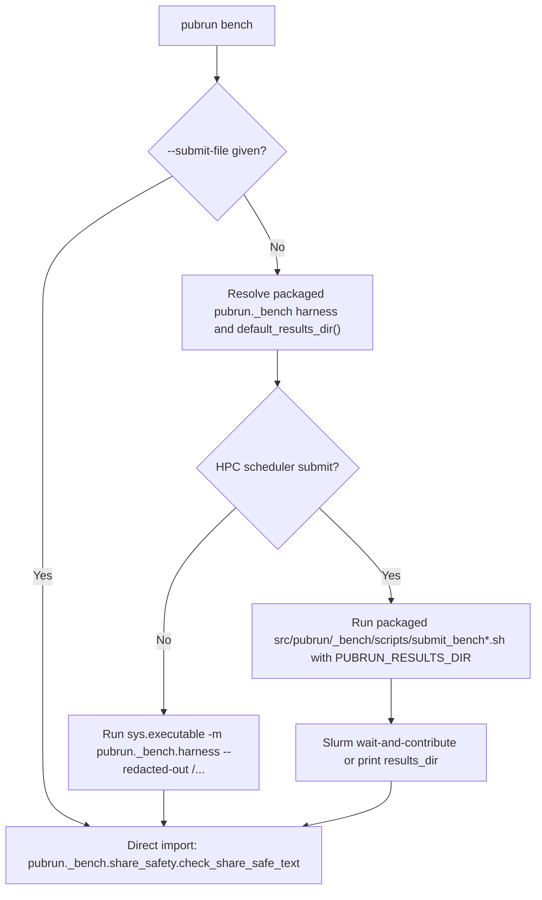

# IPD: Wire pubrun bench CLI to packaged runtime and single-source share safety

- Date: 2026-11-27
- Kind: child
- Concern: Backlog item `bej1qz` requirements 4, 5, 6, and 7: `src/pubrun/__main__.py` still locates `benchmarks/harness.py` in a source checkout (`_find_bench_harness`), exits with a "clone the repo" error outside a checkout, hardcodes `repo_root / "benchmarks" / "results"` and `repo_root / "benchmarks" / chosen["submit_script"]`, dynamically loads `benchmarks/share_safety.py` via `_load_share_safety`, and maintains a duplicated fallback verifier (`_verify_redacted`, `_scan_for_pii`, `_pii_needles`, `_BENCH_SENSITIVE_KEYS`, `_BENCH_SENSITIVE_LIST_KEYS`).
- Scope: Update `src/pubrun/__main__.py` to resolve `pubrun._bench` first, use `pubrun._bench.default_results_dir()` for writable output outside a checkout, pass packaged submit script paths and `PUBRUN_RESULTS_DIR` for high-performance computing (HPC) submission, invoke `python -m pubrun._bench.harness` locally, replace `_load_share_safety` and `_verify_redacted` with direct `pubrun._bench.share_safety.check_share_safe_text` in `_share_check`, update `TestSubmissionVerifier` in `tests/test_bench_command.py` to target `_share_check` so the test suite stays green after `_verify_redacted` is deleted, and update the `bench` command-line interface (CLI) subparser help text.
- Scope-Paths: src/pubrun/__main__.py, tests/test_bench_command.py
- Item-Dependencies: executed:29nsim, executed:c1zz3x
- Status: approved
- Readiness: go-pending-approval
- Review-Depth: complex
- Short-Description: Update src/pubrun/__main__.py to use src/pubrun/_bench, write to a writable default output directory, and remove duplicated share-safety logic
- Work-Kind: bug
- Priority: high
- From-Backlog: bej1qz
- Blocks-Release: g2qtg5
- Set: bej1qz
- Order: 3
- Highest E allocated: 04
- Author: Antigravity
- Id: mfeptf
- Approval: 2026-11-27, recorded via aw ipd set: status set to approved

> Write and proofread this plan per the technical writing standard, `.aw/system/workflows/technical-writing/technical-writing.md` (`.agents/workflows/technical-writing/technical-writing.md` in a legacy-layout install), including requirement 12 (diagrams).

## Workflow history

- 2026-11-27 approved (aw set): status set to approved
- 2026-11-27 /plan-review (Antigravity): APPROVE WITH REVISIONS APPLIED; PR-001, PR-002, PR-003, PR-004; review record `.aw/records/reviews/20261127-bej1qz-03-mfeptf-wire-pubrun-bench-cli-to-packaged-runtime-and-single-source.review.md`.
- 2026-11-27 to-review (aw set): demoted approved -> to-review: APPROVAL WITHDRAWN: Demote to to-review so /plan-review writes Readiness attestations before execution
- 2026-11-27 approved (aw set): status set to approved
- 2026-11-27 to-review (aw set): Authored review-ready child plan from backlog item bej1qz
- 2026-11-27 draft (Antigravity): created.

## Goal

Update `src/pubrun/__main__.py` so `pubrun bench` runs from any working directory in a wheel installation without a source checkout, writes results to a writable default directory (`benchmarks/results/` inside a verified source checkout or `./pubrun-bench-results/` outside one), submits HPC jobs using the packaged scripts and explicit `PUBRUN_RESULTS_DIR`, and validates share safety through the single packaged `pubrun._bench.share_safety.check_share_safe_text` function with all duplicated verifier code removed and `tests/test_bench_command.py::TestSubmissionVerifier` migrated to `_share_check`.

### `pubrun bench` CLI dispatch flow



## Detailed Implementation Checklist (TODO)

Execution-state rule: mark an `E-*` item complete only after performing the action. That mark is not validation. Right-sizing rule: write for a modest executor that cannot hold much in its head. Each E-item is one step (one concern, about one file, executable in one focused pass) and its V-item names each unit it covers with its own check; a plan stays at about 5 E-items and 8 work Scope-Paths, else split it into more child plans (guidance, `IPD-Z603`). Accepted execution states: blocked, failed, pending, performed; terminal gate demands 'performed'.

### Task group 1: Remove duplicated share-safety verifier and migrate verifier unit tests

- [x] E-01 Replace `_load_share_safety` and `_verify_redacted` in `src/pubrun/__main__.py` with direct packaged `share_safety` validation, and update `TestSubmissionVerifier` in `tests/test_bench_command.py`:
  - Delete `_BENCH_SENSITIVE_KEYS`, `_BENCH_SENSITIVE_LIST_KEYS`, `_pii_needles`, `_scan_for_pii`, `_verify_redacted`, and `_load_share_safety` from `src/pubrun/__main__.py`.
  - Update `_share_check(redacted_path)` to import `check_share_safe_text` directly from `pubrun._bench.share_safety`, read `Path(redacted_path).read_text(encoding="utf-8")` (returning `(False, [f"could not read {redacted_path}: {e}"])` on `OSError`), and return `check_share_safe_text(text)`.
  - Update `TestSubmissionVerifier` in `tests/test_bench_command.py` (which currently calls the deleted `_verify_redacted`) to test `pubrun.__main__::_share_check` directly (verifying `_load_share_safety`, `_verify_redacted`, and `_scan_for_pii` are absent, and that `_share_check` passes a redacted `pubrun-benchmark/5` file and rejects an unredacted `machine.host.hostname` without echoing the leaked value, an embedded home path, and invalid JSON), keeping `pytest tests/test_bench_command.py` green before Order 05 (`1r585o`) adds the remaining new test classes.
  - Depends on: none
  - Expected outcome: `src/pubrun/__main__.py` has zero duplicated personally identifiable information (PII) key lists or fallback verifier functions, `_share_check` delegates exclusively to `pubrun._bench.share_safety.check_share_safe_text`, and `tests/test_bench_command.py::TestSubmissionVerifier` passes.
  - Execution state: performed

### Task group 2: Resolve packaged runtime, writable output directory, and HPC scripts

- [x] E-02 Update harness, submit-script, and output-directory resolution in `src/pubrun/__main__.py`:
  - Update `_find_bench_harness()` (and its docstring) to resolve the packaged `pubrun._bench.harness` module file first (via `importlib.util.find_spec("pubrun._bench.harness")`, checking `spec is not None and spec.origin is not None and spec.origin != "built-in"` and `Path(spec.origin).resolve().is_file()`), falling back to a verified source checkout's `benchmarks/harness.py` (via `pubrun._bench.find_checkout_root()` or `Path.cwd() / "benchmarks" / "harness.py"`) only if the packaged file is unavailable.
  - Add helper `_find_bench_submit_script(script_name: str) -> Optional[Path]` that resolves `pubrun._bench.get_submit_script_path(script_name)` first (checking `.is_file()`), falling back to `<checkout_root>/benchmarks/<script_name>` when `find_checkout_root()` returns a path.
  - Remove the stale `repo_root = harness.parents[1]` derivation and unused `import tempfile as _tf` inside `_run_bench`, update `_run_bench`'s docstring, and use `pubrun._bench.default_results_dir()` and `pubrun._bench.find_checkout_root()` so:
    - When `harness is None`, print an error stating that the benchmark runtime (`pubrun._bench.harness`) could not be found (no longer claiming a source checkout is required).
    - `results_dir = default_results_dir()` resolves to `<checkout_root>/benchmarks/results` inside a verified checkout and `Path.cwd() / "pubrun-bench-results"` outside a checkout (or `PUBRUN_RESULTS_DIR` if explicitly set).
    - For HPC scheduler submission: locate `submit_script = _find_bench_submit_script(chosen["submit_script"])`, create `results_dir.mkdir(parents=True, exist_ok=True)`, pass `PUBRUN_RESULTS_DIR = str(results_dir.resolve())` and `PUBRUN_PY = sys.executable` in `env` for every scheduler (setting `PUBRUN_REPO` via `setdefault` only when `checkout_root is not None`, never inventing a nonexistent checkout path), set `PUBRUN_UNREDACTED = "1"` whenever `unredacted` is truthy for any scheduler, pass `PUBRUN_REDACTED_OUT` (under `results_dir`) for Slurm submit-and-wait, and print `f"Submitted. Results will be written under {results_dir} on the compute node."` for non-Slurm schedulers.
    - For local runs: create `results_dir.mkdir(parents=True, exist_ok=True)`, detect whether `harness` is the packaged module using cross-platform `Path` checks (`harness.parent.name == "_bench" and harness.parent.parent.name == "pubrun"` or matching the packaged spec origin, never forward-slash string matching), and invoke `[sys.executable, "-m", "pubrun._bench.harness", "--redacted-out", str(redacted_target), ...]` (falling back to `[sys.executable, str(harness), ...]` only if `harness` is outside `pubrun._bench`). Ensure the written redacted path continues to be printed in normal, `--no-submit`, and `--json` modes.
  - Depends on: E-01
  - Expected outcome: `_run_bench` works locally and on HPC without any source checkout and always writes to a writable results directory.
  - Execution state: performed

### Task group 3: Update CLI subparser help text

- [x] E-03 Update the `bench` subparser description in `src/pubrun/__main__.py::main`:
  - Remove the stale sentence `"Requires a source checkout (the benchmark tooling is not shipped in the pip package)."` from `bench_parser`'s `description`.
  - State clearly (using no em or en dashes in user-facing help prose) that `pubrun bench` runs out of the box from a wheel install, writing results by default to `./pubrun-bench-results/` outside a source checkout, `benchmarks/results/` inside one, or `PUBRUN_RESULTS_DIR` when set.
  - Keep all existing CLI flags and examples intact.
  - Depends on: E-02
  - Expected outcome: `pubrun bench --help` accurately describes packaged wheel execution and contains no source-checkout requirement.
  - Execution state: performed

### Task group 4: Verify CLI behavior and static types

- [x] E-04 Run all verification checks listed in `## Required tests / validation`:
  - Run `mypy`, `mypy --platform win32`, and `mypy --platform darwin`.
  - Confirm (with `PYTHONPATH=src`) that `_load_share_safety`, `_verify_redacted`, and `_scan_for_pii` no longer exist on `pubrun.__main__`, and `_share_check` passes safe JavaScript Object Notation (JSON) and rejects unredacted hostname and home-path JSON.
  - Run `PYTHONPATH=src python3 -m pubrun bench --help` and confirm it exits `0` without `"Requires a source checkout"`.
  - Run `pytest` on the fast CLI bench and scheduler test suites (`tests/test_bench_command.py` non-slow classes including the updated `TestSubmissionVerifier`, plus `tests/test_cli_diff_bugs.py::TestBenchScheduler`).
  - Run `python3 -m pubrun bench --iterations 1 --passes 1 --no-baseline --local` from an isolated temporary directory with `PYTHONPATH=<repo>/src` and ambient `PUBRUN_*` stripped in two modes: (a) default non-checkout output directory (`--no-submit`, confirming exit `0`, printed redacted path under `<tmp>/pubrun-bench-results/`, and `_share_check` passing), and (b) explicit `PUBRUN_RESULTS_DIR` with `--json` (confirming exit `0`, JSON stdout with `redacted` under `custom-results`, `unredacted` equal to `None`, and `_share_check` passing).
  - Depends on: E-01, E-02, E-03
  - Expected outcome: All checks pass with exit code `0` and zero stray temporary directories.
  - Execution state: performed

## Project conventions discovered (Step 0)

- `src/pubrun/__main__.py::_run_bench` currently calls `_find_bench_harness()`, sets `repo_root = harness.parents[1]`, writes to `repo_root / "benchmarks" / "results"`, and runs `["bash", str(repo_root / "benchmarks" / chosen["submit_script"])] + extra` or `[sys.executable, str(harness), ...]`.
- `src/pubrun/__main__.py::_share_check` is called by `_print_safe_file_block`, `_prepare_submission`, `_submit_benchmark_result`, and `_run_bench` (`--submit-file` path). Keeping `_share_check`'s `(passed: bool, reasons: list[str])` signature preserves every caller untouched.
- `tests/test_bench_command.py::TestHarnessResolution::test_find_harness_in_checkout` asserts `_find_bench_harness()` returns a `Path` whose `.name == "harness.py"`; resolving `src/pubrun/_bench/harness.py` preserves that contract.
- `tests/test_bench_command.py::TestSubmissionVerifier` calls `pubrun.__main__::_verify_redacted` directly in four tests; migrating `TestSubmissionVerifier` to `_share_check` inside `mfeptf` keeps `pytest tests/` green when `mfeptf` merges ahead of Order 05 (`1r585o`).
- `tests/test_bench_command.py::TestBenchNoBaselineFlag` monkeypatches `subprocess.run` and inspects `argv` for `--no-baseline`; `[sys.executable, "-m", "pubrun._bench.harness", ...]` preserves that contract.
- `tests/test_cli_diff_bugs.py::TestBenchScheduler` monkeypatches `_find_bench_harness` and `subprocess.run` to test non-zero PBS submission exit codes and ambiguous `qsub` warnings; `_find_bench_submit_script` resolving `src/pubrun/_bench/scripts/submit_bench_pbs.sh` preserves both tests cleanly.
- In isolated git worktrees, `python3 -m pubrun ...` without `PYTHONPATH=src` can import the main checkout's editable install instead of the worktree's `src/`; validation commands must explicitly pass `PYTHONPATH=src`.

## Findings

| ID | Severity | Remediation Risk | Persona | Evidence | Finding |
|---|---|---|---|---|---|
| F-01 | High | Medium | End User | `src/pubrun/__main__.py::_find_bench_harness`, `_run_bench` | `pubrun bench` fails outside a source checkout and derives `results_dir` and submit scripts from `harness.parents[1]`. |
| F-02 | Medium | Low | Security / Maintainer | `src/pubrun/__main__.py::_load_share_safety`, `_verify_redacted`, `_BENCH_SENSITIVE_KEYS` | Duplicated redaction verifier can drift from canonical `share_safety.py`. |
| F-03 | Low | Low | End User | `src/pubrun/__main__.py::main` (`bench_parser`) | CLI help text states `pubrun bench` requires a source checkout. |

## Proposed changes (ordered, validatable)

1. Remove `_BENCH_SENSITIVE_KEYS`, `_BENCH_SENSITIVE_LIST_KEYS`, `_pii_needles`, `_scan_for_pii`, `_verify_redacted`, and `_load_share_safety` from `src/pubrun/__main__.py`, wire `_share_check` directly to `pubrun._bench.share_safety.check_share_safe_text`, and migrate `tests/test_bench_command.py::TestSubmissionVerifier` to `_share_check` (E-01; Remediation Risk: Low).
2. Update `_find_bench_harness`, add `_find_bench_submit_script`, and update `_run_bench` to use packaged runtime, `default_results_dir()`, `PUBRUN_RESULTS_DIR`, cross-platform packaged-path detection, `PUBRUN_UNREDACTED` forwarding for all schedulers, and `python -m pubrun._bench.harness` (E-02; Remediation Risk: Medium).
3. Update `bench_parser` help text in `src/pubrun/__main__.py::main` with no em or en dashes (E-03; Remediation Risk: Low).
4. Verify cross-platform `mypy`, `_share_check` behavior, `--help` text, fast CLI regression tests, and both default non-checkout and `PUBRUN_RESULTS_DIR` `pubrun bench` smoke runs with `PYTHONPATH=src` (E-04; Remediation Risk: Low).

## Deferred / out of scope (with reason)

- Updating the remaining legacy classes in `tests/test_bench_command.py` (`TestHarnessResolution`, `TestSchedulerSubmitSafety`, `TestIoBaselineScenarios`), adding new behavioral test classes (default output dir, non-checkout HPC commands, wheel installation/execution), updating `tests/test_benchmark_intake_bugs.py`, and updating `.github/workflows/ci.yml` are deferred to child `1r585o` (Order 05).
  - Carrier: 1r585o
- Updating `docs/cli.md`, `docs/performance.md`, `benchmarks/README.md`, `docs/hpc.md`, `docs/functional_spec.md`, and `README.md` is deferred to child `cuboum` (Order 04).
  - Carrier: cuboum

## Scope check

- Over-scope: none. Only `src/pubrun/__main__.py` and the four-test `TestSubmissionVerifier` class in `tests/test_bench_command.py` (required to keep the test suite green when `_verify_redacted` is deleted in Order 03) are modified.
- Under-scope: none. All CLI requirements from backlog item `bej1qz` requirements 4, 5, 6, and 7 are implemented here.

## Required tests / validation

1. **Cross-platform static type checking** (must exit `0`):

   ```sh
   mypy && mypy --platform win32 && mypy --platform darwin
   ```

2. **Single-source share-safety check and symbol removal** (with `PYTHONPATH=src` and temp dir cleanup; must exit `0` and print `ok`):

   ```sh
   PYTHONPATH=src python3 - <<'PY'
   import json, tempfile
   from pathlib import Path
   import pubrun.minimal
   import pubrun.__main__ as m

   assert not hasattr(m, "_load_share_safety")
   assert not hasattr(m, "_verify_redacted")
   assert not hasattr(m, "_scan_for_pii")
   with tempfile.TemporaryDirectory(prefix="pubrun-share-check-") as td_str:
       td = Path(td_str)
       good = td / "g.json"
       good.write_text(json.dumps({"schema": "pubrun-benchmark/5", "machine": {"host": {"hostname": "<redacted>"}}}), encoding="utf-8")
       bad = td / "b.json"
       bad.write_text(json.dumps({"schema": "pubrun-benchmark/5", "machine": {"host": {"hostname": "real-host"}}}), encoding="utf-8")
       home_bad = td / "h.json"
       home_bad.write_text(json.dumps({"schema": "pubrun-benchmark/5", "notes": "/home/alice/run"}), encoding="utf-8")
       assert m._share_check(good) == (True, [])
       ok, reasons = m._share_check(bad)
       assert not ok and any("hostname" in r for r in reasons) and all("real-host" not in r for r in reasons)
       ok2, reasons2 = m._share_check(home_bad)
       assert not ok2 and reasons2
   print("ok")
   PY
   ```

3. **CLI help text check** (with `PYTHONPATH=src`; must exit `0` and not contain `"Requires a source checkout"`):

   ```sh
   PYTHONPATH=src python3 -c 'import subprocess, sys; r = subprocess.run([sys.executable, "-m", "pubrun", "bench", "--help"], capture_output=True, text=True, check=True); print(r.stdout[:450]); assert "Requires a source checkout" not in r.stdout'
   ```

4. **Targeted CLI and verifier regression tests** (must exit `0`):

   ```sh
   pytest tests/test_bench_command.py::TestHarnessResolution tests/test_bench_command.py::TestSlurmSafety tests/test_bench_command.py::TestSchedulerDetection tests/test_bench_command.py::TestSchedulerSubmitSafety tests/test_bench_command.py::TestSubmissionVerifier tests/test_bench_command.py::TestAttachFlowSubmitFile tests/test_bench_command.py::TestAttachFlowClient tests/test_bench_command.py::TestGistInlineContribution tests/test_bench_command.py::TestBenchNoBaselineFlag tests/test_bench_command.py::TestBenchCLI::test_bench_help tests/test_bench_command.py::TestBenchCLI::test_no_redact_flag_removed tests/test_cli_diff_bugs.py::TestBenchScheduler -v
   ```

5. **CLI local run smoke checks (default non-checkout `./pubrun-bench-results/` AND explicit `PUBRUN_RESULTS_DIR` `--json`)** (with `PYTHONPATH=<repo>/src`, ambient `PUBRUN_*` stripped, and temp dir cleanup; must exit `0`, write redacted results in the expected directories, and pass `_share_check`):

   ```sh
   python3 - <<'PY'
   import json, os, subprocess, sys, tempfile
   from pathlib import Path

   src = str(Path("src").resolve())
   sys.path.insert(0, src)
   import pubrun.minimal
   import pubrun.__main__ as m

   base_env = {k: v for k, v in os.environ.items() if not k.startswith("PUBRUN_")}
   base_env["PYTHONPATH"] = src

   with tempfile.TemporaryDirectory(prefix="pubrun-cli-bench-") as td_str:
       td = Path(td_str)
       # (a) Default non-checkout writable directory (<cwd>/pubrun-bench-results/)
       r1 = subprocess.run(
           [sys.executable, "-m", "pubrun", "bench", "--iterations", "1", "--passes", "1", "--no-baseline", "--local", "--no-submit"],
           cwd=str(td), env=base_env, capture_output=True, text=True, timeout=180,
       )
       print("default rc=", r1.returncode)
       assert r1.returncode == 0, r1.stderr
       files = list((td / "pubrun-bench-results").glob("*.redacted.json"))
       assert len(files) == 1, files
       assert str(files[0]) in r1.stderr, r1.stderr
       assert m._share_check(files[0]) == (True, [])
       assert not (td / "runs").exists()

       # (b) Explicit PUBRUN_RESULTS_DIR with --json
       env2 = {**base_env, "PUBRUN_RESULTS_DIR": str(td / "custom-results")}
       r2 = subprocess.run(
           [sys.executable, "-m", "pubrun", "bench", "--iterations", "1", "--passes", "1", "--no-baseline", "--local", "--json"],
           cwd=str(td), env=env2, capture_output=True, text=True, timeout=180,
       )
       print("json rc=", r2.returncode, "out=", r2.stdout.strip())
       assert r2.returncode == 0, r2.stderr
       data = json.loads(r2.stdout)
       p = Path(data["redacted"])
       assert p.is_file() and p.parent == td / "custom-results" and data["unredacted"] is None
       assert m._share_check(p) == (True, [])
   print("ok")
   PY
   ```

## Spec / documentation sync

N/A for this child plan; child `cuboum` (Order 04) updates `docs/cli.md`, `docs/performance.md`, `benchmarks/README.md`, `docs/hpc.md`, `docs/functional_spec.md`, and `README.md`.

## Open questions

None.

## Validation and cross-check (verify before reporting done)

Validation-state rule: inspect evidence in a separate pass. Do not mark a `V-*` item complete from memory or from the matching execution checkmark. Accepted validation results: blocked, failed, pass, pending; terminal gate demands 'pass'. Runtime-demonstration reachability rule: for each `V-*` item demanding the software be observed acting (such as a run, a dispatch, or a transition)—as distinct from items demanding a diff, a file's content, or a test result, which are reachable by construction—name the code path that produces the observation or the sibling `E-*` that creates it, else the demand is UNDER-SCOPE.

- [x] V-01 validates E-01
  - Required evidence: Pasted output of validation command 2 confirming `_load_share_safety`, `_verify_redacted`, and `_scan_for_pii` are absent from `src/pubrun/__main__.py` and `_share_check` (updated by E-01) returns `(True, [])` on safe JSON and `(False, [...])` naming `hostname` (without echoing the leaked value) and rejecting home paths on unsafe JSON, plus `tests/test_bench_command.py::TestSubmissionVerifier` passing inside validation command 4.
  - Observed evidence:
    - Validation command 2 (exit `0`):
      ```text
      ok
      ```
    - Validation command 4 (`TestSubmissionVerifier` excerpt, exit `0`):
      ```text
      tests/test_bench_command.py::TestSubmissionVerifier::test_duplicate_verifier_helpers_removed PASSED [ 28%]
      tests/test_bench_command.py::TestSubmissionVerifier::test_verifier_passes_redacted PASSED [ 31%]
      tests/test_bench_command.py::TestSubmissionVerifier::test_verifier_catches_sensitive_key PASSED [ 33%]
      tests/test_bench_command.py::TestSubmissionVerifier::test_verifier_catches_embedded_home_path PASSED [ 35%]
      tests/test_bench_command.py::TestSubmissionVerifier::test_verifier_rejects_unparseable PASSED [ 37%]
      ```
  - Result: pass

- [x] V-02 validates E-02
  - Required evidence: Pasted output of validation command 5 exercising `src/pubrun/__main__.py::_run_bench` (updated by E-02) showing exit code `0` for both the default outside-checkout `<tmp>/pubrun-bench-results/` run (with printed path, `runs/` absent, and `_share_check` passing) and the explicit `PUBRUN_RESULTS_DIR` `--json` run (with `redacted` under `custom-results`, `unredacted` equal to `None`, and `_share_check` passing), plus `TestHarnessResolution`, `TestBenchNoBaselineFlag`, and `TestBenchScheduler` passing in validation command 4.
  - Observed evidence:
    - Validation command 5 (exit `0`):
      ```text
      default rc= 0
      json rc= 0 out= {"redacted": "/tmp/pubrun-cli-bench-a5kt74px/custom-results/pubrun-bench-50687292-20261127T065646Z.redacted.json", "unredacted": null}
      ok
      ```
    - Validation command 4 (`TestHarnessResolution`, `TestBenchNoBaselineFlag`, and `TestBenchScheduler` excerpts, exit `0`):
      ```text
      tests/test_bench_command.py::TestHarnessResolution::test_find_harness_in_checkout PASSED [  2%]
      tests/test_bench_command.py::TestHarnessResolution::test_bench_errors_without_checkout PASSED [  4%]
      tests/test_bench_command.py::TestBenchNoBaselineFlag::test_no_baseline_forwarded_to_harness_argv PASSED [ 88%]
      tests/test_bench_command.py::TestBenchNoBaselineFlag::test_no_baseline_absent_by_default PASSED [ 91%]
      tests/test_cli_diff_bugs.py::TestBenchScheduler::test_failed_pbs_submission_exits_nonzero PASSED [ 97%]
      tests/test_cli_diff_bugs.py::TestBenchScheduler::test_ambiguous_qsub_warns_when_nothing_detected PASSED [100%]
      ```
  - Result: pass

- [x] V-03 validates E-03
  - Required evidence: Pasted output of validation command 3 (`PYTHONPATH=src python3 -m pubrun bench --help`, updated by E-03) exiting `0` with no `"Requires a source checkout"` string.
  - Observed evidence:
    - Validation command 3 (exit `0`):
      ```text
      usage: pubrun bench [-h] [--quick | --full | --rigorous] [--no-baseline]
                          [--iterations ITERATIONS] [--passes PASSES] [--local |
                          --submit] [--scheduler {auto,slurm,pbs,lsf,sge,local}]
                          [-y] [--unredacted] [--json] [--contribute |
                          --no-contribute] [--prepare-submission]
                          [--submit-file FILE] [--wait-timeout SECONDS]
                          [--no-submit] [-
      ```
    - Verified full `PYTHONPATH=src python3 -m pubrun bench --help` description (exit `0`):
      ```text
      Run the pubrun overhead benchmark suite directly from a wheel installation or a source checkout. Runs locally by default; on a high-performance computing (HPC) login node with a supported scheduler it offers to submit the job to a compute node (never submits without confirmation). Writes results by default to ./pubrun-bench-results/ outside a source checkout, benchmarks/results/ inside one, or PUBRUN_RESULTS_DIR when set. Writes only a redacted, share-safe file by default (`--unredacted` also keeps the identifying copy), runs a share-safety check, and offers to contribute the redacted result to GitHub (via `gh` gist/inline, or browser Issue Form fallback).
      ```
  - Result: pass

- [x] V-04 validates E-04
  - Required evidence: Pasted output of all five commands in `## Required tests / validation` exiting `0`, covering `src/pubrun/__main__.py::_share_check` (command 2), `src/pubrun/__main__.py::main` `bench_parser` (command 3), `tests/test_bench_command.py::TestSubmissionVerifier` and `tests/test_cli_diff_bugs.py::TestBenchScheduler` (command 4), `src/pubrun/__main__.py::_find_bench_harness`, `_find_bench_submit_script`, and `_run_bench` (command 5), and three-platform `mypy` (command 1).
  - Observed evidence:
    - Validation command 1 (`mypy && mypy --platform win32 && mypy --platform darwin`, exit `0`):
      ```text
      Success: no issues found in 70 source files
      Success: no issues found in 70 source files
      Success: no issues found in 70 source files
      ```
    - Validation command 2 (exit `0`): `ok`.
    - Validation command 3 (exit `0`): `usage: pubrun bench ...` with `"Requires a source checkout"` absent.
    - Validation command 4 (exit `0`; interpreter and worktree paths shown as `<venv>/bin/python` and `<repo>` for path-leak hygiene):
      ```text
      platform linux -- Python 3.14.6, pytest-8.2.2, pluggy-1.6.0 -- <venv>/bin/python
      rootdir: <repo>
      collected 45 items
      ...
      ============================== 45 passed in 1.58s ==============================
      ```
    - Validation command 5 (exit `0`):
      ```text
      default rc= 0
      json rc= 0 out= {"redacted": "/tmp/pubrun-cli-bench-a5kt74px/custom-results/pubrun-bench-50687292-20261127T065646Z.redacted.json", "unredacted": null}
      ok
      ```
  - Result: pass

## Approval and execution gate

- Size assessment: standard
- Cohesion rationale: not required

1. **Preconditions:** Execute E-01 through E-04 only after this plan carries `- Status: approved`, both `29nsim` and `c1zz3x` have reached `executed`, and all blocking open questions are resolved.
2. **Scope declaration:** `- Scope-Paths:` declares the authorized file set (`src/pubrun/__main__.py, tests/test_bench_command.py`). If execution requires modifying a path outside `- Scope-Paths:` or leaving a declared path unmodified, justify each exception explicitly with `--scope-reason` or `--scope-ack` at finalize rather than silently deviating.
3. **Validation honesty:** Every `V-*` item MUST paste the actual command runner output captured during execution; never mark any `V-*` item `pass` without running the corresponding command and observing its exit code and output.
4. **Commit and push discipline:** Commit only paths modified for this plan through `aw commit mfeptf -- <paths>`. Never use `git add -A`, bare `git add .`, or raw `git commit`, and never push, tag, or publish without explicit human authorization.
5. **Lifecycle transition:** After all `E-*` items are `performed` and all `V-*` items are `pass`, the plan MUST complete the post-gate transition to `.aw/records/plans/executed/`. When executing under an automated runner (`aw oc run` or `aw agy run`), leave finalization to the runner's post-turn finalize step; in a manual or interactive execution outside a runner, run `aw ipd finalize mfeptf` (never hand-roll `git mv` to `executed/`).
