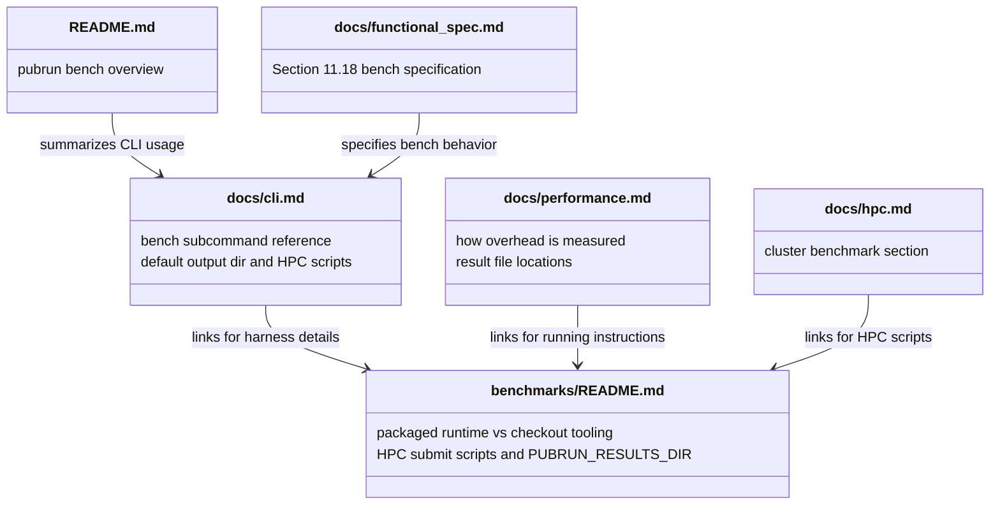

# IPD: Update benchmark documentation for packaged wheel runtime

- Date: 2026-11-27
- Kind: child
- Concern: Backlog item `bej1qz` requirement 8: `docs/cli.md`, `docs/performance.md`, and `benchmarks/README.md` (along with `docs/hpc.md`, `docs/functional_spec.md`, and `README.md`) still state that `pubrun bench` requires a source checkout because `benchmarks/harness.py` is not shipped in the wheel, and they do not document the packaged runtime under `src/pubrun/_bench/` or the writable default output directory (`./pubrun-bench-results/`) used outside a source checkout.
- Scope: Update `docs/cli.md`, `docs/performance.md`, `benchmarks/README.md`, `docs/hpc.md`, `docs/functional_spec.md`, and `README.md` so all user-facing and benchmark documentation accurately describes wheel-installed `pubrun bench` execution, writable default output directory selection, packaged HPC scripts, direct checkout shims, and single-source `share_safety` validation.
- Scope-Paths: docs/cli.md, docs/performance.md, benchmarks/README.md, docs/hpc.md, docs/functional_spec.md, README.md
- Item-Dependencies: executed:29nsim, executed:c1zz3x, executed:mfeptf
- Status: to-review
- Short-Description: Update docs/cli.md, docs/performance.md, benchmarks/README.md, docs/hpc.md, docs/functional_spec.md, and README.md to document packaged pubrun bench support
- Work-Kind: bug
- Priority: high
- From-Backlog: bej1qz
- Blocks-Release: g2qtg5
- Set: bej1qz
- Order: 4
- Highest E allocated: 04
- Author: Antigravity
- Id: cuboum

> Write and proofread this plan per the technical writing standard, `.aw/system/workflows/technical-writing/technical-writing.md` (`.agents/workflows/technical-writing/technical-writing.md` in a legacy-layout install), including requirement 12 (diagrams).

## Workflow history

- 2026-11-27 to-review (aw set): demoted approved -> to-review: APPROVAL WITHDRAWN: Demote to to-review so /plan-review writes Readiness attestations before execution
- 2026-11-27 approved (aw set): status set to approved
- 2026-11-27 to-review (aw set): Authored review-ready child plan from backlog item bej1qz
- 2026-11-27 draft (Antigravity): created.

## Goal

Bring every documentation file that describes `pubrun bench` and the benchmark harness (`docs/cli.md`, `docs/performance.md`, `benchmarks/README.md`, `docs/hpc.md`, `docs/functional_spec.md`, and `README.md`) into accurate agreement with the packaged `src/pubrun/_bench/` runtime, removing all stale source-checkout requirements and writing clean user-facing prose with no em or en dashes.

### Documentation files updated



## Detailed Implementation Checklist (TODO)

Execution-state rule: mark an `E-*` item complete only after performing the action. That mark is not validation. Right-sizing rule: write for a modest executor that cannot hold much in its head. Each E-item is one step (one concern, about one file, executable in one focused pass) and its V-item names each unit it covers with its own check; a plan stays at about 5 E-items and 8 work Scope-Paths, else split it into more child plans (guidance, `IPD-Z603`). Accepted execution states: blocked, failed, pending, performed; terminal gate demands 'performed'.

### Task group 1: Update primary benchmark and CLI documentation

- [ ] E-01 Update `docs/cli.md` (`### bench: Overhead Benchmark Runner` section):
  - Remove the statement that `pubrun bench` requires a source checkout or that benchmark tooling is not shipped in the `pip` package.
  - State that `pubrun bench` ships its standard-library runtime harness (`src/pubrun/_bench/`) in the wheel and works from any working directory after `pip install pubrun`, with no extra dependencies.
  - Document default output directory selection: `./pubrun-bench-results/` under the current working directory outside a source checkout, `benchmarks/results/` inside a source checkout, or `PUBRUN_RESULTS_DIR` when set in the environment.
  - Update references to packaged HPC submit scripts (`src/pubrun/_bench/scripts/` with checkout shims under `benchmarks/`) and packaged share-safety validation (`pubrun._bench.share_safety`).
  - Use no em or en dashes in edited or added prose.
  - Depends on: none
  - Expected outcome: `docs/cli.md` accurately documents wheel-installed `pubrun bench` and contains no source-checkout requirement.
  - Execution state: pending

- [ ] E-02 Update `docs/performance.md` and `benchmarks/README.md`:
  - In `docs/performance.md`:
    - Note under `## How overhead is measured` and `### Result files (schema pubrun-benchmark/5)` that users can run `pubrun bench` directly from a `pip`-installed wheel without cloning the repository (writing to `./pubrun-bench-results/` by default outside a checkout, or `benchmarks/results/` inside a checkout), while `python benchmarks/harness.py` and analysis scripts (`aggregate.py`, `plot.py`, `startup_breakdown.py`, `package_capture_bench.py`) remain available in a source checkout.
    - Correct the stale note claiming `benchmarks/submit_bench_{pbs,lsf,sge}.sh` pass `--out "$RESULTS_DIR/${NODE}-${STAMP}.json"` so it matches the actual redacted-only default behavior of those scripts.
  - In `benchmarks/README.md`:
    - Clarify under `## Design` that the runtime measurement core (`harness.py`, `scenarios.py`, `share_safety.py`, `workloads/`, and HPC submit scripts) is packaged inside `src/pubrun/_bench/` and exposed in `benchmarks/` via checkout shims, while non-runtime analysis, plotting, archival, and micro-benchmark scripts (`aggregate.py`, `plot.py`, `pull_submissions.py`, `startup_breakdown.py`, `package_capture_bench.py`, `test_*.py`) and `results/`/`data/` stay outside the wheel.
    - Update `## Contributing a result from a new machine` so it shows `pubrun bench` working directly after `pip install pubrun` (no source checkout required), writing by default to `./pubrun-bench-results/` outside a checkout or `benchmarks/results/` inside one, and documents `PUBRUN_RESULTS_DIR` for HPC jobs.
    - Correct the stale note about PBS/LSF/SGE scripts writing bare `.json` files so it matches the actual redacted-only behavior.
  - Use no em or en dashes in edited or added prose.
  - Depends on: E-01
  - Expected outcome: `docs/performance.md` and `benchmarks/README.md` agree with the packaged runtime and checkout shims.
  - Execution state: pending

### Task group 2: Update secondary references for cross-doc consistency

- [ ] E-03 Update `docs/hpc.md`, `docs/functional_spec.md`, and `README.md`:
  - In `docs/hpc.md` (`## Running the benchmark suite on a cluster`): remove "`pubrun bench` requires a source checkout (`git clone`), because `benchmarks/harness.py` is not shipped in the pip wheel" and explain that `pubrun bench` runs directly from a wheel install using packaged submit scripts and writes to `./pubrun-bench-results/` (or `PUBRUN_RESULTS_DIR`, or `benchmarks/results/` inside a checkout).
  - In `docs/functional_spec.md` (`### 11.18 Overhead Benchmarks (bench)`): replace `(requires a source checkout; benchmarks/harness.py is not shipped in the pip wheel)` with the packaged `src/pubrun/_bench/` runtime and writable default output directory behavior.
  - In `README.md` (`### pubrun bench`): remove `"Requires a source checkout."` and note that it works directly from a `pip`-installed wheel.
  - Use no em or en dashes in edited or added prose.
  - Depends on: E-01, E-02
  - Expected outcome: Zero documentation files in the repository claim `pubrun bench` requires a source checkout.
  - Execution state: pending

### Task group 3: Verify documentation consistency and hygiene

- [ ] E-04 Run all verification checks listed in `## Required tests / validation`:
  - Run negative `grep` across `docs/`, `benchmarks/README.md`, and `README.md` for stale "requires a source checkout" / "not shipped in the pip" claims about `pubrun bench` or `benchmarks/harness.py`.
  - Check git diff of the six documentation files for any newly introduced em or en dashes (`\u2014`, `\u2013`).
  - Run `python3 scripts/sanitize_paths.py --check --all`.
  - Depends on: E-01, E-02, E-03
  - Expected outcome: Negative grep finds zero stale bench-checkout claims, added lines have zero em/en dashes, and path sanitization exits `0`.
  - Execution state: pending

## Project conventions discovered (Step 0)

- Six documentation files currently state that `pubrun bench` requires a source checkout: `docs/cli.md`, `docs/hpc.md`, `docs/functional_spec.md`, `README.md`, and `benchmarks/README.md` (with `docs/performance.md` assuming `benchmarks/results/` and carrying a stale note on PBS/LSF/SGE `--out` flags).
- `AGENTS.md` prohibits em dashes (`—`) and en dashes (`–`) in user-facing prose (`README.md`, `docs/`, `benchmarks/README.md`).
- `scripts/sanitize_paths.py --check --all` checks tracked files for machine-local paths and identifying leaks.

## Findings

| ID | Severity | Remediation Risk | Persona | Evidence | Finding |
|---|---|---|---|---|---|
| F-01 | Medium | Low | End User | `docs/cli.md`, `docs/hpc.md`, `docs/functional_spec.md`, `README.md`, `benchmarks/README.md` | Documentation tells users `pubrun bench` requires cloning the Git repository. |
| F-02 | Low | Low | End User | `docs/performance.md`, `benchmarks/README.md` | Documentation omits `./pubrun-bench-results/` and `PUBRUN_RESULTS_DIR` and still describes an older PBS/LSF/SGE bare-`.json` `--out` behavior. |

## Proposed changes (ordered, validatable)

1. Update `docs/cli.md` `bench` section for packaged runtime and writable default output directory (E-01; Remediation Risk: Low).
2. Update `docs/performance.md` and `benchmarks/README.md` for packaged runtime vs checkout analysis tooling and accurate HPC script defaults (E-02; Remediation Risk: Low).
3. Update `docs/hpc.md`, `docs/functional_spec.md`, and `README.md` to eliminate all remaining source-checkout requirements for `pubrun bench` (E-03; Remediation Risk: Low).
4. Verify zero stale claims, zero added em/en dashes, and clean `scripts/sanitize_paths.py --check --all` (E-04; Remediation Risk: Low).

## Deferred / out of scope (with reason)

- Updating `CHANGELOG.md` is deferred to the release-notes step when preparing release `g2qtg5`, as backlog item `bej1qz` does not request a changelog entry.
  - Carrier-Declined: Release changelog entries are authored during `/release-notes`, not per backlog item.

## Scope check

- Over-scope: none. The three files named in backlog item `bej1qz` requirement 8 (`docs/cli.md`, `docs/performance.md`, `benchmarks/README.md`) plus the three sibling docs that make the identical contradicted claim (`docs/hpc.md`, `docs/functional_spec.md`, `README.md`) are updated.
- Under-scope: none. Every user-facing claim that `pubrun bench` requires a source checkout is removed.

## Required tests / validation

1. **Negative `grep` for stale `pubrun bench` source-checkout claims** (must exit `1` with zero matches):

   ```sh
   grep -rn -iE 'not shipped in the pip|bench.*requires a source checkout|requires a source checkout.*bench' docs/ README.md benchmarks/README.md; echo "exit=$?"
   ```

2. **Check added documentation lines for em or en dashes** (must exit `0` and print `ok`):

   ```sh
   python3 -c 'import subprocess; diff = subprocess.check_output(["git", "diff", "--unified=0", "--", "docs/cli.md", "docs/performance.md", "benchmarks/README.md", "docs/hpc.md", "docs/functional_spec.md", "README.md"], text=True); bad = [ln for ln in diff.splitlines() if ln.startswith("+") and not ln.startswith("+++") and ("\u2014" in ln or "\u2013" in ln)]; print("bad=", bad); assert not bad; print("ok")'
   ```

3. **Path-leak sanitizer check** (must exit `0`):

   ```sh
   python3 scripts/sanitize_paths.py --check --all
   ```

## Spec / documentation sync

This plan performs the documentation sync across `docs/cli.md`, `docs/performance.md`, `benchmarks/README.md`, `docs/hpc.md`, `docs/functional_spec.md`, and `README.md`.

## Open questions

None.

## Validation and cross-check (verify before reporting done)

Validation-state rule: inspect evidence in a separate pass. Do not mark a `V-*` item complete from memory or from the matching execution checkmark. Accepted validation results: blocked, failed, pass, pending; terminal gate demands 'pass'. Runtime-demonstration reachability rule: for each `V-*` item demanding the software be observed acting (such as a run, a dispatch, or a transition)—as distinct from items demanding a diff, a file's content, or a test result, which are reachable by construction—name the code path that produces the observation or the sibling `E-*` that creates it, else the demand is UNDER-SCOPE.

- [ ] V-01 validates E-01
  - Required evidence: Pasted `git diff -- docs/cli.md` showing removal of the source-checkout requirement and documentation of `./pubrun-bench-results/`, `PUBRUN_RESULTS_DIR`, and `pubrun._bench.share_safety`.
  - Observed evidence:
  - Result: pending

- [ ] V-02 validates E-02
  - Required evidence: Pasted `git diff -- docs/performance.md benchmarks/README.md` showing packaged wheel execution, writable default output directory, and accurate PBS/LSF/SGE redacted-only defaults.
  - Observed evidence:
  - Result: pending

- [ ] V-03 validates E-03
  - Required evidence: Pasted `git diff -- docs/hpc.md docs/functional_spec.md README.md` showing removal of all remaining source-checkout claims for `pubrun bench`.
  - Observed evidence:
  - Result: pending

- [ ] V-04 validates E-04
  - Required evidence: Pasted output of all three commands in `## Required tests / validation` showing `exit=1` for the negative grep, `ok` for the dash check, and exit `0` for `scripts/sanitize_paths.py --check --all`.
  - Observed evidence:
  - Result: pending

## Approval and execution gate

- Size assessment: standard
- Cohesion rationale: not required

Execute E-01 through E-04 only after this plan is `approved` and `29nsim`, `c1zz3x`, and `mfeptf` have reached `executed`. Commit only files within `- Scope-Paths:` through `aw commit cuboum -- <paths>`. Do not push, tag, or publish. After all `E-*` items are `performed` and all `V-*` items are `pass`, move the plan through the post-gate transition to `.aw/records/plans/executed/`.
