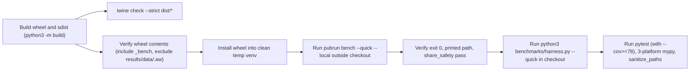

# IPD: Add benchmark packaging tests CI checks and end-to-end verification

- Date: 2026-11-27
- Kind: child
- Concern: Backlog item `bej1qz` acceptance criteria require automated tests covering wheel and non-checkout execution, default writable output directory selection, high-performance computing (HPC) submit script command generation without a source checkout, and single-source `share_safety` validation, plus verifying `tests/test_bench_command.py`, `benchmarks/test_benchmarks.py`, `twine check --strict`, wheel cleanliness, clean virtual-environment `pubrun bench --quick --local`, and source-checkout `python benchmarks/harness.py --quick`. After `mfeptf` (Order 03) migrates `TestSubmissionVerifier` to `_share_check`, remaining tests in `tests/test_bench_command.py` and `tests/test_benchmark_intake_bugs.py` still load modules from `benchmarks/` by file path, carry legacy source-text script checks and a stale non-checkout module docstring, and lack the new non-checkout, output-directory, HPC command-generation, and wheel-execution coverage.
- Scope: Update `tests/test_bench_command.py` and `tests/test_benchmark_intake_bugs.py` to test `pubrun._bench` directly and add the new behavioral coverage, update `.github/workflows/ci.yml`'s `packaging` job to verify wheel inclusion of all `pubrun/_bench/` runtime files, exclusion of non-runtime benchmark files, `twine check --strict`, and per-wheel clean-venv `pubrun bench` execution, and execute the whole-Set acceptance and regression verification suite.
- Scope-Paths: tests/test_bench_command.py, tests/test_benchmark_intake_bugs.py, .github/workflows/ci.yml
- Item-Dependencies: executed:29nsim, executed:c1zz3x, executed:mfeptf, executed:cuboum
- Status: reviewed
- Readiness: go-pending-approval
- Review-Depth: complex
- Short-Description: Update benchmark tests, add non-checkout and wheel tests, update CI packaging checks, and verify the complete Set
- Work-Kind: bug
- Priority: high
- From-Backlog: bej1qz
- Blocks-Release: g2qtg5
- Set: bej1qz
- Order: 5
- Highest E allocated: 05
- Author: Antigravity
- Id: 1r585o

> Write and proofread this plan per the technical writing standard, `.aw/system/workflows/technical-writing/technical-writing.md` (`.agents/workflows/technical-writing/technical-writing.md` in a legacy-layout install), including requirement 12 (diagrams).

## Workflow history

- 2026-11-27 /plan-review (Antigravity): APPROVE WITH REVISIONS APPLIED; PR-001, PR-002, PR-003, PR-004, PR-005; review record `.aw/records/reviews/20261127-bej1qz-05-1r585o-add-benchmark-packaging-tests-ci-checks-and-end-to-end-verif.review.md`.
- 2026-11-27 to-review (aw set): demoted approved -> to-review: APPROVAL WITHDRAWN: Demote to to-review so /plan-review writes Readiness attestations before execution
- 2026-11-27 approved (aw set): status set to approved
- 2026-11-27 to-review (aw set): Authored review-ready child plan from backlog item bej1qz
- 2026-11-27 draft (Antigravity): created.

## Goal

Bring the automated test suite and Continuous Integration (CI) packaging workflow into alignment with `src/pubrun/_bench/`, add behavioral tests for all four new coverage areas required by backlog item `bej1qz`, and run the complete whole-Set acceptance verification (wheel build, `twine check --strict`, clean virtual-environment `pubrun bench --quick --local`, source-checkout `python benchmarks/harness.py --quick`, full `pytest` with coverage, three-platform `mypy`, and path-leak sanitization).

### End-to-end verification pipeline



## Detailed Implementation Checklist (TODO)

Execution-state rule: mark an `E-*` item complete only after performing the action. That mark is not validation. Right-sizing rule: write for a modest executor that cannot hold much in its head. Each E-item is one step (one concern, about one file, executable in one focused pass) and its V-item names each unit it covers with its own check; a plan stays at about 5 E-items and 8 work Scope-Paths, else split it into more child plans (guidance, `IPD-Z603`). Accepted execution states: blocked, failed, pending, performed; terminal gate demands 'performed'.

### Task group 1: Update existing benchmark tests for packaged runtime and single-source share safety

- [ ] E-01 Update `tests/test_benchmark_intake_bugs.py` to import `pubrun._bench.share_safety` and `pubrun._bench.harness` directly:
  - Replace the file-path `_load("share_safety", _BENCH / "share_safety.py")` and `_load("_bugs_harness", _BENCH / "harness.py")` loaders with direct imports of `pubrun._bench.share_safety` and `pubrun._bench.harness` so monkeypatching `h.run`, `h.redact_result`, and `ss.check_share_safe` targets the real packaged modules and contributes to `--cov=src`.
  - Update the module docstring so it reflects that `share_safety` and `harness` are imported from `pubrun._bench`, while `.github/scripts/` and `benchmarks/aggregate.py` / `benchmarks/pull_submissions.py` remain loaded from their repository paths.
  - Add a behavioral parity test confirming `benchmarks/share_safety.py` (the checkout shim used by `.github/scripts/validate_benchmark_submission.py`) validates the same safe and unsafe fixtures as `pubrun._bench.share_safety`; load the shim under a unique temporary module name (cleaning up `sys.modules` in a `finally` block) so it never pollutes `sys.modules["share_safety"]`.
  - Depends on: none
  - Expected outcome: `pytest tests/test_benchmark_intake_bugs.py -v` passes with zero failures, exercises `src/pubrun/_bench/`, and confirms checkout shim parity without leaking `sys.modules` state.
  - Execution state: pending

- [ ] E-02 Update existing tests in `tests/test_bench_command.py` to target `pubrun._bench` and single-source `_share_check`:
  - Update the stale module docstring (which currently claims harness resolution fails for a non-checkout install) so it reflects packaged runtime execution.
  - Import `pubrun._bench.harness`, `pubrun._bench.scenarios`, `pubrun._bench.share_safety`, and `pubrun._bench.workloads.io_sink` directly in `_load_harness`, `TestIoBaselineScenarios`, and `TestBenchCLI::test_bench_quick_local_json` (while preserving a dedicated behavioral test in `TestBenchCLI` or `TestHarnessRedactedOnlyDefault` that invokes the `benchmarks/harness.py` checkout shim directly).
  - Verify and extend `TestSubmissionVerifier` (already migrated from `_verify_redacted` to `pubrun.__main__::_share_check` in `mfeptf` E-01) so it covers:
    - absence of `_load_share_safety`, `_verify_redacted`, and `_scan_for_pii` on `pubrun.__main__`;
    - passing a redacted `pubrun-benchmark/5` file;
    - rejecting an unredacted `machine.host.hostname` without echoing the leaked value;
    - rejecting an embedded home directory path;
    - rejecting invalid JavaScript Object Notation (JSON), non-object JSON (for example `[]`), and an unreadable or missing file (`OSError`).
  - Update `TestHarnessResolution` to confirm `_find_bench_harness()` resolves the packaged `pubrun/_bench/harness.py` even when `Path.cwd()` is a clean temporary directory outside the repository (and `pubrun._bench.find_checkout_root()` returns `None`), while preserving the clean exit-`1` error test when `_find_bench_harness` is monkeypatched to return `None` (updating its docstring so it reflects a missing runtime rather than a missing checkout).
  - Replace source-text inspection in `TestSchedulerSubmitSafety::test_new_submit_scripts_exist_and_quote_vars` with behavioral execution of the packaged `submit_bench_pbs.sh` (Portable Batch System (PBS)), `submit_bench_lsf.sh` (Load Sharing Facility (LSF)), and `submit_bench_sge.sh` (Sun Grid Engine (SGE)) scripts (resolved via `pubrun._bench.get_submit_script_path`) against stub `qsub`/`bsub` binaries with `stdin=subprocess.DEVNULL`, verifying literal argument forwarding (for example shell metacharacters such as `$(touch <marker>)` in `PUBRUN_QUEUE` appear verbatim in the stub's argv and never create `<marker>`). Guard POSIX shell execution with `@pytest.mark.skipif(sys.platform == "win32" or shutil.which("bash") is None, reason="POSIX bash required for HPC shell submit scripts")` so the `windows-latest` CI matrix stays green.
  - Depends on: E-01
  - Expected outcome: All existing test classes in `tests/test_bench_command.py` pass cross-platform against `src/pubrun/_bench/` with zero code-pinning source-text checks.
  - Execution state: pending

### Task group 2: Add new behavioral tests for non-checkout execution, output dir, and HPC commands

- [ ] E-03 Add new behavioral test classes in `tests/test_bench_command.py` covering backlog item `bej1qz` acceptance criteria:
  - **Default writable output directory selection**: test `pubrun._bench.default_results_dir()` when `PUBRUN_RESULTS_DIR` is set, when inside a verified source checkout (`<repo>/benchmarks/results`), and when outside a checkout (`<cwd>/pubrun-bench-results`, where `find_checkout_root` returns `None`). Test `_run_bench` outside a checkout (monkeypatching `pubrun._bench.find_checkout_root` to return `None` and stubbing `subprocess.run`) creates `<cwd>/pubrun-bench-results/`, targets a `*.redacted.json` path inside it, and prints the output path instead of attempting to write under `site-packages` or a nonexistent `benchmarks/results/`.
  - **HPC submit script command generation without a source checkout**:
    - Cross-platform CLI dispatch test (runs on Linux, macOS, and Windows): monkeypatch `pubrun._bench.find_checkout_root` to return `None` and `subprocess.run` to capture `argv` and `env`, strip ambient `PUBRUN_*` variables, and call `_run_bench(..., submit=True, scheduler=...)` for `slurm`, `pbs`, `lsf`, and `sge` from an isolated temp directory, verifying:
      - `cmd[0] == "bash"` and `Path(cmd[1]) == pubrun._bench.get_submit_script_path(...)`;
      - `env["PUBRUN_RESULTS_DIR"]` equals the resolved writable `<tmp>/pubrun-bench-results` directory;
      - `PUBRUN_REPO` is not set in `env`;
      - `PUBRUN_UNREDACTED == "1"` is set when `unredacted=True` across all four schedulers.
    - POSIX bash stub-scheduler execution test (guarded with `@pytest.mark.skipif(sys.platform == "win32" or shutil.which("bash") is None, reason="POSIX bash required for HPC shell submit scripts")`): execute the packaged Slurm, PBS, LSF, and SGE submit scripts (plus `run_bench.sbatch` with a stub `PUBRUN_PY`) from `<tmp>` against stub `sinfo`/`sbatch`/`qsub`/`bsub` binaries with `stdin=subprocess.DEVNULL` and ambient `PUBRUN_*` stripped, verifying `PUBRUN_RESULTS_DIR` defaults to `<tmp>/pubrun-bench-results`, `PUBRUN_REPO` is empty, and the emitted job body / `run_bench.sbatch` invokes `import pubrun.minimal, pubrun._bench.harness` and `-m pubrun._bench.harness` and never references `benchmarks/harness.py` or `cd "$PUBRUN_REPO"`.
  - **Wheel/non-checkout execution**: add a test marked `@pytest.mark.slow` and gated cleanly via `pytest.importorskip("build")` (so CI's `test` job skips cleanly when `build` is not installed, while CI's `packaging` job and environments with `build` run it) that:
    - builds a wheel into `tmp_path / "dist"` (`python -m build --wheel`, adding `--no-isolation` when `importlib.util.find_spec("hatchling") is not None` for fast offline execution, else isolated build);
    - verifies the wheel zip contains all 16 packaged runtime files (`pubrun/_bench/__init__.py`, `harness.py`, `scenarios.py`, `share_safety.py`, `workloads/__init__.py`, `workloads/{noop,cpu_burn,file_read,io_sink,print_loop}.py`, `scripts/__init__.py`, `scripts/{run_bench.sbatch,submit_bench.sh,submit_bench_pbs.sh,submit_bench_lsf.sh,submit_bench_sge.sh}`) and none of `benchmarks/results/`, `benchmarks/data/`, `.aw/`, `plot.py`, `aggregate.py`, `pull_submissions.py`, `startup_breakdown.py`, `package_capture_bench.py`, `test_benchmarks.py`, or `test_share_safety.py`;
    - installs the wheel into a clean temporary virtual environment using cross-platform `Scripts/python.exe` + `Scripts/pubrun.exe` on `win32` and `bin/python` + `bin/pubrun` on POSIX (passing `--no-deps` on Python 3.11+ so zero third-party deps are installed, or installing dependencies on Python < 3.11 where `tomli` is required);
    - strips BOTH `PYTHONPATH` and ambient `PUBRUN_*` from the subprocess environment, verifies `pubrun.__file__` resolves inside the virtual environment (not `_REPO / "src"`), runs `pubrun bench --iterations 1 --passes 1 --no-baseline --local --no-submit` with `stdin=subprocess.DEVNULL` from a clean temp working directory outside the repo, and asserts exit code `0`, no `runs/` directory created in the temp cwd, printed redacted result path under `<cwd>/pubrun-bench-results/`, and `check_share_safe_text` passing on the written file.
  - Depends on: E-02
  - Expected outcome: All four new coverage areas required by backlog item `bej1qz` are verified by cross-platform automated behavioral tests in `tests/test_bench_command.py`.
  - Execution state: pending

### Task group 3: Update CI packaging checks

- [ ] E-04 Update `.github/workflows/ci.yml`'s `packaging` job (`check_wheel` function and `twine` step):
  - Extend the `required` list in `check_wheel` to assert the wheel includes all 16 packaged runtime files: `pubrun/_bench/__init__.py`, `pubrun/_bench/harness.py`, `pubrun/_bench/scenarios.py`, `pubrun/_bench/share_safety.py`, `pubrun/_bench/workloads/__init__.py`, `pubrun/_bench/workloads/noop.py`, `pubrun/_bench/workloads/cpu_burn.py`, `pubrun/_bench/workloads/file_read.py`, `pubrun/_bench/workloads/io_sink.py`, `pubrun/_bench/workloads/print_loop.py`, `pubrun/_bench/scripts/__init__.py`, `pubrun/_bench/scripts/run_bench.sbatch`, `pubrun/_bench/scripts/submit_bench.sh`, `pubrun/_bench/scripts/submit_bench_pbs.sh`, `pubrun/_bench/scripts/submit_bench_lsf.sh`, and `pubrun/_bench/scripts/submit_bench_sge.sh`.
  - Add a forbidden-path loop asserting the wheel listing contains none of `benchmarks/results/`, `benchmarks/data/`, `.aw/`, `plot.py`, `aggregate.py`, `pull_submissions.py`, `startup_breakdown.py`, `package_capture_bench.py`, `test_benchmarks.py`, or `test_share_safety.py`.
  - Add `--strict` to `twine check --strict dist/*`.
  - Pass `--no-deps` to `"$venv_dir/bin/pip" install --no-deps --quiet "$whl"` (Python 3.12 has zero core dependencies, enforcing backlog item `bej1qz` requirement 3).
  - Inside `check_wheel`, create a per-label working directory `local bench_cwd="$WORK_DIR/bench-cwd-$label"; mkdir -p "$bench_cwd"` (so `direct` and `from-sdist` never share state or mask each other), strip `PYTHONPATH` and ambient `PUBRUN_*` variables, run `"$venv_dir/bin/pubrun" bench --iterations 1 --passes 1 --no-baseline --local --no-submit < /dev/null` from `"$bench_cwd"`, verify exit `0`, verify **exactly one** `*.redacted.json` file was created under `"$bench_cwd/pubrun-bench-results/"`, verify `"$bench_cwd/runs"` does not exist, and verify `check_share_safe_text` passes on that file using `"$venv_dir/bin/python"` (importing `pubrun.minimal` first).
  - Depends on: E-03
  - Expected outcome: CI permanently guards wheel inclusion of all `pubrun/_bench/` runtime files, exclusion of non-runtime benchmark artifacts, `twine check --strict`, zero-dependency installation, and independent clean-venv `pubrun bench` execution for both direct and from-sdist wheels.
  - Execution state: pending

### Task group 4: Execute whole-Set end-to-end acceptance and regression suite

- [ ] E-05 Run all whole-Set verification commands listed in `## Required tests / validation` (using `tempfile.TemporaryDirectory` so no untracked `dist/` or temp artifacts are left in the working tree even on failure):
  - Build sdist and wheel into a temporary `dist` directory, run `python3 -m twine check --strict`, verify sdist contains no `.aw/` and wheel zip contains all 16 required packaged runtime files and zero forbidden entries.
  - Install the built wheel into a clean temporary virtual environment (verifying `pubrun.__file__` resolves inside the venv) and run `pubrun bench --quick --local` with `stdin=subprocess.DEVNULL` and `PYTHONPATH` + ambient `PUBRUN_*` stripped from a clean temporary directory outside any `pubrun` source checkout; verify exit `0`, `"SAFE TO SUBMIT"` and `"PASSED"` and printed redacted path in `stderr`, exactly one `*.redacted.json` written under `./pubrun-bench-results/`, no `runs/` directory created, and `check_share_safe_text` passing inside the venv Python (`import pubrun.minimal` first).
  - Run `python3 benchmarks/harness.py --quick --redacted-out <tmp>/checkout-quick.redacted.json` inside the source checkout with ambient `PUBRUN_*` stripped, and verify exit `0` and share-safe output (using worktree `src/` on `sys.path` and `import pubrun.minimal` before importing `pubrun._bench.share_safety`).
  - Run `pytest tests/test_bench_command.py tests/test_benchmark_intake_bugs.py tests/test_report_subpackage_integrity.py benchmarks/test_benchmarks.py benchmarks/test_share_safety.py .github/scripts/ -v`.
  - Run full `pytest tests/ -p randomly --cov=src --cov-fail-under=78`.
  - Run `mypy`, `mypy --platform win32`, `mypy --platform darwin`, and `python3 scripts/sanitize_paths.py --check --all`.
  - Depends on: E-01, E-02, E-03, E-04
  - Expected outcome: Every acceptance criterion of backlog item `bej1qz` and every repository quality gate passes with pasted runner evidence.
  - Execution state: pending

## Project conventions discovered (Step 0)

- `.github/workflows/ci.yml` runs:
  - `pytest tests/ -v -p randomly` across `ubuntu-latest`/`ubuntu-24.04`, `windows-latest`, and `macos-latest` on Python 3.8 through 3.14 (with `--cov=src --cov-report=term-missing --cov-fail-under=78` on `ubuntu-latest` Python 3.12), installing `pip install -e ".[dev,tui]"` (which does NOT include `build`).
  - `pytest .github/scripts/ benchmarks/test_*.py -v -p randomly` in `extra-suites`.
  - `packaging` job on `ubuntu-latest` Python 3.12 installing `build twine`, building direct and from-sdist wheels, checking with `twine`, inspecting `python -m zipfile -l`, and testing inside clean temporary virtual environments via `check_wheel "direct"` and `check_wheel "from-sdist"`.
  - `mypy`, `mypy --platform win32`, and `mypy --platform darwin`.
- `pyproject.toml` declares `dependencies = ["tomli>=1.1.0; python_version < '3.11'"]`, so Python 3.11+ wheel installations require zero third-party runtime dependencies (`--no-deps`), while Python 3.8 through 3.10 require `tomli`.
- `AGENTS.md` prohibits code-pinning tests (no `inspect`, `ast`, regex, or substring scanning of production source files); tests must exercise real behavior and assert on observable outputs, exit codes, and side effects.
- `tests/conftest.py` prepends `<repo>/src` to `PYTHONPATH` for the session (`_subprocess_pythonpath`) and isolates `cwd` via `isolated_cwd` for every test in `tests/`. Tests and validation scripts that verify wheel installation in a clean virtual environment must strip both `PYTHONPATH` and ambient `PUBRUN_*` from the subprocess environment so Python imports `pubrun` strictly from the virtual environment's `site-packages`.
- Reviewed sibling `mfeptf` (Order 03) already migrates `tests/test_bench_command.py::TestSubmissionVerifier` from `_verify_redacted` to `_share_check` so `pytest tests/` stays green when `_verify_redacted` is deleted ahead of Order 05.
- In isolated git worktrees, ad-hoc `python3 -c` commands without `PYTHONPATH=src` import the main checkout's editable install instead of the worktree's `src/`, and importing `pubrun` under `python3 -c` without `import pubrun.minimal` first triggers `pubrun` auto-start (`src/pubrun/core.py::_is_pubrun_cli_invocation` returns `False` for `sys.argv[0] == "-c"`).

## Findings

| ID | Severity | Remediation Risk | Persona | Evidence | Finding |
|---|---|---|---|---|---|
| F-01 | High | Low | Maintainer | `tests/test_bench_command.py`, `tests/test_benchmark_intake_bugs.py` | Remaining tests load `benchmarks/harness.py`, `benchmarks/scenarios.py`, `benchmarks/share_safety.py`, and `benchmarks/workloads/io_sink.py` by file path, carry a legacy source-text script check (`test_new_submit_scripts_exist_and_quote_vars`) and stale non-checkout docstring, and lack behavioral tests for default writable output dir, non-checkout HPC script generation, and clean-venv wheel execution. |
| F-02 | Medium | Low | Maintainer | `.github/workflows/ci.yml` (`packaging` job) | CI wheel check does not yet assert `pubrun/_bench/` presence, non-runtime benchmark exclusions, `twine check --strict`, zero-dependency installation, or per-wheel clean-venv `pubrun bench` execution. |

## Proposed changes (ordered, validatable)

1. Update `tests/test_benchmark_intake_bugs.py` to import `pubrun._bench.share_safety` and `pubrun._bench.harness` directly and verify checkout shim parity without `sys.modules` leaks (E-01; Remediation Risk: Low).
2. Update existing tests in `tests/test_bench_command.py` for packaged runtime imports, extended `_share_check` coverage (building on `mfeptf`), non-checkout `_find_bench_harness()`, and Windows-safe behavioral stub-scheduler testing (E-02; Remediation Risk: Low).
3. Add new behavioral tests in `tests/test_bench_command.py` for writable default output directory, cross-platform non-checkout HPC CLI dispatch + POSIX stub-scheduler execution, and clean-venv wheel installation/execution (E-03; Remediation Risk: Low).
4. Update `.github/workflows/ci.yml` `packaging` job with all 16 required `_bench` files, 10 forbidden exclusions, `twine check --strict`, `--no-deps`, and per-label clean-venv `pubrun bench` + `share_safety` smoke runs (E-04; Remediation Risk: Low).
5. Run the complete whole-Set acceptance and regression verification suite with worktree-safe, auto-start-safe, self-cleaning commands (E-05; Remediation Risk: Low).

## Deferred / out of scope (with reason)

None. This child completes the final testing, CI hardening, and whole-Set verification for backlog item `bej1qz`.

## Scope check

- Over-scope: none. Only `tests/test_bench_command.py`, `tests/test_benchmark_intake_bugs.py`, and `.github/workflows/ci.yml` are modified.
- Under-scope: none. Every acceptance criterion in backlog item `bej1qz` is verified with pasted runner output.

## Required tests / validation

1. **Wheel build, `twine check --strict`, sdist/wheel content inspection, and clean-venv non-checkout `pubrun bench --quick --local`** (self-cleaning via `TemporaryDirectory`, verifies `pubrun.__file__` is inside the venv, runs verbatim `pubrun bench --quick --local` with `stdin=DEVNULL` and `PYTHONPATH`/`PUBRUN_*` stripped, checks `share_safety` inside the venv Python; must exit `0` and leave no untracked `dist/` or `runs/` in the repo):

   ```sh
   python3 - <<'PY'
   import os, subprocess, sys, tarfile, tempfile, zipfile
   from pathlib import Path

   with tempfile.TemporaryDirectory(prefix="pubrun-wheel-e2e-") as td_str:
       td = Path(td_str)
       dist = td / "dist"
       subprocess.run([sys.executable, "-m", "build", "--outdir", str(dist), "."], check=True)
       subprocess.run([sys.executable, "-m", "twine", "check", "--strict"] + [str(p) for p in sorted(dist.iterdir())], check=True)

       sdist = next(dist.glob("pubrun-*.tar.gz"))
       with tarfile.open(sdist, "r:gz") as tf:
           sdist_names = tf.getnames()
       assert not any("/.aw/" in n or n.startswith(".aw/") for n in sdist_names), "forbidden .aw/ in sdist"

       whl = next(dist.glob("pubrun-*.whl"))
       with zipfile.ZipFile(whl) as zf:
           names = zf.namelist()
       req = [
           "pubrun/_bench/__init__.py",
           "pubrun/_bench/harness.py",
           "pubrun/_bench/scenarios.py",
           "pubrun/_bench/share_safety.py",
           "pubrun/_bench/workloads/__init__.py",
           "pubrun/_bench/workloads/noop.py",
           "pubrun/_bench/workloads/cpu_burn.py",
           "pubrun/_bench/workloads/file_read.py",
           "pubrun/_bench/workloads/io_sink.py",
           "pubrun/_bench/workloads/print_loop.py",
           "pubrun/_bench/scripts/__init__.py",
           "pubrun/_bench/scripts/run_bench.sbatch",
           "pubrun/_bench/scripts/submit_bench.sh",
           "pubrun/_bench/scripts/submit_bench_pbs.sh",
           "pubrun/_bench/scripts/submit_bench_lsf.sh",
           "pubrun/_bench/scripts/submit_bench_sge.sh",
       ]
       missing = [r for r in req if r not in names]
       assert not missing, f"missing: {missing}"
       bad_parts = (
           "benchmarks/results/", "benchmarks/data/", ".aw/",
           "plot.py", "aggregate.py", "pull_submissions.py",
           "startup_breakdown.py", "package_capture_bench.py",
           "test_benchmarks.py", "test_share_safety.py",
       )
       bad = [n for n in names if any(b in n for b in bad_parts)]
       assert not bad, f"forbidden: {bad}"

       venv = td / "venv"
       subprocess.run([sys.executable, "-m", "venv", str(venv)], check=True)
       vpy = venv / ("Scripts/python.exe" if sys.platform == "win32" else "bin/python")
       vcli = venv / ("Scripts/pubrun.exe" if sys.platform == "win32" else "bin/pubrun")
       pip_args = [str(vpy), "-m", "pip", "install", str(whl)]
       if sys.version_info >= (3, 11):
           pip_args.insert(4, "--no-deps")
       subprocess.run(pip_args, check=True)

       work = td / "outside"
       work.mkdir()
       env = {k: v for k, v in os.environ.items() if k != "PYTHONPATH" and not k.startswith("PUBRUN_")}
       loc = subprocess.run(
           [str(vpy), "-c", "import pubrun.minimal, pathlib; print(pathlib.Path(pubrun.__file__).resolve())"],
           cwd=str(work), env=env, capture_output=True, text=True, check=True,
       ).stdout.strip()
       assert str(venv.resolve()) in loc, f"unexpected pubrun location: {loc}"

       r = subprocess.run(
           [str(vcli), "bench", "--quick", "--local"],
           cwd=str(work), env=env, stdin=subprocess.DEVNULL, capture_output=True, text=True, timeout=600,
       )
       print("rc=", r.returncode)
       print(r.stderr[-800:])
       assert r.returncode == 0, r.stderr
       assert not (work / "runs").exists(), "unexpected runs/ dir created"
       files = list((work / "pubrun-bench-results").glob("*.redacted.json"))
       assert len(files) == 1, files
       assert str(files[0]) in r.stderr, r.stderr
       assert "SAFE TO SUBMIT" in r.stderr and "PASSED" in r.stderr, r.stderr

       subprocess.run(
           [
               str(vpy), "-c",
               "import sys; from pathlib import Path; import pubrun.minimal; "
               "from pubrun._bench.share_safety import check_share_safe_text; "
               "ok, reasons = check_share_safe_text(Path(sys.argv[1]).read_text(encoding='utf-8')); "
               "assert ok and not reasons, reasons; print('VERIFIED:', Path(sys.argv[1]).name)",
               str(files[0]),
           ],
           cwd=str(work), env=env, check=True,
       )
   PY
   ```

2. **Source-checkout `python3 benchmarks/harness.py --quick` verification** (self-cleaning, worktree-safe, auto-start-safe, ambient `PUBRUN_*` stripped; must exit `0` and write a share-safe redacted JSON file):

   ```sh
   python3 - <<'PY'
   import os, subprocess, sys, tempfile
   from pathlib import Path

   src = str(Path("src").resolve())
   sys.path.insert(0, src)
   import pubrun.minimal
   from pubrun._bench.share_safety import check_share_safe_text

   env = {k: v for k, v in os.environ.items() if not k.startswith("PUBRUN_")}
   with tempfile.TemporaryDirectory(prefix="pubrun-checkout-quick-") as td_str:
       out = Path(td_str) / "quick.redacted.json"
       r = subprocess.run(
           [sys.executable, "benchmarks/harness.py", "--quick", "--redacted-out", str(out)],
           env=env, stdin=subprocess.DEVNULL, capture_output=True, text=True, timeout=600,
       )
       print("rc=", r.returncode)
       print(r.stderr[-400:])
       assert r.returncode == 0 and out.is_file(), r.stderr
       ok, reasons = check_share_safe_text(out.read_text(encoding="utf-8"))
       assert ok and not reasons, reasons
       print("VERIFIED checkout quick")
   PY
   ```

3. **Targeted benchmark, intake, and integrity test suites** (must exit `0`):

   ```sh
   pytest tests/test_bench_command.py tests/test_benchmark_intake_bugs.py tests/test_report_subpackage_integrity.py benchmarks/test_benchmarks.py benchmarks/test_share_safety.py .github/scripts/ -v
   ```

4. **Full repository test suite with randomized order and coverage gate** (must exit `0`, coverage >= 78%):

   ```sh
   pytest tests/ -p randomly --cov=src --cov-fail-under=78
   ```

5. **Three-platform static type checking and path-leak sanitization** (must exit `0`):

   ```sh
   mypy && mypy --platform win32 && mypy --platform darwin && python3 scripts/sanitize_paths.py --check --all
   ```

## Spec / documentation sync

N/A for this child plan; child `cuboum` (Order 04) completed all documentation updates prior to this plan.

## Open questions

None.

## Validation and cross-check (verify before reporting done)

Validation-state rule: inspect evidence in a separate pass. Do not mark a `V-*` item complete from memory or from the matching execution checkmark. Accepted validation results: blocked, failed, pass, pending; terminal gate demands 'pass'. Runtime-demonstration reachability rule: for each `V-*` item demanding the software be observed acting (such as a run, a dispatch, or a transition)—as distinct from items demanding a diff, a file's content, or a test result, which are reachable by construction—name the code path that produces the observation or the sibling `E-*` that creates it, else the demand is UNDER-SCOPE.

- [ ] V-01 validates E-01
  - Required evidence: Pasted output of `pytest tests/test_benchmark_intake_bugs.py -v` passing with exit code `0`, confirming all benchmark intake and self-check tests execute directly against `pubrun._bench.share_safety` and `pubrun._bench.harness` and the `benchmarks/share_safety.py` checkout shim parity test passes without `sys.modules` leakage.
  - Observed evidence:
  - Result: pending

- [ ] V-02 validates E-02
  - Required evidence: Pasted output of `pytest tests/test_bench_command.py -v` exiting `0`, confirming updated tests pin: (a) direct `pubrun._bench` runtime imports alongside direct `benchmarks/harness.py` checkout shim execution, (b) extended single-source `pubrun.__main__::_share_check` validation (including non-object JSON and `OSError`) and absence of `_load_share_safety`/`_verify_redacted`/`_scan_for_pii`, (c) `_find_bench_harness()` resolving `pubrun/_bench/harness.py` outside a checkout plus clean exit `1` when missing, and (d) behavioral literal-argument forwarding against stub `qsub`/`bsub` binaries with zero source-text inspection (non-binding pointers: `TestSubmissionVerifier`, `TestHarnessResolution`, `TestSchedulerSubmitSafety`, `TestIoBaselineScenarios`, `TestBenchCLI`).
  - Observed evidence:
  - Result: pending

- [ ] V-03 validates E-03
  - Required evidence: Pasted output of `pytest tests/test_bench_command.py -v` exiting `0`, confirming new behavioral tests pin: (a) default writable output directory selection (`PUBRUN_RESULTS_DIR`, checkout `benchmarks/results`, non-checkout `<cwd>/pubrun-bench-results`), (b) cross-platform non-checkout HPC CLI dispatch (`slurm`, `pbs`, `lsf`, `sge` targeting packaged scripts with `PUBRUN_RESULTS_DIR`, absent `PUBRUN_REPO`, and `PUBRUN_UNREDACTED`) plus POSIX stub-scheduler execution emitting `-m pubrun._bench.harness`, and (c) clean-venv wheel build, zip inclusion/exclusion inspection, and non-checkout `pubrun bench` execution passing `check_share_safe_text` (or explicit clean skip only if `build` is absent, which must execute and pass in this environment where `build` is installed).
  - Observed evidence:
  - Result: pending

- [ ] V-04 validates E-04
  - Required evidence: Pasted `git diff -- .github/workflows/ci.yml` and YAML parse check (`python3 -c 'import yaml; yaml.safe_load(open(".github/workflows/ci.yml")); print("ok")'`) showing valid YAML with `twine check --strict`, all 16 required `pubrun/_bench/` wheel entries, all 10 forbidden exclusions, `--no-deps` clean-venv install, and per-label `bench-cwd-$label` non-checkout `pubrun bench` + `check_share_safe_text` verification.
  - Observed evidence:
  - Result: pending

- [ ] V-05 validates E-05
  - Required evidence: Pasted runner outputs of all five commands in `## Required tests / validation` exiting `0`, demonstrating: (1) wheel build, `twine check --strict`, sdist/wheel content inspection, and clean-venv non-checkout `pubrun bench --quick --local` via `src/pubrun/__main__.py::_run_bench` and `src/pubrun/_bench/harness.py::main` (from `29nsim`/`mfeptf`) printing `"SAFE TO SUBMIT"`, `"PASSED"`, and the redacted path under `pubrun-bench-results/` with `check_share_safe_text` passing and no `runs/` directory; (2) source-checkout `python3 benchmarks/harness.py --quick` via `benchmarks/harness.py` shim -> `src/pubrun/_bench/harness.py::main` (from `29nsim`); (3) targeted suites including `benchmarks/test_benchmarks.py` and `tests/test_bench_command.py`; (4) full `pytest tests/ -p randomly --cov=src --cov-fail-under=78`; and (5) three-platform `mypy` and `scripts/sanitize_paths.py --check --all`.
  - Observed evidence:
  - Result: pending

## Approval and execution gate

- Size assessment: standard
- Cohesion rationale: not required

1. **Preconditions:** Execute E-01 through E-05 only after this plan carries `- Status: approved`, `29nsim`, `c1zz3x`, `mfeptf`, and `cuboum` have reached `executed`, and all blocking open questions are resolved.
2. **Scope declaration:** `- Scope-Paths:` declares the authorized file set (`tests/test_bench_command.py, tests/test_benchmark_intake_bugs.py, .github/workflows/ci.yml`). If execution requires modifying a path outside `- Scope-Paths:` or leaving a declared path unmodified, justify each exception explicitly with `--scope-reason` or `--scope-ack` at finalize rather than silently deviating.
3. **Validation honesty:** Every `V-*` item MUST paste the actual command runner output captured during execution; never mark any `V-*` item `pass` without running the corresponding command and observing its exit code and output.
4. **Commit and push discipline:** Commit only paths modified for this plan through `aw commit 1r585o -- <paths>`. Never use `git add -A`, bare `git add .`, or raw `git commit`, and never push, tag, or publish without explicit human authorization.
5. **Lifecycle transition:** After all `E-*` items are `performed` and all `V-*` items are `pass`, the plan MUST complete the post-gate transition to `.aw/records/plans/executed/`. When executing under an automated runner (`aw oc run` or `aw agy run`), leave finalization to the runner's post-turn finalize step; in a manual or interactive execution outside a runner, run `aw ipd finalize 1r585o` (never hand-roll `git mv` to `executed/`).
