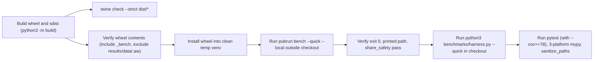

# IPD: Add benchmark packaging tests CI checks and end-to-end verification

- Date: 2026-11-27
- Kind: child
- Concern: Backlog item `bej1qz` acceptance criteria require automated tests covering wheel and non-checkout execution, default writable output directory selection, HPC submit script command generation without a source checkout, and single-source `share_safety` validation, plus verifying `tests/test_bench_command.py`, `benchmarks/test_benchmarks.py`, `twine check --strict`, wheel cleanliness, clean virtual-environment `pubrun bench --quick --local`, and source-checkout `python benchmarks/harness.py --quick`. Existing tests in `tests/test_bench_command.py` and `tests/test_benchmark_intake_bugs.py` still target the removed `_verify_redacted` fallback and file-path loading from `benchmarks/`.
- Scope: Update `tests/test_bench_command.py` and `tests/test_benchmark_intake_bugs.py` to test `pubrun._bench` directly and add the new behavioral coverage, update `.github/workflows/ci.yml`'s `packaging` job to verify wheel inclusion of `pubrun/_bench/` and exclusion of non-runtime benchmark files, and execute the whole-Set acceptance and regression verification suite.
- Scope-Paths: tests/test_bench_command.py, tests/test_benchmark_intake_bugs.py, .github/workflows/ci.yml
- Item-Dependencies: executed:29nsim, executed:c1zz3x, executed:mfeptf, executed:cuboum
- Status: to-review
- Short-Description: Update benchmark tests, add non-checkout and wheel tests, update CI packaging checks, and verify the complete Set
- Work-Kind: bug
- Priority: high
- From-Backlog: bej1qz
- Blocks-Release: g2qtg5
- Set: bej1qz
- Order: 5
- Highest E allocated: 05
- Author: Antigravity
- Id: 1r585o

> Write and proofread this plan per the technical writing standard, `.aw/system/workflows/technical-writing/technical-writing.md` (`.agents/workflows/technical-writing/technical-writing.md` in a legacy-layout install), including requirement 12 (diagrams).

## Workflow history

- 2026-11-27 to-review (aw set): Authored review-ready child plan from backlog item bej1qz
- 2026-11-27 draft (Antigravity): created.

## Goal

Bring the automated test suite and Continuous Integration (CI) packaging workflow into alignment with `src/pubrun/_bench/`, add behavioral tests for all four new coverage areas required by backlog item `bej1qz`, and run the complete whole-Set acceptance verification (wheel build, `twine check --strict`, clean virtual-environment `pubrun bench --quick --local`, source-checkout `python benchmarks/harness.py --quick`, full `pytest` with coverage, three-platform `mypy`, and path-leak sanitization).

### End-to-end verification pipeline



## Detailed Implementation Checklist (TODO)

Execution-state rule: mark an `E-*` item complete only after performing the action. That mark is not validation. Right-sizing rule: write for a modest executor that cannot hold much in its head. Each E-item is one step (one concern, about one file, executable in one focused pass) and its V-item names each unit it covers with its own check; a plan stays at about 5 E-items and 8 work Scope-Paths, else split it into more child plans (guidance, `IPD-Z603`). Accepted execution states: blocked, failed, pending, performed; terminal gate demands 'performed'.

### Task group 1: Update existing benchmark tests for packaged runtime and single-source share safety

- [ ] E-01 Update `tests/test_benchmark_intake_bugs.py` to import `pubrun._bench.share_safety` and `pubrun._bench.harness` directly:
  - Replace the file-path `_load("share_safety", _BENCH / "share_safety.py")` and `_load("_bugs_harness", _BENCH / "harness.py")` loaders with direct imports of `pubrun._bench.share_safety` and `pubrun._bench.harness` so monkeypatching `h.run`, `h.redact_result`, and `ss.check_share_safe` targets the real packaged modules and contributes to `--cov=src`.
  - Keep `.github/scripts/` and `benchmarks/aggregate.py` / `benchmarks/pull_submissions.py` loaded from their repository paths.
  - Add a behavioral test confirming `benchmarks/share_safety.py` (the checkout shim used by `.github/scripts/validate_benchmark_submission.py`) validates the same safe and unsafe fixtures as `pubrun._bench.share_safety`.
  - Depends on: none
  - Expected outcome: `pytest tests/test_benchmark_intake_bugs.py -v` passes with zero failures and exercises `src/pubrun/_bench/`.
  - Execution state: pending

- [ ] E-02 Update existing tests in `tests/test_bench_command.py` to target `pubrun._bench` and single-source `_share_check`:
  - Import `pubrun._bench.harness`, `pubrun._bench.scenarios`, and `pubrun._bench.workloads.io_sink` directly in `_load_harness` and `TestIoBaselineScenarios` (keeping a dedicated behavioral test for direct `benchmarks/harness.py` checkout shim execution).
  - Replace `TestSubmissionVerifier` (which previously tested the deleted `_verify_redacted`) with behavioral tests on `pubrun.__main__::_share_check` confirming:
    - `_load_share_safety` and `_verify_redacted` no longer exist on `pubrun.__main__`;
    - `_share_check` passes a redacted `pubrun-benchmark/5` file, rejects an unredacted `machine.host.hostname` without echoing the leaked value, rejects an embedded home directory path, and rejects invalid JSON and non-object JSON.
  - Update `TestHarnessResolution` to confirm `_find_bench_harness()` resolves the packaged `pubrun/_bench/harness.py` even when `Path.cwd()` is a clean temporary directory outside the repository, while preserving the clean exit-`1` error test when `_find_bench_harness` is monkeypatched to return `None`.
  - Replace source-text inspection in `TestSchedulerSubmitSafety::test_new_submit_scripts_exist_and_quote_vars` with behavioral execution of the packaged `submit_bench_pbs.sh`, `submit_bench_lsf.sh`, and `submit_bench_sge.sh` scripts against stub `qsub`/`bsub` binaries verifying literal argument forwarding (for example shell metacharacters in `PUBRUN_QUEUE` are not executed).
  - Depends on: E-01
  - Expected outcome: All existing test classes in `tests/test_bench_command.py` pass against `src/pubrun/_bench/` with zero code-pinning source-text checks.
  - Execution state: pending

### Task group 2: Add new behavioral tests for non-checkout execution, output dir, and HPC commands

- [ ] E-03 Add new behavioral test classes in `tests/test_bench_command.py` covering backlog item `bej1qz` acceptance criteria:
  - **Default writable output directory selection**: test `pubrun._bench.default_results_dir()` when `PUBRUN_RESULTS_DIR` is set, when inside a verified source checkout (`<repo>/benchmarks/results`), and when `find_checkout_root` returns `None` outside a checkout (`<cwd>/pubrun-bench-results`). Test `_run_bench` outside a checkout writes to `<cwd>/pubrun-bench-results/` (creating the directory and printing the output path) instead of attempting to write under `site-packages` or a nonexistent `benchmarks/results/`.
  - **HPC submit script command generation without a source checkout**: monkeypatch `pubrun._bench.find_checkout_root` to return `None` and run `_run_bench(..., submit=True, scheduler=...)` for `slurm`, `pbs`, `lsf`, and `sge` from an isolated temp directory with stub scheduler binaries (or captured `subprocess.run` calls), verifying:
    - the command targets the packaged script under `src/pubrun/_bench/scripts/`;
    - `env["PUBRUN_RESULTS_DIR"]` is set to the writable `<tmp>/pubrun-bench-results` directory;
    - `PUBRUN_REPO` is not set to a nonexistent checkout path;
    - executing the packaged Slurm, PBS, LSF, and SGE scripts against stub `sinfo`/`sbatch`/`qsub`/`bsub` binaries emits `-m pubrun._bench.harness` and never references `benchmarks/harness.py`.
  - **Wheel/non-checkout execution**: add a test (marked `@pytest.mark.slow` or skipped cleanly only if `build` is not installed; runs whenever `build` is available, which it is in this environment) that builds a wheel into `tmp_path / "dist"`, verifies the wheel zip contains `pubrun/_bench/harness.py`, `pubrun/_bench/scenarios.py`, `pubrun/_bench/share_safety.py`, `pubrun/_bench/workloads/noop.py`, and `pubrun/_bench/scripts/submit_bench.sh` and contains none of `benchmarks/results/`, `benchmarks/data/`, `.aw/`, `plot.py`, `aggregate.py`, `pull_submissions.py`, `startup_breakdown.py`, `package_capture_bench.py`, or `test_benchmarks.py`, installs the wheel into a clean temporary virtual environment (`--no-deps` on Python 3.11+ or from wheelhouse), runs `pubrun bench --iterations 1 --passes 1 --no-baseline --local --no-submit` from a clean temp working directory outside the repo, and asserts exit code `0`, printed redacted result path under `<cwd>/pubrun-bench-results/`, and `check_share_safe_text` passing on the written file.
  - Depends on: E-02
  - Expected outcome: All four new coverage areas required by backlog item `bej1qz` are verified by automated behavioral tests in `tests/test_bench_command.py`.
  - Execution state: pending

### Task group 3: Update CI packaging checks

- [ ] E-04 Update `.github/workflows/ci.yml`'s `packaging` job (`check_wheel` function):
  - Extend the `required` list to assert the wheel includes `pubrun/_bench/__init__.py`, `pubrun/_bench/harness.py`, `pubrun/_bench/scenarios.py`, `pubrun/_bench/share_safety.py`, `pubrun/_bench/workloads/noop.py`, `pubrun/_bench/scripts/run_bench.sbatch`, `pubrun/_bench/scripts/submit_bench.sh`, `pubrun/_bench/scripts/submit_bench_pbs.sh`, `pubrun/_bench/scripts/submit_bench_lsf.sh`, and `pubrun/_bench/scripts/submit_bench_sge.sh`.
  - Add a forbidden-path loop asserting the wheel listing contains none of `benchmarks/results/`, `benchmarks/data/`, `.aw/`, `plot.py`, `aggregate.py`, `pull_submissions.py`, `startup_breakdown.py`, `package_capture_bench.py`, or `test_benchmarks.py`.
  - Add a `--strict` flag to `twine check --strict dist/*`.
  - Inside the clean virtual environment smoke block in `check_wheel`, run `"$venv_dir/bin/pubrun" bench --iterations 1 --passes 1 --no-baseline --local --no-submit` from `$WORK_DIR/bench-cwd` (outside any checkout) and verify exit `0` and a created `*.redacted.json` under `$WORK_DIR/bench-cwd/pubrun-bench-results/`.
  - Depends on: E-03
  - Expected outcome: CI permanently guards wheel benchmark runtime inclusion, non-runtime exclusion, `twine check --strict`, and clean-venv `pubrun bench` execution.
  - Execution state: pending

### Task group 4: Execute whole-Set end-to-end acceptance and regression suite

- [ ] E-05 Run all whole-Set verification commands listed in `## Required tests / validation` (cleaning up any temporary build directories so no untracked `dist/` artifacts are left in the working tree):
  - Build sdist and wheel into a temporary `dist` directory, run `python3 -m twine check --strict`, and inspect wheel zip entries for required packaged runtime files and zero forbidden entries.
  - Install the built wheel into a clean temporary virtual environment and run `pubrun bench --quick --local --no-submit` from a clean temporary directory outside any `pubrun` source checkout; verify exit `0`, printed path, file written under `./pubrun-bench-results/`, and `check_share_safe_text` passes.
  - Run `python3 benchmarks/harness.py --quick --redacted-out <tmp>/checkout-quick.redacted.json` inside the source checkout and verify exit `0` and share-safe output.
  - Run `pytest tests/test_bench_command.py tests/test_benchmark_intake_bugs.py tests/test_report_subpackage_integrity.py benchmarks/test_benchmarks.py benchmarks/test_share_safety.py .github/scripts/ -v`.
  - Run full `pytest tests/ -p randomly --cov=src --cov-fail-under=78`.
  - Run `mypy`, `mypy --platform win32`, `mypy --platform darwin`, and `python3 scripts/sanitize_paths.py --check --all`.
  - Depends on: E-01, E-02, E-03, E-04
  - Expected outcome: Every acceptance criterion of backlog item `bej1qz` and every repository quality gate passes with pasted runner evidence.
  - Execution state: pending

## Project conventions discovered (Step 0)

- `.github/workflows/ci.yml` runs:
  - `pytest tests/ -v -p randomly --cov=src --cov-report=term-missing --cov-fail-under=78`
  - `pytest .github/scripts/ benchmarks/test_*.py -v -p randomly`
  - `packaging` job building direct and from-sdist wheels, checking with `twine`, inspecting `python -m zipfile -l`, and testing inside a clean temporary virtual environment
  - `mypy`, `mypy --platform win32`, and `mypy --platform darwin`
- `AGENTS.md` prohibits code-pinning tests (no `inspect`, `ast`, regex, or substring scanning of production source files); tests must exercise real behavior and assert on observable outputs, exit codes, and side effects.
- `tests/conftest.py` sets `PYTHONPATH` to `<repo>/src` and isolates `cwd` via `isolated_cwd` for every test in `tests/`. Tests that verify wheel installation in a clean virtual environment must strip `PYTHONPATH` from the subprocess environment so Python imports `pubrun` strictly from the virtual environment's `site-packages`.

## Findings

| ID | Severity | Remediation Risk | Persona | Evidence | Finding |
|---|---|---|---|---|---|
| F-01 | High | Low | Maintainer | `tests/test_bench_command.py`, `tests/test_benchmark_intake_bugs.py` | Existing tests load `benchmarks/harness.py` by file path, test deleted `_verify_redacted`, and assert `pubrun bench` errors without a checkout. |
| F-02 | Medium | Low | Maintainer | `.github/workflows/ci.yml` (`packaging` job) | CI wheel check does not yet assert `pubrun/_bench/` presence, non-runtime benchmark exclusions, `twine check --strict`, or clean-venv `pubrun bench` execution. |

## Proposed changes (ordered, validatable)

1. Update `tests/test_benchmark_intake_bugs.py` to import `pubrun._bench.share_safety` and `pubrun._bench.harness` directly and verify checkout shim parity (E-01; Remediation Risk: Low).
2. Update existing tests in `tests/test_bench_command.py` for packaged runtime, single-source `_share_check`, and behavioral stub-scheduler testing (E-02; Remediation Risk: Low).
3. Add new behavioral tests in `tests/test_bench_command.py` for writable default output directory, non-checkout HPC script command generation, and wheel installation/execution (E-03; Remediation Risk: Low).
4. Update `.github/workflows/ci.yml` `packaging` job with wheel runtime/exclusion checks, `twine check --strict`, and clean-venv `pubrun bench` smoke run (E-04; Remediation Risk: Low).
5. Run the complete whole-Set acceptance and regression verification suite (E-05; Remediation Risk: Low).

## Deferred / out of scope (with reason)

- None. This child completes the final testing, CI hardening, and whole-Set verification for backlog item `bej1qz`.

## Scope check

- Over-scope: none. Only `tests/test_bench_command.py`, `tests/test_benchmark_intake_bugs.py`, and `.github/workflows/ci.yml` are modified.
- Under-scope: none. Every acceptance criterion in backlog item `bej1qz` is verified with pasted runner output.

## Required tests / validation

1. **Wheel build, `twine check --strict`, wheel content inspection, and clean-venv non-checkout `pubrun bench --quick --local`** (must exit `0` and leave no untracked `dist/` in the repo):

   ```sh
   python3 -c 'import os, shutil, subprocess, sys, tempfile, zipfile; from pathlib import Path; td = Path(tempfile.mkdtemp(prefix="pubrun-wheel-e2e-")); dist = td / "dist"; subprocess.run([sys.executable, "-m", "build", "--outdir", str(dist), "."], check=True); subprocess.run([sys.executable, "-m", "twine", "check", "--strict"] + [str(p) for p in sorted(dist.iterdir())], check=True); whl = next(dist.glob("pubrun-*.whl")); names = zipfile.ZipFile(whl).namelist(); req = ["pubrun/_bench/__init__.py", "pubrun/_bench/harness.py", "pubrun/_bench/scenarios.py", "pubrun/_bench/share_safety.py", "pubrun/_bench/workloads/noop.py", "pubrun/_bench/scripts/run_bench.sbatch", "pubrun/_bench/scripts/submit_bench.sh", "pubrun/_bench/scripts/submit_bench_pbs.sh", "pubrun/_bench/scripts/submit_bench_lsf.sh", "pubrun/_bench/scripts/submit_bench_sge.sh"]; missing = [r for r in req if r not in names]; assert not missing, f"missing: {missing}"; bad_parts = ("benchmarks/results/", "benchmarks/data/", ".aw/", "plot.py", "aggregate.py", "pull_submissions.py", "startup_breakdown.py", "package_capture_bench.py", "test_benchmarks.py"); bad = [n for n in names if any(b in n for b in bad_parts)]; assert not bad, f"forbidden: {bad}"; venv = td / "venv"; subprocess.run([sys.executable, "-m", "venv", str(venv)], check=True); vpy = venv / ("Scripts/python.exe" if sys.platform == "win32" else "bin/python"); vcli = venv / ("Scripts/pubrun.exe" if sys.platform == "win32" else "bin/pubrun"); subprocess.run([str(vpy), "-m", "pip", "install", "--no-deps", str(whl)], check=True); work = td / "outside"; work.mkdir(); env = {k: v for k, v in os.environ.items() if k != "PYTHONPATH"}; r = subprocess.run([str(vcli), "bench", "--quick", "--local", "--no-submit"], cwd=str(work), env=env, capture_output=True, text=True, timeout=600); print("rc=", r.returncode); print(r.stderr[-600:]); assert r.returncode == 0, r.stderr; files = list((work / "pubrun-bench-results").glob("*.redacted.json")); assert len(files) == 1, files; assert str(files[0]) in r.stderr; from pubrun._bench.share_safety import check_share_safe_text; ok, reasons = check_share_safe_text(files[0].read_text(encoding="utf-8")); assert ok, reasons; print("VERIFIED:", files[0].name); shutil.rmtree(td, ignore_errors=True)'
   ```

2. **Source-checkout `python3 benchmarks/harness.py --quick` verification** (must exit `0` and write a share-safe redacted JSON file):

   ```sh
   python3 -c 'import shutil, subprocess, sys, tempfile; from pathlib import Path; td = Path(tempfile.mkdtemp(prefix="pubrun-checkout-quick-")); out = td / "quick.redacted.json"; r = subprocess.run([sys.executable, "benchmarks/harness.py", "--quick", "--redacted-out", str(out)], capture_output=True, text=True, timeout=600); print("rc=", r.returncode); print(r.stderr[-400:]); assert r.returncode == 0 and out.is_file(); from pubrun._bench.share_safety import check_share_safe_text; ok, reasons = check_share_safe_text(out.read_text(encoding="utf-8")); assert ok, reasons; print("VERIFIED checkout quick"); shutil.rmtree(td, ignore_errors=True)'
   ```

3. **Targeted benchmark, intake, and integrity test suites** (must exit `0`):

   ```sh
   pytest tests/test_bench_command.py tests/test_benchmark_intake_bugs.py tests/test_report_subpackage_integrity.py benchmarks/test_benchmarks.py benchmarks/test_share_safety.py .github/scripts/ -v
   ```

4. **Full repository test suite with randomized order and coverage gate** (must exit `0`, coverage >= 78%):

   ```sh
   pytest tests/ -p randomly --cov=src --cov-fail-under=78
   ```

5. **Three-platform static type checking and path-leak sanitization** (must exit `0`):

   ```sh
   mypy && mypy --platform win32 && mypy --platform darwin && python3 scripts/sanitize_paths.py --check --all
   ```

## Spec / documentation sync

N/A for this child plan; child `cuboum` (Order 04) completed all documentation updates prior to this plan.

## Open questions

None.

## Validation and cross-check (verify before reporting done)

Validation-state rule: inspect evidence in a separate pass. Do not mark a `V-*` item complete from memory or from the matching execution checkmark. Accepted validation results: blocked, failed, pass, pending; terminal gate demands 'pass'. Runtime-demonstration reachability rule: for each `V-*` item demanding the software be observed acting (such as a run, a dispatch, or a transition)—as distinct from items demanding a diff, a file's content, or a test result, which are reachable by construction—name the code path that produces the observation or the sibling `E-*` that creates it, else the demand is UNDER-SCOPE.

- [ ] V-01 validates E-01
  - Required evidence: Pasted output of `pytest tests/test_benchmark_intake_bugs.py -v` passing with exit code `0`.
  - Observed evidence:
  - Result: pending

- [ ] V-02 validates E-02
  - Required evidence: Pasted output of `pytest tests/test_bench_command.py -v` showing updated `TestSubmissionVerifier`, `TestHarnessResolution`, `TestSchedulerSubmitSafety`, and `TestIoBaselineScenarios` passing with exit code `0`.
  - Observed evidence:
  - Result: pending

- [ ] V-03 validates E-03
  - Required evidence: Pasted output of `pytest tests/test_bench_command.py -v` showing the new tests for default writable output directory, non-checkout HPC submit script command generation, and wheel/non-checkout execution passing with exit code `0`.
  - Observed evidence:
  - Result: pending

- [ ] V-04 validates E-04
  - Required evidence: Pasted `git diff -- .github/workflows/ci.yml` and YAML parse check (`python3 -c 'import yaml; yaml.safe_load(open(".github/workflows/ci.yml")); print("ok")'` or equivalent) showing valid YAML with `twine check --strict`, required `_bench` wheel entries, forbidden exclusions, and clean-venv `pubrun bench` smoke run.
  - Observed evidence:
  - Result: pending

- [ ] V-05 validates E-05
  - Required evidence: Pasted runner outputs of all five commands in `## Required tests / validation` (wheel build + `twine check --strict` + clean-venv `pubrun bench --quick --local`, source-checkout `python3 benchmarks/harness.py --quick`, targeted suites including `benchmarks/test_benchmarks.py`, full `pytest --cov=src --cov-fail-under=78`, three-platform `mypy`, and `scripts/sanitize_paths.py --check --all`) all exiting `0`.
  - Observed evidence:
  - Result: pending

## Approval and execution gate

- Size assessment: standard
- Cohesion rationale: not required

Execute E-01 through E-05 only after this plan is `approved` and `29nsim`, `c1zz3x`, `mfeptf`, and `cuboum` have reached `executed`. Commit only files within `- Scope-Paths:` through `aw commit 1r585o -- <paths>`. Do not push, tag, or publish. After all `E-*` items are `performed` and all `V-*` items are `pass`, move the plan through the post-gate transition to `.aw/records/plans/executed/`.
