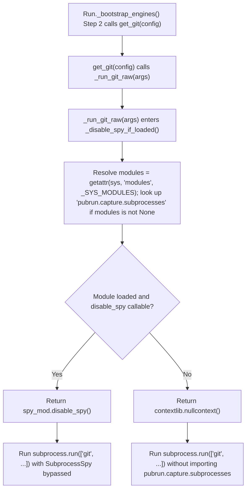

# IPD: Avoid importing pubrun.capture.subprocesses in git capture when SubprocessSpy is unloaded

- Date: 2026-11-27
- Kind: child
- Concern: During `import pubrun.nopatch` when `[capture.git].enabled` is true (the default), `src/pubrun/capture/git.py::get_git` invokes its nested `_run_git_raw` helper during Step 2 of `src/pubrun/tracker.py::Run._bootstrap_engines` before `SubprocessSpy` is installed. Because `_run_git_raw` unconditionally executes `from pubrun.capture.subprocesses import disable_spy`, every `nopatch` run loads `pubrun.capture.subprocesses` into `sys.modules` even though subprocess interception is disabled.
- Scope: Add a `sys.modules`-based `_disable_spy_if_loaded()` helper in `src/pubrun/capture/git.py` (matching `src/pubrun/capture/hardware.py`, `src/pubrun/capture/filesystem.py`, and `src/pubrun/capture/resources.py` from Implementation Plan Document (IPD) `3ed2o4`) and use it inside `_run_git_raw`; add behavioral regression tests in `tests/test_capture_engines.py` and `tests/test_import_modes.py`.
- Scope-Paths: src/pubrun/capture/git.py, tests/test_capture_engines.py, tests/test_import_modes.py
- Item-Dependencies: none
- Status: reviewed
- Readiness: go-pending-approval
- Review-Depth: standard
- Short-Description: Use _disable_spy_if_loaded() in src/pubrun/capture/git.py so nopatch runs keep pubrun.capture.subprocesses unloaded with git capture enabled
- Work-Kind: followup
- Priority: low
- From-Backlog: ctx0hj
- Set: ctx0hj
- Order: 1
- Highest E allocated: 03
- Author: Antigravity
- Id: 7a4bvr

> Write and proofread this plan per the technical writing standard, `.aw/system/workflows/technical-writing/technical-writing.md` (`.agents/workflows/technical-writing/technical-writing.md` in a legacy-layout install), including requirement 12 (diagrams).

## Workflow history

- 2026-11-28 /plan-review (Antigravity): APPROVE WITH REVISIONS APPLIED; PR-001, PR-002, PR-003
- 2026-11-28 to-review (aw set): Authored review-ready IPD graduating backlog item ctx0hj
- 2026-11-28 draft (Antigravity): created.

## Goal

Keep `pubrun.capture.subprocesses` unloaded during `import pubrun.nopatch` runs (and direct `get_git` calls) when `[capture.git].enabled` is true and `SubprocessSpy` has not been loaded. Preserve `disable_spy()` bypass behavior whenever `pubrun.capture.subprocesses` is already loaded in `sys.modules` so active `SubprocessSpy` sessions never record internal `git` capture commands.

### Git subprocess spy-bypass flow

## Detailed Implementation Checklist (TODO)

Execution-state rule: mark an `E-*` item complete only after performing the action. That mark is not validation. Right-sizing rule: write for a modest executor that cannot hold much in its head. Each E-item is one step (one concern, about one file, executable in one focused pass) and its V-item names each unit it covers with its own check; a plan stays at about 5 E-items and 8 work Scope-Paths, else split it into more child plans (guidance, `IPD-Z603`). Accepted execution states: blocked, failed, pending, performed; terminal gate demands 'performed'.

### Task group 1: Guard spy bypass lookup in git capture

- [ ] E-01 Replace the unconditional `pubrun.capture.subprocesses` import in `src/pubrun/capture/git.py::_run_git_raw` with `_disable_spy_if_loaded()`:
  - Import `contextlib` and `sys` at module scope in `src/pubrun/capture/git.py`.
  - Capture `_SYS_MODULES = sys.modules` at module import time and define `_disable_spy_if_loaded() -> Any`, matching `src/pubrun/capture/hardware.py::_disable_spy_if_loaded`, `src/pubrun/capture/filesystem.py::_disable_spy_if_loaded`, and `src/pubrun/capture/resources.py::_disable_spy_if_loaded`:
    - Resolve `modules = getattr(sys, "modules", _SYS_MODULES)`.
    - Fetch `spy_mod = modules.get("pubrun.capture.subprocesses") if modules is not None else None`.
    - Fetch `disable = getattr(spy_mod, "disable_spy", None)`.
    - Return `disable()` when `callable(disable)` is `True`; otherwise return `contextlib.nullcontext()`.
  - Inside `src/pubrun/capture/git.py::get_git` -> `_run_git_raw`, replace `from pubrun.capture.subprocesses import disable_spy` and `with disable_spy():` with `with _disable_spy_if_loaded():`.
  - Keep all timeout parsing, monotonic budget enforcement, UTF-8 decoding, `LC_ALL=C` environment handling, error handling, and return dictionary structure in `get_git` unchanged.
  - Depends on: none
  - Expected outcome: Calling `get_git` when `pubrun.capture.subprocesses` is absent from `sys.modules` completes git capture without loading `pubrun.capture.subprocesses`. Calling `get_git` when `pubrun.capture.subprocesses` is loaded enters `disable_spy()` around each `subprocess.run(["git", ...])` call.
  - Execution state: pending

### Task group 2: Behavioral regression tests and validation

- [ ] E-02 Add behavioral unit tests for `get_git` spy-bypass and unloaded-module behavior in `tests/test_capture_engines.py::TestGit`:
  - Write tests that assert observable runtime behavior only (do not inspect source code with `ast`, `inspect`, regex, or substring matching):
    1. **Active `SubprocessSpy` bypass:** Assert `SubprocessSpy.install(owner=...)` returns `True` (with `pubrun.capture.subprocesses` loaded), run `get_git({"capture": {"git": {"enabled": True}}})` inside the `git_repo` fixture while wrapping `subprocess.run` to record `_spy_bypassed()`, and assert that at least one git invocation ran, every recorded invocation ran with `_spy_bypassed()` equal to `True`, `_spy_bypassed()` is `False` after `get_git` returns, `result["capture_state"]["status"] == "complete"`, and `SubprocessSpy.get_records()` contains zero records (checked before uninstalling). Uninstall `SubprocessSpy.uninstall(owner=...)` in a `finally` block.
    2. **Monkeypatched `sys` fallback:** Replace `pubrun.capture.git.sys` with a minimal stub object lacking a `modules` attribute (via `monkeypatch.setattr`), call `_disable_spy_if_loaded()` while `pubrun.capture.subprocesses` is loaded, and assert that `_spy_bypassed()` is `True` inside the returned context manager and `False` after exit without raising `AttributeError`.
    3. **Direct `get_git` leaves `pubrun.capture.subprocesses` unloaded:** In a fresh Python subprocess (with `PYTHONPATH` pointing at `src`, `PUBRUN_IMPORT_MODE="minimal"`, `PUBRUN_AUTO_START` and `PUBRUN_RUN_MODE_OVERRIDE` removed from the environment so importing parent package `pubrun` does not trigger default auto-start and load `SubprocessSpy`, and `cwd` set to an initialized temporary git repository), import `pubrun.capture.git`, verify `"pubrun.capture.subprocesses" not in sys.modules` before calling `get_git({"capture": {"git": {"enabled": True}}})`, and assert exit `0`, `capture_state["status"] == "complete"`, and `"pubrun.capture.subprocesses" not in sys.modules` after the call.
  - Depends on: E-01
  - Expected outcome: `tests/test_capture_engines.py` passes and verifies all three behaviors (`SubprocessSpy` bypass when loaded, `_SYS_MODULES` fallback under stubbed `sys`, and zero `pubrun.capture.subprocesses` import when unloaded).
  - Execution state: pending

- [ ] E-03 Add a fresh-subprocess `nopatch` git-enabled regression test in `tests/test_import_modes.py` and run full validation:
  - In `tests/test_import_modes.py::TestSpecProbeAndBackgroundImportLockSafety`, add `test_nopatch_with_git_capture_enabled_does_not_load_subprocesses_module`:
    - Create a temporary git repository under `tmp_path` (`git init`, create a file, `git add`, `git commit` with explicit author identity and `commit.gpgsign=false`).
    - Run a fresh Python subprocess using `self._clean_env()` with `cwd=str(repo)` and no `.pubrun.toml` disabling git capture (so default `[capture.git].enabled = true` applies).
    - Execute `import pubrun.nopatch as pubrun`, obtain `run = pubrun.get_current_run()`, join `run._hardware_thread` with a 15-second timeout and assert `not hw_thread.is_alive()` when present, record `run.git_data["capture_state"]["status"]`, `run.git_data.get("commit")`, and `"pubrun.capture.subprocesses" in sys.modules` before and after `pubrun.stop()`.
    - Assert exit `0`, `git_status == "complete"`, `isinstance(commit, str)` with `len(commit) == 40`, `loaded_before_stop is False`, and `loaded_after_stop is False`.
  - In `tests/test_import_modes.py::TestSpecProbeAndBackgroundImportLockSafety::test_nopatch_background_hw_does_not_load_subprocesses_module`, update the comment above `.pubrun.toml` so it explains that disabling git capture isolates the `pubrun-hw` background-thread path (removing the stale note that `pubrun.capture.git` pre-loads `pubrun.capture.subprocesses`). Keep the test assertions and config file write unchanged.
  - Run all commands in `## Required tests / validation`.
  - Depends on: E-01, E-02
  - Expected outcome: Both `nopatch` regression tests in `tests/test_import_modes.py`, the targeted `pytest` suites (including `-p randomly`), and three-platform `mypy` pass with exit `0`.
  - Execution state: pending

## Project conventions discovered (Step 0)

- `pyproject.toml` requires Python `>=3.8` (`requires-python = ">=3.8"`), disables `pytest-randomly` by default in `addopts = "-p no:randomly"` while Continuous Integration (CI) runs `pytest -p randomly`, and runs `mypy` over `src/pubrun` on Linux, `win32`, and `darwin`.
- `src/pubrun/capture/hardware.py::_disable_spy_if_loaded`, `src/pubrun/capture/filesystem.py::_disable_spy_if_loaded`, and `src/pubrun/capture/resources.py::_disable_spy_if_loaded` (introduced by IPD `3ed2o4`) establish the exact module-level `_SYS_MODULES = sys.modules` and `_disable_spy_if_loaded() -> Any` pattern using `getattr(sys, "modules", _SYS_MODULES)` and `contextlib.nullcontext()`.
- `src/pubrun/tracker.py::Run._bootstrap_engines` calls `_get_dep("get_git")(self.config)` synchronously in Step 2 before `SubprocessSpy` is installed in Step 5, and `src/pubrun/nopatch.py` leaves `[capture.git]` enabled (`depth = "standard"` in `src/pubrun/resources/default.toml`) while keeping subprocess interception disabled.
- `tests/test_capture_engines.py::TestGit` provides a `git_repo` fixture that initializes a temporary repository with one commit and switches `cwd` into it.
- `tests/test_import_modes.py::TestSpecProbeAndBackgroundImportLockSafety` provides `_clean_env()` (clearing `PUBRUN_IMPORT_MODE`, `PUBRUN_AUTO_START`, and `PUBRUN_RUN_MODE_OVERRIDE` and prepending `src` to `PYTHONPATH`) and already hosts `test_nopatch_background_hw_does_not_load_subprocesses_module`.

## Findings

| ID | Concerns | Severity | Remediation Risk | Persona | Summary |
|---|---|---|---|---|---|
| `CT-01` | import-hygiene; isolation | Low | Low (`usability`) | Maintainer | `src/pubrun/capture/git.py::_run_git_raw` unconditionally imports `pubrun.capture.subprocesses` during Step 2 of `Run._bootstrap_engines()`, loading the subprocess interception module during `import pubrun.nopatch` runs whenever `[capture.git].enabled` is true. |

## Proposed changes (ordered, validatable)

1. `E-01` (`src/pubrun/capture/git.py`): Add `_SYS_MODULES = sys.modules` and `_disable_spy_if_loaded() -> Any` using `contextlib.nullcontext()`, and replace `from pubrun.capture.subprocesses import disable_spy` / `with disable_spy():` in `_run_git_raw` with `with _disable_spy_if_loaded():`.
2. `E-02` (`tests/test_capture_engines.py`): Add behavioral unit tests in `TestGit` covering active `SubprocessSpy` bypass, `_SYS_MODULES` fallback when `git.sys` lacks `.modules`, and unloaded `pubrun.capture.subprocesses` before and after a fresh-subprocess `get_git` call under `PUBRUN_IMPORT_MODE=minimal`.
3. `E-03` (`tests/test_import_modes.py`): Add `test_nopatch_with_git_capture_enabled_does_not_load_subprocesses_module` in `TestSpecProbeAndBackgroundImportLockSafety`, update the stale comment in `test_nopatch_background_hw_does_not_load_subprocesses_module`, and run all required `pytest` and `mypy` checks.

## Deferred / out of scope (with reason)

None. All requirements of backlog item `ctx0hj` are covered in this plan. Other synchronous callers of `from pubrun.capture.subprocesses import disable_spy` (`src/pubrun/capture/liveness.py`, `src/pubrun/core.py`, and `src/pubrun/report/reproducibility.py`) require no changes and are out of scope because none of them execute during `import pubrun.nopatch` startup: `liveness.py` is imported by `status.py` for status queries, `core.py` uses `disable_spy` only inside explicit manual `pubrun.subprocess` or `pubrun.popen` calls, and `reproducibility.py` runs only during report evaluation.

## Scope check

- Over-scope: none. Every declared file directly implements the `_disable_spy_if_loaded()` change in `src/pubrun/capture/git.py` or tests its unit and `nopatch` startup behavior.
- Under-scope: none. Both unloaded-module behavior (`nopatch` with git enabled and direct `get_git`) and loaded-module behavior (active `SubprocessSpy` bypass and stubbed `sys` fallback) are implemented and verified.

## Required tests / validation

1. `python3 -m pytest tests/test_capture_engines.py tests/test_import_modes.py tests/test_capture_isolation.py tests/test_signals.py -v`
2. `python3 -m pytest tests/test_capture_engines.py tests/test_import_modes.py -v -p randomly`
3. `python3 -m mypy && python3 -m mypy --platform win32 && python3 -m mypy --platform darwin`

## Spec / documentation sync

Not applicable. No user-facing command-line interface (CLI) flags, environment variables, configuration keys, manifest schema fields, or public Application Programming Interface (API) signatures change. `_disable_spy_if_loaded` is a private internal helper in `src/pubrun/capture/git.py`.

## Open questions

None. Backlog item `ctx0hj` names the exact target (`src/pubrun/capture/git.py::_run_git_raw`), the exact helper pattern (`sys.modules`-based `_disable_spy_if_loaded()` matching `hardware.py`, `filesystem.py`, and `resources.py` from IPD `3ed2o4`), and the required `nopatch` outcome; all affected files and test contracts were verified directly in the workspace.

## Validation and cross-check (verify before reporting done)

Validation-state rule: inspect evidence in a separate pass. Do not mark a `V-*` item complete from memory or from the matching execution checkmark. Accepted validation results: blocked, failed, pass, pending; terminal gate demands 'pass'. Runtime-demonstration reachability rule: for each `V-*` item demanding the software be observed acting (such as a run, a dispatch, or a transition), as distinct from items demanding a diff, a file's content, or a test result (which are reachable by construction), name the code path that produces the observation or the sibling `E-*` that creates it, else the demand is UNDER-SCOPE.

- [ ] V-01 validates E-01
  - Required evidence: Pasted output of (1) a fresh-subprocess probe (with `PYTHONPATH=src`, `PUBRUN_IMPORT_MODE=minimal`, and `PUBRUN_AUTO_START` / `PUBRUN_RUN_MODE_OVERRIDE` unset, in a temporary initialized git repository) importing `pubrun.capture.git`, confirming `pubrun.capture.subprocesses` is unloaded before the call, and calling `pubrun.capture.git.get_git({"capture": {"git": {"enabled": True}}})` (exercising `src/pubrun/capture/git.py::_disable_spy_if_loaded` and `_run_git_raw` updated in `E-01`) printing `status=complete`, a 40-character commit hash, and `subprocesses_loaded=False` with exit `0`, and (2) Command 3 (`mypy` on Linux, `win32`, and `darwin`) exiting `0` with zero issues.
  - Observed evidence:
  - Result: pending

- [ ] V-02 validates E-02
  - Required evidence: Pasted output of `python3 -m pytest tests/test_capture_engines.py -v` exiting `0` with all three new `TestGit` unit tests (`SubprocessSpy` bypass while loaded, `_SYS_MODULES` fallback under monkeypatched `git.sys`, and fresh-subprocess `get_git` keeping `pubrun.capture.subprocesses` unloaded, exercising `E-01` via the tests added in `E-02`) visibly listed as `PASSED`.
  - Observed evidence:
  - Result: pending

- [ ] V-03 validates E-03
  - Required evidence: Pasted output of Commands 1, 2, and 3 from `## Required tests / validation` all exiting `0`, with `TestSpecProbeAndBackgroundImportLockSafety::test_nopatch_with_git_capture_enabled_does_not_load_subprocesses_module` and `TestSpecProbeAndBackgroundImportLockSafety::test_nopatch_background_hw_does_not_load_subprocesses_module` visibly listed as `PASSED` (exercising `import pubrun.nopatch` with `[capture.git].enabled = true` through `src/pubrun/tracker.py::Run._bootstrap_engines` Step 2 and `src/pubrun/capture/git.py::_run_git_raw` updated in `E-01` via the test added in `E-03`).
  - Observed evidence:
  - Result: pending

## Approval and execution gate

- Size assessment: standard
- Cohesion rationale: not required

1. **Open questions and approval:** This plan is a proposal and must not be executed until all blocking open questions are resolved (none remain) and explicit human approval is recorded (`aw ipd set approved 7a4bvr --by-human`).
2. **Scope declaration:** `- Scope-Paths:` declares the expected files this plan modifies (`src/pubrun/capture/git.py`, `tests/test_capture_engines.py`, `tests/test_import_modes.py`). Keep changes within this scope; if execution genuinely requires editing an additional file or leaving a declared file untouched, make the necessary change and justify the delta at finalization with `--scope-reason` (per out-of-scope path) or `--scope-ack` (per declared-but-unmodified path) rather than stopping mid-run. Stop and report only on a genuinely unsafe condition (such as an unresolvable concurrent-edit conflict or missing prerequisite symbols).
3. **Validation honesty (hard requirement):** Every `V-*` item must paste actual runner output from this workspace confirming exit `0` and the required behavior; never claim passing tests or type checks that were not actually run.
4. **Commits and push policy:** Commit only files changed for this plan using `aw commit 7a4bvr -- <paths>` (never `git add -A`, bare `git add`, `git commit -a`, or raw `git commit`). Never push, tag, or publish.
5. **Lifecycle finalization:** On completion, finalize this plan to `.aw/records/plans/executed/` only after every `E-*` item is `performed` and every `V-*` item is `pass`. When run under `aw oc run` or `aw agy run`, the runner owns `aw ipd finalize 7a4bvr`; when executed manually outside a runner, the executor runs `aw ipd finalize 7a4bvr` (never hand-roll `git mv` to `executed/`).
