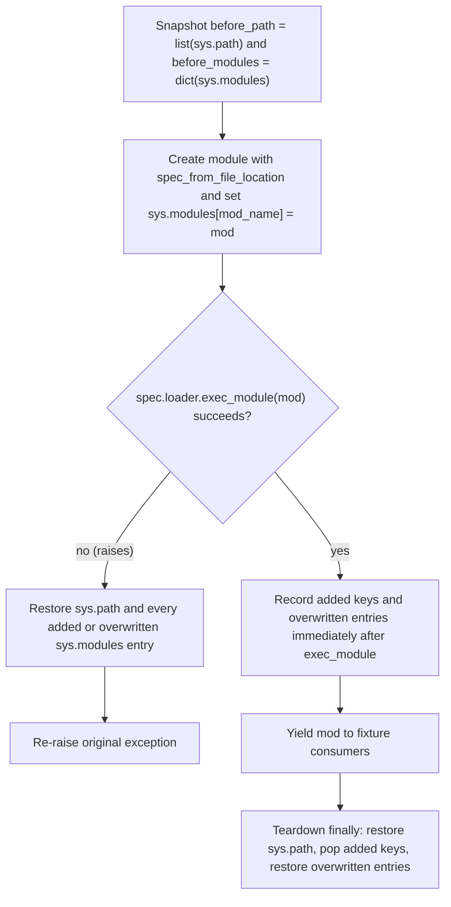

# IPD: Isolate collection-time sys.path and sys.modules mutations in tests/test_benchmark_intake_bugs.py

- Date: 2026-11-27
- Kind: child
- Concern: Test-suite import-state isolation (`TEST-I5` follow-up from executed plan `n39jh9`, Set `assess-bt`). `tests/test_benchmark_intake_bugs.py` mutates `sys.path` and `sys.modules` at collection time and in its `ps` fixture without teardown cleanup.
- Scope: `tests/test_benchmark_intake_bugs.py` (replace collection-time `sys.path.insert` and module-level `_load` bindings with a scoped loader and module-scoped fixtures that snapshot and restore `sys.path` and `sys.modules`, update tests to inject those fixtures, and add behavioral isolation tests).
- Scope-Paths: tests/test_benchmark_intake_bugs.py
- Item-Dependencies: none
- Status: auto-approved
- Readiness: go-pending-approval
- Review-Depth: simple
- Short-Description: Replace module-level script loading in tests/test_benchmark_intake_bugs.py with scoped fixtures that snapshot and restore sys.path and sys.modules
- Work-Kind: chore
- Priority: low
- From-Backlog: lp4sac
- Set: lp4sac
- Order: 1
- Highest E allocated: 03
- Author: Antigravity
- Id: ha5fbl

> Write and proofread this plan per the technical writing standard, `.aw/system/workflows/technical-writing/technical-writing.md` (`.agents/workflows/technical-writing/technical-writing.md` in a legacy-layout install), including requirement 12 (diagrams).

## Workflow history

- 2026-11-28 auto-approved (aw agy run --full-auto): auto-approved by --full-auto: review readiness cleared (not human approval)
- 2026-11-28 /plan-review (Antigravity): APPROVE WITH REVISIONS APPLIED; PR-001, PR-002
- 2026-11-28 to-review (aw set): Authored review-ready child IPD from backlog lp4sac
- 2026-11-28 draft (Antigravity): created.

## Goal

Eliminate collection-time and uncleaned fixture-time `sys.path` and `sys.modules` mutations in `tests/test_benchmark_intake_bugs.py` so collecting or executing this test module cannot leak `benchmarks/`, `.github/scripts/`, `aggregate`, `extract_attachment_url`, `validate_benchmark_submission`, `pull_submissions`, or `share_safety` into other tests in the same `pytest` process. This brings `tests/test_benchmark_intake_bugs.py` in line with the `TEST-I5` isolation pattern already applied in `benchmarks/test_*.py`, `.github/scripts/test_*.py`, `tests/test_package_benchmark.py`, and `tests/test_startup_benchmark.py`.

### Scoped script-loader lifecycle



## Detailed Implementation Checklist (TODO)

Execution-state rule: mark an `E-*` item complete only after performing the action. That mark is not validation. Right-sizing rule: write for a modest executor that cannot hold much in its head. Each E-item is one step (one concern, about one file, executable in one focused pass) and its V-item names each unit it covers with its own check; a plan stays at about 5 E-items and 8 work Scope-Paths, else split it into more child plans (guidance, `IPD-Z603`). Accepted execution states: blocked, failed, pending, performed; terminal gate demands 'performed'.

### Task group 1: Replace collection-time and uncleaned fixture script loading

- [x] E-01 Replace collection-time `sys.path` and `sys.modules` mutations and the uncleaned `ps` loader in `tests/test_benchmark_intake_bugs.py` with a scoped loader and module-scoped fixtures:
  - Add `import contextlib` (and `import subprocess` for E-02) to the standard-library imports at the top of `tests/test_benchmark_intake_bugs.py`. Keep the packaged `from pubrun._bench import harness as h` and `from pubrun._bench import share_safety as ss` imports and the path constants `_REPO`, `_BENCH`, `_SCRIPTS`, and `_FX` at module scope.
  - Remove the collection-time `for _p in (str(_BENCH), str(_SCRIPTS)):` loop that calls `sys.path.insert(0, _p)`, the uncleaned `_load(name, path)` helper, and the module-level `agg`, `x`, and `v` assignments.
  - Add a `@contextlib.contextmanager` helper `_load_scoped(mod_name: str, file_path: Path)` that:
    1. Snapshots `before_path = list(sys.path)` and `before_modules = dict(sys.modules)`.
    2. Loads the script via `importlib.util.spec_from_file_location(mod_name, file_path)` and `importlib.util.module_from_spec(spec)`, asserting `spec is not None and spec.loader is not None`.
    3. Sets `sys.modules[mod_name] = mod` and calls `spec.loader.exec_module(mod)`.
    4. On any exception during `exec_module`, restores `sys.path[:] = before_path`, removes every key in `sys.modules` not in `before_modules`, restores every key in `before_modules` whose `sys.modules.get(name)` object identity changed, and re-raises.
    5. Immediately after `exec_module` succeeds (before yielding), captures `added = [name for name in sys.modules if name not in before_modules]` and `overwritten = {name: prev for name, prev in before_modules.items() if sys.modules.get(name) is not prev}` so teardown does not evict unrelated standard-library or third-party modules imported lazily inside test bodies (for example `http.client`, `email.message`, or `urllib.response`).
    6. Yields `mod`, and in `finally` restores `sys.path[:] = before_path`, pops every key in `added`, and restores every `(name, prev)` entry in `overwritten`.
  - Define four `@pytest.fixture(scope="module")` fixtures backed by `_load_scoped`:
    - `agg`: loads `"aggregate"` from `_BENCH / "aggregate.py"`.
    - `x`: loads `"extract_attachment_url"` from `_SCRIPTS / "extract_attachment_url.py"`.
    - `v`: loads `"validate_benchmark_submission"` from `_SCRIPTS / "validate_benchmark_submission.py"` (do not call `pytest.importorskip("jsonschema")` here, because `TestValidatorDownload` and `TestValidatorParse` run without `jsonschema`).
    - `ps`: replaces the existing function-scoped `ps` fixture by calling `pytest.importorskip("jsonschema")` first and then yielding from `_load_scoped("pull_submissions", _BENCH / "pull_submissions.py")`.
  - Inject the new fixtures into every test method and helper that previously relied on the module globals:
    - `TestExtractorUrlSafety`: add `x` to all 5 test methods.
    - `TestValidatorDownload`: accept `v` in helper `_redirect_handler(self, v, monkeypatch)` and add `v` to all 7 test methods.
    - `TestValidatorParse`: add `v` to all 3 test methods.
    - `TestSchemaReasonPayloadFree`: add `v` to all 3 test methods.
    - `TestAggregateHardening`: add `agg` to all 5 test methods.
    - Keep `TestPullIsolation` (2 test methods), `TestPullRetag` (7 test methods), `TestShareSafetyNone`, `TestShareSafetyCheckoutShimParity`, `TestSlurmRedaction`, `TestScrubBoundaries`, and `TestHarnessSelfCheckGate` behaviorally intact.
  - Keep the file compatible with Python 3.8 syntax (`requires-python = ">=3.8"` in `pyproject.toml`).
  - Depends on: none
  - Expected outcome: Importing `tests/test_benchmark_intake_bugs.py` leaves `sys.path` and `sys.modules` unchanged, and every test consuming `agg`, `x`, `v`, or `ps` uses a module-scoped fixture that restores `sys.path` and `sys.modules` on teardown and on load failure.
  - Execution state: performed

### Task group 2: Add behavioral isolation tests and validate

- [x] E-02 Add behavioral collection-isolation and teardown-restoration tests in `tests/test_benchmark_intake_bugs.py`:
  - Add a `TestCollectionAndFixtureIsolation` class in `tests/test_benchmark_intake_bugs.py` testing observable runtime behavior only (do not inspect source code with `inspect`, Abstract Syntax Tree (AST) parsing, regular expressions, or substring checks):
    1. `test_importing_module_does_not_mutate_sys_path_or_sys_modules`: runs a fresh `sys.executable` subprocess (`subprocess.run`) that snapshots `list(sys.path)` and `set(sys.modules)`, loads `tests/test_benchmark_intake_bugs.py` via `importlib.util.spec_from_file_location` and `spec.loader.exec_module` under a temporary module name, and asserts exit code `0` with `sys.path == before_path` (neither `str(_BENCH)` nor `str(_SCRIPTS)` added) and none of `"aggregate"`, `"extract_attachment_url"`, `"validate_benchmark_submission"`, `"pull_submissions"`, or `"share_safety"` newly present in `sys.modules`.
    2. `test_scoped_loader_restores_state_after_normal_exit`: snapshots `list(sys.path)` and `dict(sys.modules)`, enters `_load_scoped("validate_benchmark_submission", _SCRIPTS / "validate_benchmark_submission.py")` and `_load_scoped("pull_submissions", _BENCH / "pull_submissions.py")` in turn, verifies each loaded module exposes its expected callable (`validate_file` and `process`), and asserts after each `with` block exits that `sys.path` equals the pre-call snapshot and `sys.modules` has the exact same keys and object identities as the pre-call snapshot (order-independent under `pytest -p randomly`).
    3. `test_scoped_loader_restores_state_when_exec_raises(self, tmp_path)`: writes a temporary Python script under `tmp_path` that inserts `str(tmp_path)` into `sys.path`, inserts a unique dummy key into `sys.modules`, and raises `RuntimeError("boom")`; snapshots `list(sys.path)` and `dict(sys.modules)`, verifies `_load_scoped` re-raises `RuntimeError("boom")`, and asserts `sys.path` and `sys.modules` match the pre-call snapshot afterward.
  - Depends on: E-01
  - Expected outcome: Three behavioral tests prove collection-time cleanliness in a fresh interpreter and rollback of `sys.path` and `sys.modules` after both normal exit and load failure, regardless of test execution order.
  - Execution state: performed

- [x] E-03 Run randomized `pytest` validation, post-session teardown leak verification, and Python 3.8 syntax verification:
  - Run every command listed in `## Required tests / validation` and verify exit code `0` with zero failures.
  - Depends on: E-01, E-02
  - Expected outcome: `tests/test_benchmark_intake_bugs.py` passes alongside the sibling benchmark and intake test suites across randomized runs, post-session teardown leaves no leaked script entries, and the modified test file parses cleanly under Python 3.8 syntax.
  - Execution state: performed

## Project conventions discovered (Step 0)

- `benchmarks/aggregate.py` and `.github/scripts/extract_attachment_url.py` import only Python standard-library modules and do not touch `sys.path`.
- `.github/scripts/validate_benchmark_submission.py` inserts `str(_REPO / "benchmarks")` into `sys.path` and runs `import share_safety` at top-level import time. Its `import jsonschema` statement lives inside `check_schema`, so loading `validate_benchmark_submission.py` works even without `jsonschema`.
- `benchmarks/pull_submissions.py` inserts both `str(_REPO / "benchmarks")` and `str(_REPO / ".github" / "scripts")` into `sys.path` and imports `validate_benchmark_submission as _v`, `extract_attachment_url as _x`, and `aggregate as _agg` at top-level import time. It does not import `jsonschema` at top level, while the existing `tests/test_benchmark_intake_bugs.py::ps` fixture calls `pytest.importorskip("jsonschema")` before loading it.
- None of the four loaded scripts perform lazy runtime imports from `benchmarks/` or `.github/scripts/` after module execution completes.
- Existing `TEST-I5` fixes in `benchmarks/test_share_safety.py::_load_scoped`, `benchmarks/test_pull_submissions.py::ps`, `.github/scripts/test_extract_attachment_url.py::_load_script_isolated`, and `.github/scripts/test_validate_benchmark_submission.py::v` all use module-scoped fixtures that snapshot `list(sys.path)` and `dict(sys.modules)` before `exec_module`, record added and overwritten keys immediately after `exec_module`, and restore them on teardown and on exception.
- Because `pytest` tears down module-scoped fixtures in strict Last-In First-Out (LIFO) order, making all four fixtures (`agg`, `x`, `v`, `ps`) module-scoped preserves exact snapshot restoration across every test ordering generated by `pytest -p randomly`.
- Every test in `TestPullIsolation` and `TestPullRetag` patches `ps` only through pytest's `monkeypatch` fixture (which reverts patches at function teardown) and reassigns `PullErrorHolder.cls` at the start of each test, so promoting `ps` from function scope to module scope is safe and avoids repeating the four-script load across all nine test methods (12 parametrized test invocations).
- `tests/test_benchmark_intake_bugs.py::TestShareSafetyCheckoutShimParity.test_checkout_shim_matches_packaged_share_safety_without_sys_modules_leak` already captures `before_share_safety = sys.modules.get("share_safety")` and pops its temporary module name in `finally`, so it stays order-independent with or without module-scoped fixtures active.
- `tests/conftest.py::_subprocess_pythonpath` prepends checkout `src/` to `PYTHONPATH` for subprocesses, and `pyproject.toml` sets `requires-python = ">=3.8"` and `addopts = "-p no:randomly"`, while Continuous Integration (CI) runs `pytest -p randomly`.
- Repository rule (`AGENTS.md`): tests must verify observable behavior (exit codes, runtime state, outputs), never pin source code structure via `inspect`, AST, regex, or text search.

## Findings

| ID | Concerns | Severity | Remediation Risk | Persona | Summary |
|---|---|---|---|---|---|
| `TEST-I5` (`test_benchmark_intake_bugs.py`) | testing | Low | Low (`complexity`) | Testing Expert | `tests/test_benchmark_intake_bugs.py` inserts `benchmarks/` and `.github/scripts/` into `sys.path` and registers `aggregate`, `extract_attachment_url`, `validate_benchmark_submission`, and `share_safety` in `sys.modules` at collection time, and loads `pull_submissions` inside `ps` without restoring `sys.path` or `sys.modules` on teardown. |

## Proposed changes (ordered, validatable)

1. `E-01` (`tests/test_benchmark_intake_bugs.py`): Remove top-level `sys.path.insert`, `_load`, and module-level `agg`/`x`/`v` bindings; add `_load_scoped` and module-scoped `agg`, `x`, `v`, and `ps` fixtures; inject fixtures into `TestExtractorUrlSafety`, `TestValidatorDownload`, `TestValidatorParse`, `TestSchemaReasonPayloadFree`, and `TestAggregateHardening`.
2. `E-02` (`tests/test_benchmark_intake_bugs.py`): Add `TestCollectionAndFixtureIsolation` with behavioral tests for clean collection in a fresh subprocess and snapshot rollback on both normal exit and load failure.
3. `E-03` (validation): Run randomized `pytest` across `tests/test_benchmark_intake_bugs.py` and sibling benchmark/intake test suites, run a post-teardown leak check, and verify Python 3.8 syntax compatibility.

## Deferred / out of scope (with reason)

- Production code under `src/pubrun/`, `benchmarks/`, and `.github/scripts/`: not modified because the defect is confined to test-module import isolation in `tests/test_benchmark_intake_bugs.py`.
  - Carrier-Declined: backlog item `lp4sac` scopes this change solely to `tests/test_benchmark_intake_bugs.py`.
- Sibling test files (`benchmarks/test_*.py`, `.github/scripts/test_*.py`, `tests/test_package_benchmark.py`, `tests/test_startup_benchmark.py`): already fixed under executed plans `n39jh9`, `4eo4z2`, and `37sth0` (Set `assess-bt`).
  - Carrier-Declined: already remediated in Set `assess-bt`; re-validated together in `E-03` without editing them.

## Scope check

- Over-scope: none. Only `tests/test_benchmark_intake_bugs.py` is modified.
- Under-scope: none. Every collection-time and fixture-time `sys.path` and `sys.modules` mutation named in backlog item `lp4sac` (`benchmarks/`, `.github/scripts/`, `aggregate`, `extract_attachment_url`, `validate_benchmark_submission`, `pull_submissions`, plus transitive `share_safety`) is isolated and verified by behavioral tests.

## Required tests / validation

1. Run `tests/test_benchmark_intake_bugs.py` under randomized order with two distinct seeds:
   ```sh
   python3 -m pytest -p randomly tests/test_benchmark_intake_bugs.py -v
   python3 -m pytest -p randomly --randomly-seed=1 tests/test_benchmark_intake_bugs.py -v
   ```
2. Run `tests/test_benchmark_intake_bugs.py` together with the sibling benchmark and intake test suites under randomized order to verify cross-suite compatibility:
   ```sh
   python3 -m pytest -p randomly tests/test_benchmark_intake_bugs.py benchmarks/test_share_safety.py benchmarks/test_pull_submissions.py .github/scripts/test_extract_attachment_url.py .github/scripts/test_validate_benchmark_submission.py -v
   ```
3. Verify in a fresh Python interpreter that post-session `pytest` teardown leaves neither `benchmarks/` nor `.github/scripts/` in `sys.path` and none of the five loaded scripts (`aggregate`, `extract_attachment_url`, `validate_benchmark_submission`, `pull_submissions`, `share_safety`) in `sys.modules`:
   ```sh
   python3 -c "import sys; from pathlib import Path; import pytest; rc = pytest.main(['-p', 'randomly', '-q', 'tests/test_benchmark_intake_bugs.py']); assert rc == 0, rc; bench = str(Path('benchmarks').resolve()); scripts = str(Path('.github/scripts').resolve()); assert bench not in sys.path and scripts not in sys.path, sys.path; leaked = [m for m in ('aggregate', 'extract_attachment_url', 'validate_benchmark_submission', 'pull_submissions', 'share_safety') if m in sys.modules]; assert not leaked, leaked; print('post-teardown-clean')"
   ```
4. Verify Python 3.8 syntax compatibility for `tests/test_benchmark_intake_bugs.py`:
   ```sh
   python3 -c "import ast; ast.parse(open('tests/test_benchmark_intake_bugs.py', encoding='utf-8').read(), feature_version=(3, 8)); print('py38-parse-ok')"
   ```

## Spec / documentation sync

Not applicable. This change is an internal test-isolation chore (`Work-Kind: chore`) in `tests/test_benchmark_intake_bugs.py` that does not alter public application programming interfaces (APIs), command-line interface (CLI) flags, configuration keys, manifest schemas, or user-facing behavior.

## Open questions

None.

## Validation and cross-check (verify before reporting done)

Validation-state rule: inspect evidence in a separate pass. Do not mark a `V-*` item complete from memory or from the matching execution checkmark. Accepted validation results: blocked, failed, pass, pending; terminal gate demands 'pass'. Runtime-demonstration reachability rule: for each `V-*` item demanding the software be observed acting (such as a run, a dispatch, or a transition), as distinct from items demanding a diff, a file's content, or a test result (which are reachable by construction), name the code path that produces the observation or the sibling `E-*` that creates it, else the demand is UNDER-SCOPE.

- [x] V-01 validates E-01
  - Required evidence: Pasted `git diff -- tests/test_benchmark_intake_bugs.py` confirming removal of the module-level `sys.path.insert` loop, uncleaned `_load`, and module-level `agg`/`x`/`v` bindings, addition of `_load_scoped` with exception and `finally` rollback, module-scoped `agg`, `x`, `v`, and `ps` fixtures (`ps` retaining `pytest.importorskip("jsonschema")`), and fixture injection across `TestExtractorUrlSafety`, `TestValidatorDownload`, `TestValidatorParse`, `TestSchemaReasonPayloadFree`, and `TestAggregateHardening`; plus pasted `python3 -m pytest -p randomly tests/test_benchmark_intake_bugs.py -v` output exiting `0` with all pre-existing test classes passing.
  - Observed evidence:
    - `git diff -- tests/test_benchmark_intake_bugs.py` (exit `0`):
      ```diff
      diff --git a/tests/test_benchmark_intake_bugs.py b/tests/test_benchmark_intake_bugs.py
      index 4efda3b..6fdbb55 100644
      --- a/tests/test_benchmark_intake_bugs.py
      +++ b/tests/test_benchmark_intake_bugs.py
      @@ -6,9 +6,11 @@ are imported directly from the packaged subpackage, while repository-only tools
       `benchmarks/` (`aggregate.py`, `pull_submissions.py`) and `.github/scripts/` are loaded
       from their checkout file paths.
       """
      +import contextlib
       import copy
       import importlib.util
       import json
      +import subprocess
       import sys
       import urllib.error
       from pathlib import Path
      @@ -23,23 +25,68 @@ _BENCH = _REPO / "benchmarks"
       _SCRIPTS = _REPO / ".github" / "scripts"
       _FX = _SCRIPTS / "test_fixtures"

      -for _p in (str(_BENCH), str(_SCRIPTS)):
      -    if _p not in sys.path:
      -        sys.path.insert(0, _p)

      -
      -def _load(name, path):
      -    spec = importlib.util.spec_from_file_location(name, path)
      +@contextlib.contextmanager
      +def _load_scoped(mod_name: str, file_path: Path):
      +    """Load a standalone script and restore sys.path and sys.modules on exit or error."""
      +    before_path = list(sys.path)
      +    before_modules = dict(sys.modules)
      +    spec = importlib.util.spec_from_file_location(mod_name, file_path)
           assert spec is not None and spec.loader is not None
           mod = importlib.util.module_from_spec(spec)
      -    sys.modules[name] = mod
      -    spec.loader.exec_module(mod)
      -    return mod
      +    sys.modules[mod_name] = mod
      +    try:
      +        spec.loader.exec_module(mod)
      +    except BaseException:
      +        sys.path[:] = before_path
      +        for name in list(sys.modules):
      +            if name not in before_modules:
      +                sys.modules.pop(name, None)
      +        for name, prev in before_modules.items():
      +            if name not in sys.modules or sys.modules[name] is not prev:
      +                sys.modules[name] = prev
      +        raise
      +    added = [name for name in sys.modules if name not in before_modules]
      +    overwritten = {
      +        name: prev
      +        for name, prev in before_modules.items()
      +        if name not in sys.modules or sys.modules[name] is not prev
      +    }
      +    try:
      +        yield mod
      +    finally:
      +        sys.path[:] = before_path
      +        for name in added:
      +            sys.modules.pop(name, None)
      +        for name, prev in overwritten.items():
      +            sys.modules[name] = prev
      +
      +
      +@pytest.fixture(scope="module")
      +def agg():
      +    with _load_scoped("aggregate", _BENCH / "aggregate.py") as mod:
      +        yield mod
      +
      +
      +@pytest.fixture(scope="module")
      +def x():
      +    with _load_scoped("extract_attachment_url", _SCRIPTS / "extract_attachment_url.py") as mod:
      +        yield mod


      -agg = _load("aggregate", _BENCH / "aggregate.py")
      -x = _load("extract_attachment_url", _SCRIPTS / "extract_attachment_url.py")
      -v = _load("validate_benchmark_submission", _SCRIPTS / "validate_benchmark_submission.py")
      +@pytest.fixture(scope="module")
      +def v():
      +    with _load_scoped(
      +        "validate_benchmark_submission", _SCRIPTS / "validate_benchmark_submission.py"
      +    ) as mod:
      +        yield mod
      +
      +
      +@pytest.fixture(scope="module")
      +def ps():
      +    pytest.importorskip("jsonschema")
      +    with _load_scoped("pull_submissions", _BENCH / "pull_submissions.py") as mod:
      +        yield mod
      @@ -256,27 +303,27 @@ class TestExtractorUrlSafety:
      -    def test_malformed_url_does_not_raise(self, body):
      +    def test_malformed_url_does_not_raise(self, x, body):
      -    def test_malformed_url_skipped_then_valid_wins(self):
      +    def test_malformed_url_skipped_then_valid_wins(self, x):
      -    def test_http_allowlisted_json_rejected_with_https_error(self):
      +    def test_http_allowlisted_json_rejected_with_https_error(self, x):
      -    def test_resolve_source_rejects_http(self):
      +    def test_resolve_source_rejects_http(self, x):
      -    def test_existing_errors_preserved(self):
      +    def test_existing_errors_preserved(self, x):
      @@ -294,107 +341,107 @@ class TestValidatorDownload:
      -    def test_bad_initial_url_rejected_before_fetch(self, url, tmp_path, monkeypatch):
      +    def test_bad_initial_url_rejected_before_fetch(self, v, url, tmp_path, monkeypatch):
      -    def _redirect_handler(self, monkeypatch):
      +    def _redirect_handler(self, v, monkeypatch):
      -    def test_redirect_limits_bounded(self, monkeypatch):
      -        cls = self._redirect_handler(monkeypatch)
      +    def test_redirect_limits_bounded(self, v, monkeypatch):
      +        cls = self._redirect_handler(v, monkeypatch)
      -    def test_redirect_downgrade_or_offlist_rejected(self, newurl, monkeypatch):
      -        cls = self._redirect_handler(monkeypatch)
      +    def test_redirect_downgrade_or_offlist_rejected(self, v, newurl, monkeypatch):
      +        cls = self._redirect_handler(v, monkeypatch)
      -    def test_redirect_allowed_target_proceeds(self, monkeypatch):
      -        cls = self._redirect_handler(monkeypatch)
      +    def test_redirect_allowed_target_proceeds(self, v, monkeypatch):
      +        cls = self._redirect_handler(v, monkeypatch)
      -    def test_excess_redirects_rejected(self, monkeypatch, tmp_path):
      +    def test_excess_redirects_rejected(self, v, monkeypatch, tmp_path):
      -    def test_transport_errors_become_rejects(self, exc, monkeypatch, tmp_path):
      +    def test_transport_errors_become_rejects(self, v, exc, monkeypatch, tmp_path):
      -    def test_http_exception_becomes_reject(self, monkeypatch, tmp_path):
      +    def test_http_exception_becomes_reject(self, v, monkeypatch, tmp_path):
      @@ -409,28 +456,28 @@ class TestValidatorParse:
      -    def test_invalid_utf8_rejected_at_parse(self, tmp_path):
      +    def test_invalid_utf8_rejected_at_parse(self, v, tmp_path):
      -    def test_non_standard_constants_rejected_at_parse(self, const, tmp_path):
      +    def test_non_standard_constants_rejected_at_parse(self, v, const, tmp_path):
      -    def test_nan_in_timings_rejected_at_parse(self, tmp_path):
      +    def test_nan_in_timings_rejected_at_parse(self, v, tmp_path):
      @@ -448,20 +495,20 @@ class TestSchemaReasonPayloadFree:
      -    def test_bad_value_not_echoed(self):
      +    def test_bad_value_not_echoed(self, v):
      -    def test_user_supplied_key_not_echoed(self):
      +    def test_user_supplied_key_not_echoed(self, v):
      -    def test_mixed_int_and_str_paths_sort_without_typeerror(self):
      +    def test_mixed_int_and_str_paths_sort_without_typeerror(self, v):
      @@ -496,63 +543,57 @@ class TestAggregateHardening:
      -    def test_group_null_does_not_crash(self, tmp_path):
      +    def test_group_null_does_not_crash(self, agg, tmp_path):
      -    def test_non_dict_machine_blocks_do_not_crash(self, machine):
      +    def test_non_dict_machine_blocks_do_not_crash(self, agg, machine):
      -    def test_non_dict_json_skipped_with_warning(self, tmp_path, capsys):
      +    def test_non_dict_json_skipped_with_warning(self, agg, tmp_path, capsys):
      -    def test_non_dict_scenario_entries_ignored(self):
      +    def test_non_dict_scenario_entries_ignored(self, agg):
      -    def test_writers_create_missing_parent_dirs(self, tmp_path):
      +    def test_writers_create_missing_parent_dirs(self, agg, tmp_path):
      -@pytest.fixture
      -def ps():
      -    pytest.importorskip("jsonschema")
      -    return _load("pull_submissions", _BENCH / "pull_submissions.py")
      ```
    - `python3 -m pytest -p randomly tests/test_benchmark_intake_bugs.py -v` (`--randomly-seed=1976743571`, exit `0`):
      ```text
      Using --randomly-seed=1976743571
      collected 76 items

      tests/test_benchmark_intake_bugs.py::TestAggregateHardening::test_non_dict_machine_blocks_do_not_crash[not-a-dict] PASSED [  1%]
      tests/test_benchmark_intake_bugs.py::TestAggregateHardening::test_writers_create_missing_parent_dirs PASSED [  2%]
      tests/test_benchmark_intake_bugs.py::TestAggregateHardening::test_group_null_does_not_crash PASSED [  3%]
      tests/test_benchmark_intake_bugs.py::TestAggregateHardening::test_non_dict_json_skipped_with_warning PASSED [  5%]
      tests/test_benchmark_intake_bugs.py::TestAggregateHardening::test_non_dict_machine_blocks_do_not_crash[machine1] PASSED [  6%]
      tests/test_benchmark_intake_bugs.py::TestAggregateHardening::test_non_dict_machine_blocks_do_not_crash[machine3] PASSED [  7%]
      tests/test_benchmark_intake_bugs.py::TestAggregateHardening::test_non_dict_scenario_entries_ignored PASSED [  9%]
      tests/test_benchmark_intake_bugs.py::TestAggregateHardening::test_non_dict_machine_blocks_do_not_crash[machine2] PASSED [ 10%]
      tests/test_benchmark_intake_bugs.py::TestSlurmRedaction::test_check_share_safe_rejects_unredacted_slurm[node-cn-0423] PASSED [ 11%]
      tests/test_benchmark_intake_bugs.py::TestSlurmRedaction::test_redact_result_leaves_absent_slurm_fields_absent PASSED [ 13%]
      tests/test_benchmark_intake_bugs.py::TestSlurmRedaction::test_redact_result_masks_node_and_job_id[4815162342_1] PASSED [ 14%]
      tests/test_benchmark_intake_bugs.py::TestSlurmRedaction::test_redact_result_masks_node_and_job_id[4815162342_0] PASSED [ 15%]
      tests/test_benchmark_intake_bugs.py::TestSlurmRedaction::test_check_share_safe_rejects_unredacted_slurm[job_id-12345_1] PASSED [ 17%]
      tests/test_benchmark_intake_bugs.py::TestSlurmRedaction::test_check_share_safe_rejects_unredacted_slurm[job_id-12345_0] PASSED [ 18%]
      tests/test_benchmark_intake_bugs.py::TestSchemaReasonPayloadFree::test_bad_value_not_echoed PASSED [ 19%]
      tests/test_benchmark_intake_bugs.py::TestSchemaReasonPayloadFree::test_mixed_int_and_str_paths_sort_without_typeerror PASSED [ 21%]
      tests/test_benchmark_intake_bugs.py::TestSchemaReasonPayloadFree::test_user_supplied_key_not_echoed PASSED [ 22%]
      tests/test_benchmark_intake_bugs.py::TestPullIsolation::test_print_report_shows_errors PASSED [ 23%]
      tests/test_benchmark_intake_bugs.py::TestPullIsolation::test_unexpected_error_isolated_and_batch_continues PASSED [ 25%]
      tests/test_benchmark_intake_bugs.py::TestScrubBoundaries::test_short_username_does_not_corrupt_markers_or_schema[ed] PASSED [ 26%]
      tests/test_benchmark_intake_bugs.py::TestScrubBoundaries::test_pre_redacted_value_is_not_rescanned PASSED [ 27%]
      tests/test_benchmark_intake_bugs.py::TestScrubBoundaries::test_short_username_does_not_corrupt_markers_or_schema[benchmark] PASSED [ 28%]
      tests/test_benchmark_intake_bugs.py::TestScrubBoundaries::test_non_string_values_untouched PASSED [ 30%]
      tests/test_benchmark_intake_bugs.py::TestScrubBoundaries::test_short_username_does_not_corrupt_markers_or_schema[mark] PASSED [ 31%]
      tests/test_benchmark_intake_bugs.py::TestScrubBoundaries::test_path_needle_replaced_literally_longest_first PASSED [ 32%]
      tests/test_benchmark_intake_bugs.py::TestScrubBoundaries::test_short_username_does_not_corrupt_markers_or_schema[run] PASSED [ 34%]
      tests/test_benchmark_intake_bugs.py::TestScrubBoundaries::test_short_username_does_not_corrupt_markers_or_schema[pub] PASSED [ 35%]
      tests/test_benchmark_intake_bugs.py::TestShareSafetyCheckoutShimParity::test_checkout_shim_matches_packaged_share_safety_without_sys_modules_leak PASSED [ 36%]
      tests/test_benchmark_intake_bugs.py::TestShareSafetyNone::test_virtual_env_none_is_safe PASSED [ 38%]
      tests/test_benchmark_intake_bugs.py::TestShareSafetyNone::test_every_must_be_redacted_field_may_be_none PASSED [ 39%]
      tests/test_benchmark_intake_bugs.py::TestShareSafetyNone::test_non_none_unredacted_value_still_rejected PASSED [ 40%]
      tests/test_benchmark_intake_bugs.py::TestHarnessSelfCheckGate::test_passing_self_check_writes_file PASSED [ 42%]
      tests/test_benchmark_intake_bugs.py::TestHarnessSelfCheckGate::test_failed_self_check_exits_nonzero_and_writes_nothing PASSED [ 43%]
      tests/test_benchmark_intake_bugs.py::TestHarnessSelfCheckGate::test_self_check_exception_exits_nonzero PASSED [ 44%]
      tests/test_benchmark_intake_bugs.py::TestValidatorParse::test_non_standard_constants_rejected_at_parse[-Infinity] PASSED [ 46%]
      tests/test_benchmark_intake_bugs.py::TestValidatorParse::test_nan_in_timings_rejected_at_parse PASSED [ 47%]
      tests/test_benchmark_intake_bugs.py::TestValidatorParse::test_invalid_utf8_rejected_at_parse PASSED [ 48%]
      tests/test_benchmark_intake_bugs.py::TestValidatorParse::test_non_standard_constants_rejected_at_parse[Infinity] PASSED [ 50%]
      tests/test_benchmark_intake_bugs.py::TestValidatorParse::test_non_standard_constants_rejected_at_parse[NaN] PASSED [ 51%]
      tests/test_benchmark_intake_bugs.py::TestCollectionAndFixtureIsolation::test_importing_module_does_not_mutate_sys_path_or_sys_modules PASSED [ 52%]
      tests/test_benchmark_intake_bugs.py::TestCollectionAndFixtureIsolation::test_scoped_loader_restores_state_when_exec_raises PASSED [ 53%]
      tests/test_benchmark_intake_bugs.py::TestCollectionAndFixtureIsolation::test_scoped_loader_restores_state_after_normal_exit PASSED [ 55%]
      tests/test_benchmark_intake_bugs.py::TestValidatorDownload::test_transport_errors_become_rejects[exc2] PASSED [ 56%]
      tests/test_benchmark_intake_bugs.py::TestValidatorDownload::test_redirect_allowed_target_proceeds PASSED [ 57%]
      tests/test_benchmark_intake_bugs.py::TestValidatorDownload::test_http_exception_becomes_reject PASSED [ 59%]
      tests/test_benchmark_intake_bugs.py::TestValidatorDownload::test_transport_errors_become_rejects[exc3] PASSED [ 60%]
      tests/test_benchmark_intake_bugs.py::TestValidatorDownload::test_transport_errors_become_rejects[exc1] PASSED [ 61%]
      tests/test_benchmark_intake_bugs.py::TestValidatorDownload::test_transport_errors_become_rejects[exc0] PASSED [ 63%]
      tests/test_benchmark_intake_bugs.py::TestValidatorDownload::test_redirect_downgrade_or_offlist_rejected[https://evil.example.com/a.json] PASSED [ 64%]
      tests/test_benchmark_intake_bugs.py::TestValidatorDownload::test_redirect_limits_bounded PASSED [ 65%]
      tests/test_benchmark_intake_bugs.py::TestValidatorDownload::test_excess_redirects_rejected PASSED [ 67%]
      tests/test_benchmark_intake_bugs.py::TestValidatorDownload::test_bad_initial_url_rejected_before_fetch[file://github.com/etc/a.json] PASSED [ 68%]
      tests/test_benchmark_intake_bugs.py::TestValidatorDownload::test_bad_initial_url_rejected_before_fetch[https://[invalid/a.json] PASSED [ 69%]
      tests/test_benchmark_intake_bugs.py::TestValidatorDownload::test_redirect_downgrade_or_offlist_rejected[https://[invalid/a.json] PASSED [ 71%]
      tests/test_benchmark_intake_bugs.py::TestValidatorDownload::test_bad_initial_url_rejected_before_fetch[https://github.com:99999/a.json] PASSED [ 72%]
      tests/test_benchmark_intake_bugs.py::TestValidatorDownload::test_bad_initial_url_rejected_before_fetch[ftp://github.com/a.json] PASSED [ 73%]
      tests/test_benchmark_intake_bugs.py::TestValidatorDownload::test_bad_initial_url_rejected_before_fetch[http://github.com/a.json] PASSED [ 75%]
      tests/test_benchmark_intake_bugs.py::TestValidatorDownload::test_redirect_downgrade_or_offlist_rejected[http://github.com/a.json] PASSED [ 76%]
      tests/test_benchmark_intake_bugs.py::TestExtractorUrlSafety::test_malformed_url_does_not_raise[https://[invalid/a.json] PASSED [ 77%]
      tests/test_benchmark_intake_bugs.py::TestExtractorUrlSafety::test_resolve_source_rejects_http PASSED [ 78%]
      tests/test_benchmark_intake_bugs.py::TestExtractorUrlSafety::test_malformed_url_does_not_raise[https://github.com:abc/a.json] PASSED [ 80%]
      tests/test_benchmark_intake_bugs.py::TestExtractorUrlSafety::test_malformed_url_does_not_raise[https://github.com:99999/a.json] PASSED [ 81%]
      tests/test_benchmark_intake_bugs.py::TestExtractorUrlSafety::test_http_allowlisted_json_rejected_with_https_error PASSED [ 82%]
      tests/test_benchmark_intake_bugs.py::TestExtractorUrlSafety::test_malformed_url_skipped_then_valid_wins PASSED [ 84%]
      tests/test_benchmark_intake_bugs.py::TestExtractorUrlSafety::test_existing_errors_preserved PASSED [ 85%]
      tests/test_benchmark_intake_bugs.py::TestPullRetag::test_same_reason_without_marker_still_posts PASSED [ 86%]
      tests/test_benchmark_intake_bugs.py::TestPullRetag::test_final_fallback_adds_label_only PASSED [ 88%]
      tests/test_benchmark_intake_bugs.py::TestPullRetag::test_unreadable_comments_degrade_to_posting[{"comments": "x"}] PASSED [ 89%]
      tests/test_benchmark_intake_bugs.py::TestPullRetag::test_unreadable_comments_degrade_to_posting[[1,2]] PASSED [ 90%]
      tests/test_benchmark_intake_bugs.py::TestPullRetag::test_unreadable_comments_degrade_to_posting[] PASSED [ 92%]
      tests/test_benchmark_intake_bugs.py::TestPullRetag::test_primary_edit_first_and_no_fallback_on_success PASSED [ 93%]
      tests/test_benchmark_intake_bugs.py::TestPullRetag::test_repeat_rejection_same_reason_not_reposted PASSED [ 94%]
      tests/test_benchmark_intake_bugs.py::TestPullRetag::test_view_failure_degrades_to_posting PASSED [ 96%]
      tests/test_benchmark_intake_bugs.py::TestPullRetag::test_fallback_still_drops_pending[True-status:accepted] PASSED [ 97%]
      tests/test_benchmark_intake_bugs.py::TestPullRetag::test_unreadable_comments_degrade_to_posting[not json] PASSED [ 98%]
      tests/test_benchmark_intake_bugs.py::TestPullRetag::test_fallback_still_drops_pending[False-status:needs-fix] PASSED [100%]

      ============================== 76 passed in 1.64s ==============================
      ```
  - Result: pass

- [x] V-02 validates E-02
  - Required evidence: Pasted `python3 -m pytest -p randomly tests/test_benchmark_intake_bugs.py -k TestCollectionAndFixtureIsolation -v` output exiting `0` with all three behavioral isolation tests passing (`test_importing_module_does_not_mutate_sys_path_or_sys_modules`, `test_scoped_loader_restores_state_after_normal_exit`, and `test_scoped_loader_restores_state_when_exec_raises`, re-derived at execution time), confirming the subprocess collection check and `_load_scoped` normal/exception rollback assertions run and pass without source-inspection assertions.
  - Observed evidence:
    - `python3 -m pytest -p randomly tests/test_benchmark_intake_bugs.py -k TestCollectionAndFixtureIsolation -v` (`--randomly-seed=2488362444`, exit `0`):
      ```text
      Using --randomly-seed=2488362444
      collected 76 items / 73 deselected / 3 selected

      tests/test_benchmark_intake_bugs.py::TestCollectionAndFixtureIsolation::test_importing_module_does_not_mutate_sys_path_or_sys_modules PASSED [ 33%]
      tests/test_benchmark_intake_bugs.py::TestCollectionAndFixtureIsolation::test_scoped_loader_restores_state_when_exec_raises PASSED [ 66%]
      tests/test_benchmark_intake_bugs.py::TestCollectionAndFixtureIsolation::test_scoped_loader_restores_state_after_normal_exit PASSED [100%]

      ======================= 3 passed, 73 deselected in 0.83s =======================
      ```
  - Result: pass

- [x] V-03 validates E-03
  - Required evidence: Pasted complete runner outputs with exit code `0` for: (1) `python3 -m pytest -p randomly --randomly-seed=1 tests/test_benchmark_intake_bugs.py -v`, (2) `python3 -m pytest -p randomly tests/test_benchmark_intake_bugs.py benchmarks/test_share_safety.py benchmarks/test_pull_submissions.py .github/scripts/test_extract_attachment_url.py .github/scripts/test_validate_benchmark_submission.py -v`, (3) `python3 -c "import sys; from pathlib import Path; import pytest; rc = pytest.main(['-p', 'randomly', '-q', 'tests/test_benchmark_intake_bugs.py']); assert rc == 0, rc; bench = str(Path('benchmarks').resolve()); scripts = str(Path('.github/scripts').resolve()); assert bench not in sys.path and scripts not in sys.path, sys.path; leaked = [m for m in ('aggregate', 'extract_attachment_url', 'validate_benchmark_submission', 'pull_submissions', 'share_safety') if m in sys.modules]; assert not leaked, leaked; print('post-teardown-clean')"` printing `post-teardown-clean`, and (4) `python3 -c "import ast; ast.parse(open('tests/test_benchmark_intake_bugs.py', encoding='utf-8').read(), feature_version=(3, 8)); print('py38-parse-ok')"` printing `py38-parse-ok`.
  - Observed evidence:
    - (1) `python3 -m pytest -p randomly --randomly-seed=1 tests/test_benchmark_intake_bugs.py -v` (exit `0`):
      ```text
      Using --randomly-seed=1
      collected 76 items

      tests/test_benchmark_intake_bugs.py::TestScrubBoundaries::test_short_username_does_not_corrupt_markers_or_schema[ed] PASSED [  1%]
      tests/test_benchmark_intake_bugs.py::TestScrubBoundaries::test_non_string_values_untouched PASSED [  2%]
      tests/test_benchmark_intake_bugs.py::TestScrubBoundaries::test_pre_redacted_value_is_not_rescanned PASSED [  3%]
      tests/test_benchmark_intake_bugs.py::TestScrubBoundaries::test_short_username_does_not_corrupt_markers_or_schema[run] PASSED [  5%]
      tests/test_benchmark_intake_bugs.py::TestScrubBoundaries::test_short_username_does_not_corrupt_markers_or_schema[pub] PASSED [  6%]
      tests/test_benchmark_intake_bugs.py::TestScrubBoundaries::test_short_username_does_not_corrupt_markers_or_schema[benchmark] PASSED [  7%]
      tests/test_benchmark_intake_bugs.py::TestScrubBoundaries::test_short_username_does_not_corrupt_markers_or_schema[mark] PASSED [  9%]
      tests/test_benchmark_intake_bugs.py::TestScrubBoundaries::test_path_needle_replaced_literally_longest_first PASSED [ 10%]
      tests/test_benchmark_intake_bugs.py::TestHarnessSelfCheckGate::test_self_check_exception_exits_nonzero PASSED [ 11%]
      tests/test_benchmark_intake_bugs.py::TestHarnessSelfCheckGate::test_failed_self_check_exits_nonzero_and_writes_nothing PASSED [ 13%]
      tests/test_benchmark_intake_bugs.py::TestHarnessSelfCheckGate::test_passing_self_check_writes_file PASSED [ 14%]
      tests/test_benchmark_intake_bugs.py::TestShareSafetyNone::test_non_none_unredacted_value_still_rejected PASSED [ 15%]
      tests/test_benchmark_intake_bugs.py::TestShareSafetyNone::test_virtual_env_none_is_safe PASSED [ 17%]
      tests/test_benchmark_intake_bugs.py::TestShareSafetyNone::test_every_must_be_redacted_field_may_be_none PASSED [ 18%]
      tests/test_benchmark_intake_bugs.py::TestValidatorParse::test_nan_in_timings_rejected_at_parse PASSED [ 19%]
      tests/test_benchmark_intake_bugs.py::TestValidatorParse::test_non_standard_constants_rejected_at_parse[-Infinity] PASSED [ 21%]
      tests/test_benchmark_intake_bugs.py::TestValidatorParse::test_non_standard_constants_rejected_at_parse[Infinity] PASSED [ 22%]
      tests/test_benchmark_intake_bugs.py::TestValidatorParse::test_invalid_utf8_rejected_at_parse PASSED [ 23%]
      tests/test_benchmark_intake_bugs.py::TestValidatorParse::test_non_standard_constants_rejected_at_parse[NaN] PASSED [ 25%]
      tests/test_benchmark_intake_bugs.py::TestSchemaReasonPayloadFree::test_mixed_int_and_str_paths_sort_without_typeerror PASSED [ 26%]
      tests/test_benchmark_intake_bugs.py::TestSchemaReasonPayloadFree::test_user_supplied_key_not_echoed PASSED [ 27%]
      tests/test_benchmark_intake_bugs.py::TestSchemaReasonPayloadFree::test_bad_value_not_echoed PASSED [ 28%]
      tests/test_benchmark_intake_bugs.py::TestPullIsolation::test_print_report_shows_errors PASSED [ 30%]
      tests/test_benchmark_intake_bugs.py::TestPullIsolation::test_unexpected_error_isolated_and_batch_continues PASSED [ 31%]
      tests/test_benchmark_intake_bugs.py::TestValidatorDownload::test_redirect_downgrade_or_offlist_rejected[https://[invalid/a.json] PASSED [ 32%]
      tests/test_benchmark_intake_bugs.py::TestValidatorDownload::test_bad_initial_url_rejected_before_fetch[https://github.com:99999/a.json] PASSED [ 34%]
      tests/test_benchmark_intake_bugs.py::TestValidatorDownload::test_bad_initial_url_rejected_before_fetch[https://[invalid/a.json] PASSED [ 35%]
      tests/test_benchmark_intake_bugs.py::TestValidatorDownload::test_bad_initial_url_rejected_before_fetch[http://github.com/a.json] PASSED [ 36%]
      tests/test_benchmark_intake_bugs.py::TestValidatorDownload::test_transport_errors_become_rejects[exc1] PASSED [ 38%]
      tests/test_benchmark_intake_bugs.py::TestValidatorDownload::test_redirect_downgrade_or_offlist_rejected[http://github.com/a.json] PASSED [ 39%]
      tests/test_benchmark_intake_bugs.py::TestValidatorDownload::test_transport_errors_become_rejects[exc0] PASSED [ 40%]
      tests/test_benchmark_intake_bugs.py::TestValidatorDownload::test_bad_initial_url_rejected_before_fetch[ftp://github.com/a.json] PASSED [ 42%]
      tests/test_benchmark_intake_bugs.py::TestValidatorDownload::test_http_exception_becomes_reject PASSED [ 43%]
      tests/test_benchmark_intake_bugs.py::TestValidatorDownload::test_transport_errors_become_rejects[exc2] PASSED [ 44%]
      tests/test_benchmark_intake_bugs.py::TestValidatorDownload::test_redirect_allowed_target_proceeds PASSED [ 46%]
      tests/test_benchmark_intake_bugs.py::TestValidatorDownload::test_transport_errors_become_rejects[exc3] PASSED [ 47%]
      tests/test_benchmark_intake_bugs.py::TestValidatorDownload::test_redirect_downgrade_or_offlist_rejected[https://evil.example.com/a.json] PASSED [ 48%]
      tests/test_benchmark_intake_bugs.py::TestValidatorDownload::test_redirect_limits_bounded PASSED [ 50%]
      tests/test_benchmark_intake_bugs.py::TestValidatorDownload::test_bad_initial_url_rejected_before_fetch[file://github.com/etc/a.json] PASSED [ 51%]
      tests/test_benchmark_intake_bugs.py::TestValidatorDownload::test_excess_redirects_rejected PASSED [ 52%]
      tests/test_benchmark_intake_bugs.py::TestExtractorUrlSafety::test_http_allowlisted_json_rejected_with_https_error PASSED [ 53%]
      tests/test_benchmark_intake_bugs.py::TestExtractorUrlSafety::test_malformed_url_skipped_then_valid_wins PASSED [ 55%]
      tests/test_benchmark_intake_bugs.py::TestExtractorUrlSafety::test_resolve_source_rejects_http PASSED [ 56%]
      tests/test_benchmark_intake_bugs.py::TestExtractorUrlSafety::test_malformed_url_does_not_raise[https://github.com:abc/a.json] PASSED [ 57%]
      tests/test_benchmark_intake_bugs.py::TestExtractorUrlSafety::test_existing_errors_preserved PASSED [ 59%]
      tests/test_benchmark_intake_bugs.py::TestExtractorUrlSafety::test_malformed_url_does_not_raise[https://github.com:99999/a.json] PASSED [ 60%]
      tests/test_benchmark_intake_bugs.py::TestExtractorUrlSafety::test_malformed_url_does_not_raise[https://[invalid/a.json] PASSED [ 61%]
      tests/test_benchmark_intake_bugs.py::TestShareSafetyCheckoutShimParity::test_checkout_shim_matches_packaged_share_safety_without_sys_modules_leak PASSED [ 63%]
      tests/test_benchmark_intake_bugs.py::TestAggregateHardening::test_non_dict_scenario_entries_ignored PASSED [ 64%]
      tests/test_benchmark_intake_bugs.py::TestAggregateHardening::test_writers_create_missing_parent_dirs PASSED [ 65%]
      tests/test_benchmark_intake_bugs.py::TestAggregateHardening::test_group_null_does_not_crash PASSED [ 67%]
      tests/test_benchmark_intake_bugs.py::TestAggregateHardening::test_non_dict_json_skipped_with_warning PASSED [ 68%]
      tests/test_benchmark_intake_bugs.py::TestAggregateHardening::test_non_dict_machine_blocks_do_not_crash[not-a-dict] PASSED [ 69%]
      tests/test_benchmark_intake_bugs.py::TestAggregateHardening::test_non_dict_machine_blocks_do_not_crash[machine1] PASSED [ 71%]
      tests/test_benchmark_intake_bugs.py::TestAggregateHardening::test_non_dict_machine_blocks_do_not_crash[machine3] PASSED [ 72%]
      tests/test_benchmark_intake_bugs.py::TestAggregateHardening::test_non_dict_machine_blocks_do_not_crash[machine2] PASSED [ 73%]
      tests/test_benchmark_intake_bugs.py::TestCollectionAndFixtureIsolation::test_scoped_loader_restores_state_when_exec_raises PASSED [ 75%]
      tests/test_benchmark_intake_bugs.py::TestCollectionAndFixtureIsolation::test_importing_module_does_not_mutate_sys_path_or_sys_modules PASSED [ 76%]
      tests/test_benchmark_intake_bugs.py::TestCollectionAndFixtureIsolation::test_scoped_loader_restores_state_after_normal_exit PASSED [ 77%]
      tests/test_benchmark_intake_bugs.py::TestSlurmRedaction::test_redact_result_masks_node_and_job_id[4815162342_0] PASSED [ 78%]
      tests/test_benchmark_intake_bugs.py::TestSlurmRedaction::test_redact_result_masks_node_and_job_id[4815162342_1] PASSED [ 80%]
      tests/test_benchmark_intake_bugs.py::TestSlurmRedaction::test_check_share_safe_rejects_unredacted_slurm[job_id-12345_0] PASSED [ 81%]
      tests/test_benchmark_intake_bugs.py::TestSlurmRedaction::test_check_share_safe_rejects_unredacted_slurm[job_id-12345_1] PASSED [ 82%]
      tests/test_benchmark_intake_bugs.py::TestSlurmRedaction::test_check_share_safe_rejects_unredacted_slurm[node-cn-0423] PASSED [ 84%]
      tests/test_benchmark_intake_bugs.py::TestSlurmRedaction::test_redact_result_leaves_absent_slurm_fields_absent PASSED [ 85%]
      tests/test_benchmark_intake_bugs.py::TestPullRetag::test_primary_edit_first_and_no_fallback_on_success PASSED [ 86%]
      tests/test_benchmark_intake_bugs.py::TestPullRetag::test_unreadable_comments_degrade_to_posting[] PASSED [ 88%]
      tests/test_benchmark_intake_bugs.py::TestPullRetag::test_fallback_still_drops_pending[False-status:needs-fix] PASSED [ 89%]
      tests/test_benchmark_intake_bugs.py::TestPullRetag::test_repeat_rejection_same_reason_not_reposted PASSED [ 90%]
      tests/test_benchmark_intake_bugs.py::TestPullRetag::test_unreadable_comments_degrade_to_posting[[1,2]] PASSED [ 92%]
      tests/test_benchmark_intake_bugs.py::TestPullRetag::test_view_failure_degrades_to_posting PASSED [ 93%]
      tests/test_benchmark_intake_bugs.py::TestPullRetag::test_unreadable_comments_degrade_to_posting[not json] PASSED [ 94%]
      tests/test_benchmark_intake_bugs.py::TestPullRetag::test_unreadable_comments_degrade_to_posting[{"comments": "x"}] PASSED [ 96%]
      tests/test_benchmark_intake_bugs.py::TestPullRetag::test_final_fallback_adds_label_only PASSED [ 97%]
      tests/test_benchmark_intake_bugs.py::TestPullRetag::test_same_reason_without_marker_still_posts PASSED [ 98%]
      tests/test_benchmark_intake_bugs.py::TestPullRetag::test_fallback_still_drops_pending[True-status:accepted] PASSED [100%]

      ============================== 76 passed in 1.21s ==============================
      ```
    - (2) `python3 -m pytest -p randomly tests/test_benchmark_intake_bugs.py benchmarks/test_share_safety.py benchmarks/test_pull_submissions.py .github/scripts/test_extract_attachment_url.py .github/scripts/test_validate_benchmark_submission.py -v` (`--randomly-seed=3089082513`, exit `0`):
      ```text
      Using --randomly-seed=3089082513
      collected 146 items

      .github/scripts/test_validate_benchmark_submission.py::test_adversarial_rejected[home_path.json-share-safety] PASSED [  0%]
      .github/scripts/test_validate_benchmark_submission.py::test_gist_raw_host_on_allowlist PASSED [  1%]
      .github/scripts/test_validate_benchmark_submission.py::test_download_rejects_non_allowlisted_host PASSED [  2%]
      .github/scripts/test_validate_benchmark_submission.py::test_non_json_suffix_rejected PASSED [  2%]
      .github/scripts/test_validate_benchmark_submission.py::test_adversarial_rejected[unredacted_hostname.json-share-safety] PASSED [  3%]
      .github/scripts/test_validate_benchmark_submission.py::test_adversarial_rejected[negative_timing.json-schema] PASSED [  4%]
      .github/scripts/test_validate_benchmark_submission.py::test_adversarial_rejected[missing_required.json-schema] PASSED [  4%]
      .github/scripts/test_validate_benchmark_submission.py::test_adversarial_rejected[not_json.json-parse] PASSED [  5%]
      .github/scripts/test_validate_benchmark_submission.py::test_verdict_never_contains_payload PASSED [  6%]
      .github/scripts/test_validate_benchmark_submission.py::test_valid_result_accepted PASSED [  6%]
      .github/scripts/test_validate_benchmark_submission.py::test_injection_shaped_value_is_inert_data PASSED [  7%]
      .github/scripts/test_validate_benchmark_submission.py::test_missing_file_rejected PASSED [  8%]
      .github/scripts/test_validate_benchmark_submission.py::test_adversarial_rejected[wrong_schema.json-schema] PASSED [  8%]
      .github/scripts/test_validate_benchmark_submission.py::test_gist_lookalike_host_rejected PASSED [  9%]
      .github/scripts/test_validate_benchmark_submission.py::test_adversarial_rejected[not_object.json-parse] PASSED [ 10%]
      .github/scripts/test_validate_benchmark_submission.py::test_oversized_rejected PASSED [ 10%]
      .github/scripts/test_extract_attachment_url.py::test_finds_allowlisted_json_attachment PASSED [ 11%]
      .github/scripts/test_extract_attachment_url.py::test_gist_raw_host_allowed PASSED [ 12%]
      .github/scripts/test_extract_attachment_url.py::test_no_url_in_body PASSED [ 13%]
      .github/scripts/test_extract_attachment_url.py::test_inline_rejects_oversize_before_parse PASSED [ 13%]
      .github/scripts/test_extract_attachment_url.py::test_rejects_off_allowlist_host PASSED [ 14%]
      .github/scripts/test_extract_attachment_url.py::test_objects_host_allowed PASSED [ 15%]
      .github/scripts/test_extract_attachment_url.py::test_inline_rejects_multiple_blocks PASSED [ 15%]
      .github/scripts/test_extract_attachment_url.py::test_resolve_source_inline_kind PASSED [ 16%]
      .github/scripts/test_extract_attachment_url.py::test_inline_requires_marker PASSED [ 17%]
      .github/scripts/test_extract_attachment_url.py::test_empty_body PASSED   [ 17%]
      .github/scripts/test_extract_attachment_url.py::test_resolve_source_none_when_empty PASSED [ 18%]
      .github/scripts/test_extract_attachment_url.py::test_first_valid_json_wins_over_later_noise PASSED [ 19%]
      .github/scripts/test_extract_attachment_url.py::test_rejects_non_json_attachment PASSED [ 19%]
      .github/scripts/test_extract_attachment_url.py::test_inline_rejects_zero_blocks PASSED [ 20%]
      .github/scripts/test_extract_attachment_url.py::test_gist_html_page_rejected_as_data_url PASSED [ 21%]
      .github/scripts/test_extract_attachment_url.py::test_url_wins_over_inline_when_both_present PASSED [ 21%]
      .github/scripts/test_extract_attachment_url.py::test_injection_shaped_body_is_inert PASSED [ 22%]
      .github/scripts/test_extract_attachment_url.py::test_resolve_source_url_kind PASSED [ 23%]
      .github/scripts/test_extract_attachment_url.py::test_host_allowlist_matches_validator PASSED [ 23%]
      tests/test_benchmark_intake_bugs.py::TestAggregateHardening::test_non_dict_json_skipped_with_warning PASSED [ 24%]
      tests/test_benchmark_intake_bugs.py::TestAggregateHardening::test_non_dict_scenario_entries_ignored PASSED [ 25%]
      tests/test_benchmark_intake_bugs.py::TestAggregateHardening::test_non_dict_machine_blocks_do_not_crash[not-a-dict] PASSED [ 26%]
      tests/test_benchmark_intake_bugs.py::TestAggregateHardening::test_group_null_does_not_crash PASSED [ 26%]
      tests/test_benchmark_intake_bugs.py::TestAggregateHardening::test_non_dict_machine_blocks_do_not_crash[machine1] PASSED [ 27%]
      tests/test_benchmark_intake_bugs.py::TestAggregateHardening::test_non_dict_machine_blocks_do_not_crash[machine3] PASSED [ 28%]
      tests/test_benchmark_intake_bugs.py::TestAggregateHardening::test_non_dict_machine_blocks_do_not_crash[machine2] PASSED [ 28%]
      tests/test_benchmark_intake_bugs.py::TestAggregateHardening::test_writers_create_missing_parent_dirs PASSED [ 29%]
      tests/test_benchmark_intake_bugs.py::TestShareSafetyNone::test_every_must_be_redacted_field_may_be_none PASSED [ 30%]
      tests/test_benchmark_intake_bugs.py::TestShareSafetyNone::test_virtual_env_none_is_safe PASSED [ 30%]
      tests/test_benchmark_intake_bugs.py::TestShareSafetyNone::test_non_none_unredacted_value_still_rejected PASSED [ 31%]
      tests/test_benchmark_intake_bugs.py::TestScrubBoundaries::test_short_username_does_not_corrupt_markers_or_schema[mark] PASSED [ 32%]
      tests/test_benchmark_intake_bugs.py::TestScrubBoundaries::test_short_username_does_not_corrupt_markers_or_schema[benchmark] PASSED [ 32%]
      tests/test_benchmark_intake_bugs.py::TestScrubBoundaries::test_path_needle_replaced_literally_longest_first PASSED [ 33%]
      tests/test_benchmark_intake_bugs.py::TestScrubBoundaries::test_short_username_does_not_corrupt_markers_or_schema[ed] PASSED [ 34%]
      tests/test_benchmark_intake_bugs.py::TestScrubBoundaries::test_short_username_does_not_corrupt_markers_or_schema[run] PASSED [ 34%]
      tests/test_benchmark_intake_bugs.py::TestScrubBoundaries::test_non_string_values_untouched PASSED [ 35%]
      tests/test_benchmark_intake_bugs.py::TestScrubBoundaries::test_short_username_does_not_corrupt_markers_or_schema[pub] PASSED [ 36%]
      tests/test_benchmark_intake_bugs.py::TestScrubBoundaries::test_pre_redacted_value_is_not_rescanned PASSED [ 36%]
      tests/test_benchmark_intake_bugs.py::TestPullIsolation::test_unexpected_error_isolated_and_batch_continues PASSED [ 37%]
      tests/test_benchmark_intake_bugs.py::TestPullIsolation::test_print_report_shows_errors PASSED [ 38%]
      tests/test_benchmark_intake_bugs.py::TestPullRetag::test_fallback_still_drops_pending[False-status:needs-fix] PASSED [ 39%]
      tests/test_benchmark_intake_bugs.py::TestPullRetag::test_view_failure_degrades_to_posting PASSED [ 39%]
      tests/test_benchmark_intake_bugs.py::TestPullRetag::test_fallback_still_drops_pending[True-status:accepted] PASSED [ 40%]
      tests/test_benchmark_intake_bugs.py::TestPullRetag::test_primary_edit_first_and_no_fallback_on_success PASSED [ 41%]
      tests/test_benchmark_intake_bugs.py::TestPullRetag::test_repeat_rejection_same_reason_not_reposted PASSED [ 41%]
      tests/test_benchmark_intake_bugs.py::TestPullRetag::test_same_reason_without_marker_still_posts PASSED [ 42%]
      tests/test_benchmark_intake_bugs.py::TestPullRetag::test_unreadable_comments_degrade_to_posting[{"comments": "x"}] PASSED [ 43%]
      tests/test_benchmark_intake_bugs.py::TestPullRetag::test_final_fallback_adds_label_only PASSED [ 43%]
      tests/test_benchmark_intake_bugs.py::TestPullRetag::test_unreadable_comments_degrade_to_posting[] PASSED [ 44%]
      tests/test_benchmark_intake_bugs.py::TestPullRetag::test_unreadable_comments_degrade_to_posting[[1,2]] PASSED [ 45%]
      tests/test_benchmark_intake_bugs.py::TestPullRetag::test_unreadable_comments_degrade_to_posting[not json] PASSED [ 45%]
      tests/test_benchmark_intake_bugs.py::TestValidatorParse::test_nan_in_timings_rejected_at_parse PASSED [ 46%]
      tests/test_benchmark_intake_bugs.py::TestValidatorParse::test_non_standard_constants_rejected_at_parse[Infinity] PASSED [ 47%]
      tests/test_benchmark_intake_bugs.py::TestValidatorParse::test_non_standard_constants_rejected_at_parse[-Infinity] PASSED [ 47%]
      tests/test_benchmark_intake_bugs.py::TestValidatorParse::test_non_standard_constants_rejected_at_parse[NaN] PASSED [ 48%]
      tests/test_benchmark_intake_bugs.py::TestValidatorParse::test_invalid_utf8_rejected_at_parse PASSED [ 49%]
      tests/test_benchmark_intake_bugs.py::TestCollectionAndFixtureIsolation::test_scoped_loader_restores_state_when_exec_raises PASSED [ 50%]
      tests/test_benchmark_intake_bugs.py::TestCollectionAndFixtureIsolation::test_importing_module_does_not_mutate_sys_path_or_sys_modules PASSED [ 50%]
      tests/test_benchmark_intake_bugs.py::TestCollectionAndFixtureIsolation::test_scoped_loader_restores_state_after_normal_exit PASSED [ 51%]
      tests/test_benchmark_intake_bugs.py::TestValidatorDownload::test_redirect_downgrade_or_offlist_rejected[https://evil.example.com/a.json] PASSED [ 52%]
      tests/test_benchmark_intake_bugs.py::TestValidatorDownload::test_bad_initial_url_rejected_before_fetch[https://[invalid/a.json] PASSED [ 52%]
      tests/test_benchmark_intake_bugs.py::TestValidatorDownload::test_excess_redirects_rejected PASSED [ 53%]
      tests/test_benchmark_intake_bugs.py::TestValidatorDownload::test_http_exception_becomes_reject PASSED [ 54%]
      tests/test_benchmark_intake_bugs.py::TestValidatorDownload::test_redirect_downgrade_or_offlist_rejected[https://[invalid/a.json] PASSED [ 54%]
      tests/test_benchmark_intake_bugs.py::TestValidatorDownload::test_bad_initial_url_rejected_before_fetch[ftp://github.com/a.json] PASSED [ 55%]
      tests/test_benchmark_intake_bugs.py::TestValidatorDownload::test_bad_initial_url_rejected_before_fetch[file://github.com/etc/a.json] PASSED [ 56%]
      tests/test_benchmark_intake_bugs.py::TestValidatorDownload::test_bad_initial_url_rejected_before_fetch[http://github.com/a.json] PASSED [ 56%]
      tests/test_benchmark_intake_bugs.py::TestValidatorDownload::test_redirect_allowed_target_proceeds PASSED [ 57%]
      tests/test_benchmark_intake_bugs.py::TestValidatorDownload::test_redirect_downgrade_or_offlist_rejected[http://github.com/a.json] PASSED [ 58%]
      tests/test_benchmark_intake_bugs.py::TestValidatorDownload::test_transport_errors_become_rejects[exc3] PASSED [ 58%]
      tests/test_benchmark_intake_bugs.py::TestValidatorDownload::test_redirect_limits_bounded PASSED [ 59%]
      tests/test_benchmark_intake_bugs.py::TestValidatorDownload::test_transport_errors_become_rejects[exc2] PASSED [ 60%]
      tests/test_benchmark_intake_bugs.py::TestValidatorDownload::test_transport_errors_become_rejects[exc0] PASSED [ 60%]
      tests/test_benchmark_intake_bugs.py::TestValidatorDownload::test_bad_initial_url_rejected_before_fetch[https://github.com:99999/a.json] PASSED [ 61%]
      tests/test_benchmark_intake_bugs.py::TestValidatorDownload::test_transport_errors_become_rejects[exc1] PASSED [ 62%]
      tests/test_benchmark_intake_bugs.py::TestShareSafetyCheckoutShimParity::test_checkout_shim_matches_packaged_share_safety_without_sys_modules_leak PASSED [ 63%]
      tests/test_benchmark_intake_bugs.py::TestSlurmRedaction::test_check_share_safe_rejects_unredacted_slurm[job_id-12345_0] PASSED [ 63%]
      tests/test_benchmark_intake_bugs.py::TestSlurmRedaction::test_check_share_safe_rejects_unredacted_slurm[node-cn-0423] PASSED [ 64%]
      tests/test_benchmark_intake_bugs.py::TestSlurmRedaction::test_check_share_safe_rejects_unredacted_slurm[job_id-12345_1] PASSED [ 65%]
      tests/test_benchmark_intake_bugs.py::TestSlurmRedaction::test_redact_result_masks_node_and_job_id[4815162342_1] PASSED [ 65%]
      tests/test_benchmark_intake_bugs.py::TestSlurmRedaction::test_redact_result_masks_node_and_job_id[4815162342_0] PASSED [ 66%]
      tests/test_benchmark_intake_bugs.py::TestSlurmRedaction::test_redact_result_leaves_absent_slurm_fields_absent PASSED [ 67%]
      tests/test_benchmark_intake_bugs.py::TestHarnessSelfCheckGate::test_passing_self_check_writes_file PASSED [ 67%]
      tests/test_benchmark_intake_bugs.py::TestHarnessSelfCheckGate::test_self_check_exception_exits_nonzero PASSED [ 68%]
      tests/test_benchmark_intake_bugs.py::TestHarnessSelfCheckGate::test_failed_self_check_exits_nonzero_and_writes_nothing PASSED [ 69%]
      tests/test_benchmark_intake_bugs.py::TestExtractorUrlSafety::test_resolve_source_rejects_http PASSED [ 69%]
      tests/test_benchmark_intake_bugs.py::TestExtractorUrlSafety::test_http_allowlisted_json_rejected_with_https_error PASSED [ 70%]
      tests/test_benchmark_intake_bugs.py::TestExtractorUrlSafety::test_existing_errors_preserved PASSED [ 71%]
      tests/test_benchmark_intake_bugs.py::TestExtractorUrlSafety::test_malformed_url_does_not_raise[https://github.com:99999/a.json] PASSED [ 71%]
      tests/test_benchmark_intake_bugs.py::TestExtractorUrlSafety::test_malformed_url_does_not_raise[https://github.com:abc/a.json] PASSED [ 72%]
      tests/test_benchmark_intake_bugs.py::TestExtractorUrlSafety::test_malformed_url_skipped_then_valid_wins PASSED [ 73%]
      tests/test_benchmark_intake_bugs.py::TestExtractorUrlSafety::test_malformed_url_does_not_raise[https://[invalid/a.json] PASSED [ 73%]
      tests/test_benchmark_intake_bugs.py::TestSchemaReasonPayloadFree::test_bad_value_not_echoed PASSED [ 74%]
      tests/test_benchmark_intake_bugs.py::TestSchemaReasonPayloadFree::test_mixed_int_and_str_paths_sort_without_typeerror PASSED [ 75%]
      tests/test_benchmark_intake_bugs.py::TestSchemaReasonPayloadFree::test_user_supplied_key_not_echoed PASSED [ 76%]
      benchmarks/test_pull_submissions.py::test_inline_adversarial_rejected[wrong_schema.json-schema] PASSED [ 76%]
      benchmarks/test_pull_submissions.py::test_retag_direct_fallback_drops_needs_fix_when_pending_absent PASSED [ 77%]
      benchmarks/test_pull_submissions.py::test_retag_apply_rejection_comments PASSED [ 78%]
      benchmarks/test_pull_submissions.py::test_no_source_is_rejected PASSED   [ 78%]
      benchmarks/test_pull_submissions.py::test_process_issue_reaccepted_drops_needs_fix_without_pending PASSED [ 79%]
      benchmarks/test_pull_submissions.py::test_dedupe_same_bytes_two_issues_keeps_both_sources PASSED [ 80%]
      benchmarks/test_pull_submissions.py::test_inline_valid_result_accepted PASSED [ 80%]
      benchmarks/test_pull_submissions.py::test_run_gh_uses_argv_no_shell PASSED [ 81%]
      benchmarks/test_pull_submissions.py::test_retag_concurrent_label_drift_falls_back_to_add_only PASSED [ 82%]
      benchmarks/test_pull_submissions.py::test_inline_adversarial_rejected[missing_required.json-schema] PASSED [ 82%]
      benchmarks/test_pull_submissions.py::test_inline_adversarial_rejected[home_path.json-share-safety] PASSED [ 83%]
      benchmarks/test_pull_submissions.py::test_store_content_addressed_and_sidecar PASSED [ 84%]
      benchmarks/test_pull_submissions.py::test_dry_run_writes_nothing PASSED  [ 84%]
      benchmarks/test_pull_submissions.py::test_retag_apply_accepts_drops_pending_argv PASSED [ 85%]
      benchmarks/test_pull_submissions.py::test_aggregate_over_stored_corpus PASSED [ 86%]
      benchmarks/test_pull_submissions.py::test_cross_dir_imports_resolve PASSED [ 86%]
      benchmarks/test_pull_submissions.py::test_repo_slug_injection_rejected PASSED [ 87%]
      benchmarks/test_pull_submissions.py::test_inline_oversize_rejected_before_parse PASSED [ 88%]
      benchmarks/test_pull_submissions.py::test_store_cap_matches_stated_256k PASSED [ 89%]
      benchmarks/test_pull_submissions.py::test_path_confinement_rejects_escape PASSED [ 89%]
      benchmarks/test_pull_submissions.py::test_retag_dry_run_makes_no_gh_call PASSED [ 90%]
      benchmarks/test_pull_submissions.py::test_inline_adversarial_rejected[unredacted_hostname.json-share-safety] PASSED [ 91%]
      benchmarks/test_share_safety.py::test_text_wrapper_parse_failure PASSED  [ 91%]
      benchmarks/test_share_safety.py::test_missing_field_is_not_unsafe PASSED [ 92%]
      benchmarks/test_share_safety.py::test_home_path_anywhere_rejected PASSED [ 93%]
      benchmarks/test_share_safety.py::test_unredacted_hostname_rejected PASSED [ 93%]
      benchmarks/test_share_safety.py::test_text_wrapper_non_object PASSED     [ 94%]
      benchmarks/test_share_safety.py::test_scaling_bench_skip_keys_and_protected_schema_not_false_positive[temporary] PASSED [ 95%]
      benchmarks/test_share_safety.py::test_windows_userprofile_path_rejected PASSED [ 95%]
      benchmarks/test_share_safety.py::test_version_is_exposed PASSED          [ 96%]
      benchmarks/test_share_safety.py::test_scaling_bench_bare_relative_workdir_excluded_from_raw_needles PASSED [ 97%]
      benchmarks/test_share_safety.py::test_redacted_result_is_safe PASSED     [ 97%]
      benchmarks/test_share_safety.py::test_unredacted_python_executable_rejected PASSED [ 98%]
      benchmarks/test_share_safety.py::test_scaling_bench_skip_keys_and_protected_schema_not_false_positive[ext4] PASSED [ 99%]
      benchmarks/test_share_safety.py::test_scaling_bench_validate_share_safety_still_rejects_real_leak PASSED [100%]

      ============================= 146 passed in 2.32s ==============================
      ```
    - (3) Post-teardown leak verification (exit `0`):
      ```text
      ........................................................................ [ 94%]
      ....                                                                     [100%]
      76 passed in 2.56s
      post-teardown-clean
      ```
    - (4) Python 3.8 syntax verification (exit `0`):
      ```text
      py38-parse-ok
      ```
  - Result: pass

## Approval and execution gate

- Size assessment: standard
- Cohesion rationale: not required

1. **Open questions and approval:** This plan is a proposal and must not be executed until explicit human approval is recorded (`aw ipd set approved ha5fbl --by-human`). No blocking open questions remain.
2. **Scope declaration:** `- Scope-Paths:` declares edits to `tests/test_benchmark_intake_bugs.py`. Keep changes within this scope; if execution genuinely requires editing an additional file, make the necessary change and justify it with `--scope-reason` at finalization. Stop and report only on a genuinely unsafe condition (such as an unresolvable concurrent-edit conflict or missing prerequisite symbols).
3. **Validation honesty (hard requirement):** Every `V-*` item must paste actual runner output from this workspace confirming exit `0` and the required behavior; never claim passing tests or checks that were not actually run.
4. **Commits and push policy:** Commit only files modified for this plan through `aw commit ha5fbl -- tests/test_benchmark_intake_bugs.py` (never `git add -A`, bare `git add`, `git commit -a`, or raw `git commit`). Never push, tag, or publish.
5. **Lifecycle finalization:** On completion, finalize this plan to `.aw/records/plans/executed/` only after every `E-*` item is `performed` and every `V-*` item is `pass`. When run under `aw oc run` or `aw agy run`, the runner owns `aw ipd finalize ha5fbl`; when executed manually outside a runner, the executor runs `aw ipd finalize ha5fbl` (never hand-roll `git mv` to `executed/`).
