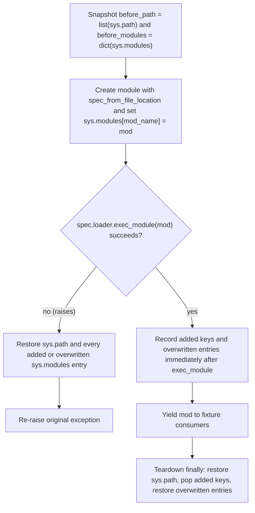

# IPD: Isolate collection-time sys.path and sys.modules mutations in tests/test_benchmark_intake_bugs.py

- Date: 2026-11-27
- Kind: child
- Concern: Test-suite import-state isolation (`TEST-I5` follow-up from executed plan `n39jh9`, Set `assess-bt`). `tests/test_benchmark_intake_bugs.py` mutates `sys.path` and `sys.modules` at collection time and in its `ps` fixture without teardown cleanup.
- Scope: `tests/test_benchmark_intake_bugs.py` (replace collection-time `sys.path.insert` and module-level `_load` bindings with a scoped loader and module-scoped fixtures that snapshot and restore `sys.path` and `sys.modules`, update tests to inject those fixtures, and add behavioral isolation tests).
- Scope-Paths: tests/test_benchmark_intake_bugs.py
- Item-Dependencies: none
- Status: to-review
- Short-Description: Replace module-level script loading in tests/test_benchmark_intake_bugs.py with scoped fixtures that snapshot and restore sys.path and sys.modules
- Work-Kind: chore
- Priority: low
- From-Backlog: lp4sac
- Set: lp4sac
- Order: 1
- Highest E allocated: 03
- Author: Antigravity
- Id: ha5fbl

> Write and proofread this plan per the technical writing standard, `.aw/system/workflows/technical-writing/technical-writing.md` (`.agents/workflows/technical-writing/technical-writing.md` in a legacy-layout install), including requirement 12 (diagrams).

## Workflow history

- 2026-11-28 to-review (aw set): Authored review-ready child IPD from backlog lp4sac
- 2026-11-28 draft (Antigravity): created.

## Goal

Eliminate collection-time and uncleaned fixture-time `sys.path` and `sys.modules` mutations in `tests/test_benchmark_intake_bugs.py` so collecting or executing this test module cannot leak `benchmarks/`, `.github/scripts/`, `aggregate`, `extract_attachment_url`, `validate_benchmark_submission`, `pull_submissions`, or `share_safety` into other tests in the same `pytest` process. This brings `tests/test_benchmark_intake_bugs.py` in line with the `TEST-I5` isolation pattern already applied in `benchmarks/test_*.py`, `.github/scripts/test_*.py`, `tests/test_package_benchmark.py`, and `tests/test_startup_benchmark.py`.

### Scoped script-loader lifecycle



## Detailed Implementation Checklist (TODO)

Execution-state rule: mark an `E-*` item complete only after performing the action. That mark is not validation. Right-sizing rule: write for a modest executor that cannot hold much in its head. Each E-item is one step (one concern, about one file, executable in one focused pass) and its V-item names each unit it covers with its own check; a plan stays at about 5 E-items and 8 work Scope-Paths, else split it into more child plans (guidance, `IPD-Z603`). Accepted execution states: blocked, failed, pending, performed; terminal gate demands 'performed'.

### Task group 1: Replace collection-time and uncleaned fixture script loading

- [ ] E-01 Replace collection-time `sys.path` and `sys.modules` mutations and the uncleaned `ps` loader in `tests/test_benchmark_intake_bugs.py` with a scoped loader and module-scoped fixtures:
  - Add `import contextlib` (and `import subprocess` for E-02) to the standard-library imports at the top of `tests/test_benchmark_intake_bugs.py`. Keep the packaged `from pubrun._bench import harness as h` and `from pubrun._bench import share_safety as ss` imports and the path constants `_REPO`, `_BENCH`, `_SCRIPTS`, and `_FX` at module scope.
  - Remove the collection-time `for _p in (str(_BENCH), str(_SCRIPTS)):` loop that calls `sys.path.insert(0, _p)`, the uncleaned `_load(name, path)` helper, and the module-level `agg`, `x`, and `v` assignments.
  - Add a `@contextlib.contextmanager` helper `_load_scoped(mod_name: str, file_path: Path)` that:
    1. Snapshots `before_path = list(sys.path)` and `before_modules = dict(sys.modules)`.
    2. Loads the script via `importlib.util.spec_from_file_location(mod_name, file_path)` and `importlib.util.module_from_spec(spec)`, asserting `spec is not None and spec.loader is not None`.
    3. Sets `sys.modules[mod_name] = mod` and calls `spec.loader.exec_module(mod)`.
    4. On any exception during `exec_module`, restores `sys.path[:] = before_path`, removes every key in `sys.modules` not in `before_modules`, restores every key in `before_modules` whose `sys.modules.get(name)` object identity changed, and re-raises.
    5. Immediately after `exec_module` succeeds (before yielding), captures `added = [name for name in sys.modules if name not in before_modules]` and `overwritten = {name: prev for name, prev in before_modules.items() if sys.modules.get(name) is not prev}` so teardown does not evict unrelated standard-library or third-party modules imported lazily inside test bodies (for example `http.client`, `email.message`, or `urllib.response`).
    6. Yields `mod`, and in `finally` restores `sys.path[:] = before_path`, pops every key in `added`, and restores every `(name, prev)` entry in `overwritten`.
  - Define four `@pytest.fixture(scope="module")` fixtures backed by `_load_scoped`:
    - `agg`: loads `"aggregate"` from `_BENCH / "aggregate.py"`.
    - `x`: loads `"extract_attachment_url"` from `_SCRIPTS / "extract_attachment_url.py"`.
    - `v`: loads `"validate_benchmark_submission"` from `_SCRIPTS / "validate_benchmark_submission.py"` (do not call `pytest.importorskip("jsonschema")` here, because `TestValidatorDownload` and `TestValidatorParse` run without `jsonschema`).
    - `ps`: replaces the existing function-scoped `ps` fixture by calling `pytest.importorskip("jsonschema")` first and then yielding from `_load_scoped("pull_submissions", _BENCH / "pull_submissions.py")`.
  - Inject the new fixtures into every test method and helper that previously relied on the module globals:
    - `TestExtractorUrlSafety`: add `x` to all 5 test methods.
    - `TestValidatorDownload`: accept `v` in helper `_redirect_handler(self, v, monkeypatch)` and add `v` to all 7 test methods.
    - `TestValidatorParse`: add `v` to all 3 test methods.
    - `TestSchemaReasonPayloadFree`: add `v` to all 3 test methods.
    - `TestAggregateHardening`: add `agg` to all 5 test methods.
    - Keep `TestPullIsolation` (2 test methods), `TestPullRetag` (7 test methods), `TestShareSafetyNone`, `TestShareSafetyCheckoutShimParity`, `TestSlurmRedaction`, `TestScrubBoundaries`, and `TestHarnessSelfCheckGate` behaviorally intact.
  - Keep the file compatible with Python 3.8 syntax (`requires-python = ">=3.8"` in `pyproject.toml`).
  - Depends on: none
  - Expected outcome: Importing `tests/test_benchmark_intake_bugs.py` leaves `sys.path` and `sys.modules` unchanged, and every test consuming `agg`, `x`, `v`, or `ps` uses a module-scoped fixture that restores `sys.path` and `sys.modules` on teardown and on load failure.
  - Execution state: pending

### Task group 2: Add behavioral isolation tests and validate

- [ ] E-02 Add behavioral collection-isolation and teardown-restoration tests in `tests/test_benchmark_intake_bugs.py`:
  - Add a `TestCollectionAndFixtureIsolation` class in `tests/test_benchmark_intake_bugs.py` testing observable runtime behavior only (do not inspect source code with `inspect`, Abstract Syntax Tree (AST) parsing, regular expressions, or substring checks):
    1. `test_importing_module_does_not_mutate_sys_path_or_sys_modules`: runs a fresh `sys.executable` subprocess (`subprocess.run`) that snapshots `list(sys.path)` and `set(sys.modules)`, loads `tests/test_benchmark_intake_bugs.py` via `importlib.util.spec_from_file_location` and `spec.loader.exec_module` under a temporary module name, and asserts exit code `0` with `sys.path == before_path` (neither `str(_BENCH)` nor `str(_SCRIPTS)` added) and none of `"aggregate"`, `"extract_attachment_url"`, `"validate_benchmark_submission"`, `"pull_submissions"`, or `"share_safety"` newly present in `sys.modules`.
    2. `test_scoped_loader_restores_state_after_normal_exit`: snapshots `list(sys.path)` and `dict(sys.modules)`, enters `_load_scoped("validate_benchmark_submission", _SCRIPTS / "validate_benchmark_submission.py")` and `_load_scoped("pull_submissions", _BENCH / "pull_submissions.py")` in turn, verifies each loaded module exposes its expected callable (`validate_file` and `process`), and asserts after each `with` block exits that `sys.path` equals the pre-call snapshot and `sys.modules` has the exact same keys and object identities as the pre-call snapshot (order-independent under `pytest -p randomly`).
    3. `test_scoped_loader_restores_state_when_exec_raises(self, tmp_path)`: writes a temporary Python script under `tmp_path` that inserts `str(tmp_path)` into `sys.path`, inserts a unique dummy key into `sys.modules`, and raises `RuntimeError("boom")`; snapshots `list(sys.path)` and `dict(sys.modules)`, verifies `_load_scoped` re-raises `RuntimeError("boom")`, and asserts `sys.path` and `sys.modules` match the pre-call snapshot afterward.
  - Depends on: E-01
  - Expected outcome: Three behavioral tests prove collection-time cleanliness in a fresh interpreter and rollback of `sys.path` and `sys.modules` after both normal exit and load failure, regardless of test execution order.
  - Execution state: pending

- [ ] E-03 Run randomized `pytest` validation and Python 3.8 syntax verification:
  - Run every command listed in `## Required tests / validation` and verify exit code `0` with zero failures.
  - Depends on: E-01, E-02
  - Expected outcome: `tests/test_benchmark_intake_bugs.py` passes alongside the sibling benchmark and intake test suites across randomized runs, post-session teardown leaves no leaked script entries, and the modified test file parses cleanly under Python 3.8 syntax.
  - Execution state: pending

## Project conventions discovered (Step 0)

- `benchmarks/aggregate.py` and `.github/scripts/extract_attachment_url.py` import only Python standard-library modules and do not touch `sys.path`.
- `.github/scripts/validate_benchmark_submission.py` inserts `str(_REPO / "benchmarks")` into `sys.path` and runs `import share_safety` at top-level import time. Its `import jsonschema` statement lives inside `check_schema`, so loading `validate_benchmark_submission.py` works even without `jsonschema`.
- `benchmarks/pull_submissions.py` inserts both `str(_REPO / "benchmarks")` and `str(_REPO / ".github" / "scripts")` into `sys.path` and imports `validate_benchmark_submission as _v`, `extract_attachment_url as _x`, and `aggregate as _agg` at top-level import time. It does not import `jsonschema` at top level, while the existing `tests/test_benchmark_intake_bugs.py::ps` fixture calls `pytest.importorskip("jsonschema")` before loading it.
- None of the four loaded scripts perform lazy runtime imports from `benchmarks/` or `.github/scripts/` after module execution completes.
- Existing `TEST-I5` fixes in `benchmarks/test_share_safety.py::_load_scoped`, `benchmarks/test_pull_submissions.py::ps`, `.github/scripts/test_extract_attachment_url.py::_load_script_isolated`, and `.github/scripts/test_validate_benchmark_submission.py::v` all use module-scoped fixtures that snapshot `list(sys.path)` and `dict(sys.modules)` before `exec_module`, record added and overwritten keys immediately after `exec_module`, and restore them on teardown and on exception.
- Because `pytest` tears down module-scoped fixtures in strict Last-In First-Out (LIFO) order, making all four fixtures (`agg`, `x`, `v`, `ps`) module-scoped preserves exact snapshot restoration across every test ordering generated by `pytest -p randomly`.
- Every test in `TestPullIsolation` and `TestPullRetag` patches `ps` only through pytest's `monkeypatch` fixture (which reverts patches at function teardown) and reassigns `PullErrorHolder.cls` at the start of each test, so promoting `ps` from function scope to module scope is safe and avoids repeating the four-script load nine times.
- `tests/test_benchmark_intake_bugs.py::TestShareSafetyCheckoutShimParity.test_checkout_shim_matches_packaged_share_safety_without_sys_modules_leak` already captures `before_share_safety = sys.modules.get("share_safety")` and pops its temporary module name in `finally`, so it stays order-independent with or without module-scoped fixtures active.
- `tests/conftest.py::_subprocess_pythonpath` prepends checkout `src/` to `PYTHONPATH` for subprocesses, and `pyproject.toml` sets `requires-python = ">=3.8"` and `addopts = "-p no:randomly"`, while Continuous Integration (CI) runs `pytest -p randomly`.
- Repository rule (`AGENTS.md`): tests must verify observable behavior (exit codes, runtime state, outputs), never pin source code structure via `inspect`, AST, regex, or text search.

## Findings

| ID | Concerns | Severity | Remediation Risk | Persona | Summary |
|---|---|---|---|---|---|
| `TEST-I5` (`test_benchmark_intake_bugs.py`) | testing | Low | Low (`complexity`) | Testing Expert | `tests/test_benchmark_intake_bugs.py` inserts `benchmarks/` and `.github/scripts/` into `sys.path` and registers `aggregate`, `extract_attachment_url`, `validate_benchmark_submission`, and `share_safety` in `sys.modules` at collection time, and loads `pull_submissions` inside `ps` without restoring `sys.path` or `sys.modules` on teardown. |

## Proposed changes (ordered, validatable)

1. `E-01` (`tests/test_benchmark_intake_bugs.py`): Remove top-level `sys.path.insert`, `_load`, and module-level `agg`/`x`/`v` bindings; add `_load_scoped` and module-scoped `agg`, `x`, `v`, and `ps` fixtures; inject fixtures into `TestExtractorUrlSafety`, `TestValidatorDownload`, `TestValidatorParse`, `TestSchemaReasonPayloadFree`, and `TestAggregateHardening`.
2. `E-02` (`tests/test_benchmark_intake_bugs.py`): Add `TestCollectionAndFixtureIsolation` with behavioral tests for clean collection in a fresh subprocess and snapshot rollback on both normal exit and load failure.
3. `E-03` (validation): Run randomized `pytest` across `tests/test_benchmark_intake_bugs.py` and sibling benchmark/intake test suites, run a post-teardown leak check, and verify Python 3.8 syntax compatibility.

## Deferred / out of scope (with reason)

- Production code under `src/pubrun/`, `benchmarks/`, and `.github/scripts/`: not modified because the defect is confined to test-module import isolation in `tests/test_benchmark_intake_bugs.py`.
  - Carrier-Declined: backlog item `lp4sac` scopes this change solely to `tests/test_benchmark_intake_bugs.py`.
- Sibling test files (`benchmarks/test_*.py`, `.github/scripts/test_*.py`, `tests/test_package_benchmark.py`, `tests/test_startup_benchmark.py`): already fixed under executed plans `n39jh9`, `4eo4z2`, and `37sth0` (Set `assess-bt`).
  - Carrier-Declined: already remediated in Set `assess-bt`; re-validated together in `E-03` without editing them.

## Scope check

- Over-scope: none. Only `tests/test_benchmark_intake_bugs.py` is modified.
- Under-scope: none. Every collection-time and fixture-time `sys.path` and `sys.modules` mutation named in backlog item `lp4sac` (`benchmarks/`, `.github/scripts/`, `aggregate`, `extract_attachment_url`, `validate_benchmark_submission`, `pull_submissions`, plus transitive `share_safety`) is isolated and verified by behavioral tests.

## Required tests / validation

1. Run `tests/test_benchmark_intake_bugs.py` under randomized order with two distinct seeds:
   ```sh
   python3 -m pytest -p randomly tests/test_benchmark_intake_bugs.py -v
   python3 -m pytest -p randomly --randomly-seed=1 tests/test_benchmark_intake_bugs.py -v
   ```
2. Run `tests/test_benchmark_intake_bugs.py` together with the sibling benchmark and intake test suites under randomized order to verify cross-suite compatibility:
   ```sh
   python3 -m pytest -p randomly tests/test_benchmark_intake_bugs.py benchmarks/test_share_safety.py benchmarks/test_pull_submissions.py .github/scripts/test_extract_attachment_url.py .github/scripts/test_validate_benchmark_submission.py -v
   ```
3. Verify Python 3.8 syntax compatibility for `tests/test_benchmark_intake_bugs.py`:
   ```sh
   python3 -c "import ast; ast.parse(open('tests/test_benchmark_intake_bugs.py', encoding='utf-8').read(), feature_version=(3, 8)); print('py38-parse-ok')"
   ```

## Spec / documentation sync

Not applicable. This change is an internal test-isolation chore (`Work-Kind: chore`) in `tests/test_benchmark_intake_bugs.py` that does not alter public application programming interfaces (APIs), command-line interface (CLI) flags, configuration keys, manifest schemas, or user-facing behavior.

## Open questions

None.

## Validation and cross-check (verify before reporting done)

Validation-state rule: inspect evidence in a separate pass. Do not mark a `V-*` item complete from memory or from the matching execution checkmark. Accepted validation results: blocked, failed, pass, pending; terminal gate demands 'pass'. Runtime-demonstration reachability rule: for each `V-*` item demanding the software be observed acting (such as a run, a dispatch, or a transition), as distinct from items demanding a diff, a file's content, or a test result (which are reachable by construction), name the code path that produces the observation or the sibling `E-*` that creates it, else the demand is UNDER-SCOPE.

- [ ] V-01 validates E-01
  - Required evidence: Pasted `git diff -- tests/test_benchmark_intake_bugs.py` confirming removal of the module-level `sys.path.insert` loop, uncleaned `_load`, and module-level `agg`/`x`/`v` bindings, addition of `_load_scoped` with exception and `finally` rollback, module-scoped `agg`, `x`, `v`, and `ps` fixtures (`ps` retaining `pytest.importorskip("jsonschema")`), and fixture injection across `TestExtractorUrlSafety`, `TestValidatorDownload`, `TestValidatorParse`, `TestSchemaReasonPayloadFree`, and `TestAggregateHardening`; plus pasted `python3 -m pytest -p randomly tests/test_benchmark_intake_bugs.py -v` output exiting `0` with all pre-existing test classes passing.
  - Observed evidence:
  - Result: pending

- [ ] V-02 validates E-02
  - Required evidence: Pasted `python3 -m pytest -p randomly tests/test_benchmark_intake_bugs.py -k TestCollectionAndFixtureIsolation -v` output exiting `0` with all three behavioral isolation tests passing (`test_importing_module_does_not_mutate_sys_path_or_sys_modules`, `test_scoped_loader_restores_state_after_normal_exit`, and `test_scoped_loader_restores_state_when_exec_raises`, re-derived at execution time), confirming the subprocess collection check and `_load_scoped` normal/exception rollback assertions run and pass without source-inspection assertions.
  - Observed evidence:
  - Result: pending

- [ ] V-03 validates E-03
  - Required evidence: Pasted complete runner outputs with exit code `0` for: (1) `python3 -m pytest -p randomly --randomly-seed=1 tests/test_benchmark_intake_bugs.py -v`, (2) `python3 -m pytest -p randomly tests/test_benchmark_intake_bugs.py benchmarks/test_share_safety.py benchmarks/test_pull_submissions.py .github/scripts/test_extract_attachment_url.py .github/scripts/test_validate_benchmark_submission.py -v`, and (3) `python3 -c "import ast; ast.parse(open('tests/test_benchmark_intake_bugs.py', encoding='utf-8').read(), feature_version=(3, 8)); print('py38-parse-ok')"` printing `py38-parse-ok`.
  - Observed evidence:
  - Result: pending

## Approval and execution gate

- Size assessment: standard
- Cohesion rationale: not required

1. **Open questions and approval:** This plan is a proposal and must not be executed until explicit human approval is recorded (`aw ipd set approved ha5fbl --by-human`). No blocking open questions remain.
2. **Scope declaration:** `- Scope-Paths:` declares edits to `tests/test_benchmark_intake_bugs.py`. Keep changes within this scope; if execution genuinely requires editing an additional file, make the necessary change and justify it with `--scope-reason` at finalization. Stop and report only on a genuinely unsafe condition (such as an unresolvable concurrent-edit conflict or missing prerequisite symbols).
3. **Validation honesty (hard requirement):** Every `V-*` item must paste actual runner output from this workspace confirming exit `0` and the required behavior; never claim passing tests or checks that were not actually run.
4. **Commits and push policy:** Commit only files modified for this plan through `aw commit ha5fbl -- tests/test_benchmark_intake_bugs.py` (never `git add -A`, bare `git add`, `git commit -a`, or raw `git commit`). Never push, tag, or publish.
5. **Lifecycle finalization:** On completion, finalize this plan to `.aw/records/plans/executed/` only after every `E-*` item is `performed` and every `V-*` item is `pass`. When run under `aw oc run` or `aw agy run`, the runner owns `aw ipd finalize ha5fbl`; when executed manually outside a runner, the executor runs `aw ipd finalize ha5fbl` (never hand-roll `git mv` to `executed/`).
