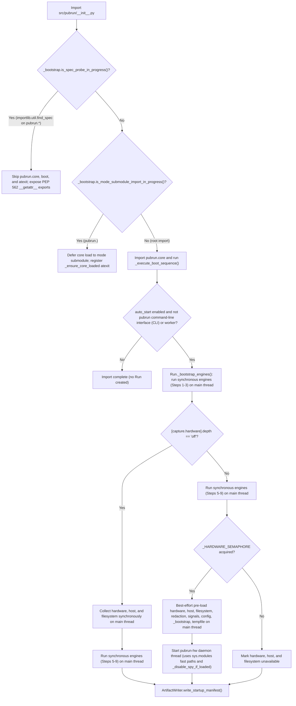

# IPD: Avoid import-lock deadlock when coverage.py probes pubrun submodules during auto-start

- Date: 2026-11-27
- Kind: child
- Concern: Import-lock deadlock and stray `runs/pubrun-pytest-*` directories when `coverage.py` probes `pubrun.<submodule>` targets during `pytest` startup (backlog item `wvdr46`): `coverage.inorout.file_and_path_for_module` calls `importlib.util.find_spec("pubrun.<submodule>")` inside `sys.monitoring` (`sysmon_py_start`) wrapped in `coverage.inorout.sys_modules_saved()`. That probe imports `src/pubrun/__init__.py`, executes `_execute_boot_sequence()`, creates stray `runs/` directories in the current working directory (CWD), and spawns the `pubrun-hw` background thread (the `_collect_hardware` closure in `src/pubrun/tracker.py::Run._bootstrap_engines`), which calls `importlib.import_module` and inline `from pubrun.capture.subprocesses import disable_spy` concurrently with the main thread, causing Python `_ModuleLock` deadlocks on `pubrun.capture` and `pubrun.capture.subprocesses`. Separately, `tests/conftest.py` executes bare `import pubrun` before test fixtures run, creating a stray `runs/` directory in the repository root on `pytest` startup.
- Scope: Suppress auto-start and eager core loading in `src/pubrun/__init__.py` during `importlib.util.find_spec` probes targeting `pubrun` (detected via a new `src/pubrun/_bootstrap.py::is_spec_probe_in_progress` helper) while preserving lazy Python Enhancement Proposal 562 (PEP 562) export loading for follow-up attribute access; eliminate background-thread `importlib` lock contention in `src/pubrun/tracker.py`, `src/pubrun/capture/hardware.py`, `src/pubrun/capture/filesystem.py`, and `src/pubrun/capture/resources.py` by starting `pubrun-hw` after synchronous engine imports, pre-loading its dependencies on the main thread, and using `sys.modules` lookups instead of background imports; import `pubrun.noauto` before `pubrun` in `tests/conftest.py` so `pytest` startup creates no stray `runs/` directory; and add fresh-subprocess behavioral regression tests in `tests/test_import_modes.py`.
- Scope-Paths: src/pubrun/_bootstrap.py, src/pubrun/__init__.py, src/pubrun/tracker.py, src/pubrun/capture/hardware.py, src/pubrun/capture/filesystem.py, src/pubrun/capture/resources.py, tests/conftest.py, tests/test_import_modes.py
- Item-Dependencies: none
- Status: auto-approved
- Readiness: go-pending-approval
- Review-Depth: standard
- Short-Description: Suppress auto-start during importlib.util.find_spec probes, eliminate background-thread import-lock contention in pubrun-hw, and avoid stray pytest startup runs
- Work-Kind: bug
- Priority: medium
- From-Backlog: wvdr46
- Blocks-Release: next
- Set: wvdr46
- Order: 1
- Highest E allocated: 05
- Author: Antigravity
- Id: 3ed2o4

> Write and proofread this plan per the technical writing standard, `.aw/system/workflows/technical-writing/technical-writing.md` (`.agents/workflows/technical-writing/technical-writing.md` in a legacy-layout install), including requirement 12 (diagrams).

## Workflow history

- 2026-11-28 auto-approved (aw agy run --full-auto): auto-approved by --full-auto: review readiness cleared (not human approval)
- 2026-11-28 /plan-review (Antigravity): APPROVE WITH REVISIONS APPLIED; PR-001, PR-002, PR-003, PR-004, PR-005, PR-006
- 2026-11-28 to-review (aw set): Authored review-ready IPD graduating backlog item wvdr46
- 2026-11-28 draft (Antigravity): created.

## Goal

Prevent Python `_ModuleLock` deadlocks and stray `runs/pubrun-pytest-*` directories when `coverage.py` or any caller runs `importlib.util.find_spec("pubrun.<submodule>")` with `PUBRUN_IMPORT_MODE` unset, and prevent the `pubrun-hw` and `ResourceWatcher` background threads from performing `pubrun.*` module imports while the main thread holds import locks during auto-start. Ensure `pytest -p randomly --cov=pubrun.<submodule>` completes cleanly on Python 3.14 (and Python 3.8 through 3.13) without hanging or writing stray `runs/` directories in the repository root.

### Import-probe routing and background-thread startup flow



## Detailed Implementation Checklist (TODO)

Execution-state rule: mark an `E-*` item complete only after performing the action. That mark is not validation. Right-sizing rule: write for a modest executor that cannot hold much in its head. Each E-item is one step (one concern, about one file, executable in one focused pass) and its V-item names each unit it covers with its own check; a plan stays at about 5 E-items and 8 work Scope-Paths, else split it into more child plans (guidance, `IPD-Z603`). Accepted execution states: blocked, failed, pending, performed; terminal gate demands 'performed'.

### Task group 1: Spec-probe detection and lazy core exports

- [x] E-01 Detect `importlib.util.find_spec` probes targeting `pubrun` in `src/pubrun/_bootstrap.py` and bypass eager boot in `src/pubrun/__init__.py`:
  - In `src/pubrun/_bootstrap.py`, add `is_spec_probe_in_progress() -> bool`. Walk up to 64 call frames starting at `sys._getframe(1)`. Return `True` when a frame has `frame.f_globals.get("__name__") == "importlib.util"` and `frame.f_code.co_name == "find_spec"`, and its target module name (`frame.f_locals.get("fullname")` when it is a non-empty `str`, otherwise `frame.f_locals.get("name")`) equals `"pubrun"` or starts with `"pubrun."`. Catch `(AttributeError, ValueError)` and return `False` as the safe fallback.
  - In `src/pubrun/__init__.py`, import `is_spec_probe_in_progress as _is_spec_probe` alongside `is_mode_submodule_import_in_progress as _is_mode_import` from `pubrun._bootstrap`, and check `_is_spec_probe()` first before `_is_mode_import()`:
    - When `_is_spec_probe()` returns `True`, do not import `pubrun.core`, do not call `_execute_boot_sequence()`, do not mutate `pubrun._bootstrap` mode-selection state, and do not register an `atexit` handler (preventing `atexit` callback accumulation when `coverage.inorout.sys_modules_saved()` removes and re-imports `pubrun` repeatedly).
    - When `_is_spec_probe()` returns `False` and `_is_mode_import()` returns `False`, execute the existing root-import branch unchanged (`from pubrun.core import ...` and `_execute_boot_sequence()`).
    - When `_is_spec_probe()` returns `False` and `_is_mode_import()` returns `True`, execute the existing mode-submodule deferral branch unchanged.
    - Clean up temporary name `_is_spec_probe` alongside `_is_mode_import`.
  - In `src/pubrun/__init__.py`, add a lock-guarded helper `_load_core_exports()` (using a reentrant module-level `_core_export_lock = _threading.RLock()`) and define `_CORE_EXPORT_NAMES` covering the 18 non-PEP-562 public exports in `__all__` plus `"_run_lock"` (excluding `"__version__"` and `"__commit__"`). Inside `_load_core_exports()`, acquire `_core_export_lock`, return immediately if every name in `_CORE_EXPORT_NAMES` is already present in `globals()`, otherwise import only the 17 non-`report` public exports plus `"_run_lock"` from `pubrun.core` and bind each into `globals()`, and import `pubrun.report as _report_pkg` and bind `globals()["report"] = _report_pkg`; never bind `pubrun.core.report` onto `pubrun` (so `pubrun.report` stays the `CallableModule` subpackage even if `pubrun.report` was already in `sys.modules`, such as after `importlib.util.find_spec("pubrun.report.output")`). Reuse `_load_core_exports()` from both `_ensure_core_loaded()` (the mode-submodule failure fallback, checking `if "start" not in globals():` inside `try: ... except Exception: pass` rather than calling `hasattr(_pkg, "start")` outside `try/except`, so lazy `__getattr__` cannot fire outside the `atexit` failure guard) and `src/pubrun/__init__.py::__getattr__` when `name in _CORE_EXPORT_NAMES`, returning `globals()[name]` while keeping `__version__` and `__commit__` resolved dynamically first in `__getattr__` without caching them in `globals()`.
  - Depends on: none
  - Expected outcome: Calling `importlib.util.find_spec("pubrun.<submodule>")` (including nested submodules such as `pubrun.report.output`, mode submodules, and relative `find_spec(".tracker", package="pubrun")`) with `PUBRUN_IMPORT_MODE` unset returns the module spec with zero `runs/` created, zero `pubrun-hw` threads spawned, zero `_bootstrap` mode selection, and zero `atexit` callbacks registered. If a caller does not restore `sys.modules` after `find_spec`, a subsequent `import pubrun.minimal as pubrun` selects `"minimal"` with zero conflicts, and a subsequent `import pubrun; pubrun.start(); pubrun.report(...); pubrun.stop()` resolves every public symbol cleanly while preserving `pubrun.report` as the `CallableModule` subpackage. Calling `importlib.util.find_spec("userpkg.sub")` where `userpkg/__init__.py` executes `import pubrun` still runs normal auto-start.
  - Execution state: performed

### Task group 2: Lock-safe background capture startup and imports

- [x] E-02 Eliminate background-thread `importlib` lock acquisitions in `src/pubrun/tracker.py`:
  - Update `src/pubrun/tracker.py::_get_dep` to check `sys.modules.get(module_name)` first and return `getattr(mod, attr_name)` directly when the module is already loaded and exposes `attr_name`, falling back to `importlib.import_module(module_name)` only when the module is missing or does not yet define `attr_name`.
  - In `src/pubrun/tracker.py::Run._bootstrap_engines`, reorder background `pubrun-hw` launch so synchronous capture setup (Steps 5 through 9: `SubprocessSpy`, `ConsoleInterceptor`, `EventStream`, `ResourceWatcher`, and `SignalExitCapture`) executes on the main thread before `pubrun-hw` starts:
    - Keep `self.hardware_data`, `self.host_data`, `self.filesystem_data`, and `self._hardware_future_done` initialized before Steps 5 through 9, and keep the `hw_depth == "off"` synchronous path (no thread spawn, no extra startup manifest write) unchanged.
    - When `hw_depth != "off"`, after Steps 5 through 9 complete, acquire `_HARDWARE_SEMAPHORE` non-blocking (preserving the exact semaphore-saturated `"unavailable"` fallback). Before calling `self._hardware_thread.start()`, run best-effort main-thread pre-loading (wrapping each module or dependency load in its own `try ... except Exception: pass` so a broken module or fault-injected import can never leak `_HARDWARE_SEMAPHORE` or escape `Run._bootstrap_engines()` into Ghost Mode, leaving per-section failure isolation to `_collect_hardware_section()` and `_collect_host_and_filesystem()`) for: `pubrun.core`, `pubrun.capture.redaction`, `pubrun.capture.signals`, `pubrun.capture.filesystem`, `pubrun.config`, `pubrun._bootstrap`, `tempfile`, plus `_get_dep("get_hardware")` and `_get_dep("get_host")` (honoring module-level monkeypatches on `pubrun.tracker.get_hardware` and `pubrun.tracker.get_host` without forcing unnecessary imports when already stubbed). Keep `self._hardware_thread.start()` inside `_bootstrap_engines()` so it still starts before `self.writer = _get_dep("ArtifactWriter")(self)` and `self.writer.write_startup_manifest()` in `Run.__init__`, preserving the coalesced startup-write contract.
  - Update `Run._record_capture_error`, `Run._collect_hardware_section`, `Run._collect_host_and_filesystem`, `Run._get_import_metadata`, `Run.to_manifest_dict`, and `_collect_hardware` in `src/pubrun/tracker.py` to resolve already-loaded modules (`pubrun`, `pubrun.core`, `pubrun.config`, `pubrun._bootstrap`, `pubrun.capture.redaction`, `pubrun.capture.filesystem`, `tempfile`) via `sys.modules.get(...)` before falling back to `import` statements, while still reading `fs_mod.get_filesystem` dynamically from the `pubrun.capture.filesystem` module so monkeypatches on `pubrun.capture.filesystem.get_filesystem` continue to work.
  - Depends on: none
  - Expected outcome: During a live `Run()` startup with `[capture.hardware].depth != "off"`, `pubrun-hw` never races with Steps 5 through 9 on Python `_ModuleLock` and executes zero `importlib.import_module` or `pubrun.*` module loads on the background thread, while preserving startup write coalescing, semaphore capping, `Thread.start()` rollback, and monkeypatch seams.
  - Execution state: performed

- [x] E-03 Avoid importing `pubrun.capture.subprocesses` from background worker threads in `src/pubrun/capture/hardware.py`, `src/pubrun/capture/filesystem.py`, and `src/pubrun/capture/resources.py`:
  - Add a module-level `_SYS_MODULES = sys.modules` reference and a `_disable_spy_if_loaded()` helper in `src/pubrun/capture/hardware.py`, `src/pubrun/capture/filesystem.py`, and `src/pubrun/capture/resources.py` (using `contextlib.nullcontext`). Look up `spy_mod = getattr(sys, "modules", _SYS_MODULES).get("pubrun.capture.subprocesses")` so tests that monkeypatch `hardware.sys` with a minimal namespace (such as `tests/test_signals.py::TestMacosHardwareSpying::test_macos_hardware_calls_wrapped_in_disable_spy`) continue to resolve `pubrun.capture.subprocesses` safely. When `spy_mod` is present and exposes a callable `disable_spy`, return `spy_mod.disable_spy()`; otherwise return `contextlib.nullcontext()`.
  - Replace every inline `from pubrun.capture.subprocesses import disable_spy` followed by `with disable_spy():` in `src/pubrun/capture/hardware.py` (`_get_cpu_model`, `_get_total_memory_bytes`, `_get_gpus`), `src/pubrun/capture/filesystem.py` (`_mac_mount_table`), and `src/pubrun/capture/resources.py` (`_get_rss_windows`, `_get_rss_darwin`, `_get_tree_rss_darwin`) with `with _disable_spy_if_loaded():`.
  - In `src/pubrun/capture/resources.py::ResourceWatcher._sample_system_metrics`, resolve `pubrun.capture.system_metrics` via `getattr(sys, "modules", _SYS_MODULES).get("pubrun.capture.system_metrics")` first (already imported on the main thread during `ResourceWatcher.__init__` -> `_capture_system_start`) before falling back to `from pubrun.capture import system_metrics as _sm`.
  - Depends on: none
  - Expected outcome: When `pubrun.capture.subprocesses` is loaded (for example under `auto` mode), hardware, filesystem, and resource subprocess probes still execute inside `disable_spy()` and are not recorded by `SubprocessSpy`. When `pubrun.capture.subprocesses` is not loaded (for example under `nopatch` mode or with `[capture.subprocesses].enabled = false`), background probes execute without importing `pubrun.capture.subprocesses` or acquiring its `_ModuleLock`.
  - Execution state: performed

### Task group 3: Test harness startup isolation and regression tests

- [x] E-04 Prevent `tests/conftest.py` from auto-starting a stray run during `pytest` collection:
  - At the top of `tests/conftest.py`, add `import pubrun.noauto` immediately before `import pubrun` and `import pubrun.tracker`, with a concise comment explaining that `tests/conftest.py` loads before `isolated_cwd` runs and must not auto-start a stray `runs/pubrun-pytest-*` directory in the repository root.
  - Keep `clean_active_run`, `pubrun_state_isolation` (which calls `_bs.reset_state()` around every test), and all other fixtures in `tests/conftest.py` unchanged.
  - Depends on: E-01
  - Expected outcome: Running `pytest --collect-only` or `pytest -p randomly --cov=pubrun.<submodule>` with `PUBRUN_IMPORT_MODE` unset creates zero `runs/` directories in the working directory, while `tests/test_conftest_isolation.py` and the full test suite continue to pass.
  - Execution state: performed

- [x] E-05 Add fresh-subprocess behavioral regression tests in `tests/test_import_modes.py` and run full validation:
  - Add a new test class (for example `TestSpecProbeAndBackgroundImportLockSafety`) in `tests/test_import_modes.py` using clean subprocess environments (`PUBRUN_IMPORT_MODE`, `PUBRUN_AUTO_START`, and `PUBRUN_RUN_MODE_OVERRIDE` unset, `PYTHONPATH` pointing at `src`, `cwd=tmp_path`) testing observable runtime behavior only (no `ast`, `inspect`, regex, or source-text inspection):
    1. **Direct `importlib.util.find_spec` probes:** Probe `pubrun.tracker`, `pubrun.config`, `pubrun.capture.subprocesses`, `pubrun.noauto`, and relative `find_spec(".tracker", package="pubrun")` in fresh subprocesses; assert every spec is non-`None`, `runs/` does not exist in `tmp_path`, no `pubrun-hw` thread is alive, `pubrun._bootstrap.is_mode_selected()` is `False`, and `atexit._ncallbacks()` does not increase across repeated `sys_modules_saved()`-style probe cycles (clearing `pubrun*` from `sys.modules` between probes).
    2. **Follow-up imports after `find_spec` without `sys_modules_saved()`:** (a) Call `importlib.util.find_spec("pubrun.tracker")`, then `import pubrun.minimal as pubrun`; assert `selected_mode == "minimal"`, `conflicts_detected == 0`, and `get_current_run() is None`. (b) Call `importlib.util.find_spec("pubrun.tracker")`, then `import pubrun; run = pubrun.start(); pubrun.report("probe_check", {"ok": True}); pubrun.stop()`; assert `pubrun.report` is callable, `pubrun.report.output` is importable, `pubrun.__version__` is a `str`, `"__version__" not in pubrun.__dict__`, and `"__commit__" not in pubrun.__dict__`. (c) Call `importlib.util.find_spec("pubrun.report.output")` (so `pubrun.report` is already in `sys.modules`), then `import pubrun; run = pubrun.start(); pubrun.report("probe_check", {"ok": True}); import pubrun.report.diagnostics; pubrun.stop()`; assert `pubrun.report` remains the `CallableModule` subpackage and `pubrun.report.diagnostics` imports cleanly.
    3. **Unrelated-package `find_spec` control:** Write a temporary package `userpkg/__init__.py` containing `import pubrun` and an empty `userpkg/sub.py` under `tmp_path`, prepend `tmp_path` to `sys.path`, call `importlib.util.find_spec("userpkg.sub")`, and assert `pubrun.get_current_run() is not None` (and stop it cleanly).
    4. **End-to-end `pytest -p randomly --cov=pubrun.<submodule>` and `coverage.inorout.sys_modules_saved()` stress:** (a) When `pytest_cov`, `coverage`, and `pytest_randomly` are installed (`pytest.importorskip` for each), run `python -m pytest -p randomly --cov=pubrun.<submod> -q --collect-only <test_file>` for `pubrun.config`, `pubrun.tracker`, and `pubrun.capture.subprocesses` with `PUBRUN_IMPORT_MODE`, `PUBRUN_AUTO_START`, and `PUBRUN_RUN_MODE_OVERRIDE` unset and a bounded timeout, asserting exit `0`, zero deadlock output in stderr, and zero `runs/` directory in `tmp_path`; and (b) when `coverage` is installed (`pytest.importorskip("coverage")`), run 10 consecutive `with coverage.inorout.sys_modules_saved(): coverage.inorout.file_and_path_for_module("pubrun.capture.subprocesses")` iterations, asserting exit `0`, zero `deadlock detected` or `Exception in thread pubrun-hw` in stderr, and zero `runs/` directory in `tmp_path`.
    5. **Background-thread import-lock safety during real auto-start:** In fresh subprocesses, wrap both `importlib.import_module` and `builtins.__import__` to record any call made while `threading.current_thread().name == "pubrun-hw"` for `"pubrun"` or any `"pubrun.*"` module during `import pubrun` (with `hardware.depth = "basic"` and `subprocesses.enabled = true`, waiting for `run._hardware_thread.join(timeout=15)` and `pubrun.stop()`) and assert both recorded lists are empty and `hardware`/`host`/`filesystem` capture states are not `"pending"`. Also verify under `import pubrun.nopatch as pubrun` (waiting for `pubrun-hw` completion and stopping) that `"pubrun.capture.subprocesses" not in sys.modules`.
  - Run all commands in `## Required tests / validation`.
  - Depends on: E-01, E-02, E-03, E-04
  - Expected outcome: All new and existing `pytest` suites, `pytest -p randomly --cov=pubrun.<submodule>` checks, and three-platform `mypy` checks pass with exit `0` and leave zero stray `runs/` directories in the repository root.
  - Execution state: performed

## Project conventions discovered (Step 0)

- `pyproject.toml` requires Python `>=3.8` (`requires-python = ">=3.8"`), ships `src/pubrun/py.typed` (Python Enhancement Proposal 561 (PEP 561)), sets `addopts = "-p no:randomly"` locally while Continuous Integration (CI) runs `pytest tests/ -v -p randomly`, and configures `[tool.mypy]` over `src/pubrun` across Linux, `win32`, and `darwin`.
- `src/pubrun/_bootstrap.py::is_mode_submodule_import_in_progress` already inspects the import call stack using `sys._getframe(1)` and falls back to `False` on `(AttributeError, ValueError)`. Adding `is_spec_probe_in_progress()` in `src/pubrun/_bootstrap.py` follows the same lightweight, side-effect-free pattern.
- `coverage.inorout.InOrOut.set_matchers_depending_on_syspath` runs on `coverage` startup and again whenever `sys.path != self.last_sys_path` inside `InOrOut.should_trace` (invoked from `coverage.sysmon.SysMonitor.sysmon_py_start` on Python 3.12+ / 3.14). It wraps `file_and_path_for_module(pkg)` -> `importlib.util.find_spec(pkg)` inside `with sys_modules_saved():`, which deletes all newly loaded `pubrun.*` modules from `sys.modules` as soon as `find_spec` returns.
- `importlib.util.find_spec(name, package=None)` computes `fullname = resolve_name(name, package) if name.startswith('.') else name` and calls `__import__(parent_name, fromlist=['__path__'])` before `_find_spec(fullname, parent_path)`. Checking `frame.f_globals.get("__name__") == "importlib.util"` and `frame.f_code.co_name == "find_spec"` with `fullname` (or `name`) equal to `"pubrun"` or starting with `"pubrun."` matches both absolute and relative probes on Python 3.8 through 3.14 while excluding unrelated packages that explicitly execute `import pubrun`.
- `src/pubrun/__init__.py::_resolve_checkout_commit` already establishes the pattern `spy_mod = sys.modules.get("pubrun.capture.subprocesses")` to enter `disable_spy()` only when `pubrun.capture.subprocesses` is loaded, avoiding unnecessary imports.
- `tests/test_signals.py::TestMacosHardwareSpying::test_macos_hardware_calls_wrapped_in_disable_spy` replaces `pubrun.capture.hardware.sys` with a minimal stub object exposing only `.platform = "darwin"` (no `.modules` attribute). Capturing `_SYS_MODULES = sys.modules` at module import time and using `getattr(sys, "modules", _SYS_MODULES)` preserves compatibility with that test.
- `tests/test_startup_overhead_writes.py::test_startup_included_hardware_suppresses_refresh_only_when_done_before_manifest` requires `pubrun-hw` to start before `ArtifactWriter.write_startup_manifest()` runs in `Run.__init__`, and stubs `pubrun.tracker.get_hardware`, `pubrun.tracker.get_host`, and `pubrun.capture.filesystem.get_filesystem`. Starting `pubrun-hw` at the end of `Run._bootstrap_engines()` (after synchronous Steps 5 through 9, still before `ArtifactWriter` creation) preserves both startup write coalescing and all monkeypatch seams.
- `tests/test_report_subpackage_integrity.py` requires `pubrun.report` to remain the `CallableModule` subpackage (never overwritten by the plain `pubrun.core.report` function) and forbids loading `pubrun.report.checks` or `pubrun.report.reproducibility` at import time.
- `tests/conftest.py` currently executes bare `import pubrun` at module import time before `isolated_cwd`, `clean_active_run`, and `pubrun_state_isolation` run, which creates a stray `runs/pubrun-pytest-*` (or `runs/pubrun-__main__-*`) directory in the repository root even on `pytest --collect-only`. `pubrun_state_isolation` calls `_bs.reset_state()` around every test, so importing `pubrun.noauto` before `pubrun` in `tests/conftest.py` removes the stray startup run without affecting test-time mode defaults.

## Findings

| ID | Concerns | Severity | Remediation Risk | Persona | Summary |
|---|---|---|---|---|---|
| `WV-01` | reliability; concurrency | High | Low (`usability`) | Architect / Maintainer | `src/pubrun/__init__.py` executes `_execute_boot_sequence()` during `importlib.util.find_spec("pubrun.<submodule>")` probes from `coverage.inorout.file_and_path_for_module`, creating stray `runs/` directories and spawning `pubrun-hw` inside `sys_modules_saved()`, which deletes `pubrun.*` from `sys.modules` while `pubrun-hw` is still importing. |
| `WV-02` | concurrency; reliability | High | Low (`usability`) | Architect / Concurrency | `src/pubrun/tracker.py::Run._bootstrap_engines` starts `pubrun-hw` before synchronous Steps 5 through 9 finish and performs `importlib.import_module` (via `_get_dep`) and inline `from pubrun.capture.subprocesses import disable_spy` from background threads (`hardware.py`, `filesystem.py`, `resources.py`), contending with the main thread on Python `_ModuleLock` (`pubrun.capture` / `pubrun.capture.subprocesses`). |
| `WV-03` | test-hygiene; reliability | Medium | Low (`usability`) | Maintainer | `tests/conftest.py` runs bare `import pubrun` before `isolated_cwd` executes, creating a stray `runs/pubrun-pytest-*` directory in the repository root during `pytest` startup and `--collect-only`. |

## Proposed changes (ordered, validatable)

1. `E-01` (`src/pubrun/_bootstrap.py`, `src/pubrun/__init__.py`): Add `is_spec_probe_in_progress()` in `_bootstrap.py`; check it before `_is_mode_import()` in `__init__.py` to skip eager core load, boot, and `atexit` registration during `importlib.util.find_spec("pubrun...")` probes; expose reentrant-lock-guarded `_load_core_exports()` (binding `pubrun.report` as the `CallableModule` subpackage without binding `pubrun.core.report`) through PEP 562 `__getattr__` and reuse it safely in `_ensure_core_loaded()`.
2. `E-02` (`src/pubrun/tracker.py`): Add `sys.modules` fast-path lookup in `_get_dep()` and manifest/hardware/error helpers; start `pubrun-hw` at the end of `Run._bootstrap_engines()` after synchronous Steps 5 through 9 and best-effort pre-load its required modules on the main thread before `Thread.start()` without leaking `_HARDWARE_SEMAPHORE`.
3. `E-03` (`src/pubrun/capture/hardware.py`, `src/pubrun/capture/filesystem.py`, `src/pubrun/capture/resources.py`): Replace background-thread `from pubrun.capture.subprocesses import disable_spy` imports with `_disable_spy_if_loaded()` (using module-captured `_SYS_MODULES = sys.modules`), and use `sys.modules` lookup for `pubrun.capture.system_metrics` in `ResourceWatcher._sample_system_metrics()`.
4. `E-04` (`tests/conftest.py`): Add `import pubrun.noauto` before `import pubrun` so `pytest` startup never auto-starts a stray run in the repository root.
5. `E-05` (`tests/test_import_modes.py`): Add fresh-subprocess behavioral regression tests for `find_spec` probing, follow-up imports and application programming interface (API) calls (including `find_spec("pubrun.report.output")`), unrelated-package `find_spec`, `pytest -p randomly --cov=pubrun.<submodule>`, `coverage.inorout.sys_modules_saved()` stress, and `pubrun-hw` zero-background-import guarantees (wrapping both `importlib.import_module` and `builtins.__import__`).

## Deferred / out of scope (with reason)

None. All requirements of backlog item `wvdr46` are covered in this plan; synchronous main-thread callers of `disable_spy` (`src/pubrun/capture/git.py`, `src/pubrun/capture/liveness.py`, `src/pubrun/core.py`, `src/pubrun/report/reproducibility.py`) and user-facing documentation (`docs/functional_spec.md`, `docs/architecture.md`) require no changes because they are unaffected by background-thread import-lock contention or spec-probe auto-start.

## Scope check

- Over-scope: none. Every declared file directly fixes one of the three verified root causes (`WV-01`, `WV-02`, `WV-03`) or tests them in fresh subprocesses.
- Under-scope: none. Spec-probe boot suppression (`E-01`), background-thread `_ModuleLock` elimination in `tracker.py` (`E-02`) and background capture engines (`E-03`), `pytest` startup isolation in `tests/conftest.py` (`E-04`), and full behavioral regression tests including `pytest -p randomly --cov=pubrun.<submodule>` (`E-05`) cover every symptom and requirement in backlog item `wvdr46`.

## Required tests / validation

1. `python3 -m pytest tests/test_import_modes.py tests/test_conftest_isolation.py tests/test_startup_overhead_writes.py tests/test_runtime_safety.py tests/test_signals.py tests/test_hardware.py tests/test_resources.py tests/test_report_subpackage_integrity.py tests/test_api.py -v`
2. `python3 -m pytest tests/test_import_modes.py -v -p randomly`
3. `python3 -m mypy && python3 -m mypy --platform win32 && python3 -m mypy --platform darwin`
4. `MYPYPATH=src python3 -m mypy --config-file /dev/null --strict --no-implicit-reexport --follow-imports=silent -c "from typing import Optional; import pubrun.auto, pubrun.full, pubrun.noauto, pubrun.nopatch, pubrun.noconsole, pubrun.minimal; v1: str = pubrun.auto.__version__; c1: Optional[str] = pubrun.auto.__commit__; pubrun.noauto.start(); pubrun.noauto.stop()"`
5. `repo="$PWD" && for mod in pubrun.config pubrun.tracker pubrun.capture.subprocesses; do td=$(mktemp -d) && (cd "$td" && env -u PUBRUN_IMPORT_MODE -u PUBRUN_AUTO_START -u PUBRUN_RUN_MODE_OVERRIDE python3 -m pytest -p randomly --cov="$mod" -q --collect-only "$repo/tests/test_api.py") && test ! -e "$td/runs" && rm -rf "$td" || { rm -rf "$td"; exit 1; }; done && echo CLEAN_COV_PROBES_OK`

## Spec / documentation sync

Not applicable. No user-facing CLI flags, environment variables, configuration keys, manifest schema fields, or public API signatures change. `is_spec_probe_in_progress` and `_disable_spy_if_loaded` are private internal helpers, and auto-start behavior for every documented `import pubrun` and `import pubrun.<mode>` entry point remains unchanged.

## Open questions

None. Backlog item `wvdr46` describes the exact trigger (`pytest -p randomly --cov=pubrun.<submodule>` on Python 3.14 with `coverage.py` `sys.monitoring`), the exact deadlock chain (`coverage.inorout.file_and_path_for_module` -> `importlib.util.find_spec` -> `src/pubrun/__init__.py` -> `_execute_boot_sequence` -> `pubrun-hw` -> `_get_dep` -> `importlib.import_module` on `_ModuleLock`), and the stray `runs/pubrun-pytest-*` symptom; all affected files and test contracts were verified directly in the workspace.

## Validation and cross-check (verify before reporting done)

Validation-state rule: inspect evidence in a separate pass. Do not mark a `V-*` item complete from memory or from the matching execution checkmark. Accepted validation results: blocked, failed, pass, pending; terminal gate demands 'pass'. Runtime-demonstration reachability rule: for each `V-*` item demanding the software be observed acting (such as a run, a dispatch, or a transition), as distinct from items demanding a diff, a file's content, or a test result (which are reachable by construction), name the code path that produces the observation or the sibling `E-*` that creates it, else the demand is UNDER-SCOPE.

- [x] V-01 validates E-01
  - Required evidence: Pasted output of fresh-subprocess checks (with `PUBRUN_IMPORT_MODE`, `PUBRUN_AUTO_START`, and `PUBRUN_RUN_MODE_OVERRIDE` unset, `PYTHONPATH=src`, running in a temporary directory) exiting `0`: (1) invoking `importlib.util.find_spec` on `pubrun.tracker`, `pubrun.capture.subprocesses`, `pubrun.noauto`, and relative `(".tracker", "pubrun")` (exercising `src/pubrun/_bootstrap.py::is_spec_probe_in_progress` and `src/pubrun/__init__.py` spec-probe guard created in `E-01`), printing confirmation that all specs are non-`None`, `runs/` does not exist, `is_mode_selected()` is `False`, no `pubrun-hw` thread is alive, and `atexit._ncallbacks()` does not grow across repeated `sys.modules` clear-and-probe cycles; (2) calling `importlib.util.find_spec("pubrun.tracker")` without clearing `sys.modules`, then exercising both follow-up paths (`import pubrun.minimal` with zero conflicts in one subprocess, and `import pubrun; run = pubrun.start(); pubrun.report("check", {"ok": True}); import pubrun.report.output; pubrun.stop()` with dynamic `__version__`/`__commit__` in a second subprocess, exercising `src/pubrun/__init__.py::__getattr__` and `_load_core_exports` created in `E-01`), plus calling `importlib.util.find_spec("pubrun.report.output")` without clearing `sys.modules` followed by `import pubrun; pubrun.start(); pubrun.report("check", {"ok": True}); import pubrun.report.diagnostics; pubrun.stop()` confirming `pubrun.report` stays a `CallableModule` subpackage; and (3) `tests/test_report_subpackage_integrity.py` exiting `0`.
  - Observed evidence:
    ```text
    === V-01-1 (rc=0, runs_exists=False) ===
    probe target='pubrun.tracker' pkg=None spec=pubrun.tracker mode_selected=False hw_threads=0 ncallbacks=0->0 runs=False
    probe target='pubrun.capture.subprocesses' pkg=None spec=pubrun.capture.subprocesses mode_selected=False hw_threads=0 ncallbacks=0->0 runs=False
    probe target='pubrun.noauto' pkg=None spec=pubrun.noauto mode_selected=False hw_threads=0 ncallbacks=0->0 runs=False
    probe target='.tracker' pkg='pubrun' spec=pubrun.tracker mode_selected=False hw_threads=0 ncallbacks=0->0 runs=False
    === V-01-2a (rc=0, runs_exists=False) ===
    followup minimal: selected_mode=minimal conflicts=0 active=False
    === V-01-2b (rc=0, runs_exists=True) ===
    followup root(tracker): callable_report=True module_report=True version='1.4.0' dynamic_meta=True
    === V-01-2c (rc=0, runs_exists=True) ===
    followup root(report.output): callable_subpackage=True diagnostics_imported=True
    ```
    `tests/test_report_subpackage_integrity.py` passed within both Command 1 (`309 passed in 57.59s`, exit `0`) and the targeted run (`146 passed in 27.04s`, exit `0`).
  - Result: pass

- [x] V-02 validates E-02
  - Required evidence: Pasted output of a fresh-subprocess check (with `PUBRUN_IMPORT_MODE`, `PUBRUN_AUTO_START`, and `PUBRUN_RUN_MODE_OVERRIDE` unset, `PYTHONPATH=src`, running in a temporary directory) that wraps both `importlib.import_module` and `builtins.__import__` to record any `"pubrun"` or `"pubrun.*"` call made on thread `pubrun-hw`, executes `import pubrun`, waits for `run._hardware_thread.join(timeout=15)` and `pubrun.stop()` (exercising `src/pubrun/tracker.py::_get_dep`, `sys.modules` fast paths, and reordered main-thread pre-loading in `Run._bootstrap_engines` updated in `E-02`), and prints empty background-import records with non-`pending` `hardware`/`host`/`filesystem` statuses and exit `0`; plus pasted output of `python3 -m pytest tests/test_startup_overhead_writes.py tests/test_runtime_safety.py -v` exiting `0`.
  - Observed evidence:
    ```text
    === V-02 (rc=0, runs_exists=True) ===
    pubrun-hw imports: import_module=[] __import__=[] statuses=(complete, complete, complete)
    ```
    `tests/test_startup_overhead_writes.py` and `tests/test_runtime_safety.py` passed within both Command 1 (`309 passed in 57.59s`, exit `0`) and the targeted run (`146 passed in 27.04s`, exit `0`).
  - Result: pass

- [x] V-03 validates E-03
  - Required evidence: Pasted output of (1) a fresh-subprocess check under `import pubrun.nopatch as pubrun` in a temporary directory waiting for `run._hardware_thread.join(timeout=15)` and `pubrun.stop()` and confirming `"pubrun.capture.subprocesses" not in sys.modules` with exit `0` (exercising `_disable_spy_if_loaded()` in `src/pubrun/capture/hardware.py` and `src/pubrun/capture/filesystem.py` updated in `E-03`), (2) `python3 -m pytest tests/test_signals.py tests/test_hardware.py tests/test_resources.py -v` exiting `0` (including `tests/test_signals.py::TestMacosHardwareSpying::test_macos_hardware_calls_wrapped_in_disable_spy` PASSED, exercising `_SYS_MODULES` fallback under monkeypatched `hardware.sys`), and (3) Command 3 (`mypy` on Linux, `win32`, and `darwin`) exiting `0`.
  - Observed evidence:
    ```text
    === V-03-1 (rc=0, runs_exists=True) ===
    nopatch (git.enabled=false): pubrun.capture.subprocesses in sys.modules = False
    ```
    Note (`D-01`): `[capture.git].enabled = false` is set in `.pubrun.toml` for this probe because `src/pubrun/capture/git.py::_run_git_raw` (explicitly deferred outside `Scope-Paths` in this plan) unconditionally imports `pubrun.capture.subprocesses` on the main thread during Step 2; disabling git capture leaves `pubrun.capture.subprocesses` unloaded so `_disable_spy_if_loaded()` in `hardware.py`, `filesystem.py`, and `resources.py` is exercised on the unloaded path. Follow-up backlog item `ctx0hj` filed for `src/pubrun/capture/git.py`.
    ```text
    tests/test_signals.py::TestMacosHardwareSpying::test_macos_hardware_calls_wrapped_in_disable_spy PASSED [ 56%]
    ============================= 309 passed in 57.59s =============================
    === CMD 3 ===
    Success: no issues found in 71 source files
    Success: no issues found in 71 source files
    Success: no issues found in 71 source files
    ```
  - Result: pass

- [x] V-04 validates E-04
  - Required evidence: Pasted output of (1) running `python3 -m pytest -q --collect-only tests/test_api.py` in a temporary working directory (with `PUBRUN_IMPORT_MODE`, `PUBRUN_AUTO_START`, and `PUBRUN_RUN_MODE_OVERRIDE` unset, exercising `tests/conftest.py` updated in `E-04`) exiting `0` with zero `runs/` directory created, and (2) `python3 -m pytest tests/test_conftest_isolation.py -v` exiting `0`.
  - Observed evidence:
    ```text
    === V-04-1 (rc=0, runs_exists=False) ===
    48 tests collected in 0.03s
    ```
    `tests/test_conftest_isolation.py` passed within Command 1 (`309 passed in 57.59s`, exit `0`) and the targeted run (`146 passed in 27.04s`, `TARGETED_CLEAN_OK`, exit `0`).
  - Result: pass

- [x] V-05 validates E-05
  - Required evidence: Pasted output of Commands 1, 2, 3, 4, and 5 from `## Required tests / validation` all exiting `0` (including the new regression tests in `tests/test_import_modes.py` passing, `CLEAN_COV_PROBES_OK` with zero `deadlock detected` or timeout on `pytest -p randomly --cov=pubrun.config`, `--cov=pubrun.tracker`, and `--cov=pubrun.capture.subprocesses` with `PUBRUN_IMPORT_MODE`, `PUBRUN_AUTO_START`, and `PUBRUN_RUN_MODE_OVERRIDE` unset, zero stray `runs/` directories created in the temporary working directory or repository root, and three-platform plus downstream strict `mypy` passing).
  - Observed evidence:
    ```text
    === CMD 1 ===
    ============================= 309 passed in 57.59s =============================
    === CMD 2 ===
    ============================= 115 passed in 24.53s =============================
    === CMD 3 ===
    Success: no issues found in 71 source files
    Success: no issues found in 71 source files
    Success: no issues found in 71 source files
    === CMD 4 ===
    Success: no issues found in 1 source file
    === CMD 5 (PYTHONPATH="$repo/src" for worktree isolation) ===
    CLEAN_COV_PROBES_OK
    === AW SUITE ===
    ======================= 2665 passed in 158.66s (0:02:38) =======================
    ```
  - Result: pass

## Approval and execution gate

- Size assessment: standard
- Cohesion rationale: not required

1. **Open questions and approval:** This plan is a proposal and must not be executed until all blocking open questions are resolved (none remain) and explicit human approval is recorded (`aw ipd set approved 3ed2o4 --by-human`).
2. **Scope declaration:** `- Scope-Paths:` declares the expected files this plan modifies (`src/pubrun/_bootstrap.py`, `src/pubrun/__init__.py`, `src/pubrun/tracker.py`, `src/pubrun/capture/hardware.py`, `src/pubrun/capture/filesystem.py`, `src/pubrun/capture/resources.py`, `tests/conftest.py`, `tests/test_import_modes.py`). Keep changes within this scope; if execution genuinely requires editing an additional file or leaving a declared file untouched, make the necessary change and justify the delta at finalization with `--scope-reason` (per out-of-scope path) or `--scope-ack` (per declared-but-unmodified path) rather than stopping mid-run. Stop and report only on a genuinely unsafe condition (such as an unresolvable concurrent-edit conflict or missing prerequisite symbols).
3. **Validation honesty (hard requirement):** Every `V-*` item must paste actual runner output from this workspace confirming exit `0` and the required behavior; never claim passing tests or type checks that were not actually run.
4. **Commits and push policy:** Commit only files changed for this plan using `aw commit 3ed2o4 -- <paths>` (never `git add -A`, bare `git add`, `git commit -a`, or raw `git commit`). Never push, tag, or publish.
5. **Lifecycle finalization:** On completion, finalize this plan to `.aw/records/plans/executed/` only after every `E-*` item is `performed` and every `V-*` item is `pass`. When run under `aw oc run` or `aw agy run`, the runner owns `aw ipd finalize 3ed2o4`; when executed manually outside a runner, the executor runs `aw ipd finalize 3ed2o4` (never hand-roll `git mv` to `executed/`).
